# 高级机器学习主题-CS8850-｜-Advanced-Machine-Learning-p37-P37_核技巧与软间隔--BV1sapPz4Ewx_p37-

And now after we covered linear SVM。In all of its beauty and glory。

 we can go to the full case of SVM， the general。

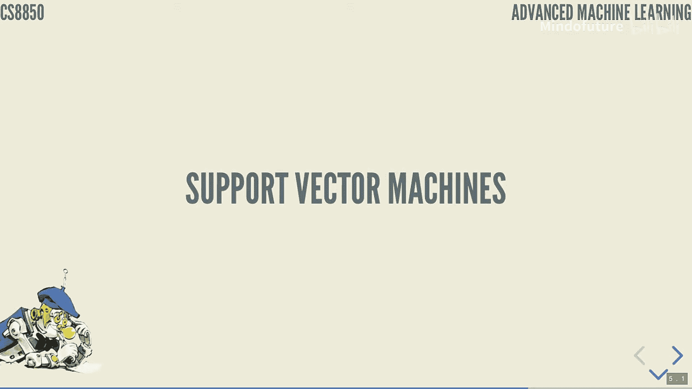

Let's quickly repeat what we already spoke about。 So max margin classifiers。

 given to classes A and B， data is a set of labeled examples， right。X is the features。

 And y is just a scalar label。 And in this case， based this boundary when distributions are known is defined as a。

Pteriors， and。Where the difference of the besteris is0。Is there。That surface。

In the multidimensional space at which the difference of the besterior 0 is our decision boundary。

 which can also be represented as a ratio or log ratio。

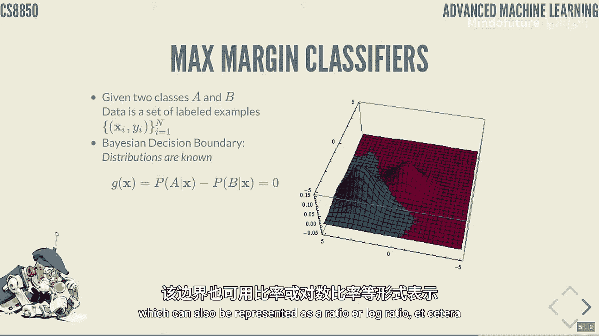

Et cetera。M so emerging。Hperplane， we build it。Sort of guided by similar principles。

By restricted optimal base classifier when restricted to linear class。

Willll get maximum margin hyperplane when we don't want to use any prior information at all and want to concentrate all of our。

Distribution on each of those points in on the figure on the right。So。Now。

 what to do when the data is not linearly separable in the support vector machine or just in general。

 in any other method。

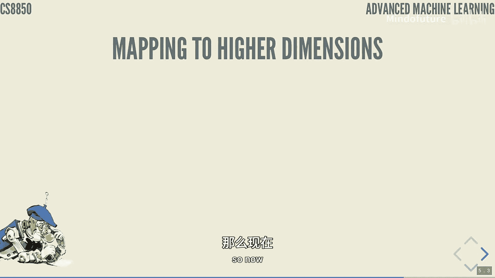

And。Here's a suggestion。 We can map each point into higher dimensional space from the two dimensional space we can construct by using some ingenuity or。

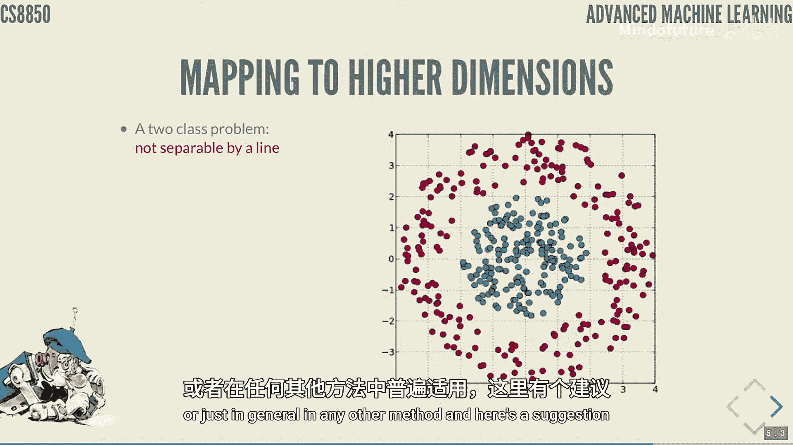

Simple brutefor celebri。Of functions。5hi， we can construct a mapping that takes our 2D picture。

This one into 3G。In the hope that in 3G。The data becomes clearly linearly separable。

 although in 2D going back。

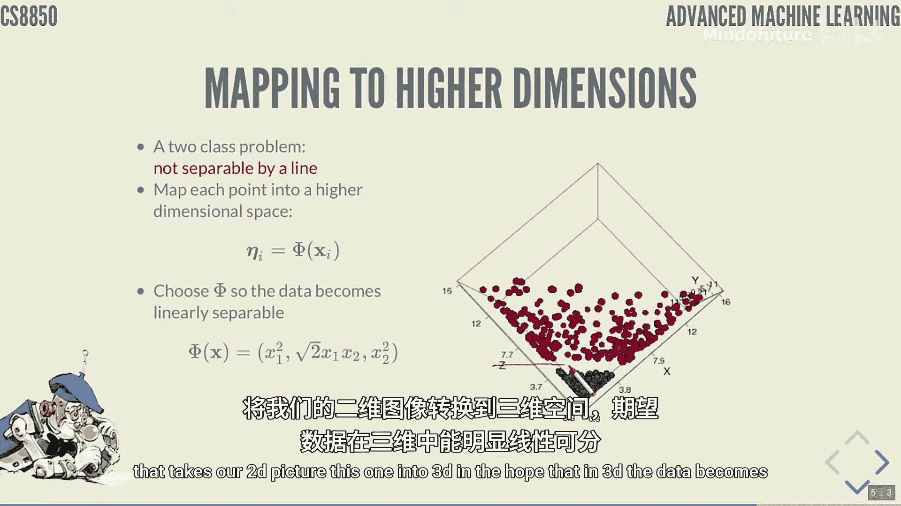

There is no way to put a line through those two classes and separate them。

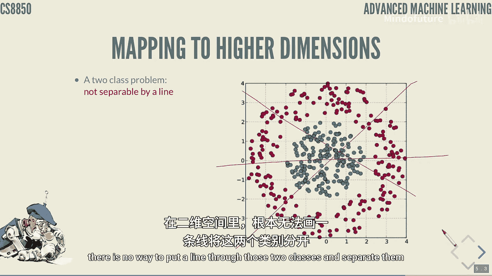

Well。You just need to either know how to construct those kernels。Or。Get lucky。

If we use a polynomial kernel like here， So we take our。

X and Y or x 1 and x2 and construct a three dimensional space just using this kernel。

 Then the data becomes separable。 and now we can use a linear SVM and。

It will succeed and will find a separating hyperplane。

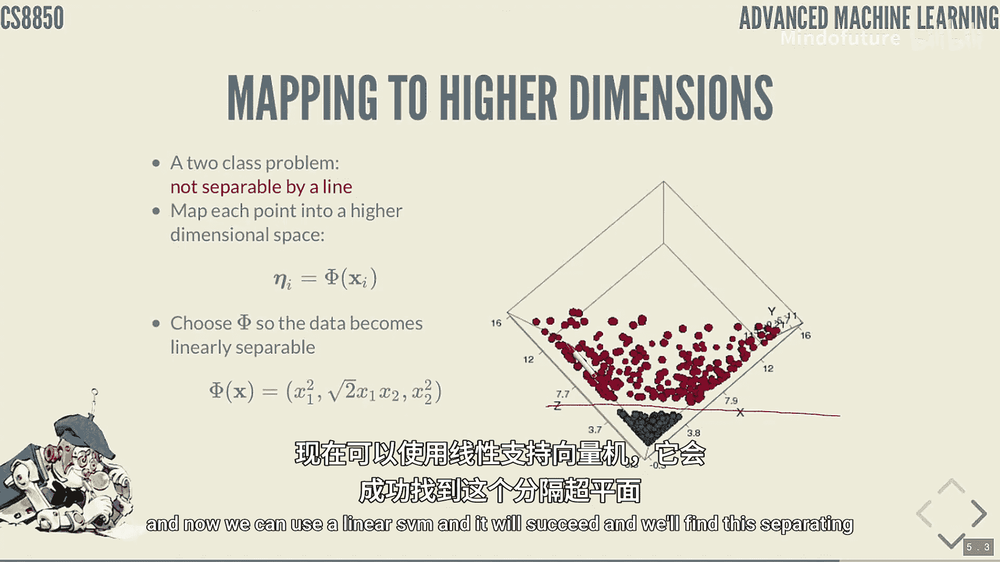

So。This。Is kind of an interesting。 And maybe。Tedious process， right。

 We need to find the mapping and appropriate mappings are hard to construct。

 What do we do in this case， So dimensionality can be many， even infinite。

 and we have to compute very expensive in our product。Right， so first。

 we have to map the data into feature space。 then to compute。 basically。

 the trick is instead of computing inner our product。Or doing anything with the original data points。

 We start working with。Transform data points。Or vectors， right。 They are vectors， in our case。

For example， our inner product。Is now。This。In know product of feature。Maps data。

But this is also kind of expensive right， what if this feature， as I say here。

 what if this feature mapping or we want to map into infinite dimensional space and by the way。

 a radial basis kernel does map into infinite dimensional space and you can see this if you wonder when you have time。

 just try to decompose the inner product or that kernel。Into daily basis。

So we can afford avoid first mapping。Into feature space and then computing the kernels by defining Hilber spaces with kernels and using Mercer's theum that will be next。

 not the next slide， so。AHilbert space is a linear space that basically has an inner product defined。

 So what we can do， we can just define the inner product instead of defining the mapping。 So。

 for example。Like our kernel is another product of the feature mapped factorss。诶。

We can use our polynomial feature map。And first， map the vector X， and then map the vector Y。

 and then compute their inner product。 But in fact， and if you do the algebra。

 you will see that this inner product is nothing but。

Just this expression and this expression is much simpler to compute directly rather than first map each of the X and y and then compute the result。

 we can simply do this and be done if inner product is all that we care about if we don't need to separately map into feature space。

And the same here， the second order， another second order polynoal kernel。

We can either first transform。哦， wait对 wait。This is an example。 yeah。

 so what I'm doing here is I'm actually multiplying through this inner product。

Getting this and getting that。Just to show you that it's the same either you first map into feature space and compute a product or just you compute。

Inner product squared directly， the result is exactly the same， and this is much cheaper。

So take a linear algorithm， replace inner products with kernels。And get that on the as the result。If。

In your linear algorithm， you don't separately have。Data entering as。Data itself。

 not as an inner product。 If your data enters into the algorithm just as an inner product。Then the。

 the kernel trick would work， just replace all of the inner products。Of this form。

With inner products。Or kernels now in this form。 And magically。

 you're now operating in the feature space， which is。High dimensional and non nonlinear and。

With regards to。Support vector machines。Andline for vector machines。

 The hope is that when we map into that feature space， we get to。

Like the data becomes linearly sparable。 So let's， let's check what happens to support vector machine when we apply the kernel tree linear support vector machine。

 when apply when we apply the kernel trick to it， so。

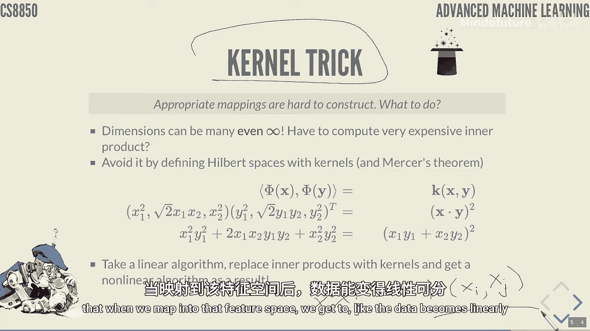

It call a original regional formulation。NowOn the previous slides in the previous section where this is dual formulation。

And notice this。And that。In the optimization problem and in the final classifier。The data。

And any samples， the new samples， the old samples， they only enter this whole process。

 the whole computation process as an inner product。 So what we can do。

 we can replace those inner products。With kernels。And if we write this in the matrix form。

 and by now in the class。You have to already understand that everything is better in the matrix form。

 So you can see how simple it becomes。 And G is an actual matrix。 It's called G matrix。

It's a matrix of inner products。 X I， I is on the diagonal， and then X， I， J。Is off the diagonal。

But basically， you can obtain egg。 you can obtain this G matrix。

 which is n by n number of samples by number of samples。

 That's what I was referring to in the previous episode about。诶哦诶。

Computational complexity of this problem grows quitedraically and how bad really it is。

 That's why you need SMmoO sequential minimum optimization methods or as methods or rather different tricks。

 But my point is， take your samples， all of your X sub I samples and arrange them。Throws in a matrix。

咁。This is a D dimensionsal matrix。Of and samples。X。And take。X transpose。

And when you multiply them through。You will get G， that G here。

This G is matrix of inner products and it's called gram matrixtri。Okay。

 we are ready now this beautiful dual formulation and the matrix form。

 Now we're ready to talk about Mercer's theorem。

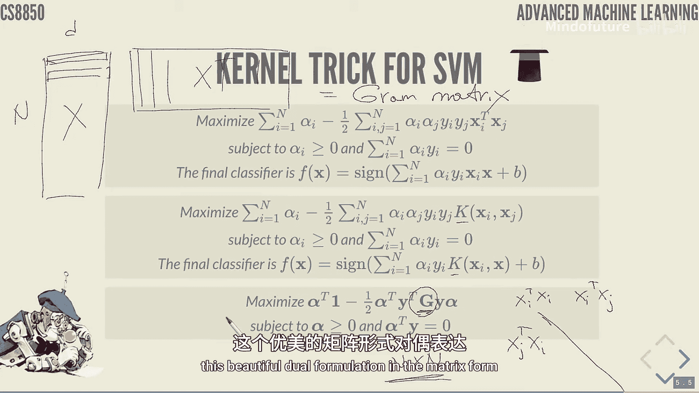

So what is a kernel？A function。K。😊，That takes two vectors， and it returns a scalar。

Is the kernel function， Eve and only Eve。If it's symmetric。

That is K of x and y equals k of Y and x and positive semideite。

 So positive semidefinite in terms of。General functions K will be defined as a vector。

 as an integral， but for us， it suffices that for all possible combinations of like for all x and for all data points。

 the gram matrix is positive s。H this。This just says it。Or。From this， we know from the algebra。

 and it follows that。Minimal eigenvalue is no less than 0 than the matrix is positive symmetry and。

So呃。Easier said than done， because testing for positive seminess。Is difficult。

 And then symmetry is as well。 So if you see a new problem。

 text classification or graft classification or chemical compounds classification。

You need a new kernel technically， but it's very hard to just come up by following a guidebook with a new kernel。

Basically coming up with a new kernel is an art and back in the 2000s there were still lots of papers published that would introduce a kernel for this kernel for that because it was an art and people were devising a new kernel。

For each new application， that means similarly， like now。

 lots of researchers are working in devising。Now， this。2020 devising。

New architectures of neural networks for new domains they are applying deep learning to。

So creating kernels is an art， but some generative rules can help。 for example， in inner product。

 any in product is a kernel。A constant is a kernel。 Colnal product is also a kernel。

For all functions that map vectors to scalrs， a product of those functions is also kernel。

 No negatively weighted linear combination of kernels is a kernel。

 and a few more rules that you can use to construct your kernels out of already existing kernels。

 which are。The popular。Plinnoial kernelel。And the radial basis kernel。And others， a few others。

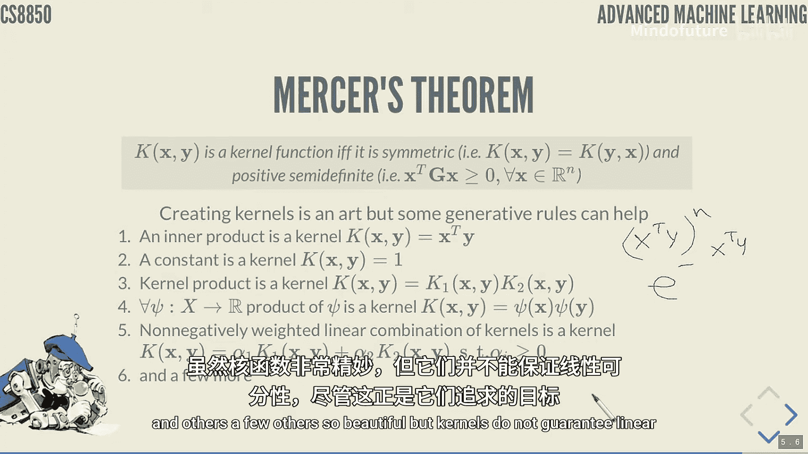

So， beautiful， but。Clonnels do not guarantee linear separability， unfortunately。

 even though they strive for that and can push us into a nonlinear domain。But。Still， no， no， no。Well。

 it is the same as with your neural networks， the neural networks deep learning。

Can be thought of as learnable kernels as are complicated or complex non nonlinear mapping。Mappings。

Of data。 And then you apply on top something like a max margin classifier or rather logistic regression。

 The only point is that when you are manually picking a kernel by using some rule of thumb or I don't know some superstitious feelings and prior experience。

Then you can make mistakes。And pick a kernel that always work to you for you。

 but today it doesnt just doesn't work and then what to do it's not separating the data is not separating in deep learning you kind training the kernel to separate the data so that's why it's so popular because it is so powerful and it。

Replaces one art。The art of picking correct kernel with another art， the art of training。

 deep learning。 But in any case， so not linearly separ data， even after。We。

Executed all of our artistic abilities and selected the kernels that we。So it would work。

 or we went cheated。 We went to a cluster。Of supercomputer and around hyperpar search。

Shifting through all possible kernels and still didn't find one that would separate the data and return a sparse solution where only a few supports are remaining to do。

Well， in this case。So far， we talked about something called hard margin SVM。

 Let's talk about soft margin SVM。 Let's introduce like variables some。ItS like me those kite。

Larger than0 or not negative， it can be equal to0。This way， we will allow mistakes。 So at first。

 we wanted everything to be either on this side， greater than one or on that side。

 right than the label take care of the sign。 But now we're saying， okay， well。

Sometimes mistakes happen， so we allow for each particular sample。Well now。A slackla variable。

So it could be a little。rong。We are saying， okay， you can be a little wrong。

 So there's this steel class or blue class。 and for everything that's correctly on the correct side of the hyperplane。

 constraints are inactive and slack variables are also inactive。For the。Same for the other side。

Slack variables and constraints are inactive for。Correctly classified。So sified samples。

 but for something that is still correctly classified， but within the margin。

 Slack variable is less than one， but for something that is incorrectly classified this additional S variable that we just introduced。

Is greater than one。 So given that when we have this。Okay。

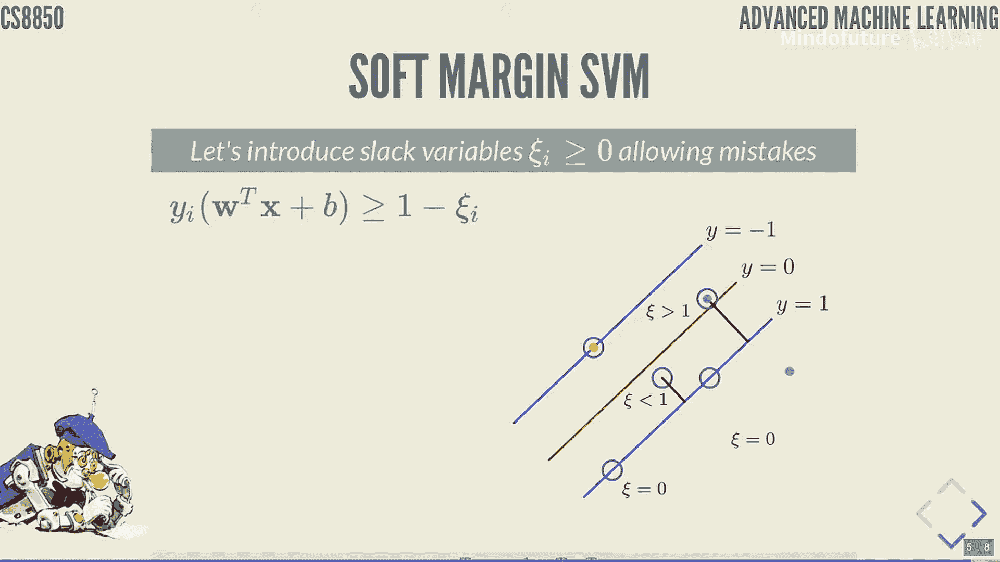

And we plug this into our dual formulation and do the math beautifully and surprisingly。

 the slack variables fall out and we end up with the sock called box constraint right here。

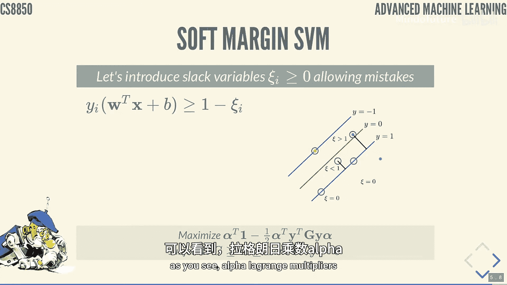

As you see， alpha。嗯。Lrangee multipliers are。嗯。Constrained to a box， because。

Each of the alphas is within between 0 and C now。And that is。

If you think of alpha as a three dimensional vector， that just fits within a box with a side C。

It has to be inside of this box。So by introducing Slack variables。

 we went from just non negative Larange multipliers。To box constraint like large multipliers。

 where see this。Slack or the box constraint hyperparmeter needs to be determined somehow either by cross validation that we discuss。

 who will discuss later or some other more complicated or more actually specialized methods。

 such as incas。Not going not going to discuss。 Were already are spending a lot of time on support vector machines in this class。

 this is a length of lecture。 Support vector machines are extremely important and。Bruthful。

In terms of bringing a lot of ideas to the field of machine learning and actually be powerful。

Dominating the field for almost 20 years， and still being。Maybe placeable。

 I would say in some tabular data classification and。Some simple。Data classification。

 that is not big data and not。Sensory。Okay， what next。

 let's now see how the same addition affects the primal formulation。 So for the primal formulation。

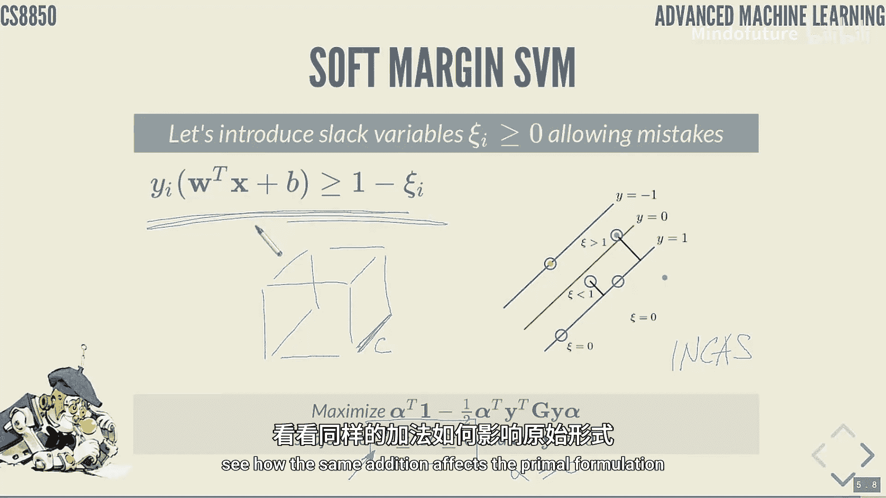

Remember that were maximize， we were maximizing。The norm of the。

Tectctor normal to the hyperplane define this hyperplane。

But now we need to maximize this whole expression。Yes， this is the weight of the slack variables。

 and the sum is larger the more mistakes we have。 If you don't have any mistakes， this goes to 0。

 And then we're back at。The original hard margin primal formulation。 When do we have no mistakes。

 when the data is linearly separable。 So if we want to。Fnalyize mistakes。With an infinite penalty。

 remember that when we defined our primal formulation at the beginning， the constraints were。Hard。

They just had to be satisfied。That's like infinite penalty。 If you violate the constraint。

 So if we put C to infinity， then we'll get exactly the hard margin。S Vm。

Of the one we originally defined。So like this example shows us the higher the C， the。Closer。

 the solution is to the。诶。Max margin and the smaller they see， the hyper parameter。

 the more we allow like the wider is overlap of the margin with the data。诶。

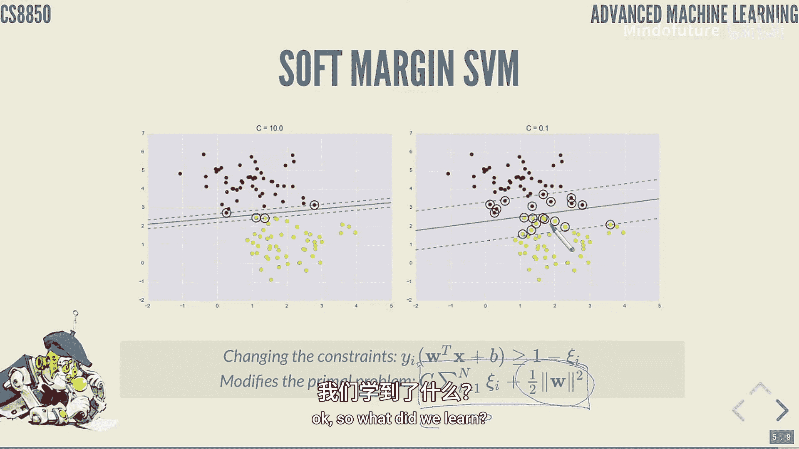

Hey， so what did you learn。P home points， advantages of SVM。

Qudratic programming with single optimum is very efficient。 although still quadratic。

 we do need linear methods or subline methods for big data。Sparse solutions based on supports。

 sparse is good and easy to handle and when we get just few supports。

 prediction is actually blinding very fast。And that's important in practice in production。

And then because of the large margin， we get great generalization。Unlike other methods。

 another another thing， Okay， well， let's talk about advantages first。

 so sensitive to noise and outliers and data。Just start adding outliers and the solutions。

 even with soft margins， will be affected。Making or choosing kernel for the task is an art。

 And that is actually the largest problem with vector machines。 and what that's why deep learning is。

诶。咩咩。Has replaced server vector machines， at least。In the discourse， a popular discourse in academia。

Well， another problem is dependence on soft margin hyper parameter or C。

Because now you need to estimate it somehow， but。There is no hypobra or free learning。

 as they used to say。So I wouldn't worry too much about that。 Not just one thing。When we talk about。

Separating fiberplan。那 let's行。😔，办法。So we wanted non negative answer when we classified everything would be trained and found a separating hyperplane。

We are finding separating hyperplane either when we use the perron algorithm or when we use logistic regression or when we use support vector machines。

The family of the classifiers are。Hge from our first lectures， the hypothesis set。

Is exactly the same。 We're looking for just one separating hyperble from on all。Possible hyperplanes。

 but the learners are different。 We have covered so far at least three different widely different targetalgas。

Mgistic regulation algorithms， support vector emission algorithm。And perciron， they use different。

Objective， they optimized different objective function。 And they saw like。This is a tricky thing。

 Pay attention。Because when you're solving a problem， when you're applying some。

The medical method or some machine learning method。Usually， you have real world problem。

And then it's easy to fall into。A mistake like into the following era， thinking that。

The algorithm is solving your problem。 The algorithm is actually。Optimizing some objective function。

And it is your task as a researcher， as an engineer， as a scientist。

 to figure out which objective function fits your problem best。

Machine learning doesn't solve this problem so far。Well， let wait a little bit。 Then we will have。

General intelligence， general artificial intelligence， and then things will become much easier。

 promised。 Thank you。

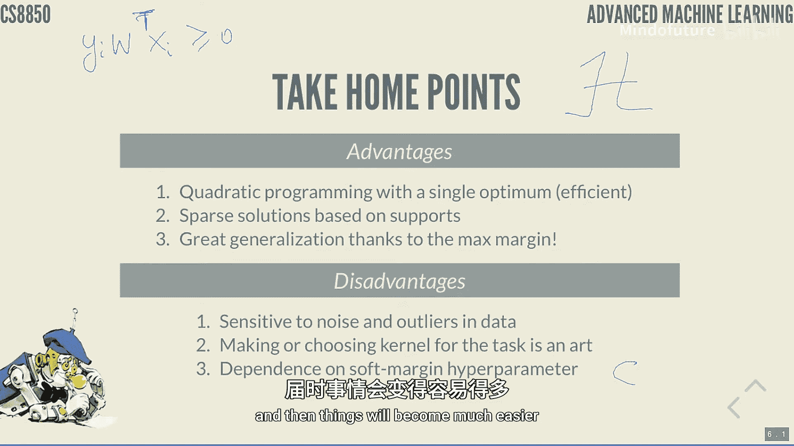