# 高级机器学习主题-CS8850-｜-Advanced-Machine-Learning-p38-P38_矩阵分解--BV1sapPz4Ewx_p38-

Mtriric factorization starting to record on air don't say anything not interesting just say interesting stuff。

 So matrix factorization， what will I talk about SD No you already supposed to know that that was the preview。

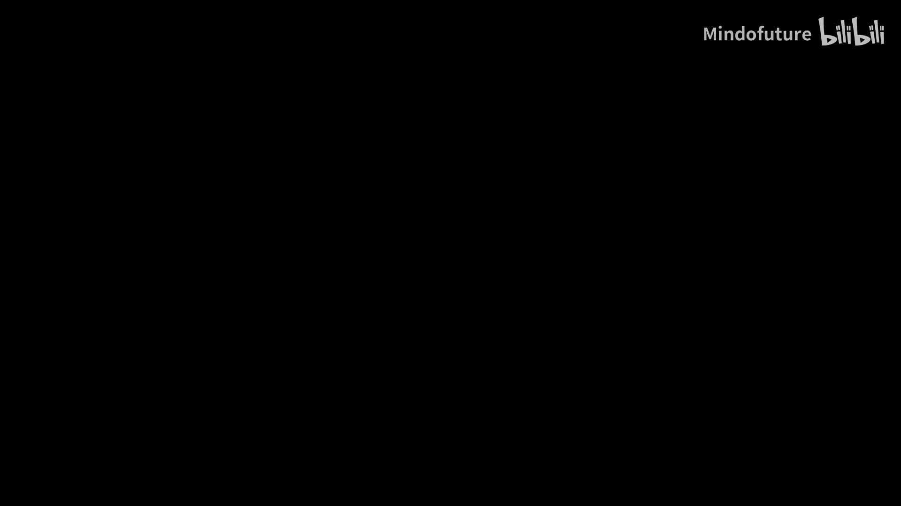

I will talk about what we're talking about and then independent component analysis that was that I'm not heavily prepared to kill you with ICA。

 but I will try on NMF avoid ICA will just do blackboarding the old style as well and MMF is a fun thing dictionary learning another matrix factorization technique。

What I requires， you can think of everything in this lecture a little bit as unsubupervised learning。

Although more specifically， it is matrix factorization and a lot of unsupervised learning。

Which is not clustering is a major factorization， although clustering often can be represented so I'll give you some take on points on what I mean。

In this lecture for you to remember or to take away from So let's let's look at one shallow model right this is。

The same。What's on the screen is actually a graphical little representation of this equation expression。

 two matrices are multiplied by another， or rather if we think if you go in this notation well。

The way it's written。It's written symmetrically。But you could say。Well。Depends on how you define W。

 but there will be a transpose either there or there。So there's graphical representation。😊。

Which is a little bit misleading， but the important part。

 each connection here simply represents an element in this matrix。In the W matrix or W transpose。

 regardless。Everything is connected to everything， it's a bipart graph。Nothing is connected。

Within the levels， say visible level， hidden level。

Think of this just as words just as labels don't think into meaning too much I'm taking this picture from a representation that I drew for a restricted boson machine that's where the names comes come from but any matrix vectorization or any matrix representation is like that and although those V and H are vectors。

We put together all of our Vs visible units as data。Into a matrix and we get a matrix。

And a product of two matrices gives us another matrix。You can think of it either graphically。

As in this picture and again， everything connected to everything。

 but imagine that the non ball that edges are just zeros or very low values。And。

Every method that I will talk about today。Is。Represented by this problem and usually what we have。嗯。

Usually we will be working if we use this notation hidden mixture feasible。

 usually we will be working with this we。诶。得。Right so we have V and we're looking to approximate V by a product of two matrices or。

However many number of matrices， but usually do in the。Methods that we will talk about today。

 So let's talk about， let's start with。The most difficult of all of the methods I think from today。

 but was the most easy exposition because I'm not going to go into much detail on an independent component analysis。

And。I will use I forgot what the slide style call the textual slides that's why I didn't record it so cocktail party problem independent component analysis。

Is traced back to either to the 70s or to the 90s and it comes from two different communities depending on which reviewer you get everyone will claim that you're wrong so if you don't mention both those communities arrived at the problem independently one community in the 70s was looking for。

Access on which to project the data。Such that it doesn't simply end up in a lump of。But。

cloloud circled cloud of points as Gaussian because back in the 70s and people were just project projecting the data into two dimensional space and mostly it was orthogonal projections。

 most of the data would just end up as a Gaussian lump of data on piece paper。So。

People started thinking about projection pursuit， can we find directions in the data one by one in that high dimensional data such that the data is not simply projected into orthotgonal grid。

 but some nonartgonal grid and so on so they were developing and somehow most of people didn't know about that line of thought。

Simultaneously in the 90s， early 90s， late 80s， people started talking about the problem called blind source separation。

What if we have a mixture of sources and most like you know your central limitium。

 your lots of other results， most of the stuff that we measure is a mixture of stuff we don't measure any kind of pure measurement signals directly。

 we usually measure mixtures。And blind source separation。Land source separation。

Established or posed a problem， how can we extract the sources？That were mixed somehow in any。

 that's why like I will tell you about cocktail party， that's a specific way of mixing sources。

Without any additional information， is there a way。

 that's why blind is there a way to extract the sources that were later mixed somehow。

 so cocktail party is talking about a specific。诶。

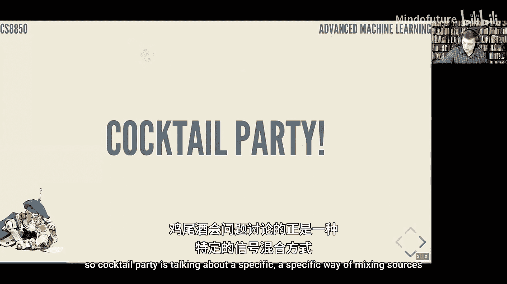

A specific way of mixing sources。So if we have cocktail parts is very visual。

 that's why everyone is using it。So if we have microphones。Pa。

Pardon my delions or whatever and we have speakers。

And imagine that I drew enough smiley faces to match the number of my microphones。

 just for simplicity， I have the same number of smiley faces as microphones and when they speak。

The signal。Ends up on each of the microphones。That is each microphone measures。Each of the speakers。

And we can represent our measurements at the microphones as our data。呃。Yeah， too bad。As our data。

Let's use notations。Call our speakers sources in the matrix of coefficients that。

Is used to adapt the signals from each of the speaker at this particular microphone at this particular microphone。

Is a mixing matrix so that is our cocktail party problem and cocktail part problem is。

Successfully solved by humans， you can imagine that when you're in a large party and everyone is holding a small talk around you。

 you are able to maintain a small talk with the person that you're talking with while everyone around you is talking。

 but you're still。Able to separate the sound of the person who is talking to。

Easily understandable what I'm talking about and as most of the analog and models completely wrong cocktail part problem and ICA are unrelated independent component analysis is unable to solve cocktail part problem because it's fing nonlinear mixture because you have delays on those microphones it's like everyone in the field is motivating independent component analysis with the cocktail party problem。

 but this equation here notice assumes instantaneous mixtures。That the signals， the sources。

 the signal at each source， let me draw those signals， this is my S。

And this is my A that I'm multiplying each role。By a column here。

The assumption here is that when this person is speaking。

The the signal from this person arrives at this microphone at the same time when it arrives at this microphone。

 so for real cocktail party problem with real physics with speech。This problem is wrongly said that。

I'm kind of giving you simultaneously two conflicting worldviews right like in the school they told you oh when you see this。

 no division by zero is impossible don't do that or at least I don't know in elementary school or when they do that and then suddenly they come to you and they say oh。

Sorry。That's perfectly fine don't worry no it's like you can divide by zero you cannot the same here theyre giving you did didactically I'm giving you a wrong view but you understand what is mixing right but in fact in order for this mixture to cat to happen you need instantaneous mixtures。

Luckily， we have electromagnetic waves that move with speed of light and we can ignore on short distances。

The delays because they're so fast that we can even use quasi static Max equations。

 assuming there is no dynamics， especially our heads are unfortunately are so small。

That the signals propagate instantly through it， so in brain imaging in electron into toalography。EG。

 I don't know why it started sensing my hand。呃。In the EG and FMRI and other signals that are practically like instantaneously。

Combined on the sensors and propagate using electromagnetic phenomena。

We can use independent component analysis。

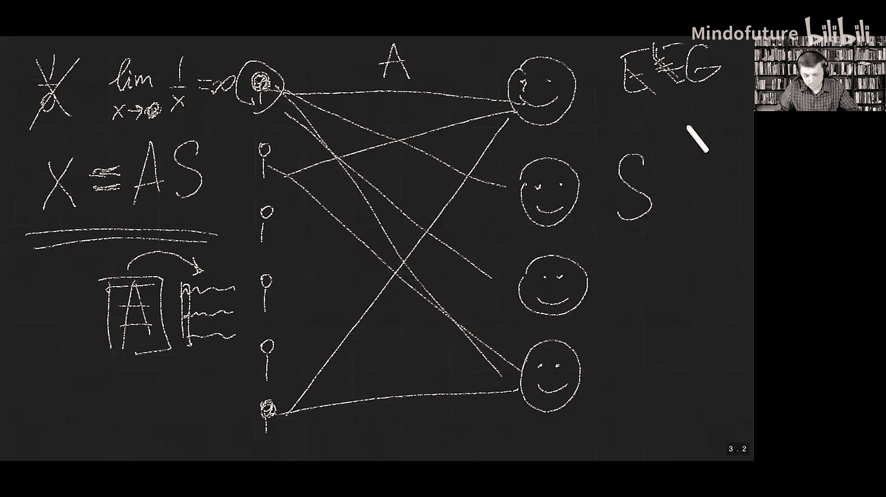

I see what I have。There yes， yes， so well， at least we cant I didn't tell you anything much about independence yet。

 but at least you can see this problem。

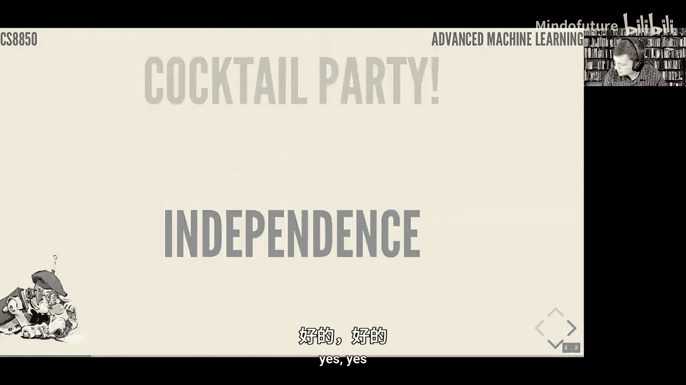

On。The screen imagine the cocktail party problem， but such that our sound goes with a speed of light and then you will see that if we can decompose this matrix given x if we can find both a and s。

Then we're done， but how can we find both A and S there ist a lot of ambiguity that we should put some constraint on。

Either or both in order to find something because。As you know 10 equals a plus B or a times B。

 you can have any A， any B or like in our case it's a times B right there are many， many。

 many possible solutions so independent component analysis。

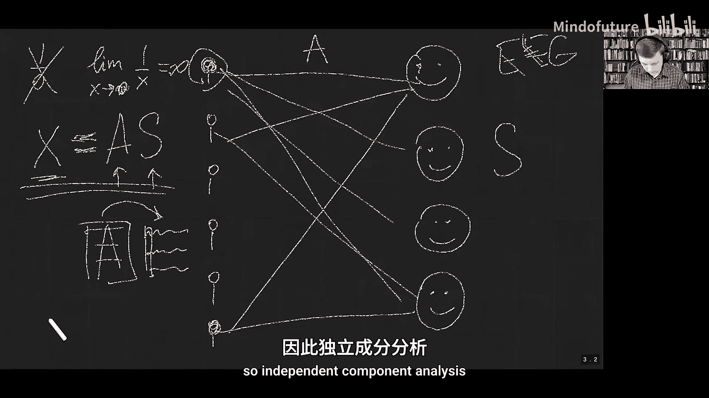

Is a problem。So larger umbrella problem is blind source separation。

 but then we minimize the problem domain in many books it's called or I was browing through the deep learning book and it's called an algorithm。

Independent component analysis is not an algorithm， it's a class of problems。

 it's a smaller class than blind source separation because blind source separation compute combines all other stuff besides independence。

 but independent component analysis says，Let's assume that those speakers are independent from each other。

So what does independence mean？Mathematicically。

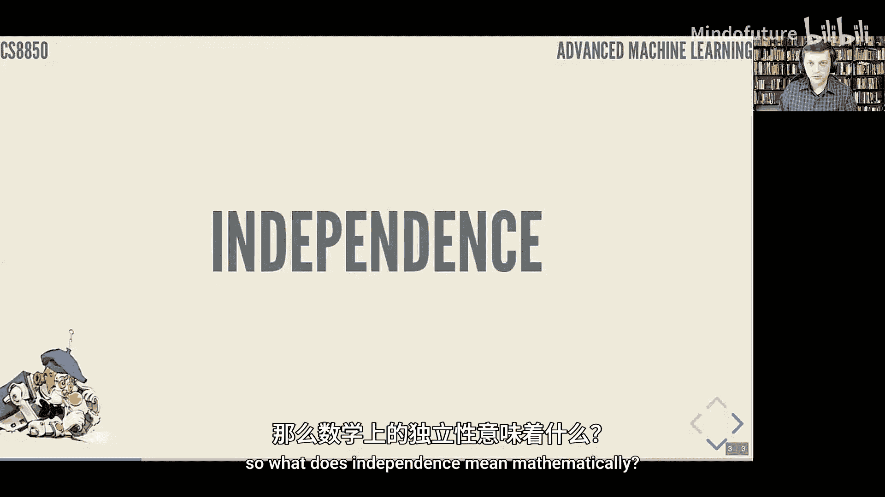

We assume that independence means if we have two speakers。

 then they're joint speaker X and speaker Y then。Their joint probability is a product of their marginals。

So that's what statistical independence means there is also linear algebra。

 independence orthotgonality， don't confuse them。You can see。

This would be a very strange conversation。If everyone's talking doesn't relate to one another in any way。

Yeah， well， but surprisingly， yeah， if you， yeah， if you impose。

If you impose this assumption so that it holds 100%。Then yes。

 it's like everyone ignores everyone there is no communication but。Interestingly。

 if we maximize this， then we like there is enough in the signal in the speech that makes it independent。

 like， for example， with with this model。You can take musical sources， just songs and well。

 they are independent in a sense right， because you just took those songs from different recordings and mixed them with linear mixture。

 you can demix them。Like almost perfectly or even perfectly if you don't add noise with people。

 it will work as well though。If we make sure that there are no delays， I mean， it seems like。

The obvious thing is that people don't tend to talk over one another。Most of the time。No， no， no， no。

 no， this does not matter， yeah， this does not matter， even if we talk over one another。

 there are other approaches to to this case， the separation of people simultaneously talking。We can。

It's just really counterintuitive that this would work。

Like is it just the representation of it that like？I don't know， it seems like a big assumption。

The dependence。Between the speakers， let's yeah， or the signals in the brain is much lower than their own intrinsic signal。

The independence。So， you can。Maximize independence and say your dependence will get lost in the noise。

Like and maximizing doesn't mean。Optimizing it totally， like making them completely independent。

So okay， yeah， but you're right with those。Doubouts。

But they are turns out to be in practice their minor。And in practice when we're using， well。

 and again， cocktail parts is just a motivator for this problem， first of all， because of delays。

 the mixture is not nonlinear。then。If we' were talking about speech。

 there is even a more interesting problem called manural speech separation。

 when you only have one microphone which as humans we can do。

 but we have complicated language models involved as well and all kind of higher level machinery to separate two people speaking。

 when we can separate with one ear plugged， we can separate a few people speaking simultaneously about their own stuff。

 not yes you're right when people converse， they don't speak。Together， oh， yeah。 Okay。 Well trying。

 I found the answer。 the cocktail parts， right， we assume that。

No one cares about each other right people just talk to in small groups or something。

 so you hear all of that and they are indeed independent mostly again。But anyways。

One type of independence is the statistical type of independence when the joint is a product of marginals or we can generalize it。

 right？Set of access。Is a product。Perfect eyes。 This is not raw。 This is black。 This is B。

And this is ani。Don't confuse this with linear independence， linear independence。

 CS x transpose y is zero， their're orthogonal vectors。Although there is。Adulation。That。Basically。

 if you have gausian sources， if you have gaus and random variables。

 then linear independence leads to decocorrelatedness remember how we computed cavariance matrix correlation matrix。

 it was x transpose x， that's how we estimated the cavariance matrix when we collected our samples inside of the x transpose as rows。

Wait，' isn't linear independence just when they're not coline， they don't have to be orthogonal。诶。

Yes。Like the span of the two vector is span though yes， yes， yes。

 but with this three theyre all not none of them are klinear right， but one is extra。

 one is dependent。Anyone。But usually when we think about orthogonology or full independence， right。

You write about the span， but then there is this the full orthotgon and the full orthotgon。

Is close to statistical independent， but only for Gaussian for the the。

Distributions that go only up to second moment， second order moment。Mean and variance。

When for distributions that are described by just two statistics。

 this will be statistical independence。But it's not enough there are。

There is more like when you can be statistically dependent。

 still dependent with higher order moments， but independent in terms of correlation covariance matrix will be。

あ、ダイアグの。With some values on the diagonal。So ICA works with。Or at least ones to push and assume。

Independence that is that is more fundamental than decocorrelation。

 So there is a difference why I'm saying that。There is a difference that plays a functional role in independent component analysis and further between decolation。

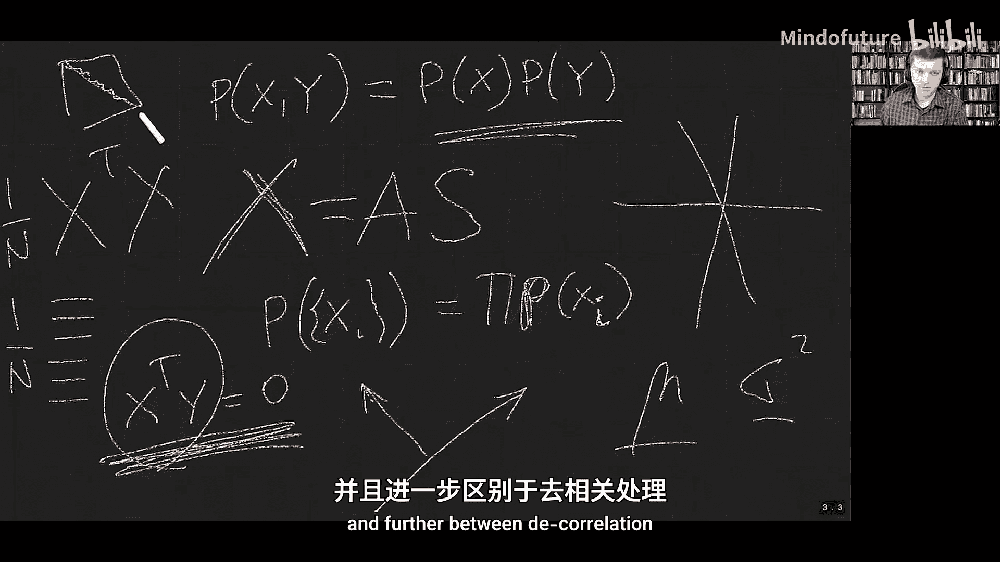

嗯哼嗯。

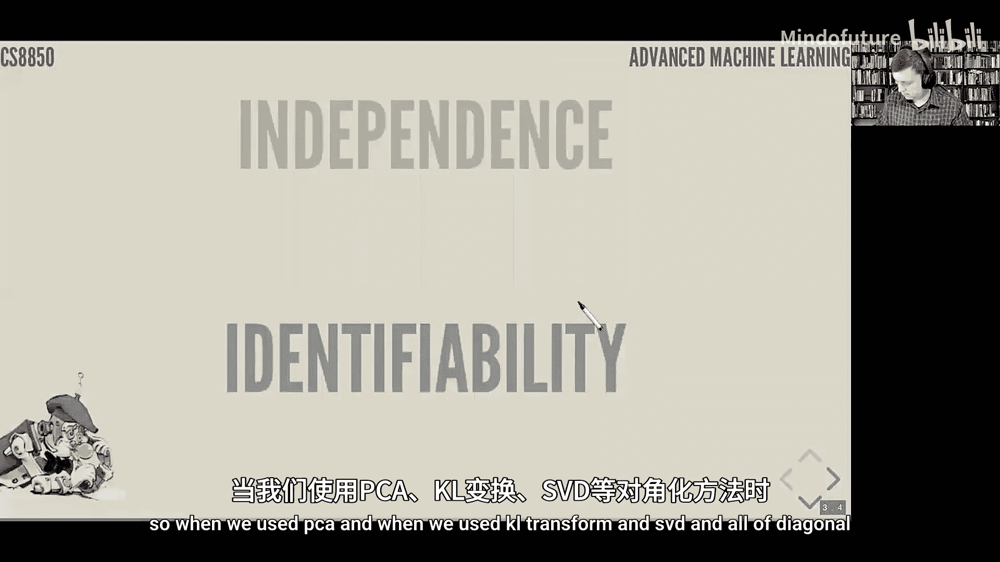

So when we used PCA and when we used。KL transform and thisVD and all of kind of diagonal well they're all the same diagonalization methods。

We two。Our data and then diagonalize it by finding， that's back to homework by the way。

 in a question。From someone。 So our kale transform。Tils us。Take W。

Transpose the set of all of your eigenvectors。Orphaormal set， so orthogonal matrix。

 everything is normalized to one and multiply by your data that when you take an orthogonal matrix。

And multiply by anything or any vector all you do is rotation it doesn't it doesn't change the length it just rotates so we would go from。

This。Do that like a rotation。But then if we also took our eigenvalues。

Basically divide when we invert our eigenvalue matrix we divide each eigenvalue。

 we divide were inverted one over each eigenvalue， basically what we're doing where。

Turning our data into a circle。Normalizing each of the new rotated access to one。Or yes。

 the one so you have a unit circle and this process is called whitening because your data becomes like there is no preference in any direction it's deco or whitened because white noise is the noise for every frequency is present so in here in the circle data there is no preference for any linear direction。

Like now， once you have a circle， you can diagonalize it or effectively anything diagonalizes the。

Spherre actually， or a ball of datum。And of course， what I mean by one is the variance。

 the data could be still anywhere。Up to infinity， so that's widening。The the。Imagine like the。

Problems still could be there Imagine two of us are speaking and we're speaking independently and this is person one。

And this is person two， if we plot them on the axis of person one， person two。

 we get some signal here and some signal here。So now I mix。

 I take a mixing matrix and I mix this too and I will get。Something like that。

A linear mixture of those two signals so now if I apply PCA and even if I de widen it。

What I will get。Is。I will find the major principal access。Of of the red data。

And then I will rescale it， so it's sort of circular。That's maxim what PCA can do。

 principal component analysis。K it'll transform another matrix factorization technique that we already covered。

But ICA will actually find。This axis。And the goal of ICA is to find those a that are still spanning the space。

 but are not orthogonal anymore。The independence of the sources is the guiding principle。

At least declared and there are so now and this is all still just definition of a problem。

 not definition of how right not definition of an algorithm it's just okay well we do this by using the algorithm but by using or relying on independence。

 but how do we actually do that。So。First， let's talk about abigus。After。You take those red。嗯。Well。

 let me give you another example first about PCA。Let's take our data。Sampled again， this P1， P2。

And if the data is sampled， like you plot it against each other and you get a。

A cube or a square or a hyper cube for multiple sources。 Then we mix it。And our mixture。

Will give us some kind of。I don't know， I。But bit。Mixture， this is mixture。How do we get the mixture。

 we take P1， P2， and this will be like sample one， sample two。And we apply。

4our by four two by two matrix and we'll get this mixture and we plot again this new coordinate。

So if we apply PCA。BCA will first find the major access。

Major access of variants and then whiten so after it will find those axis。

 here they are the green axis。It'll make sure that the variance。In all direction is the same。

 This is what PC will find and ICA will find。Something like that closer to aal data。

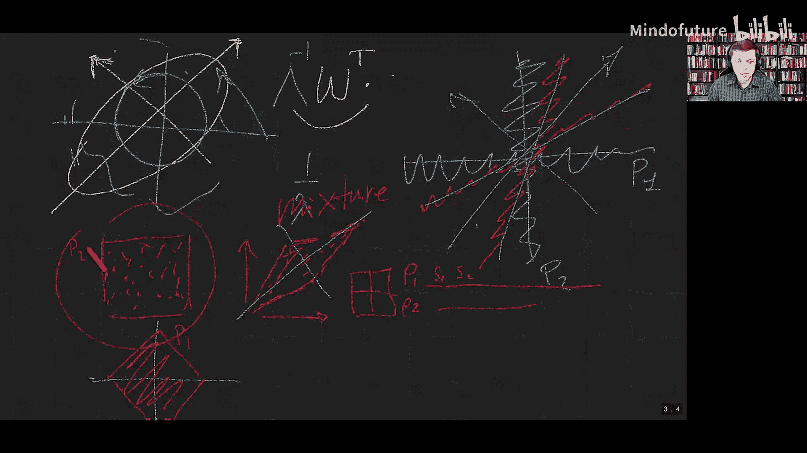

呃。Not just that this is still a mixture。And this is， again， the mixed signal ambiguous is。Well。

 there is， at least there is a ambiguity in multiply。

Like you can multiply each one by minus one and you'll still get the same answer。

 so there is a sign ambiguity there is a magnitude ambiguity。

You can multiply a by one over lambda and multiply s by lambda and you can still get the same x。

 there is a permutation ambiguity， you can permute the rows of s and you per the columns of a and you'll get the same x and。

Those two， but there is another ambiguity with the Gaus and。Distribution。

 if you have a circular Gaussian distribution， then the ammbigui that I mentioned that you can put your access anywhere anyhow when your a are orthogonal。

 you already have a problem because it's up to any rotation when you are an IC where you can put any linearly independent basis。

The number of possibilities is even larger， so ICA can not work with gas and sources PC。

Is build on the assumption of gos and sources， I cannot deal with them， it cannot disentangle so。

Now we are coming to how would you do it now you know that the sources are non Gaussian and in fact。

 if our speech is non Gaussian my well， first of all。

 my speech is fare because I pause to think about what to say next and things like that I'm not just constantly。

아。They meeting some kind of noise and sound。So any sparse signal。

 although it may seem to you like that， but of course。Yeah。

 so I think this liabilityability leads us to some approaches。

One approach is called fast ICA and yeah。

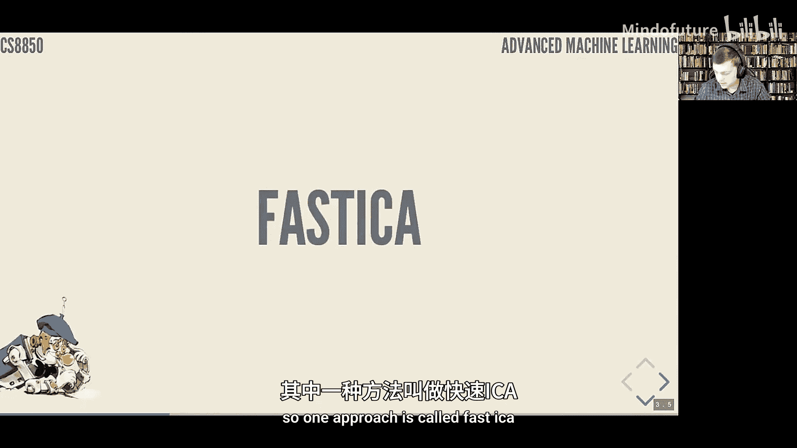

The beauty of improvising gives me a chance not to go back to deepen the details。

 so what fast I see it does it observes the following。If we take a Gaussian。

Something that looks like Yason。Probably from information theory， Gaussian is the highest， well。

 we'll need it next， but Gaussian is the highest entropy distribution for given variants， but also。

For if you measure。Moments。So first moment is Armenian。Then second moment is our。WellVance。

 then the third one， I believe is is skewness and the fourth moment is corosis。

 so what Courtosis measures for Gaussian Courtosis is three for anything that has。

That is so called sub ghosts and。Corosis is lower。Basically。

 the number of outliers on the tails is smaller than the Gaussian it falls off the tails of。

Those peaky distributions follow faster than the Gausson does。

And then is there are supergaussian distributions， kosis is higher than three， so what FA ICA does。

 it says let's take our mixtures。And， let's find。X equals A S， okay。Usually， what we do。嗯。We do this。

And then we'll say， okay。Let's modify parameters of the W， let's start playing with our data。

ax linearly transforming our data。Into S， such that。

Cortosis is optimized whatever we want maximal corosis like we need to push it away from Gaussian so the more non Gausian sources we get the better and so let's lets let's get our results away each one then notice each one can be measured independently of each other as long as each of them is non Gaussian maximally as we can get。

The results should be good and the results are surprisingly good。Okay。

 but it's probably blasphemy in the scientific circles。

 but it never worked for us in brain imaging data。's surprisingly good photo examples。

 and it's blendingly fast。 But somehow， when you start working with brain imaging data， real data。

It doesn't give interesting solutions， it doesn't convert to something that we can use or it converges to suboptimal results。

 but it's fast， easy to understand。Relatively easy to understand because the problem is choosing a non nonlinearity that would measure the corosis when you're doing optimization so but just。

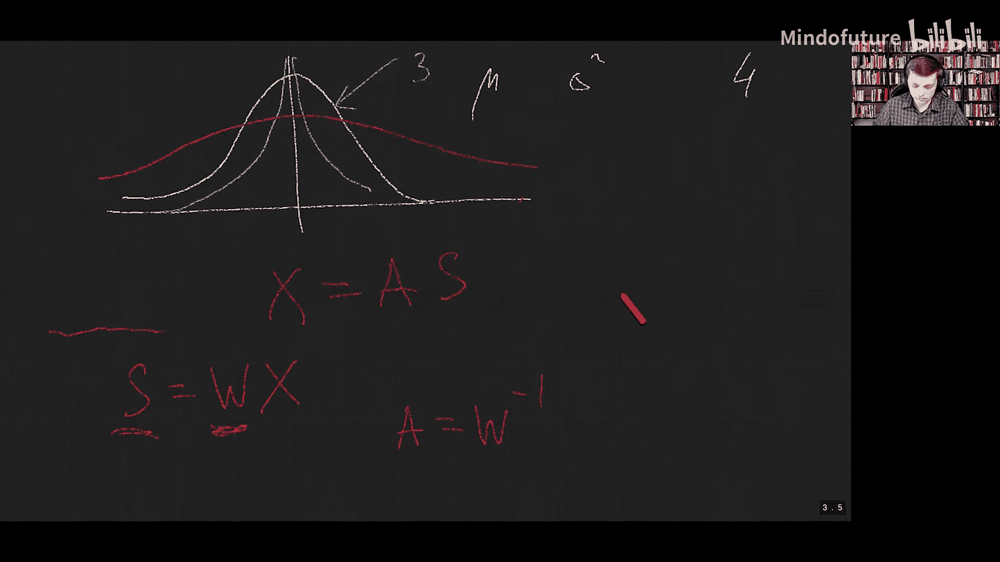

Just an sumtuition， Another algorithm is based on。

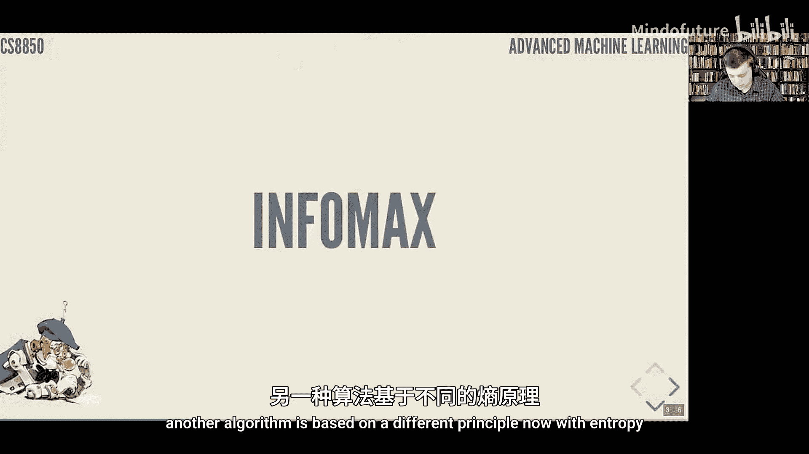

A different principle。Now with entropy and this principle is called Inax。

Remember our initial figure where we had our。Visible units。

Visible units and hidden units or input and output。 Think of it as input and output。 Think of it as。

If our output is the sources that we want to get。W is our de mixing matrix。Now。

 because we are un mixing。Well， I redefined all of the notation XV。S is H， so if that is the case。

Informax principle says that if our。And I envision the question。So we from Jack， I guess。Or anyone。

 what's the problem with maximizing mutual information between input and output。

 but what would a degenerate solution be？For W。Okay identity。

 so identity transform will maximize the information because they will be the same。

 but so ignoring identity or avoiding identity infoax principle tells us let's maximize information but let's set the w such that。

The information between input and output is maximized， we can decompose this information。

Mual information。Well， mutual information in differential form is nothing but。

Kale divergence of the joint distribution。And product of the marginals。诶。

So we want to minimize scale divergence。Of this two。And we know that y is Wx plus some noise， maybe。

So this we can。You can multiply the log through and you can observe what happens， but basically。

You have。呃。Entropy of。X， and enpy of y minus conditional enpy of y given x。

Or cross entropy well conditional actually so。That that。

This number or this entropy does not depend on W， this is like leftover and all infoax is trying to do to maximize mutual information between input in output is maximize the entropy of the result of the output of the sources and just one last comment the way it does it we treat this matrix vectorization now some connection between like everything is connected。

 everything is connected back to the K divergence but Jack noted that already in one of the posts and Slack and everything is connected with deep learning and all this this is a single layer neural network if you put a sigmoid unit here logistic regression right if you put a logistic sigmoid unit。

Think about two nodes， two output nodes。Each one has a sigmoid unit。

Sigmoid union squishes the output to stay between 0 and1。 If we plot x and y on the output， Well。

 I'm overloading， let's say y1。And why too， if we applaud them。Thats Y1 and Y 2 here。

Then sigmoid it will not let them go outside of the zero to one boundcing box。

Sigmoid it keeps them in the bounding box when we go from two units to multiple units。

 we're talking about keeping our output in a hypercube and within a hypercube output。

 which one is has highest entropy？The one that is spread around uniformly， the uniform distribution。

 any bounded for any bounded interval uniform distribution has the highest entropy or unbounded entro distribution with given variance Gausian has the highest entropy。

So what Inax is trying to do， it's trying to find an unmixing matrix。Such that the output。

Is in the output is distributed。呃。As much uniformly as possible。So one question。This。

Expression I of X Y is the mutual information here right。

 and it looks like it's no symmetric between x and y。

 but then the one that you wrote down at the bottom looks like it is。

It is symmetric you can rewrite it either which way so I mean。Okay。

 so this it is metric at the top so yeah， yeah， yeah yeah。

 you can just rer it in different you can of y given x equal， yeah， yeah， you can just。

And's not the probability， it's the I got it's entropy it's the entropy Oh yeah。Yeah， yeah。

 with entropy， it's。Well， as you， as you remember， right， probably you。

And the differential it should be， right？And。This bottom is equal to I， the mutual information。

 or it's equal to the entropy of x given y。The嗯。This is expression。This is mutual information。

 this is not entropy Okay， let's do the exercise。They have a lot more to tell you about in this lecture。

 so but let's try， so I can just if if you open up the log。Right， you will get negative。

Entropy of the Jo。Minus。Like。Let me try。Do you still see my screen I mean。

 I can just look up the I just don't know the definition for the entrytropy of。X given Y， I guess。

I can just Google that。 It's cross entropy。Okay， maximally。

 you're multiplying the joint by the log of the product。 but then， but then you have， yeah。

Well in any case， but the point of entropy or the conditional entropy， yeah。

 that is called conditional entropy as well， but the point of conditional entropy is that this is the information in y that does not depend on X。

诶。Oops， window is closed， screen sharing has stopped。Next time this happens， please tell me。Deクtop。

But the point that。Yeah， and I understand I'm not， I'm not going。

In a very detailed and sort of step by step skipping lots of steps， just trust me for now。

 but you can look it up later。Usually in my lectures， I try to show all the steps。

But to maximize that， it's enough to maximize。Entropy of y， given that y is a linear function of X。

 And then then you're dealing with。Brananddom variable transformations here， so you need a Jacobian。

 your distribution of y， if you remember right your distribution of y。

 how to express distribution of y through the distribution of x， you need the Jacobian， I believe。

 divided by Jacobian， right？Something like that。It linearizing。Yeah， yeah。 well， no， no， no， no， no。

 no， this is from。Transformation of random variables if one random variable is a function of another and you know the distribution function of the original random variable。

 what will be the distribution of the result？This is an aside anyways。

 turns out InM needs RW to be inversible。Because of this division by Jacob and our W ends up。

 yeah like you end up with。W inverse times。Probil X， and then you'll get probability Y。That。

What I was not gonna talk about anyways。But the point is， let's maximize。The entropy of the output。

To maximize mutual information between x and Y。인put and output。

Informax does that in just a thereative batch manner， mini batch manner。

 maximize mutual informations in the many mini batch。Take your ex， map it into a hypercu。

Measure the entropy see if it's uniformly mapped into hypercbe and if it's not keep going so that it maximizes。

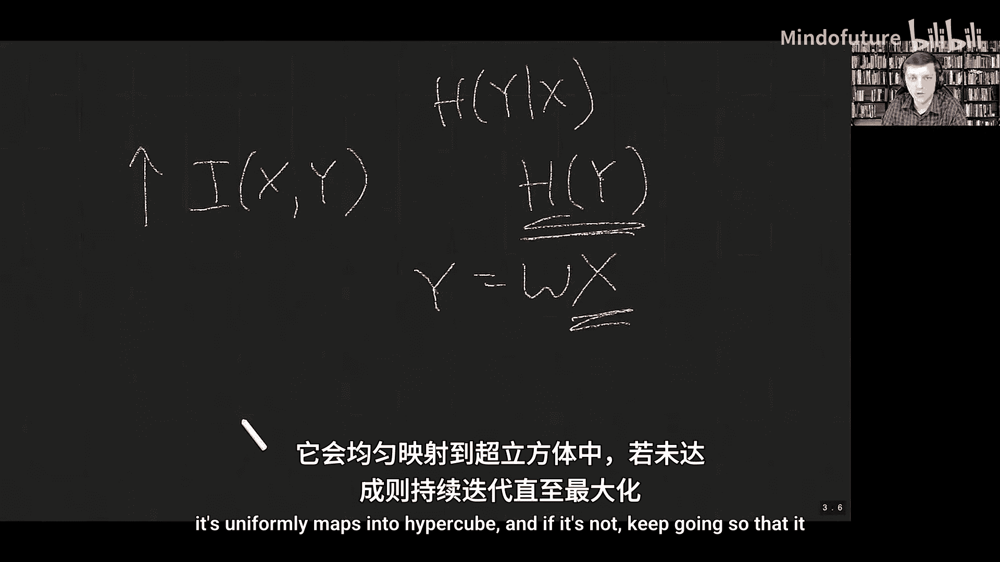

Informm gives very good results， another approach could be much more simple。

 much more direct by like avoiding all the talk of entropy。

 neural networks or projection pursuit is maximum likelihood and I'm putting it here just for completeness。

Information theory。Book by David McKay that I put in the in the。

Links to this class has a good exposition of this approach。

If you'd like to know how you can compute how you can solve ICA problem ICA is a general problem there are at least three algorithms there are many。

 many， many more algorithms to solve independent component analysis and it is still a linear problem you're finding a matrix factorization given your data how you can decompose it in the product of two matrices your mixing matrix and the sources sources are independent let's go to another problem just like that。

On the surface， so morphologically， it's exactly the same。

How one matrix is a product of two other matrices。In ICA and especially with this condition of invertibility。

 you should have noticed that。Number of sources and number of measurements is the same otherwise the matrix is not square and you cannot inverted and the same was for PCA when we don't have to en scale a transform and in compression in my examples in the notebook we actually draw a lot of eigenvectors。

 but it is still a full rank transform。No negative matrix factorization so what it is think about additive features anywhere you have additive features like when you cannot subtract when all of the features are positive gene expressions well are like that well。

Arguably our facial features are like that or at least we can use them。

 so if you have different eyes， noses， eyebrows， you can only add them like when you shine light through the film right those are features additive。

But they are unknown， you know they are additive， but all you have is the result。

And you don't know which features were added together。

 can you extract the features and their weights？That will reconstruct any possible face。

 think of human faces， think of different types of noses and but the algorithm doesn't know about noses all it has is just pictures all of the faces can we decompose。

Let's let's define formally I see some confused looks formally it's easy so one important is low rank we don't want to have too many facial features we we want to only have like a few facial features and they're different weight coefficients。

So。W。If our X。Let me think so。This dimension of W and H。That gets multiplied is R and r is small。

That's what low rank means。We want to represent our data and if we put our faces as columns of x and we have many。

 many faces， we want to represent our data as a product of the and I'll show you in the next picture of the types of features and their weighting coefficients such that everything all of the three are no negative。

 so zero or higher。That's no negative matrix factorization。 How do we do that Well， effectively。

 we are minimizing this objective， right。To satisfy this equality， so the Frbinious norm。And。Yeah。

 how can we do that so and I'll show you an example later to understand what is w， what is H。

 so when we minimize this objective。Just。Distance squared or Euclidean distance。

 think about it like that if everything is affected vector。

If we think of x and the reconstruction just as a vector in some space， it's just elude in distance。

We can differentiate with respect to W and differentiate with respect to H separately and those are the results of if we actually differentiate those two。

 that's what you will get。And we can just do classical solution gradient descent if our Eta is just a single number。

 then this is simply a product。But， I want。Learning rate。

 this is just a gradient descent learning rate， so H。Minus learning positive learning rate。

 but I'm assuming the learning rate can be negative as well or anything I'm just doing the grading descent with the for age here。

And I'm assuming that I want learning rate。To be different for each of the parameters。

 for each of the elements in age， I'm kind of optimizing them in parallel。

 that's why this element wise anam product。Another mostly forgotten trick or at least not taught in。

Elementary optimization theory is this exp gradient we can。

Eleement wise multiply by e to the power of our gradient times the learning rate。

And when we when the gradient gets to zero， which is multiplying by one。

 so nothing like if the stuff stop changes， it's kind of an equivalent form。

We're doing almost the same thing or achieving almost the same thing。

 but I'm introducing here for you to introduce a novel mindbing notion of optimization that you don't have to add your gradients。

 you can multiply by by some derivative of your gradient like exponentialated gradient。

 so instead of doing steps additively。As here。We're still iterating。

 but we're iterating multiplicatively when I first heard about it， that was like， wait is it like。

Could we even do that， Why didn't like no one tell me about it's just amazing。So now， okay。

 as you remember， the lighten jar， the what is our logistic regression。Let's。Now。

 when we know what we want to do， we want to find such a multiplicative factor that we can just multiply by and converge to the solution。

We can simply do the magic and find it， so if we set our learning rate magically。

because we know what we want to achieve right that's what I mean by magically it's not that we kind of stumbled upon it by some kind of roundabout way long we know exactly we want to achieve we want to set our learning rate。

If you take if you take this learning rate。Plug it here into your normal gradient updates。

YouFor H separately and for W separately， you will get to this expression。

 do this exercises it's just algebra， but it's it's interesting yes just。

Plug this in into normal gradientding descent， the is element wise。And you will get learning rate is。

Per each parameter， so the dimension of Eta H is the same as H。

 the dimension of Eta W is the same as W。And if you set the learning rate to this value。And notice。

 I completely ignore the iteration index。But。Like。Those values here are at the previous iteration。

 all of the Hs and W， you start with randomly initializing them to no negative values。

Better away from zero because the beauty of it， anything that is zero。

In multiplplications of updates， stay zero。Any element in age that is zero that is element y is multiplied by anything will stay zero。

 that's clear， right？Okay， and the same for W， but now。

Not just that we started with gradient descent where we needed to set the learning rate。这。

We just heurically came up with a way to get rid of the summation and ended up with just product。

 but we also got rid of any hyperparameters。There is no learning rate anymore explicitly defined。

 the learning rate for each of the elements and age in NMF form in multiplicative updates of NMF。

Is dynamically changing with your updates。There are lots of tricks， if this goes to zero。

 anything here goes to zero， the algorithm blows up， what do you do？

Fdge the usual right just add some protection so that it doesn't go fully to zero but the algorithm is beautiful。

 it's very easy to code up and couple of lines of Matlab Julia Python by anything you want and it does find the factorization if you're careful with all of the sorts of numerical instabilities and if you don't。

诶。If you don't initialize incorrectly because yes。Despite the simplicity。

 the first time I implemented it， it didn't work。Because of course one thing is a beautiful formula another thing is reality and if you don't know all of the tricks how to not to get in trouble。

 you will get in trouble so advantages automatic non negativity constrain satisfaction well if you start with non negative H and W。

No negative times， no negative never gives you a negative number。

It's a constrain satisfaction problem， but we even forgot about it like it's given to us for free nice adaptive learning rate and no parameter setting no hyper parameter setting you still I mean we're estimating H and W and it also minimizes the。

呃。Distance。Between。This two expressions。In the end， interesting， okay， let's。

I think I need to see my next slide， otherwise I'm inventing the narrative here as I go。😔。

So let's take one column of x， it's a human face here it is。

Then our features are W after this solution are those facial features， some eyebrows。

 well sometimes with noses and all you could do with those is add together by using those weights in H and that weights are also not negative you're just adding them you're not PCA is canceling you say it can add negative face to a positive face and cancel and creative and the rank。

Is small， so you're using only a small number of those features facial。

Features and you reconstruct that's the reconstruction， that's how NmF works。

You can also do the same with hyperpectral images and other kinds of data people using ICA another NMF sorry another。

Advantage of NMF， you can show。呃。That NMF is basically by clustering。

 It's simultaneously clusters in two dimensions and people you just need to。

Premute the results correctly。 And people are using that in。Genetics and other fields。Yes。

Let's take that idea of matrix factorization a little bit further。

So imagine that we want to be able to represent everything with just a few numbers， few codes。

If we have a large enough codebook， if our typical faces codebook say is large enough。

 then each face we can only say like， okay， use those three features。And represent this person。

 but for another person use other three features， so sometimes non overlap so the more the code book is the the sparse the coding the fewer examples in the extreme I can just keep pictures of all of the phases and I can just say。

 okay， this is the face I just need one number an index into database the dictionary learning says can we take the data and learn those features。

Where。Our alpha is a sparse vector， so we impose some sparsity on alpha by the constrained phi L0 norm ideally。

 but we do L1 usually sometimes lP norm lots of approaches I'm not going to go into the actual approaches of。

How to train dictionary learning， but。To give you intuition。

Which is important here is that we can construct unlike an MF。

Which was looking for lower rank approximation。Unlike PCA and ICA。

 which are doing full or rankic composition。Dictionary learning introduces another key idea if you haven't heard about it yet。

 it introduces overcomplete representation。You have more than you need for linear independence。

You don't care about linear dependence anymore， it is you are giving more than you need to represent a point in n dimensional space because you want to represent a point now with fewer vectors that's why its like you know in 2D it's enough to represent everything it's enough to have two vectors but if you have tons and tons tons of vectors。

 maybe it's enough to have one point and the nearest vector on that point。

That's that's kind of intuition when when you go into multidimensional spaces that easy you to understand or at least makes more sense because you can at least combine three。

Linearally dependent basis。And here what they are。We can take well， we can use it for genoizing。

 of course， so our dictionary for this particular data would be like that and dictionary is learned so you will see an advantage。

There are universal dictionaries forier basis， cosine transforms in JPEG waveth transform in JPG 2000。

 those are universal， they're trying to be universally good without any expectation of what will come their way。

Dictionary learning is if you know what your data is， you'd rather learn the basis。For your data。

 Not just those of you who are。Modern hipie boys or girls and playing with deep learning all the time that's the that's the mantra of deep learning let's learn everything from data and deep learning didn't come up with that mantra I mean yeah like this is like deep learning let's learn the basis from data I mean at least in this in this sense。

Here's an example， let's learn the basis from human faces， this is JPEG JPG 2000。

 the very good codex or compressors， so this is the distance inside of KSVD is a method to do dictionary learning。

This is the distance to the original， to the ground truth， the smaller the better。And as you see。

 this is reconstruction with exactly the same compression ratio， all of those methods， JG。

 JP 2000 PCA， they give the same compression they have the same compression ratio。

 but the reconstruction looks quite differently。JpeG tries to be universal for all images。

 look how better PCA is because PCA was trained on this kind of data。

 it's a PCA created eigenfaceases specific basis for that particular that shouldn't be surprising now。

But KSVD is even better diction learning because it created over complete basis， so di learning is a。

Cool method， you should use it， it does very interesting。Ideas。

 notions I will go through the notions to remember to take away at the end i'm still a little bit confused about whether we're learning a basis or we're learning。

A huge set of vectors that's weigh more than a basis and then like over acompte basis。

It's called over complete basis basis it's yeah yeah yeah it's don't be don't be too strict to definitions as long as you understand。

 yes， it's not a basis anymore it's not linearly independent。😊，Spning， no， no， I mean， it depend。

 Yes， I mean， it's， it's larger than this the dimension of this space。

But then the advantage is the compression， the bandwidth。

Receiv party and a transmitting party has a large dictionary now that they have to store。

 but the bandwidth is minimized or at least。How how it could be because you're sending on okay this this and that combine this few and you'll get what I mean and then it's all called the number of。

Of vectors in your。Super basis or whatever is is a hyperparameter yeah yeah yeah you decide how you want to do it tons of tons of difficulties there in optimization of course。

But。One thing about NF I didn't mention that will become important right now with autoing Qua。

Which are surprisingly also nothing but matrix factorization。

And even more more just I will tell that in a minute， no negative matrix factorization looks。

So we're minimizing this。This， this is。Interestingly。

 looking problem looks like a quadratic convicx problem like convicx optimizationim。

If we were looking。For just this matrix， let's call it。X tilde， it is convex and X tilde。

 we don't care about X tilder。 We want the decomposition W and H。

 And once we want the compositionposition of W and H。It is not a convex problem anymore。

 it's a convex in W separately and convicx in H， but it is not convex in L of them look。

LikeThis is a little bit surprising All we do like everything is linear is just two matrices multiplied together and we've suddenly thrown away from convexity into an unknown world。

 what's going on。 So auto encoders are even more interesting So you have。😊，This is important。

 everything is linear in autoing code， original， everything is linear。Two matrices。

 low run approximation。Encoder。You can take them the same matrices as a leather。In this case。

 the same so we have。A new objective function， unlike all of the previous methods and the objective well。

It's kind of the same， but still we call it reconstruction error in NmF if you can think reconstruction error。

If you think x tilde is nothing but WH， that's here reconstruction error in NMF that we're minimizing。

In other encoders， we're also minimizing reconstruction error X is what comes in x prime is what comes out。

 you are projecting。X to a lower dimension and then projecting it back to a higher dimension you want to find。

Projections such that the reconstruction is from the lower dimension is the best。Well。

 this is nothing but provably a PCA that this does SVG。I mean。

 they're identical and when we'll get to the lectures on Ford backs and G。

People were running around with war vectors as an example of triumph of deep learning。

 although it is a shallow learning， B， it's not too different from SVD。

 it's actually a PCA and SVD as well。We'll talk about that later so basically this is our x prime right we take x we multiply it by w project project here and then we reconstruct it by W transpose。

So that's auto encoder。Objective function that we minimize。Incoder decoder is right there。

 so in matrix factorizations， you can think。You're doing the encodeder decoder trick。

 but at least in auto encodeder， you're doing it explicitly and you're calling it directly an auto encodeder like with encodeder decoder that we use。

Further， so the simple model， it is even simple simpler than NmF， no constraints。

 the same W just transpose。It is not convex。诶。Once you have a product of linear product of matrices。

要。And you want to keep them separated and you start optimizing you quickly fall out of the convexity and simple problems recently somebody Andrew Saks used that property to model deep learning by linear networks it's exactly。

An interesting property， but that you know if you multiply a bunch of linear matrices together it is equivalent as a single matrix multiplication because you can just multiply them you don't need this whole deep network or in auto encoder if you multiply them together this is just one single matrix transform low rank matrix non inverible but still why is it interesting to look at them separately well because if it's a single matrix you don't have that internal representation in auto encoder we're interested in this。

I think God does compression。And it is forced to do compression meaningfully because otherwise the reconstruction won't work。

 it is forced to leave only meaningful bits about the image in the compressed representation。Okay。

Andtroex dynamics。 Okay， let's skip all of that。 So without encoder since。

This is already a hard problem to optimize why why would we even limit ourselves to。Linear case。

 let's add nonlinear and shallow two matrices。We can have deep auto encoders。

 nonlinear auto encoders， and they all are unsupervised。Models。

 although you're training them by back propagation by supervised technique because you have an objective that you can measure reconstruction error so unsupervised because you don't have to label anything all you do is try to。

Maximize the quality of the construction or minimize the distance。

 So Jeff Hinton and Rolanza Hodov has done this。嗯。Back in 2006 and published it in science。

 that was an interesting publication because。For years by 2006。

The supportup vector machines were dominating the landscape and no one would ever in their right mind publish anything about neural networks and suddenly the science paper appears what was the problem back like a little bit of historical note in 2006 and before 15 or 20 years it was very hard to train the networks deeper than a couple of layers because the gradients was would vanish and nothing would stay optimized the suggestion in the science paper was。

We can pretrain each layer using RBM。And then train the auto encoder， Funnily。

Another group in Montreal led by Yolo Benjo suggested to use the original autoingder with the reconstruction error to pretrain the layers。

 so basically we take our auto encodeder。Split。😊，How to encode them in the small parts and train them separately just so that this is an encoding。

And this is a decoding to reconstruct one from another。

Well anyways now were I've jumped quite away from matrix factorization this is out of scope of this lecture just don't be afraid if you don't understand everything I think it's interesting and elementary how a simple matrix factorization model and problem can lead us to。

Extensions that are interesting。So what they showed in this science paper in 2006 that if you do two dimensional projection on any of the two。

嗯。Aess or principal vectors of PC you get something like that and auto the encoder actually out the encoder。

Compression。When you， your。Compression layer， the bottleneck is just two numbers。

Leads to separation it separates semantically the data without having any signal about the type of the data just reconstruction error that's fun another idea is from your engines group is the noing o encoder so now what we do is instead of simply reconstruction error remember reconstruction error was given an X and given reconstructioned x what how would you。

Train it how how would you。Obtain the compression what they did is they know the X。

But what they entered into the system was x plus noise。And they expected。

 but they were judging the system against the true X。

So this is a precursor of what's now is an interestingly developing and highly advertised and advocated for methods。

calllled selfupervised methods when again it's like unsupervised but you're adding some information that doesn't require any human labeling or intervention and trying your model to it's like like gameplay like kids developing brains we're playing games modeling situations without actual situations and we learn from them so theres thenoising thing the task is even a noisy image to construct construct theno one is thenoisizing think also an interesting idea。

So big home points。Still have some time， but keep getting this calls。

There are lots and lots of different interesting matrix characterization methods。

The examples from SK learnn implemented once， but SK learnn is very。

Conservative and didn't have many interesting methods implemented and look how different they are so PCA gives us kind of those smudge of faces。

 those faces， PCA cow。Gusion is close to Eucliian L norm L norms spreads the energy。

 so that's why we get kind of non sparse solutions fast Ica a little more interesting little sparser。

 but still you can add sparses to the PCA then you get the eyebrows and things like that。

This is sparse NMF， I think， yes， this is NMF。Dictionally learning。High frequency components。

You need another advantage of PCA so disadvantage of PCA in methods like that is that your main components are low frequency and then you need to get far far in detail to model those sharp edges like on the glasses in dictionary learning。

 you can only take few already sharp components because they're not constrained by capturing as much variance as possible。

And so they that's why， by the way， they're better than JPG and that kind of compression the Fourier based on Fourier ideas because Fourier tries to capture first low frequency components and then add higher frequency later because they're less informative but not in this context well K means K means is an important。

Well the important thing is missing here is vector quantization。

We can also compress everything by prototypical faces。

So instead of picking a constructed eigen phasese， stay like okay， this face is a prototype。

 so vector quantization says find me a cone。OfFs that kind of surrounding all possible phases。

 just few phases such that you can by convictx combination of just those real faces represent everything in the data set I didn't talk about it at all。

 but that's an important。Forgoten concept， but still it's good to know NMF NMF can automatically give you sparsity because no negativity and sparsity are related。

 but not always often you need to enforce additional sparsity on NMF。

And when you enforce additional sparsity on NMF， you get papers in IC as we did back in 2012。

 if I believe correctly， and I don't have enough time to talk about it。

 but basically interesting now you have no negativity that give you some sparsity and then you can control the sparsity as a dial。

 if you put additional constraint on say，AndW， I believe， if you're saying that。

You want to minimize L1 norm。Of W together with minimizing the reconstruction error of NmF。Just。

 just a comment so。This thanks to having in mind。Let's see your cheat shape printed out and I can bring it with you on the next exam principal component analysis of funds or totalal axis of maximal variance。

Use this full rank transform。And can be used for compression when lower variance axis are dropped at reconstruction。

 what else frequently used to preprocess data， almost always even ICA requires that and no one actually bother to develop theory why would you need this。

 but anyway。Independent component analysis， blind source separation problem。

 a sub problemm of the larger problem， still a problem。

 finds linear transform that maximizes statistical independence of sources。

The resulting basis is not orthogonal， as I said， it can capture other bases。

 but it's still rank full basis。No is often independent of the rest of the data。 so for example。

 we can。In the brain imaging， we can remove eye blinks and we can remove heartbeat and things like that because they are independent of what's going on in your brain unless you're meditating on on。

Your eyelings target so statistically independent you IC is often used for gennoizing because you can clearly see oh this is not the signal I'm throwing away it deconstructs the signal into separate source and then you can reconstruct again a clear image clear signal no negative matrix specization additive features leave to no negative problem。

Lower rank approximation multiplicative updates multiplicative updates is a beautiful idea I don't know I love it no negativity leads to sparse solution to dictionary learning overcomplete dictionary sparse representation of samples。

Only a few bases are involved in including coding in gentle。

 I'm intering myself but anyways uses explicit sparsity constraint sparsity does do， but let's。

Say dictionary learning what the original way to fix questions。

Those are very useful prepro techniques and very useful data exploration techniques。And well。

 of course， if you go into compression。Information transmission and all of that。Without this， you。

 usually don't do machine learning。Without those methods。

 at least classical machine learning learning， you wouldn't。But then。Deep learning approaches。

Kind of trying to learn those things themselves， but if you don't understand how the methods of today lecture work。

 then you don't understand what you're doing when you're applying to learning you're just a technician。

So pay attention to the slides， this methods， and try to understand basic concepts if you do need to do the algebra to understand them do it。

I actually have a quick question。Good， so。呃。So sort of when you started talking about ICA。

 the one of the things that I took away was。嗯。The like PCA projection where you just end up with this sort of blob like overlapping blob is sort of like。

Like a problem， like your data is not separated in any way。And then。诶。

Of course you just talked about autoenrs very briefly and it was just one result。

 but the autoenr gave us dimensionality reduction with this nice separation well that was not linear yellow encoder though。

Yeah， okay， the linear order encoder is nothing but PCA， probably。Yeah。s。

This is no linear auto encoder， so it can， it can be a universal function appximator。 It probably。

 you know， can evaluate stuff。 but this is just PC。 linear encoder only doing PC。 Yeah， well。

 just celllo， but linear as well is important。 Yeah， okay， so for the， I guess for I mean。

 they for the nonlinear auto encoder。呃嗯。I'm not I'm not applying this type of dimensionality reduction a lot。

 but at the same time I。Based upon what I just saw。

I should be looking at nonlinear auto encoders a lot more depends on what you're trying to do yeah。

 it's all all all depends on the goal yeah。I guess that's a fair answer。Well。

 a reconstruction error is a take home point right。

 so you can use a reconstruction error to regularize your other objectives， which people usually do。

And out in code kind of。Explicitly enforces this into an idea space like you can see why and how it works Many other methods use reconstruction error。

 but it's not so evident or clear。Okay。Any other questions？Okay， yeahy， I can get out finally。Yeah。

 thank you and see you on Tuesday。 I don't know what I'm going to talk about。Something interesting。

 I'm sure。

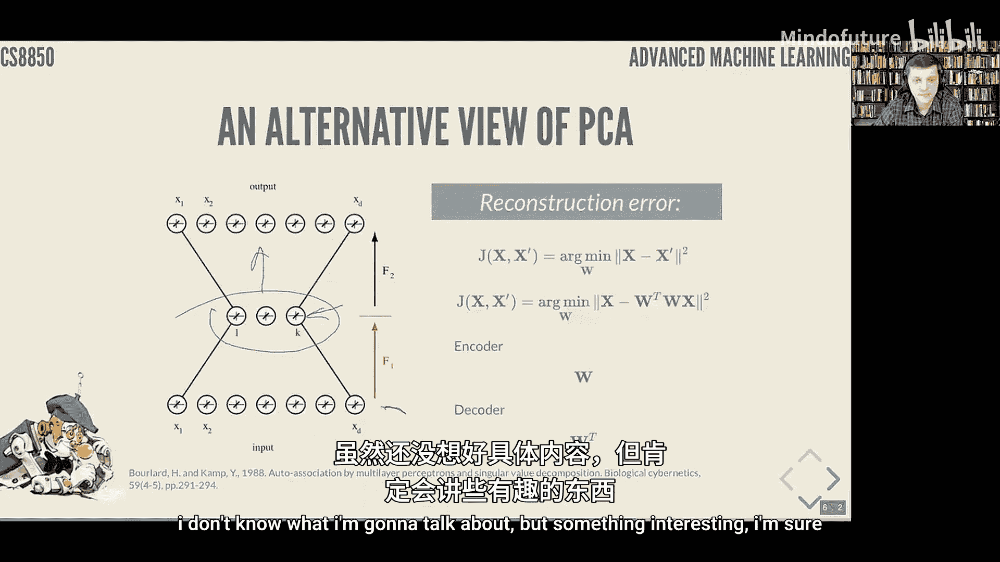

拜拜哎。