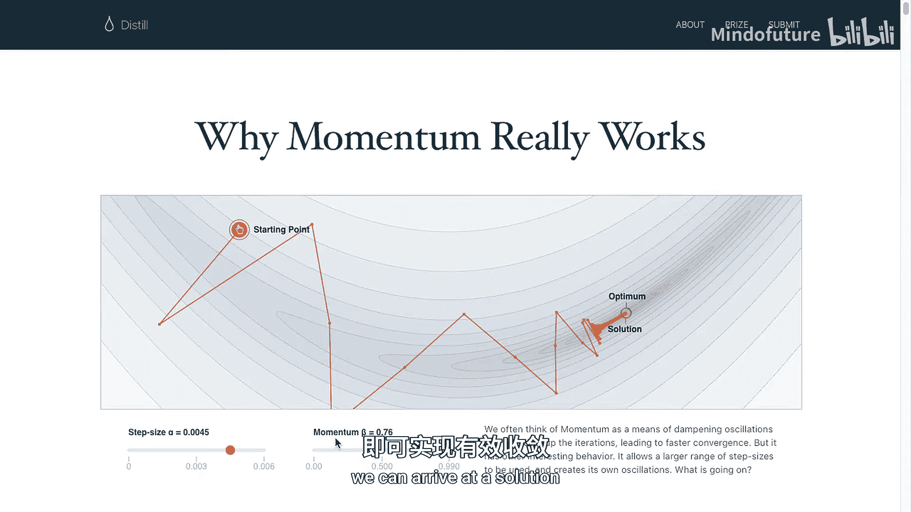
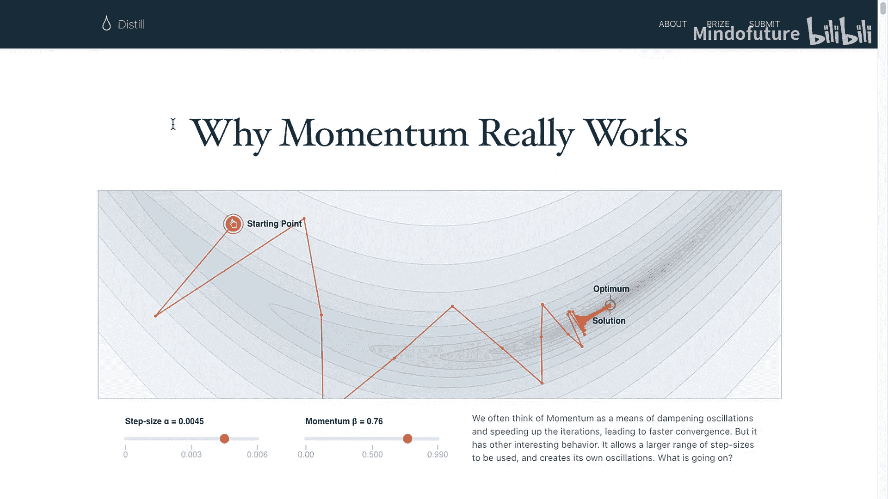
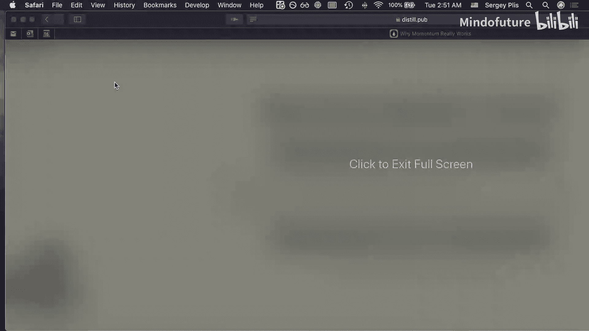
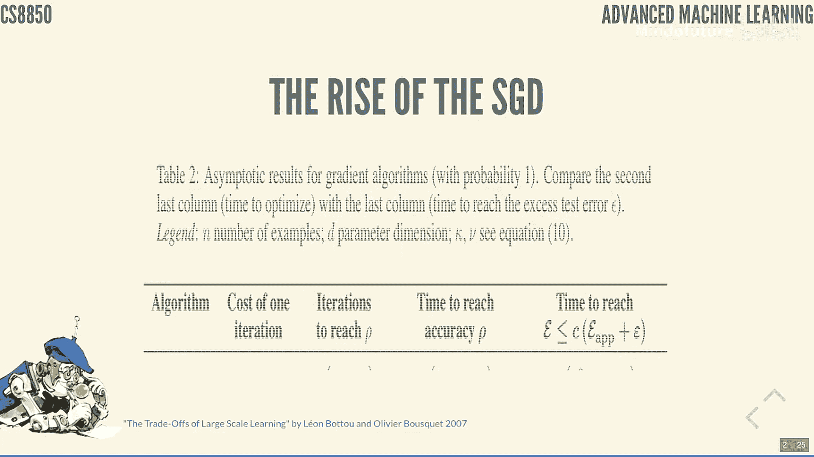

# 高级机器学习主题-CS8850-｜-Advanced-Machine-Learning-p39-P39_随机梯度下降--BV1sapPz4Ewx_p39-

Hi， this is our 15th lecture。 Stochastic gradientding descent。What are we going to talk about。Yes。

Not surprisingly， stochastic gradient in descent。So嗯。So far， we have considered。Various models。

 And we have considered。A fewew ways to estimate them。With。

The notion of stochasticity is already familiar from training the perceptron algorithm。Where we fed。

The data samples one by one to their algorithm。There was a batch algorithm。

 there was a stochastic algorithm。So logistic regression was not trained stochically。Although。

It was an literacy algorithm， but it was looking at the data all at once。

 support vector machines similarly。The logistic regression， but。2好。

And we'll talk about later in this lecture。That。Not using all the data all at all at once can have its own advantages。

 and we will see those in this lecture。And also， we'll find out the details about。

What does it mean to use stochastic gradient descent a little bit of recent findings。

 relatively recent findings， maybe the last five years。呃。Ill read more。And。是。

The importance of stochastic gradient descent for large data computation。As well as。Approaches。

Thatre accelerating that are accelerating stochastic gradient in descent and our。

Helping stochastic gray in descent to escape。What previously was thought as local minimum。So。

Radian decent。Regular， not stochastic。 What is grade in descent is a way to minimize an objective function J of。

At some point。非ta。So J of the then is an objective function。嗯。Oh， like。That。Data point or is。

Point in space where our objective function is defined。But datata。

And the space is a space of parameters of our model。 So if our model is。Perceptron， then。

J is an objective function， but our parameters are the W， the normal to the vector of the。

Separating Hyplane， if our model is our neural network。

 then all of the weights of that neural network are are are。Our parameters。对对。The objective function。

Is the loss that we are minimizing that single number。

 but parameters of the model then later will be used。

Where we will find a point in this parameter space。Where objective function is minimal。

 And then this parameters parameters at this point that。

A result in the minimum objective of functions will will be used in our model and。

The optimal model that we could find。Eta is the learning rate that determines the size of steps we take here。

And then， our update equation is just the。Let's without loss of generality。

 assume that we're minimizing and we're minimizing， as they say there。

Our new value of the parameters is just the old value。

Minus learning rate times the gradient of the objective function。So we want to find a local near。

Because at local minimum。Or at local。Actually， we want to find just one。So at a local minimum。

The gradient will be 0。And。We will not be moving anywhere that since we achieved our goal。

G and descent。So。There are few gradient descent variants。And they differ。

In what is used as this gradient。嗯。Of the objective function。

 where it is plugged in into the update equation。So one is badge gradient descent。

 batchge means when all of the data。Is used to evaluate the gradient and the objective function。

 So gradient。Is。Functional， it takes a function and it returns a function。So， we have our。Yeah。

 an operator。 So we have when we're saying。Ci。😔，What we are， in fact。嗯 saying。

Is not just a function of the parameters， but it also is a function of our data。

And then given the data， given the parameters。We can evaluate the value of our objective。

The same about the gradient。This is， in fact。Function of theta and datata。Access the data。

 theta are the parameters， theta and data。X。Is a set of all of our samples。

For I go still it the way through。The way you organize those samples in X could be a matrix where each column h row is a sample。

Could be anything else。For our purposes， a matrix is fine， but。

What I want to say here is that badge gradient descent takes this complete matrix or this complete set for each evaluation of the gradient at each step。

Sttochastic gradient descent。Uses only one sample at a time。Take a sample。At some point。

 I it finally the gradient。Make a step。Mini batch grade in the。E valid。A small， but a small sample。

 instead of just X。Hi， it thanks。Hs。Hi。Plus I plus say， batch size。A range of samples。

The thing is the difference between the three。Besides just looking at this。

Because there are evaluating。The gradient。Essentially， with respect to different data sets each time。

It。Air or surface。Or the manifold。On which the action is happening。

 as I imagine a ball sliding along。And that our surface。For a。Given all of the data。

 we have another surface。Which is。Well， it's， I don't want to say it's true every surface。

 but that's every surface defined by our data。When we're taking one element at a time。

We're evaluating a totally different function。 We're instead of evaluating the a shell。Smooth。

 supposedly smooth。Eir manifold。Or instead of evaluating the gradient at a point and space in the status space。

 parameter space of some。Have some true error manifold or data defined error manifold or。

Full data defined the altogether rather。 We are evaluating。

Graient with respect to some random or some。ItsA different error manifold that is defined only for this data point specifically。

 right， Because if we are thinking about， if we think about it this way， x sub I， let's fix I to 3。

We can， for this particular point， we can fully optimize。Take multiple iterations。

 never change the X， always keep keep the X that sample the same。And。

Findine theta that optimizes just for this x for this one sample。 and it will be the optimum。This。

This data。That this data that minimizes。This function。Will be different。

 Let me write in another place。Will be different from this data。

These two are not the same when you're minimizing with respect to this one sample。

And the holiday is set。We want to find such data that is in the vicinity of the minimum of this data set or very close to it or is at the same location。

Mini bad also gives us yet another estimate if we fix the mini batch。

 if we fix a sample for each mini bad。The minimum changes for each sample， the minimum changes。

The key difference is that in the badge gradient descent， when we iterate。

 we always are taking steps with respect to the same。Surface， and。

Every step is along the same surface and we arrive at the minimum。In stochastic gradient descent。

 each step and a mini batch， each step。You end up in a different surface because you're making a step。

 but then you're taking another step with respect different surface and yet different surface and the stochasticity。

 always making a limited decision but making only a step， not fully converging。

leadss in the end probably to convergence to the same minimum as the patch gradient descent。

But only if you're careful。That later。Tradeoffs， depending on the amount of data。

So the accuracy of the parameter update changes and the time taking to perform an update changes。

 So badge is accurate。 that's as accurate as it can get， but it's slow。It needs a lot of memory。

 and it can be done online if the data keeps coming in。嗯。If we have a lot， a lot of data。

 as happened in 2 thousandss in this century， when we started to。

Started entering in the era of big data。And where we are stuck now for a while。

 when the data is dataset sets。Are large terabytes。It's very hard to find the real， where we can。

Put everything。 But there is also space complexity that is connected， the larger the。

Data sets are usually you have to look at each data point at every iteration。

 so each data is processed at every iteration， that's a lot stochastic on the other hand is fast and memory consumption is low and it can be done online so just take a sample at a time。

 no need to use any memory， no need to compute for all of the data very fast。

Mini batch is moderately fast， model uses a little more memory。 moderate memory can be done online。

Beerful。嗯。Only accuracy may be a problem because if you didn't didn't choose a learning rate。

Good enough or carefully enough。You may never converge and start balancing around the local minimum。

old that in the basin of which you have started。anyways， so batch gradient descent。

 let's see how it works， so we want to compute the gradient of J data with respect to the entire data set。

The update equation is the same。 The update equation is the same for all of them。

 but we need to calculate the gradients for the whole data set and perform just one update for each update。

 the whole data set， as I said， is involved for those who。Under this said code better than the words。

Here's what we have。 We just set the number of epochs， and each iteration includes the whole epoch。

 and epoch is one path。One pass through the whole dataset set。Eta is a learning rate。

We evaluate the gradient on this whole dataset set。 Oh， that's an epoch。

 We made a pass through the whole dataset set。And then we update the parameters。 And boom， boom。

 boom， we just make。A step that is equal equals to an hippok and hopefully we can verge。Given the。

Learning great。And stars are in the right quadrants。就。我论。

Pch gradient in thiscent has its own advantages。 Well。

 advantages are we're working with the best possible error surface， right。

And we guaranteed to converge to a local or global minimum of that surface， Global minimum if。

The function strictly convex。In all other cases， it's。네 네 lot of mini but。Yeah。

 even in on strictly on X functions。But conx functions， we can arrive to。Sort of global minimum， but。

Distributed global medium。Disadvantages。Can be very， very slow。

 The more data the slower it gets can be intractable due to memory requirements when you get the large data。

Problematic。And no online updates。No， what about stochastic gradient descent， Great。

 We need to perform parameter of date for each training example， X sub I and the corresponding label。

1 subi instead of the complete dataset set。 We only use one sample at a time。

 update equation is exactly the same。 but just now depends only on one sample instead of the whole dataset set。

嗯， okay。For those who understand code better than the words， we still loop through the epochs。

However， many epochs you want to train for。But the trick is now we just randomly shuffle the data at each epoC and then because we randomly shuffled every time we go through an epoC。

 we always looking at a different sample than we did before and then for each example in the data we evaluate the gradient just on that example。

 the double of the data and the label。And do， do an update。Okay。What are the advantages？

Usually much faster than batchge gradientd in descent。

Can be used to learn online disadvantageages performs frequent updates with high variances that cause the objective function to fluctuate heavily。

Okay， fluctuations。 look， badge gradient decent。 Who would just。Praise the curvature smoothly。

But because our stochastic gradient in decent does not actually see that function。

 It sees a glimpse of it。It bounces， bounceuns， bounceuns around， may end up in the same place。

 Good may end up in a different place。 So batch gradient in descent converges to the minimum of the baing of the parameters are placed in。

 and the fluctuation is small， so。哦。If you happen to choose a random start for the algorithm near some minimum。

Or in this kind of。嗯。Attraction。Ba in if you start here， it'll definitely end up there。

 that's it there is no other option。But SGD fluctuations are large。

 but it may jump over if the fluctuation， one particular fluctuation at one particular step is。Large。

 what could happen is say if you started here。Your your batch will definitely end up here。

But gradient descent due to stochasticity may end up in a better local minimum。

But all of that ultimately complicates convergence to the exact minimum as SGD keeps overshooting。

 so this stochasticity of SGD is a problem。Learning rate and ealing if we carefully and slowly decrease the learning rate。

 SGD shows the same convergence behavior as batch gradient and descent so we can make them behave the same。

Probably。Mini batch gradient des。 Mini batch just says this。Fluctuaation and uncertainty。

 stochasticity of stochastic gradient this sand is just too much to handle。

 Why don't we smooth it a little bit by instead of taking a random stay respectfully for each sample。

 Let's just take few samples simultaneously and average their gradient。

 So instead of one sample pulling north another pulling south and pulling west。

 we can like at this point， each like take a few samples and they will be all pulling us in a different direction。

 but we will sum the gradient up and going in the average direction。So， you will take。

A mini batch of N。For each epo， we shuffle， and then we iterate through the epo。With the batch size。

 evaluate the gradient on the batch and make a step of an update to the parameters end up in some new。

 hopefully more interesting place and continue。Stepping down。

The words a local minimum where we will live happily ever after。

So mini me gradient descent advantages。Mini batch gradient descent reduces the variance of the parameter updates。

We just saw the grades in is averaged for all of the samples in the mini match。

Or just add it the averaging part will be handled by the learning rate。

Another advantage is we can make use of highly optimized matrix optimizations common to deep learning libraries that make computing the gradient very efficiently。

Even if our batch gradient descent is impossible， intractable because you cannot put the complete terabyte。

Size data set into GPU memory， but you can still compute everything fast with large enough mini batchges so that your GPU。

Ks and pipelines are fully saturated， and。Everything goes fast。

 and you go through your epog very fast because of the fast matrix computation due to the。Bch sizes。

Disadvantages， we have to set the mini batch size。 So a little chat on this。 Yeah。

 like sometimes small mini batch size is good somewhere there is an optimal mini batch size。

 But what we're finding。 and especially in training models that are very distributed。

To play games such as Stark and in。嗯。Exploration explorations in studies in the projects like that。

 We're running multiple models separately in something that is called data parallel mode。 Well。

 we in fact， we're running the same model， but every one of the models running on different GPUs or different nodes is。

Only working with their share of data。And there is a notion of something that is called effective batch size。

 so。A number of samples each GPU or each network is looking at at a time。Is enough to be。

Deceit in the memory。But。After each of those networks at each GPU in distributed fashion。

Took this step。 We average all of the gradients from all of the nodes and only then take the same step everywhere in this averaging all of the gradients。

Is。Effectively the same as if we were using a very large batch size that equals to the local batch size times the number of。

Nots in your distributed networks that are doing the training。So， challenges。

We still don't know how to set the learning rate， right， we need to set the learning rate。

 It's a hyperparameter。And then。I remember learning rate anneling。

 if we anne decrease the learning rate carefully enough。

 we can get the same point as the bad gradient decent。

But how to set this learning rate schedule unclear。Well， multiple， multiple interesting results。

 And this is more of。嗯。FY I， like one strategy is that you have a learning rate。

 stepwise learning rate for you， you keep it。At some level， for a few epos， then you draw it。

 Keep it for a few epo。 then you drop it， Keep it for a few epos and。So。Interestingly。

 what happens with。Often with the loss， you， you exhibit this behavior that。At the moment， when you。

Drop your learning rate。 Your loss drops dramatically。 It is almost as if。怎么都。Gets and like it。one。

Side note when I say the model and when we're discussing all of this stochastic gradient descent and gradient descent。

 it is applicable to any model that we can optimize in a supervised learning fashion and sometimes even unsupervised but mostly supervised。

Most popular right now are deep learning models， neural networks of various sorts and。Archiects but。

Does not have to be just deep learning。 This applies much wider。But the point is。Like。

 if the model arrives， say， imagine our。Our Bayian。Or our error surfaces like that。

 So you had a large step and the model starts bouncing here。

 Then you decrease the learning rate and the model。Quickly drops and starts bouncing here。

 And then you decrease the learning rate and the model drops and starts bouncing here and so on。

 just an interesting behavior。Well。Recently， in the field， we found that。

Instead of that stepwise learning rate， an interesting。Behavior is to start with a low learning rate。

 and then to increase it。Slowly to some kind of maximum value before the neural network。

Goes out of control and ends up with numerical overflows and underflows。But then， decrease it。

To zero and then jump up again。And decreasing And do in that sinusoidal manner。And interestingly。

 when you do that， what happens with。it gets stuck。 and then it's。

 it goes up and then it gets stuck and then。It goeses up。 And then。So。

With this disruptions on in your loss， you push your loss up。Deliberately， in that case。

The lowest point where the loss gets is lower than where it would have gotten。Otherwise。

 with a stepwise learning rate and link。 Okay， another question is how to change learning rate per parameter。

 We have so many parameters。Why do we need to assume that they have the same？Learning rate well。

And another one is， of course， how to avoid local minimum and saddle points。

We will learn next about how the field arrived。Two solutions， some complete。

 some partial to all of this channel just。嗯。Even those that are partial， still efficient。

And effective。Okay。黑奇。😊，There are several algorithms to deal with some problems that stochastic gradient descent introduces。

And end up with advantages that it brings。So SGD problems。If we have a ravine。

 as you see on the figuregor。The optimal and fast way to get to the solution would be to continue going down。

 If you look in this angle， say the ravine goes like that。So。Despite the optimal way。

 it will be to crawl or to。Go in large steps along this line that's not kind of trying to give you a perspective。

Whatum。Usly happens。If you took。The step。That is incorrect。And just simply doing gradient descent。

 stoastic gradient descent， you start bouncing around。 So let's look at the demo。Hopefully。

 works for us。Yeah， so。You can play with it following the link in my slides that I will provide for you。

 but。四会啊我妈咪早啲。😔，AMoment parameter is this and depending on the step size， look what will happen。😔，嗯。

We will either。K to get stuck here and the optimum is over there。Let's take larger steps。

 so we can get。To the solution。And they'll look what happens， the。

 like if we don't take take steps large enough。We keep bouncing around this ravine。

And then converging to somewhere。But not reaching the optone for take steps that are too large。

nothing interesting happened we first start bouncing around。😔，诶。Too much。 And then just diverge。

If the step is too small。Don't get far。And you are far。 Well， I guess if we continue。

 continued for a while， going with this small， small step， we would eventually in a long one time。

 get to the meeting。But let's look at what happens with momentum。

 how momentum works that willll explain later。In this lecture。

So let's add some momentum and increase the step size。We increase the step size， but add momentum。So。

 with some step size。So。S the steps has more。我啦。More momentum。 And we're at the solution practically。

 So with a momentum term。And carefully chosen step size。😔，But large enough。

We can arrive at a solution。

嗯。

嗯。出去。

OkayThat was control。So how does this momentum work？Well。The same idea as in the physical momentum。

Look， what will happen to you He don't fast in you seat belt。But the same idea is that。

we want to model our search。Of the local minimum。With rolling a heavy ball。Along the surface。

 the error surface。And。Instead of。F chasing and taking random steps。

We want to have some memory or some inertia of where this heavy ball was rolling， even though。

The roughness of the surface that it's rolling on。Dictating changes in the direction。

 if the roughness is small， the fluctuations are small。

 the heavy ball will just continue rolling and roll over the small changes in the surface。

 smaller roughness and rough smaller roughness in the surface， if it is if the roughness is。

Not perhaps， but the actual change then only then the ball will change the direction。

 How do we actually emulate it。Within the frameworks of stochastic gradient descent。 And here's how。

 instead of。Instead of。Doing the update。The regular gradient is send update or stochastic or not。

Instead of this。Lad。As。Acccuulate， instead of making a step。

 we will keep a variable where we will accumulate with some discounting factor， our previous。Gadian。

壊スて二うクイジ。So。Say we're starting， compute the gradient， made the step here。那。Our new gradient。I's this。

But are all gradient。Stllling us。Go here。2。Actually， to go here from this point。 Well。

 we will discount this gradient。By some factor。And we'll go here instead。

 So we are changing our direction。But slowly， we're still preserving the tendency of going where we were going before。

Let's do this， Let's。Have。E1 equals lambda is 0 plus。A present。

Let me just denote this whole thing with novella。But then。A2。Is。嗯对。Me1 Oh what wait。

 But this is nothing but。なで。F serum。Next。And的。That's gradient1， gradient 2。Then we3 is nothing， but。

Let's plug in V 2。So。You。0。Yes。So that that will be squared。This。この配信。I lost Cl of one。Here， okay。

 when I flagged the in I had okay。That's my mistake。😔，But。And then。3。

 so you see that we have discounting factors。For all of our previous gradients。

 But we have all of the gradients propagated。 and we're kind of making if， if， if we say。

 take lamb to 0。9 as here。Then this is really small。 Now。 This is slightly larger0。起千。ze point and。

HGient and。的事实。Very small number now。By doing that。

 we are actually emulating inertry and emulating heavy ball rolling downhill。

And jumping over or avoidvoing changes。Changing the direction too fast。

You can play with the demo linked in this on the distill website linked in the slides。

So momentum is accumulated， the farther the ball rolls downhill。

 the problem with accumulation momentum is that the momentum may accumulate。

Too much of inertia and not stop。 We'd like to stop。Right， like we'd like to go fast。

Say we would like to go fast in here。Don't fly over and like end up somewhere there。

 We still would like to stop at a local minimum。That is favorable。

Another interesting approach to this problem。Of momentum of how to handle the inertia。

 how to have advantages of the inertia， but。Avoid disadvantages is nest of accelerated gradient or。

Usually cold night。 And so what nest of gradient does， you can see it here in。Instead。So。

 we are here。而。Previous gradient is telling us。To go here。Our new gradient。He at the same。

 at this point。So， yeah， this is the pointee。We had that other gradient that brought us here。

Tells us to go here and continue that the new gradient is telling us to go here。

Before we would just sum them with some discount factor。 What nest of accelerated gradient does。

As you actually see here， it says。Okay。What if we did go just where the。

Ineria tells us to go the momentum， our our kind of memory of the gradient。

And computed the gradient here。 Where would it point then。And say， it once somewhere there。

And then we're saying， well， okay， then that's what we computed。 We computed the Galian。

At that point。That we would have wind up if we continued our iner。And we're saying， okay。

 let's go somewhere in between。Where that gradient is telling us， and where。

The momentum gradient is telling us to go。Instead of。Going here。Following this gradient。

We will end up。At this point。So the interesting part about nestero gradient that。

It probably converges。And in， it converges in the order of。嗯。Like it kind of over just。Unrsly。

 quadraically。Not linearly， but the。Sublinely， right。

 This is how fast our error decreases with each of our steps。 We're making a step。

 according to nest gradient。And we're getting closer by one over step square。

 regular gradient is getting closer just by one over T。

 So it's quited drastically faster than thevergence。And very interesting approach， very。

Aductive idea。SoBut now we want parameter specific learning rate。

All of this stuff before that we looked at。Just set a single number。

 single learning rate for all parameters， but some parameters change。Faster。

 some parameters change smaller， some parameters。Have a lot of data samples in the data with those parameters having meaningful values。

 And if we continue changing everything equivalent。

 then those parameters that have some value and effect the gradient in in the data of the data。

 they will affect the gradient the most while others rarely absorb features will not affect the gradient at all。

 So guided by this idea of how do we rebalance this effect of frequency in the data was created adequate a grad parameter。

 at a grad approach， adaptive gradient， basically in the adaptive gradient， unlike the momentum。

 and all the previous approaches， what we do， we just keep adding the square of the gradient。

So square of the gradient will be just。So if we call this G， then it will be just G transpose G。

We keep accumulating that and then Eta is a single number。And for each parameter。맨 그 어？Yeah， when。

 when we do that。Yeah， I never mind Yeah。 We don't。 We do not。Yes。

 so what we actually have is we're squing the gradient element wise。So okay。

 are squing the gradient telling into twice it's still G， but it's every GI。Squared， and then。

Were accumulating。Just adding， adding and adding all of the previous one。

 So it's like adddjectitive gradient。A squared of the gradient。

And then divided by the dividing by the square root。诶。Of the diagonal。 So we are normalizing。

A new gradient at the new point。By the summation of all of the previous gradient。

So it's root means squared， basically RMS。Greient RG， right， Epsilon is just for stability。

 So we don't divide by 0 if something bad happens。If the gradients go to 0， but what。In fact。

 happens is the。Square root of this。Number this number grows too large because we are only summming and summing and summing positive numbers。

And we don't converge to quick or quick enough。 This numbers grows to large and which go to0。

 and everything stalls。 Nothing changes anymore。 No this gradient， even if it's there。

 doesn't get to our parameters and。What changes happen。 So to address that。

Stop this diminishing learning rate in undergrad。Jeff Hinton is one of his lectures， suggested。

AC a suggestion in one of his lectures on Coursera。诶。But also， in parallel， people developing。added得。

Delta， which we'll see in the next slide。Also arrived with the same conclusion。 So instead of。

 if we denote this。Gient the gradient by G T。Instead of simply accumulating all of the squares of the gradient。

 as we did in Agrad。What we do， we do a running window average。So now by adding a discounting factor。

We are。As we've seen， as we've seen in the momentum slide， we are discounting our past and。Thus。

If this is our future in time and we're doing the averaging。 So we're always kind of averaging。

Before in undergrad， everything was averaged with the same coefficient one。

 But now there is a fall of well。It's actually much faster exponential than I drawing here。

 but still there is a fall。With every step， we preserve only some history in。

This window running average。 And this is。A root mean square propagation。

 RMS probe or a modified version of agrad。Because， again， we more modify each either Oh modify each。

Element of the gradient。By normalizing it by square root of， well。

 this dig is basically what happens。This。Eta is the same divided by corresponding element of the sector。

Which is the sum。Of G E squared I elements。Eta Eta n0 here。

 Eta divided by well sum or square plus fetch factors So for numerical medical issues for numerical stability。

 But then when you multiply this by the G vector。Essentially。

 you simply normalize each element in the G by corresponding divided a multiply by either and divide by。

The RMS routineing squared。그래 이제。This idea allows。Independent re normalization of the learning rate。

 depending on how often。Assemble how frequent asemble is in the data set。

 And it also avoids the problem of othergrad of。Collapse or kind of diminishing learning rate when。诶。

The summ grows so large that。No changes are happening to Theta because。The gradient has no effect so。

People in other Delta paper， the author of the Add Delta paper， observed that the units don't match。

 Now， are if theta has some units。Then。The update。They'll defeat them。As some units as well。

 but those units are not units of data。Because units of deelta data are units of G。

But units of G are nothing， but units of。诶。Partial of J over par of partial with respect to theta。

 But those are one over units of theta。But if we look at the proper second order methods with Hasian the inverse of the Haesian。

 we see that the units of Delta theta。Just。G。look at this。

 the units of Delta data are exactly units of data。Which is nicer。Go to shut down my city。Okay。

 which is nicer。And so they went ahead and introduced another。Factor， also， moving average。

So this is the same as RMS Pro well actually it's a question who was first because added Dlta and RMS Pro were kind of simultaneously and independently discovered。

 but add Delta added this additional tracking fgi， so we have deelta theta。

 our update basically the update that includes。이제 그래징。第捕あ。-1， T -1。

The update that includes the gradient。And we're tracking the square of this update。

 the average of the square of that update with a moving average。Similarly。

 as we did for the gradient。There is a trick that even though for the gradient。

 we can track the instantaneous or the current value for the update。

 we cannot because by this time this value hasn't been obtained。 you have to use。

Like you compute the gradient only here， you can you can compute， you cannot compute this value here。

 but that's technicality， you can do the algebra， right yourself。So what happens now。

 we are dividing root mean square of the square of the root mean square of the and root mean square of the gradient。

By each other。And。Uiplying it by the new gradient。The current gradient the。Learning rate is gone now。

 It's fully adaptive now。Okay done。 Well， it's a good method。But wasn't fully satisfactory。

I'll show you some results， but the interesting part is the way and the what is tracked。Observing。

How other other grad works， how Ars probe and other delta works and what is happening with it。嗯。

Authors of Adam， Adapive moment。Method。Basically， we're trying to approximate。Second order。

 well add the delta as well is trying to approximate second order methods。Like whereas other grad。

And RMS S prop， theyre not trying to approximate the second order methods， the ones that use。

Haesian or second derivative in addition to the first derivative。

 But Adam and A Delta are explicitly after that。And。哦。What Adam is doing， It's tracking。

And moving average with some decay with independent decay。Tracking the gradient。

 similar to the momentum。And striking the square of the grid。And。Those two。

Estimates turned out to be biased。 So there is a。嗯。This bias correction for those two。

Moving averages that are being tracked。 And then the update is similar to RMS update。诶。

So Adam had turned out to be a very successful algorithm in multiple aspectss and actually works really well with those default parameters。

And now by looking at those as， you can see where the ideas are coming from。

And why would we want to model second order methods so。

The reasoning is like that when we study optimization theory and when optimization theory was developing and is developing。

Well the idea is that it's very easy to get on a local minimum。And so one thing is。Okay。

 if you have a saddle point like that。I'm actually drawing a saddle for you。

 and you're going by second order， first order method， just by gradient descent。

 You will end up somewhere here。 and that's it gradient is0 at this point。

 But if you had second order information， you would see that in this direction。

 you could still continue。Going， and you would escape this saddle point。

And now imagine that this is just two dimensions， but the neural network。

 large model has millions or billions of parameters。

 That means each parameter is that I mentioned in the。诶。

Error surface in the objective space where the objective is defined or the loss function is defined。

By chance。To get all of those parameters to have the same or the surface for all of those parameters to have the same inflection sign。

Its very difficult to actually have a local mini。All of them have to curve up。 All of the。

 the error surfaces of each parameter independently has to curve up。

 And then you will end up in some kind of。Pouch in some kind of a ball， a little ball， a local mini。

 But the more of the parameters you have， the more chances that at least one of them will be inflecting into a different。

呃。Direction， and that means you will have。More likely than not points。

 saddle points rather than local minimum。And indeed。

 we have observed when we started putting a lot of effort into training those larger models after。

Alex Kevsky。Alexnet 2012 paper， which attracted a lot of interest to the field。We found out that。

Almost always， those models converge to the global optimum or。Something。Like that。

 all of the opta here are as good as any other。And methods like Adam。

And Ar Delta and others specifically address this problem of saddle points。

By not actually doing second order optimization， we want to。

Use any information in the gradients that we can。In order to escape the saddle points。So。

 for example。Like this division， right， when the gradient convers to 0。

 this ratio converges to 0 as well。 But say if you have。Yeah， if you you， you， you will be。

Enforcing the gradient to continue by dividing by normalizing。

 even if in most of the dimensions of theta， the gradient is 0。But in those few that it is not 0。

It will keep making。Okay thank you。Progress。Okay， I think that's right。 We'll see then。Tamples。

 so many more methods were developed we developed since then Adam X， NA AMS S gra， Adam W。

Here H Adam， Hagmo。 But if in doubt， just use Adam。 That works good enough You can always。

And you have to， if you can't。YeahIf you cant get it to work。

 you can always go into the literature and read about specifics of each of those other methods if it works for your problem that you're encountering。

 but frankly in practice Adam works quite well， so this is an animation pre atom time。

And you can see how the nest of accelerated gradient， the othergrad。

 at the delta and aromas probe compared to the red ball， which is just stochastic gradient descent。呃。

So as you see， RMS S probe in this particular example in othergrad are we behaving quite well。

 and then the。Maenta color here， nester of accelerated gradient catches up。 This is a subtle point。

 by the way， that all of them can eventually manage to escape some faster， some slower。

From this saddle point。Well。嗯。Interesting。Something went wrong。It can show you the table。

 but that is okay a problem。 not a big problem Anyways。 The thing is that back in 2007。

 Leon Buttu and El Boque， I think if I'm pronouncing his last name correctly。

Published at the neural Information processinging System conference paper that was stating that now as we are growing and settling in the region。

 in the。Times of big data。Poassical batchge optimization techniques are invisible。

 and they require a lot of time and complexity， While stochastic gradientd descent has a lot of advantages。

 And one of the claims was that not only。It。Not only it is。Faster to compute。

 but it actually can merge faster， not just because。It's taking more steps in the same time。

 but it actually leads to convergs much faster and in 2018 in December。

 when neural information processing systems is holding their meeting，Good now famous conference。

The authors were given test of time award that 10 years after this paper predictions actually hold up and almost everyone in the industry and。

Many people in academia switch to using stochastic gradients and that's it for todays lecture。😔，Yeah。

