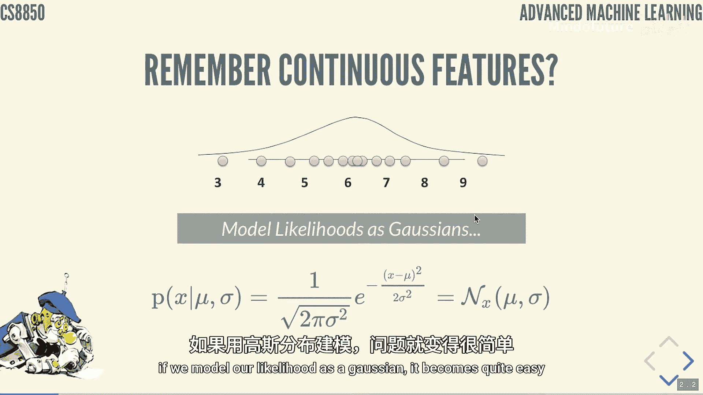
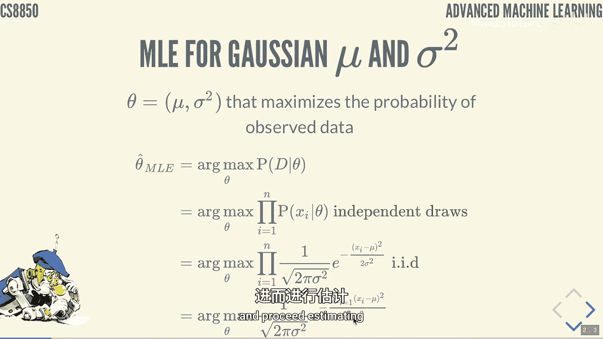
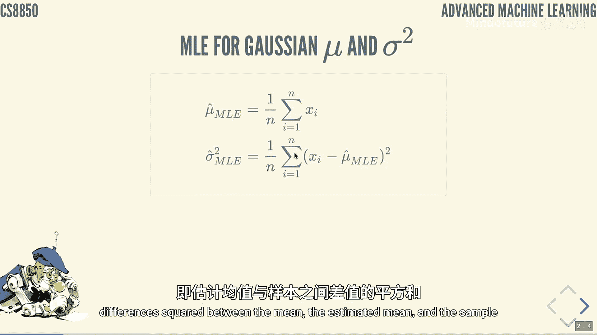
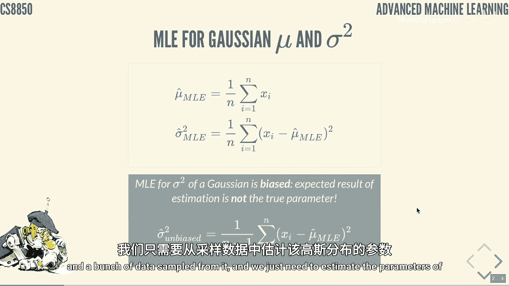
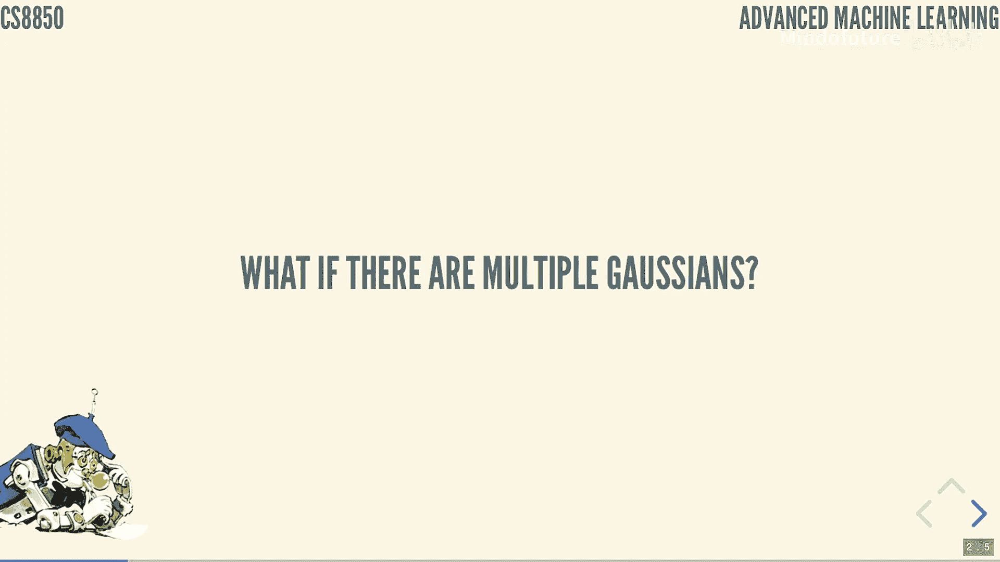

# 高级机器学习主题-CS8850-｜-Advanced-Machine-Learning-p40-P40_MLE回顾--BV1sapPz4Ewx_p40-

Hi， everyone。 This is our 16th lecture。As far is very cold。And we mainly talk today about gay means。

 but in fact， we we'll talk about it。A lot of other things surrounding it。Specifically。

We recall maximum likelihood estimation of thousandsus， which we already covered。

And I will consider gaussian mixture model。That。Comes out of Emily4 Gaus and basically follows from it。

Then we'll talk about clustering a little bit in general what it is and why it's interesting。

And then we'll consider one specific clustering algorithm。't know heart can means。

You'll understand what it means when we go through this。And another version of it。

 which is called soft gaminging。Okay， that's cool。Hemily forgotgas。

Remember the continuous features when we have our continuous features。

In our maximum likelihood estimation lecture number 9。 And we did't want。

Or didn't know how to deal with them。At first， but then it was easy， right。

 Let's formulate our likelihood。 and then let's maximize the likelihood。

 If we model our likelihood as a Gaussian it becomes quite easy。

We will。As in any microfil like liquid。诶。Problem， well need to find parameters that maximize the probability of observed data。

 And we do that through maximizing。We'll find those parameterss through maximizing the likelihood。

 which is easy to do， assuming independent draws then our likelihood factors into the product of individual likelihoods likelihood of each sample independently。

 and then we know what it is because we said that's a Gaussian。

And the Gaussian has an unknown mean parameter an unknown variance parameter。

 But since the samples are I D。We can just。Conser consume。

This product inside of the exponent and proceed estimating maximum likelihood estimator of the mean of this Gauss。

 which is well known sample mean， just a sum of all of the parameterss divided by N。😔。

And also， maximum likelihood estimator of the variance， which is a square。诶。Some of all of the。

Differences squared between the mean。The estimated mean and the sample well。

Also， I recall that we， we learned。SoThat this maximum， like because teamator。Is biased。 So。

 and it's biased mainly because we are using our maximum likelihood estimator for the mean。

 not that true mean。 if we were using the true mean， we would have been fine。

So to correct the bias in the maximum likelihood estimator， we need to normalize by n -1， not1。 Okay。

 so that was good and。Nice and easy when we have one single Gaussian。

And a bunch of data sampled from it。 And we just need to estimate the parameters of that Gaussian。

 But what happens if there are multiple Gausss。

