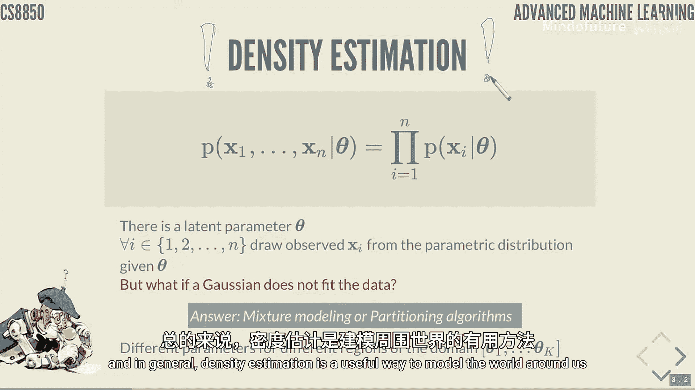
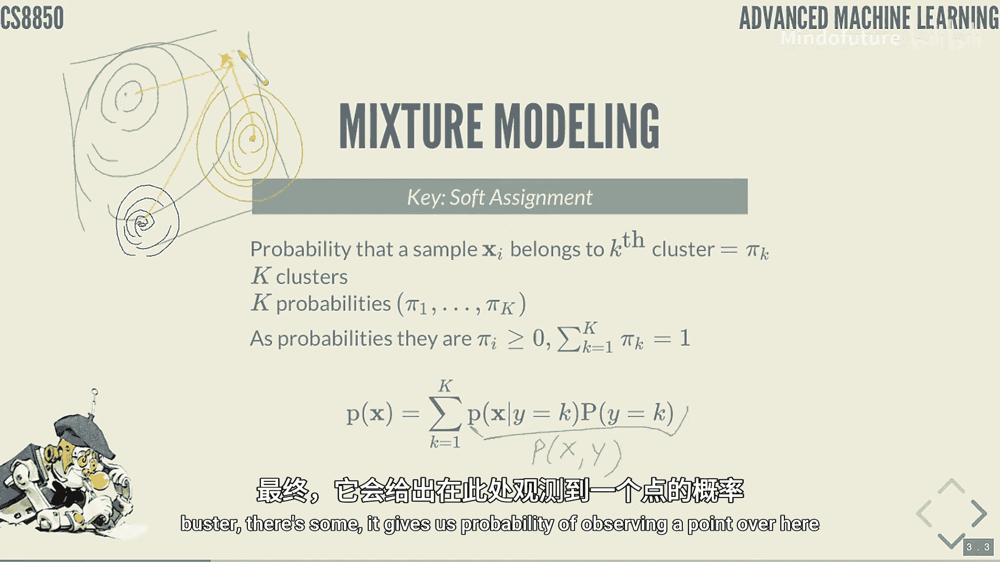
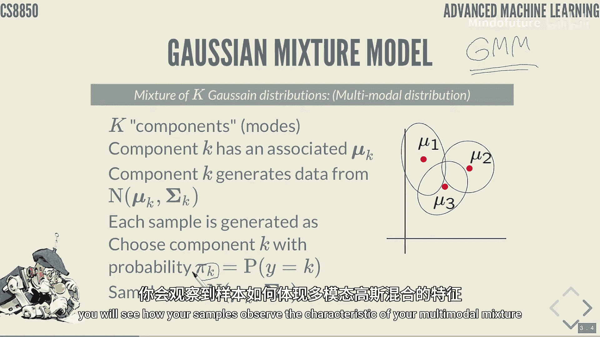
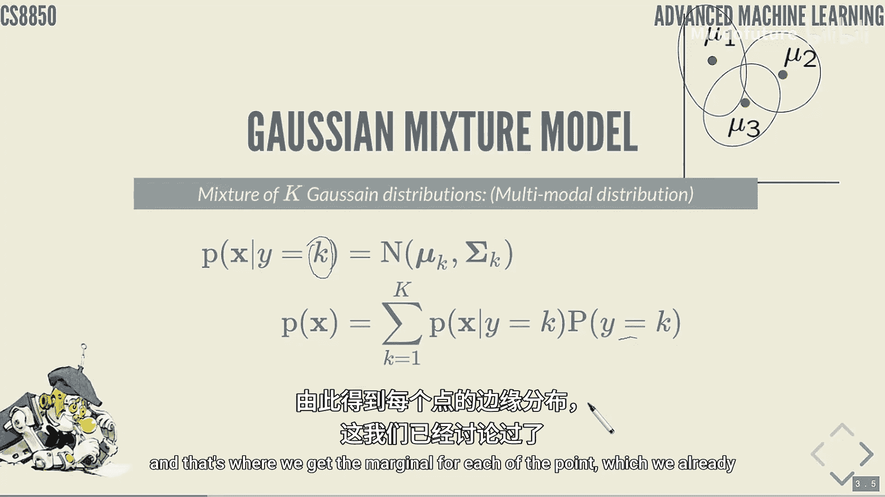
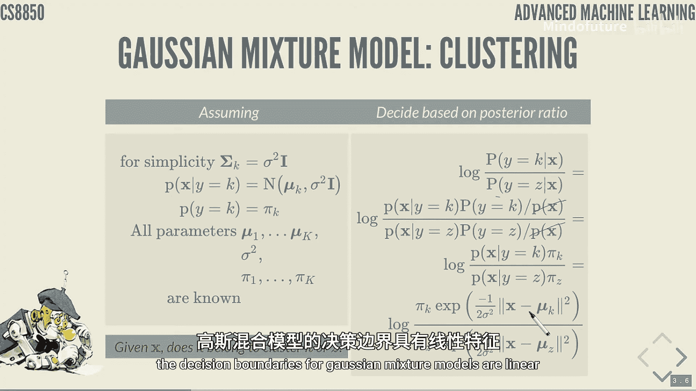
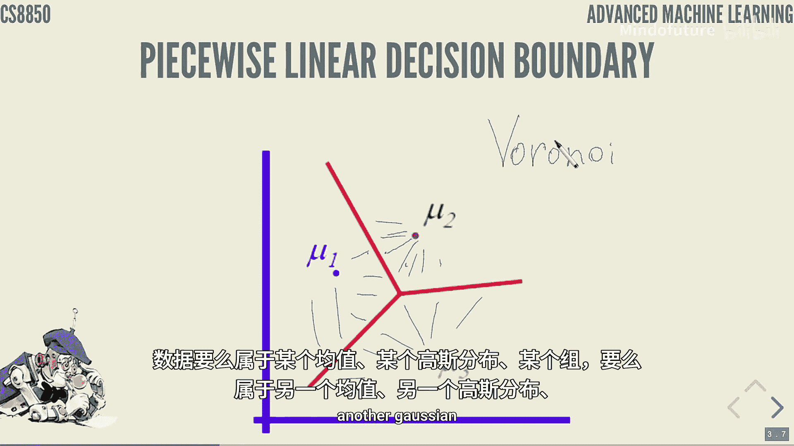

# 高级机器学习主题-CS8850-｜-Advanced-Machine-Learning-p41-P41_高斯混合模型--BV1sapPz4Ewx_p41-

When there are multiple Gaussians。That represent the data。We call this cetation a mixture of Gausss。

Or we call this。Probability， density， a mixture of thousands。 Notice that。

If we have one single Gaussian。All we need to know is the mean and the values。Or covariance matrix。

 Think about。All that I say in general， in any dimensional situationation in any dimensional case。

 But if we have two gas and distributions。Then， in order for their sum。Some of those sense。

Is there respective mean。And that。We have k of them or two of them。What we're actually doing。

 this will not be a probability distribution yet。But if we pre multiply。系。A weight。

 such that does weight。Some to one。Or。The spies could be the priors。 We could call them the ps。

 We can call them。Convetx weights， basically a convex combination of thousandsuss for a uniform。哦。

Probability of either left or right will just。Scale them down by half。

 multiply by by half each of them。 and then some。 and we'll get a new distribution。

 This distribution is called calciumusian mixture model。What is its density how does it。

Then still look。 And how can we estimate it。So we have our data set and our parameter set。😔。

The likelihood of individual samples and the overall likelihood。

 because of the idea assumptions of our data set。It's just a product of individual likelihoods for each of the points。

And so now we have an unobserved or latent parameter theta。And for all。

Indice is for all of the samples and the data set， we draw observation from the parameter distribution given theta。

So。아 에스 파라드。Yeah， but if a single Gaussian doesn't feed the data。We use， as I said。

 mixture of gaussian。Or modeling or mixture modeling or partitioning algorithms。Basically。

 we have a data set。And we have a mixture of different models。 and we partition our data set。

Into a subset that belong to one model or another are generated either 10us00 or another one or the third one。

And so on。It doesn't in general， mixture modeling or partitioning。

 algorithms don't have to be Gaussians， but Gausss are。

Veryty convenient to talk about and easier to deal with。 So let's stick with Gauss for now。

And that allows us in general， again。To if we want to estimate density， this is important。

 This is about density estimation， still density estimation。

It call was very important for us by itself to figure out the probabilities of surrounding world。

 but then density estimation helped us to build a better classifier。

Like in the naive base and in general， density estimation。

Is a useful way to model the world around us。

So。Enough of that， let's go a little deeper into mixture modeling。So。Instead of。

Assigning everything to one class or one probability just one Gaussian。

 let's consider this notion of soft assignment。 So probability that sample X I belongs to the case cluster or to the case Gaussian。

So we have to go sense。We have a sample here。 Well， I should。Trrow this color。

So there is certain probability of all of the three sample。To belong to each of the Gaussians， right？

Or clusters， right， it could this sample has some probability of belonging to this group。

And has some probability of belonging to that group。And that probability is this weight factor by k。

A class thirs。Okay， provals。As probabilities， they are positive and sum to one that is the convex combination that I mentioned before。

And then probability of observing certain point。Is just the sum of our。P state probabilities。

 That's probability。Or actually， the joint in this case， probability of observing。

X of a particular class。As you see， what ears is。Proability of observing。So in a particular class。

 integrated。Over or marginalized over all of the classes。 This is probability observing。

An X at some point。 And again， classes is just the Gaussians。 So if you have。

If your density is your guian。Distributions， mixture ofs。Yess。And。Probability of observing a point。

Here， at this locationation。Is an integralt of what's the probability of this point。

 According to orange cluster。 What's the probability of this point according， according to。嗯。

What is it maganta， plaster and or purple。And according to the green plus their sum gives us probability of observing a point over here。

 that's what we have。

So。And go in mixture model， this is an example of the classes。Mixture of koffs and distributions。

Distions the distribution will have multiple modes， K modes。嘅。呃。

Heals protruding that word so a components。And each component or the mode has an associated mean。

And component K generates data from a Gaussian with。Respective mean and respective covalance。

 mean is a vector and covariance is a matrix。 So we kind of being general here for any distribution。

Any dimension where our data leaves。And then each sample is generated as follows。

Choose the component K with probability pi of K。So， first， we sample。Which。

Component or which coosian we will be sampling from。According to the probabilities。fi。And。

Once we generated the sample， we generated the K， we know from which probability density。

 gausian probability density we will be samplingmbling from。 And so we do。One node。

 one thing to note is that gaus mixture model is a generative model。

 generative model is a class of models。Of generative models。

Is a class of models that don't only describe the data or don't only solve a problem of classificationification。

 say， but they can also generate the data that they were trained on。

 not just the data that they were trained on is the training data。

 but in general the data that adhere to the distribution of the data that they were trained on。

 So for example， your kernel density est estimators with pars and Windows。And。

Radio radioio basis kernels。You can sample or generate new samples from those。Etimators。

 once the estimation is done。 and the same here in the gaussian mixture models。For short。

 they are called GMMs。嗯我 there。More readily recognized and known by this same Jms。

Jamans are generative model， and here I'm describing a process of generating a sample from this model first。

我也是。The prior probability to a sample。Which Gaussian you will be sampling from and then sample generate a sample from that Gaussian according to that Gaussian。

 then to next， the same， choose probability distribution and sample and continuing the process。

 you will see how your samples。Observe the characteristic of your multimodal mixture of gas。

So mixture of k Gauss and distributions， our likelihood is now for a likelihood for the case gausian。

Is。Ngoian。Itself， and。Then we have a prior。That's what you get the marginal for each of the point。

 which we already discussed。

C and mixture model is。Can be thought of as clustering。So let's make some assumption。

 So if we assume for simplicity that our gauss。All have the same。Cavariance。

 there is no difference in cavariance。 It's all the same for them。

 And also this what's written here is。The same variance for。Well I think see matrix。

 that means all of those covariances arepherical It's just around。嗯。It equiistant probabilities。

 equi in。any direction。The only difference of those Gaussians is they have different means。

The priors are the respective probabilities of sampling that covariance。

 multinoial distribution and all of our parameters are known。

 The important is all of the means for each of the kgaussians， the sigma。

 the sigma squared variances and the。诶。Mixer probabilities or prior probabilities are also known。

 Then given X， we need to decide， does it belong to cluster K or cluster Z。

Which cluster basically it belongs to。So， and we can do so， as you know。

 based on the posterior ratio。And cluster K over cluster Z log。If we go and。Those are the bests。

 there's the the Bayesian。Probability inver formulas。 Now， the evidence cancels out。

We know what we have here， pie pies are。Mix your component。Proportion of this particular cause and。

 in the。Overall， some。And then。The normalizing constant cancel out and what we get。

 we get a question in your exam。When you derive the。The even boundary， you will see that it's linear。

The decision bone there is。For gaussian mixture models are linear。

 and especially in this physical case， those linear models are also pretty close or actually the same to the vonoid deesslation of the space。

Every。Point on this side of the decision boundary is closer。Did this mean。

And every point on this side of those decision boundaries。What what do this mean so。They。Basically诶。

Delinete the distance， distance cells or regions of the space。Or verony cells， so called。This is。哦。

Okay。ACusian mixture modeling。We have not talked about estimation。That's the topic of next lecture。

 not even this lecture。 It's very involved and interesting process， but。As you may see already。

 just by this in the forward mode in the generative mode calcium and mixture model。It resembles。

grouping the data around those respective means， it either belong。

 the data either belongs to one mean， one Gaus in one group or another mean。

 another Gaus in another group。

