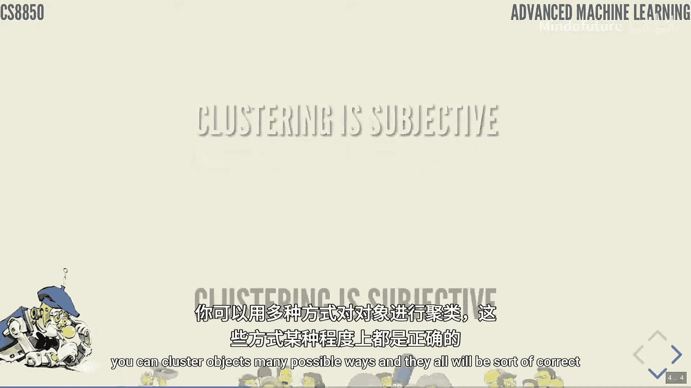
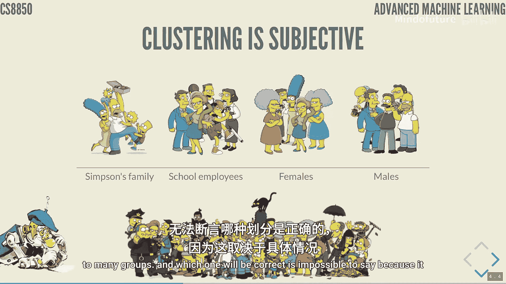
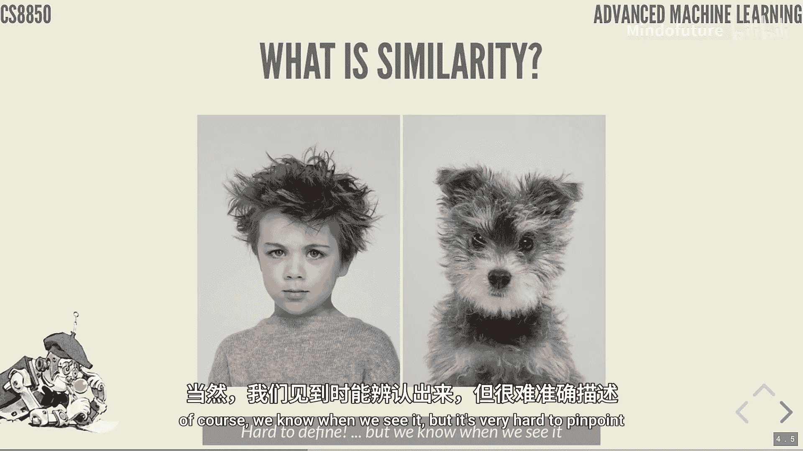

# 高级机器学习主题-CS8850-｜-Advanced-Machine-Learning-p42-P42_聚类--BV1sapPz4Ewx_p42-

So what is clustering？Clustering。Is a way， is a way to split the data。In the groups， right？

 So there's this slump of a。Of objects， of anything like we all do clustering all the time， right。

 because when we even name objects， those objects are not the same。 like when we say a tree。嗯。

Kind of identify a cluster with a name。 But what does that。Name mean。

 does it mean everything in this cluster is the same。 And yes， and no， sort of some， some。

Trees are more similar than others， but there is definitely a huge。

Diversity among what we call a tree clustering is also a compression mechanism。

 If we have identified and agreed on clustering in the data， then all we need to say is a tree。

 and it's already clear what we mean。 We don't need to discuss the all diversity and details in in the scenery when giving instructions or communicating。

 So clustering is a way to discover regularities and data。我俾。

You can think of it as a first sort of step to。Clasification， because classification， in a way。

 is assigning observations to clusters。 So the only。Definitive difference。

 definitive differences that clustering is unsupervised what we' going to see in this lecture or what you may have already seen with mixture modeling that。

Flustering， actually， is a way of mixture modeling。 And let's see。

How we usually define the clustering。So what is it sort of formally。

So it's very similar to mixture models， which component does x belong to， which cluster。

The process of grooming objects into the clusters by similarity， we put。

Similar objects into the same clusters。We want have similarity within the clusters to be very high。

 we want a subject inside of the cluster subjects objects。

 I mean inside of the clusters to be very similar or highly similar and we want objects across the clusters or samples across the clusters to be dissimilar。

 so clustering is the most common form of unsupervised learning as they say， but although。

Just I have to make this note we've talked about PCA， ICA， NMF kernel density estimation and so on。

 those are also unsupervised methods and they're much， much more like very commonly used。

Even in a in。Wasing as an unsupervised technique and within the supervised world as well， but still。

 when you say machine learning can be split to supervised and unsupervised。Wch already。

Not fully correct picture but。We often do say this。Roughly split into the components。

 although there are other components just so you know。Other components to mention3。

 but when we say unsupervised。Usually it's like what istsupervised， if supervised is classification。

 then unsupervised must be clustering。SoBut the problem is that clustering。Is subjective。

You can cluster objects many possible ways， and they all will be sort of correct。🤢。

For example， let's look at the Simpsons family and the friends。Like we can。

Extract multiple groupings。We can extract the grouping of Simpson's family or school employees or females or males。

 and as you see in the group of females and school employees same people can make it into both groups and into many groups。

So it's kind of subjective of how you define those groups or how you。呃。

I can choose which groups to split the objects into， because。嗯。Some of them。wrong。

Gassesses or like group。Sets。They， could could admit sort of conflicting assignment。

Or you could equally well put the same。Person from the character， from the Simpsons。To many groups。

 and。Which one will be correct is impossible to say because well， depends。

Another one is， what is similarity， right， we want。Highly similar object within the same cluster。

 And we want this similar object with different in different clusters。

 But similarity is hard to define。 Of course， we know when we see it， but。It's very hard to pinpoint。

