# 高级机器学习主题-CS8850-｜-Advanced-Machine-Learning-p43-P43_硬k均值--BV1sapPz4Ewx_p43-

Talk about a specific clustering algorithm called hard。Gam means。First， let's define the problem。

Given a set of observations。X1 through X n， where X I is D dimensional real vector。

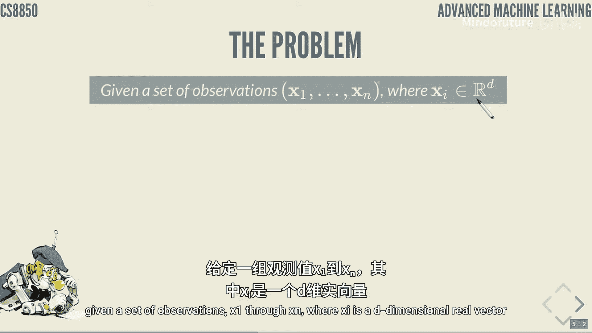

So we're in Euclidean space。if you see应该嗯。If you want to think of it。

The problem is we want to partition all of those n observations into K clusters such that K is less than or equal to n。

So。There is enough samples to be put into clusters。And。嗯。

Those are the subset partitions such that the set or the sets minimize the within cluster equilibrium gradient square distance。

So we want the average。Euclidean， within cluster Euclidean distance。To be minimal。

So take the mean or centroid point， the mean point in Kamin's algorithm in the class thing usually called centroid。

And take all of the。Poins assigned to this cluster。

Compute within cluster distances and the average or the total sum of those distances across the classes should be minimal。

Cs easy， but in general。

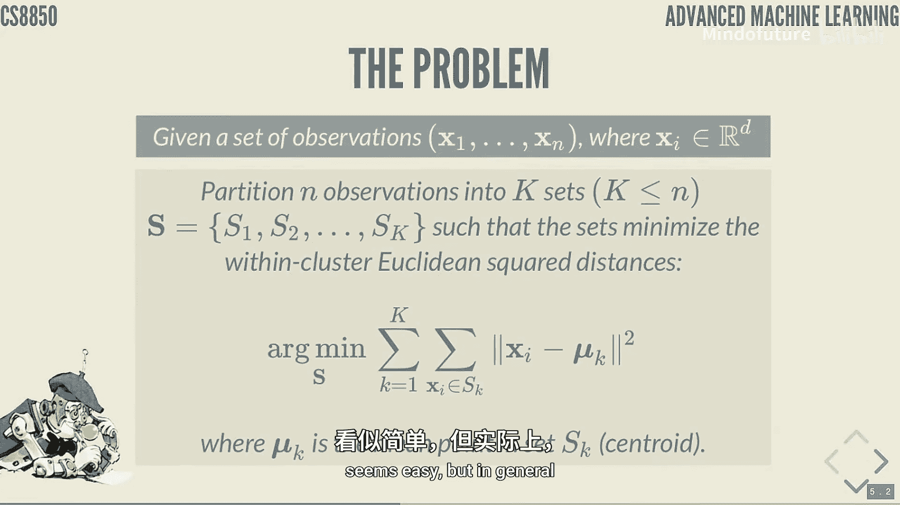

This is an empty hard problem。It's a combinatorial problem， because you can have。Multiple。

 multiple assignments。嗯。Like multiple subsets and the discrete combinatorial problem。

 Hard assignment and what do you assign to one cluster。 What do you assign to another。

 And we don't want to。Or or deal is that。呃。Comppitorial problems， usually and be hard problems。

 especially。 So usually we resort or fall back to heuristic solutions and two heuristic solutions that we will be considering in this class。

 today's lecture and next lecture is came in algorithm。 And gas and mixture models。

 We already discussed and considered gas and mixture models。As a generative forward problem。

 But we will talk about how to actually estimate the Gaussian mixture model in the next lecture in this lecture。

 let's。Figure out how to tackle this N hard problem。By another approach。 So let's try to。

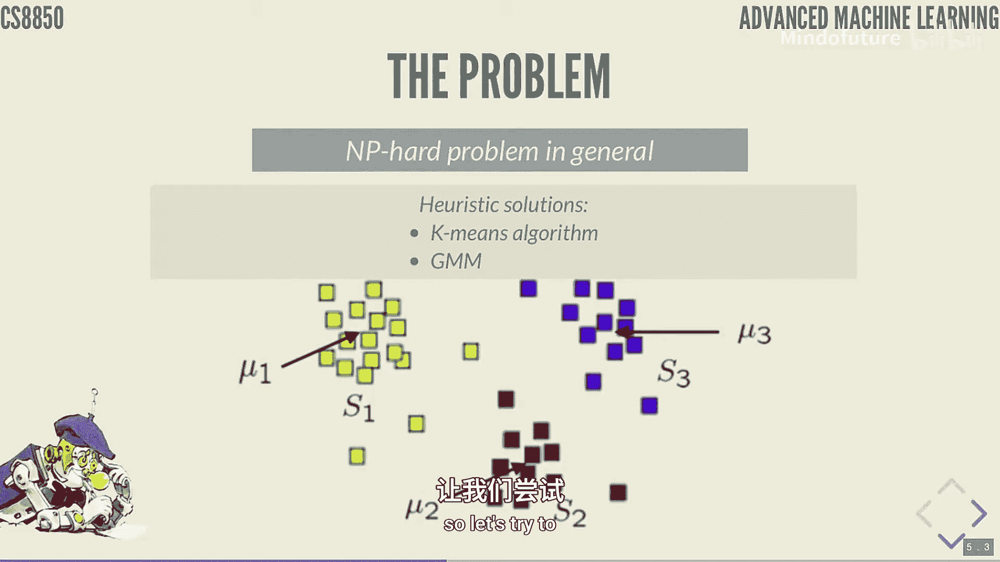

Mannually simulate K means how it will work。 So K means algorithm works in the following way。

 Given the data， these blue points。The diamond shape。Guess random means for each of the clusters。

 say we already set a hyperparameter that there will be three clusters。

 We guess that they will be in those random locations。

Then we assigned points to the nearest cluster center。 So we assume that our cases。

Are the means of the new clusters or cents， and we assigned whatever is closest to K1。

Where signs stood。Cluster 1， whatever is closest to K2， among all of the three。

 we assign to cluster 2， and we did the same for K3。That's。Step 2。Then in the third step。

We two our assigned points and recomputd， updated the mean。 That was our first original guess。

 But now we recomputd the mean。 What is the mean of the new。Assignment and。We。

Updated our scent cluster centroid。 That's a step in。The gling one。S point of it iterative process。

 So we estimated the mean using assignments from the last the means using assignments from the last step。

 Now， let's reassign our points again， based on the same。嗯。The rule。

 whatever is closest to the new means。Or mean estimates get assigned to that particular cluster like as you see。

 our previous assignment was green for K1， but now once the mean shifted。

 the veronoid bound or the veranoid cells have also been updated and then this green point moved into cluster2。

 this red point and the screen point moved into clusters 3。WellBut now after we've done that。

 we are ready。To update the means again with this new cluster assignments。

 we will reestimate cluster means using assignment of the last step。

 and we will continue this process。And T convergence， when we cannot make any more reassignments。

And un sequentialequly， when that happens， we cannot。Of the means either。

 because they're already at average locations。So just to drive the point back home。

 let's look yet at another example due to David McKay， this is our theta that we're working with。

 So we start with random。

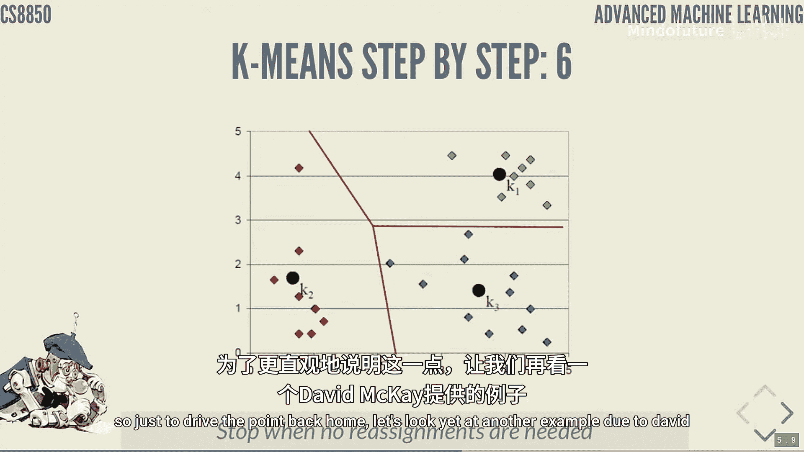

Location of the means。 and as you see。We've done this assignment。 Well。

 I'm sure there is a line here。 The border， The better noise cells must be linear。

 So everything here closest to this mean was assigned to one cluster to the diamond cluster。

 and everything closer to that mean was assigned to the plus cluster。Then we took all the process。

 compute the average and moved。2。Original estimate of the mean to the average。

 we' have done the same with the diamonds。嗯。The assignmentsment and continued until convergence。

 assignment， update， assignment， update， assignment， update sequence。Converges。 and in fact。

 it proably converges。 It doesn't converge to a local optimum， but in fact that it is convergent。

 you can observe by the process that we're following here our objective are our。

Potential function here is。I remember that that。Inter class。Distances。Average。

 and every time those distances。嗯诶诶。Minimized。So every time this functional is decreased because when every time we do theassignments。

 we assign closer and closer points to the means or we we shift the means so that。呃。

The points become closer。 So this functional is always reduced， and。

That is sort of clo proof that this is a dynamical map。If we can find this。

Physical notion potential function。We believe。Well， for the system， then。What is it， Well。

 it's like an energy function， if we imagine that。Those distances are springs where the stiffnesses。

 And by Ho law， this describes as。嗯。The tension， the the the tension in the。Springs。

And every time we reassigned， we。ALn the tension， minimize the tension， so。

Eventually will converge because this energy function is called called basically Le of function。

 And the dynamical system。 if that function exists， that means。That dynamical map andverges。

That's an in of how the proof might have gone， but。

I I just ask you to trust that the process always emergeent， but。

We'll see how it can emerges incorrectly sometimes。

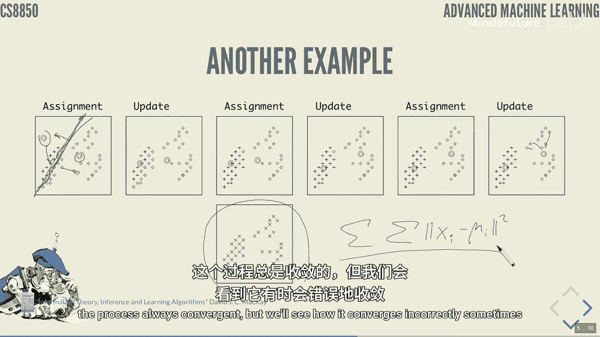

Or about。So once again， reiterate the complete algorithm。

 all we need as an input is data plus desired number of clusters and plus distance metric。

 distance metric will define the space error。Data leaves in the distance metric defined here on the screen theres just practically Euclidean distance。

Now， some of the squared of of the differences， so it means squared error。But， you can use。

Any other metric， if you want to， K means will work， you can use even。I don't know。

 or smoother distance。Or any other。more or less interesting metric fu correlation as a similarity can be made into a metric and you can use it to L1 distance would be fine as well。

 so then initialization is the only step。诶。There is randomly big centers of the K clusters。

Then iteration proceeds as follows。 First， decide the class membership of N object by assigning them to the nearest cluster center。

Secondly， estimate K cluster centers， centroids or means by assuming the membership found above。

That's correct。And when do we terminate， we will terminate if none of an objects change membership in the last generation。

If something changed， we keep repeating those iterations。

 Let's look closer at each of the important parts of our assignment update cycle of the internal in the iterations。

 So assignment happens in the following way。 We decide the class membership of an objects by assigning them to the nearest cluster center basically。

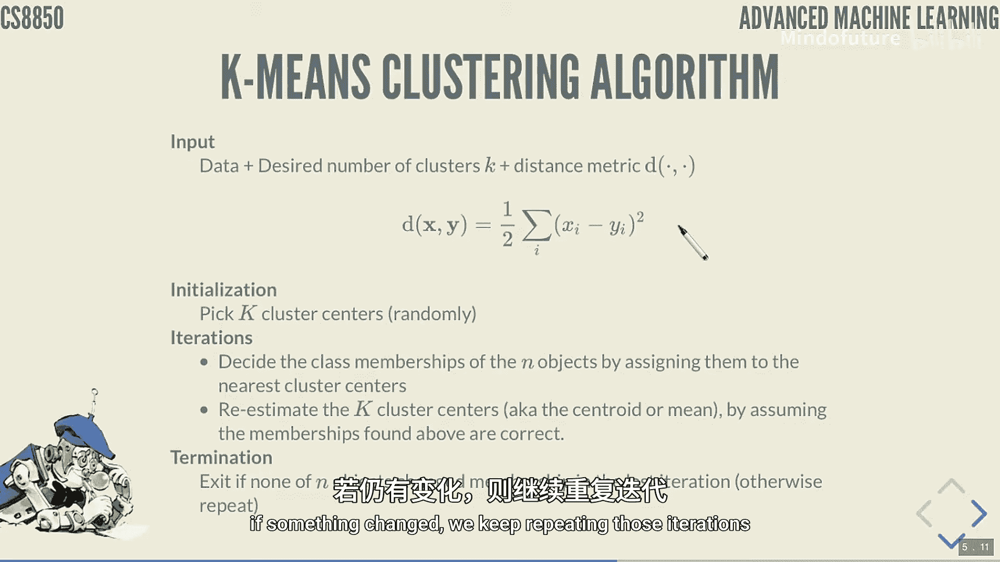

For in sample。The class membership is Ar of the distance to the already estimated mean from that sample。

For for convenience， although it may look complicated right now， but it will help us to deal with。

Even more complicated problems。 And to general generalize the algorithm。

 let's define responsibilities。 So if we have four clusters。

 a responsibility vector is a binary vector of four elements。 and such that。All elements are zero。

 but that element， that single element in this vector for which our point assignment is defined that our point at in question x sub n。

 if it is assigned。Or belongs to cluster。Okay， then it's non zero。 So responsibilities of clusters。

The number goes a mixture model。Responsibility for generating that point。

 and this in came meanss and hard came meanss， those responsibilities are binary and they hard。

Only one of the clusters is responsible for this point or equivalently only the point is assigned to a single cluster at a time。

 but。We can see now that if we take all of our points。The first one the last one。And put。

And by K matrix， it's a binary matrix。And。Each column will only have。

One single non zero element because each sample can only belong to one class。And then。Next。

 next slide。Will become。Clear if you keep in my in mind。This rectangular matrix。

What if there is a tie that at the point is right on the decision boundary？Where do we assign it。

 Well in a continuous space， this is very rare， but if that happens。

 just assign the point to the smallest matching key。

Basically pick some random or arbitrary rule to great ties。So another sub step。Yeah。

Substep of our iteration is update。Now， we have all of our assignments， responsibilities。

 What do we do with them。 So now we reest the the key cluster centers。 We move our means or centroid。

 Look what happens with some。All of our elements， with corresponding weights。嗯。So。What that means。

As index is K， we are computing。 The mean K。 What happens here is that we multiply by an indicator by a responsibility。

 which is either0 or1。 So if this sample was not assigned to cluster K or to the mean K to Android K。

 then this responsibility is 0。 So think about our。K by and。Matrix。

So each sample is either assigned or not assigned。The when。We are talking about this case。

Cluster Kaith mean， we're talking about summing along this dimension。

This R K is exactly the count of numbers of elements that were assigned to this class。

 As you can see， we are summing along this row。Inward， computing capital R sub K。But here。

All we are doing we're multiplying each of those elements as weights。

Times to the corresponding x sub K S sub n vectors。This is a matrix of responsibilities。

 R x sub n matrix。Is。Somewhere else separately。 So， for example， if our。X。Ens。

Can be organized into D by N matrix。Where each column here is our sample x。Or。Each individual sample。

 and。Then we can multiply by the row of this matrix。And we will explain to me。

And what the row of this matrix will do， because the responsibility matrix will do。

 since those are binary， it will only pick those columns。

That correspond to nonzero elements of the responsibilities and sum the map。

Then we'll need to normal X by R still， and we'll get mu up K。 That is the update step。

Just to reiterate what is happening， we're starting with any random choice for mean one。

 mean two and mean three in this three mean example from D andhar。

 the famous pattern classification book。

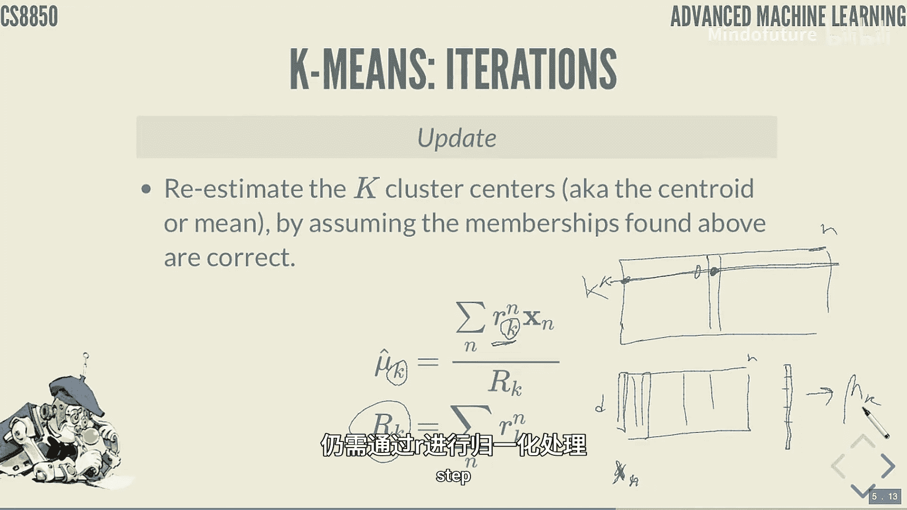

And once we're doing update after update， as you see here with one，2， three。

 the vrenoid esations keep shifting until they shift into the right position and thus we partition the place so the space。

 partitioning the space means。嗯。Separating the space into non overlapping regions。

 such that the union of those regions gives us back the complete space again。

 So gaming means Alating by partition， the partitions， the space continuously as each it progresses。

So。

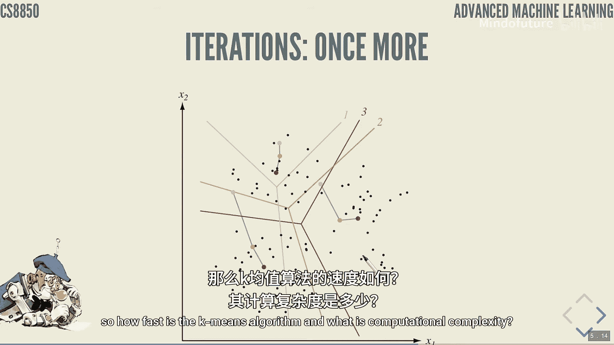

How fast is the K in algorithm and what is computational complexity Well computing distance between each of n objects and K clusters is of order k timess and linear。

 you have to look at each point and the distance to the mean。

Sounds fantastic Line is not exponential， but when you're dealing with internet scale data。

 even linear is a problem， so people have invented a lot of newest neighbor。

Searchches and data structures such that so that you can。Solve this problem easier。 but in general。

 it's。Like every easy problem when。Magnify to scales becomes。Difficult or impossible。

 even depending on the scale。Next step， computing is cluster centralroid。

 So just averaging each object， you know each object belongs to at least some cluster。

 So it gets added once。 That's why the or the big F N。The complexity is of order n of the separation。

 and then for L iterations， the total complexity since our distance complexity is larger is L times k times n。

So is it guaranteed to terminate？Yes， it's guaranteed determinator as I explained already。

 Let's see an example of dependence on the starting position。

 Imagine we don't know anything about our data。 We don't want to make any recommendations about starting positions。

 Were just allowing algorithm to blindly start and do something。

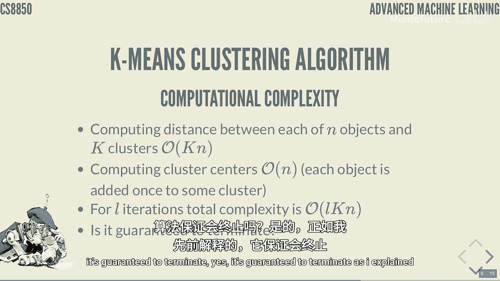

Throw three points。 We know there are three clusters。 We don't know where they are。

 Thr three points as initial starting position to agree1 red。 And then when it converges。

 look what happens， this is a perfect came in result it converged in its。From the point of view。

 if Ga means is correct， Everything that is closer to the green is at the green。

test line will be somewhere just in between those two and just in between those two。

 since we are only considering the shortest distance。😔，Not bad。 at least。 Well， at least。

Remember remember， clustering is subjective， and this is what Kmins will give you。

 But if we ask a random person。From the street， they will probably say， oh， no。

 Those should be the clusters。 Why is that？ We don't know what。

What's going on on the head of those random people in the street。

 But I guess they have a way or a reason to think this particular image clusters the way。

The can color delineates it here。 K means thingss otherwise。

 So what else can K means do to us if we give it three different random seeds。

 This is our previous example data set or the same as before。

 and we're initializing four means and running to convergence and look what it convers to this is one cluster。

 this is another， this is another。 So maybe visually we would think that there are three clusters there。

 but K means based on just the foreignoid desation。

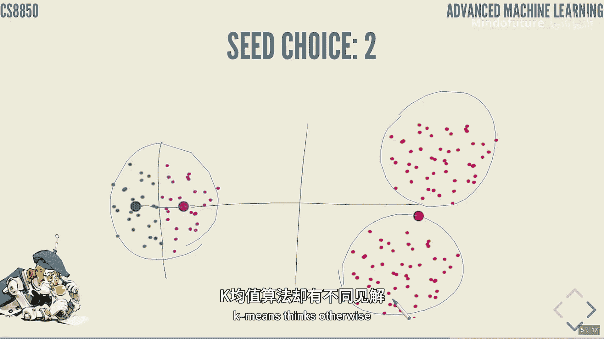

Does not necessarily optimize our visual or intuitive notion of clustering。 right。

 It only is based on the distance。 Second run， gives us quite another clustering where most of the data belong to。

The largest cluster， and the others are sharing a smaller subcl。So。

That's an example of what do we optimize when we iterate and solve。Came in Sal。 Well。

 we spoke about it before。 This is the objective， the intercster。

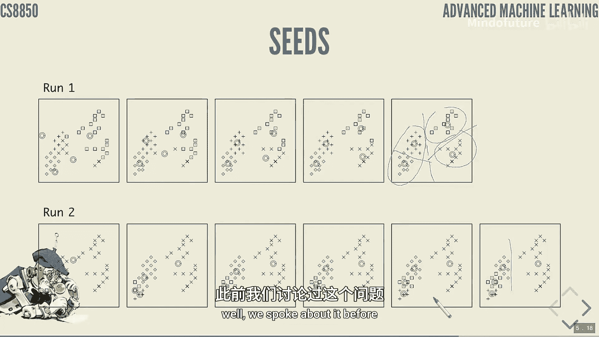

Actually will minimize intracster T distance or average intracluster so within the cluster we want our points to be as close to the centralroid as possible among all of the possible configurations and of course it's very hard the problem is going hard to guarantee that we will arrive to the optimal solution but we are trying and arriving to a solution in the worst case came in on modern data sets is so fast that we may be able to simply restart whether a few randomly starts and if we have a ways to somehow visualize our data and just make an expert opinion whether it works or not the result that camemins obtained for us。

Then it's ideal。 we can run multiple times and just take a look and decide what to do with it。

 But how to choose the number of clusters for K means。

 can we choose the number of clusters automatically no and again。

 just a little mantra that they keep repeating in。

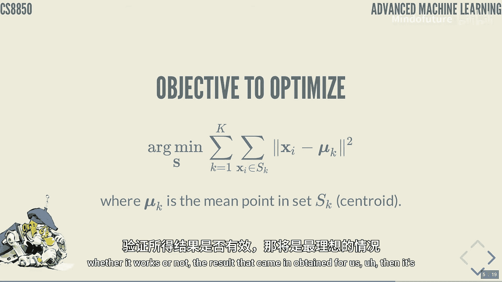

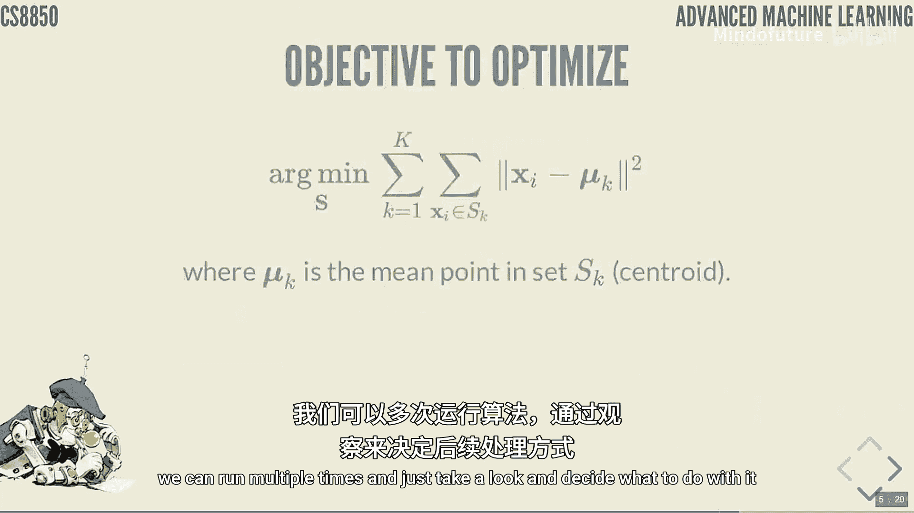

The monres。あThere is no。嗯。H for under free learning。

So there is a fiber parameter that we need to somehow set。 and this is number of clusters。

 So one of the heuristics is called elbow method of came means clustering。

Take our objective function that we minimize intra cluster distance。

 average intra clusterster distance and keep creating the number of clusters and computing this running gaming means and computing this metric。

 That's what we're plotting on the Y axis here。 And this is a decaying of。feet， so。

We are getting better and better， continuously better。 The more clusters we add。

 That's saying general， problem of the likelihood and problem of metrics like that。

 that the more parameter， it's kind of like an overfitting problem， the more parameters you have。

 the better you can feed the data。 So the more you add。

 the better you feed where when to stop for K means the stop。Is recommended to do at the elbow。

If you have this inflection point in your graph， choose your number of clusters right at the inflection point。

 it is a heuristic and we have done that once it works or can work， but imagine difficult situations。

 when it would not work， where is that elbow in this graph when everything is sort of linearly decaying。

 I don't know very hard to choose， so the more smooth this is。😔，The list。We can do。嗯。Read。

 because we cannot find the elbow。 Great。 Let's consider a couple of failure modes of ks。

 So one failure mode of ks is when we have a dense lump of the data。

 like lots and lots and lots of very similar object。 and then we have a large。

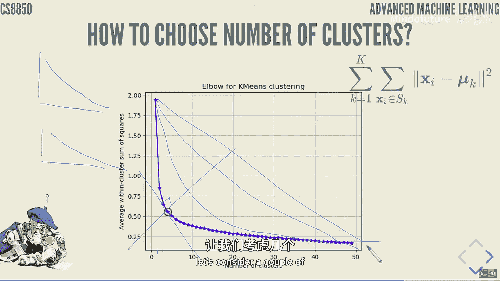

Diverse cluster that is kind of known on the circular。 When this situation arises， we。

 we do like we are able to estimate the smaller cluster。 But because all we care is equidistant。嗯。

Some of unrelated points get assigned to this cluster。

 although if we were plot the distribution based on the density of the samples。

 this samples would be having very low probability of belonging to that class。

 or because of the high variance here。The samples have high chance of being assigned or belong to this through to this cluster。

 That was one failure mode。 Another failure mode is what if our data is not grouping and central centralizing。

 lumping into circular clusters well。

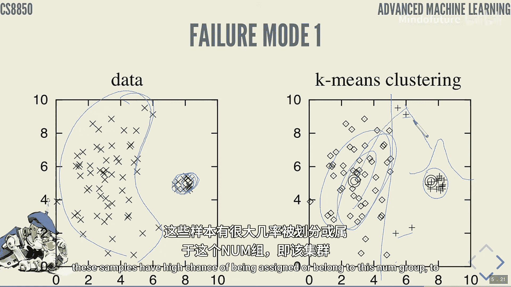

Always。Kay means。Hasnt has a tendency or。What's the word I'm looking for。It has a tendency of。

Splitting horizontally， because that's when the distances are easier， minimized。

 It's very hard to find this solution。It's's unlikely。

 but a solution like that is more likely than solution of this one。Narrow the nearby clusters。

Get separated right through it's。Kme in as blind to the cluster studying in densities。

 So it prefers solutions on the right。

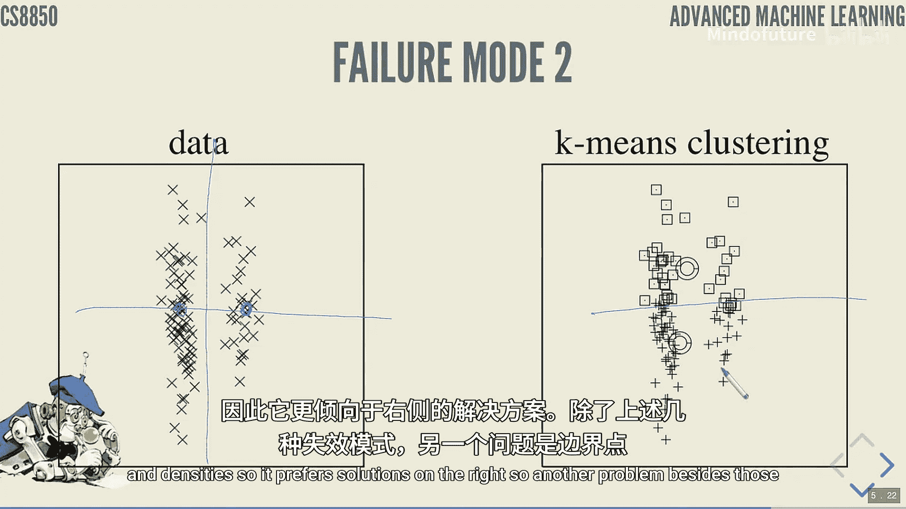

So another problem besides those couple failure modes。 Another problem is borderline points。

 Let's look at。

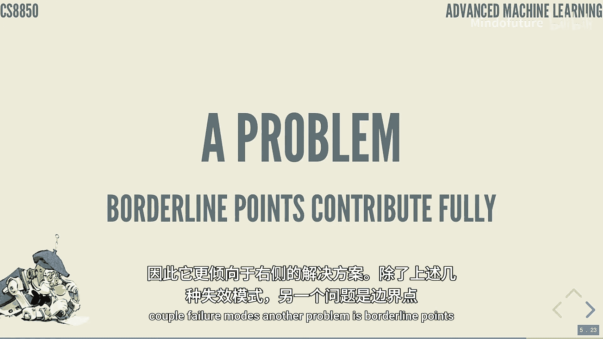

One of the examples， well， but even here， let's look at these examples。

They are assigned to this cluster now， they're so far away from it yet when when we compute the mean。

They are computed with equal contribution as the rest of the points。 And they have the same effect。

 Even though they may be noisy because they're right on the boundary。

 They're near the opposing cluster near the other cluster and still， they counted has。

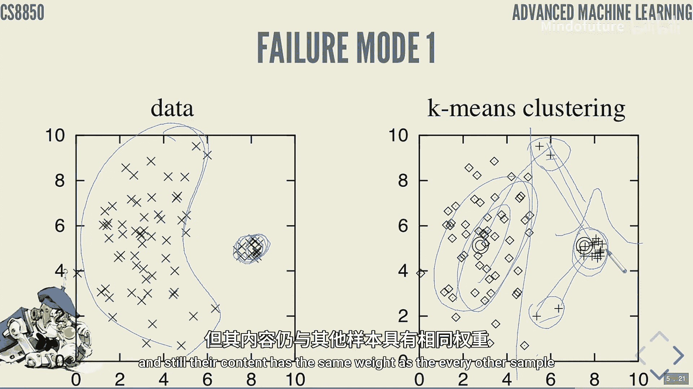

Not the same weight as the every other sample， and this is a problem which we will shortly solve。

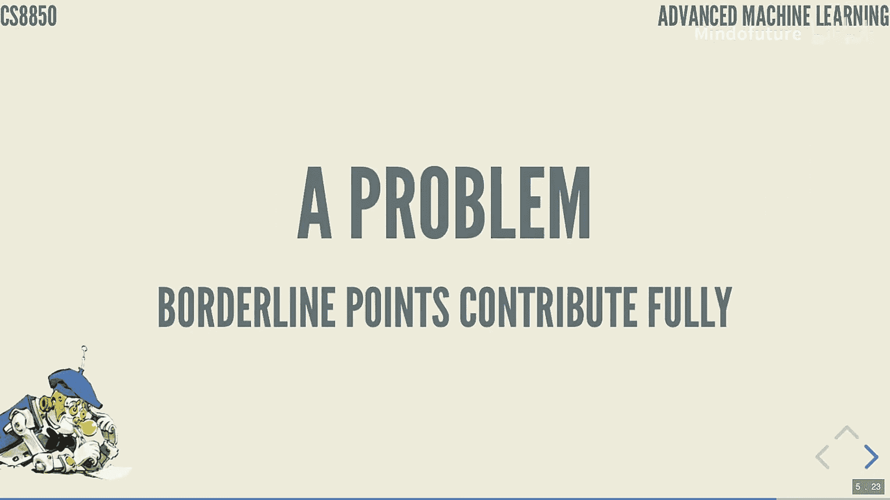