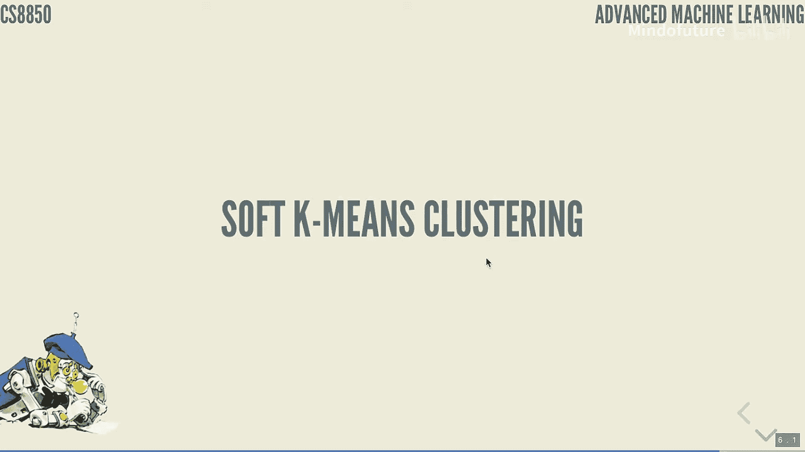
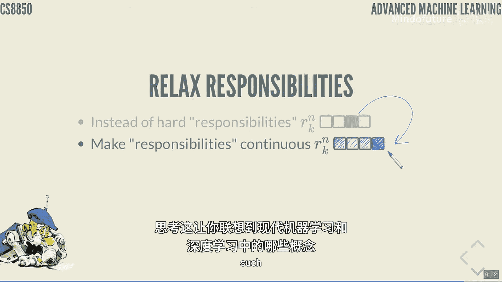
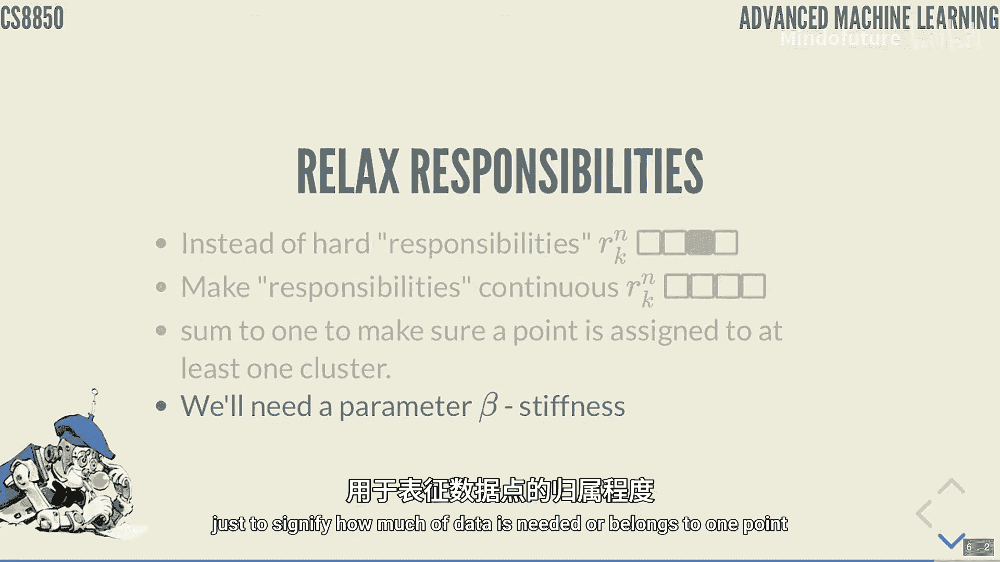
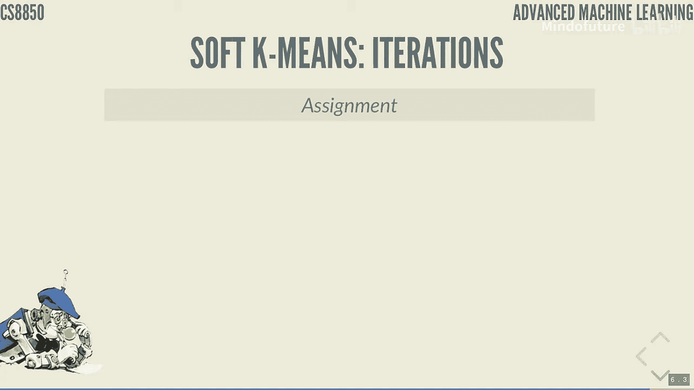
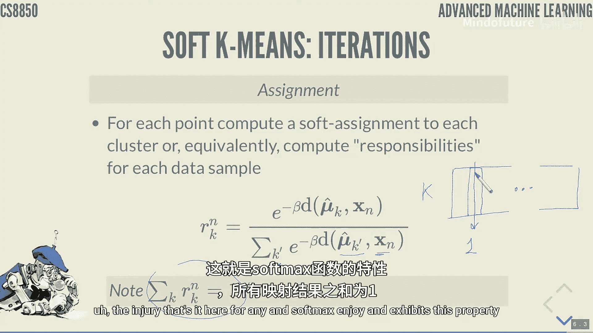
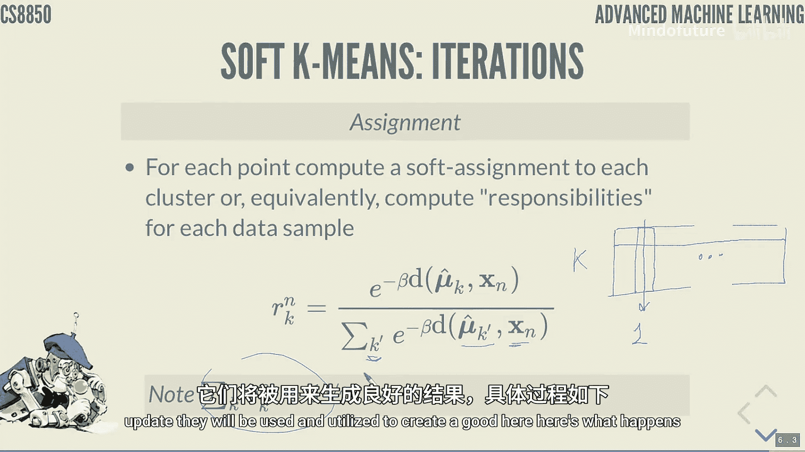
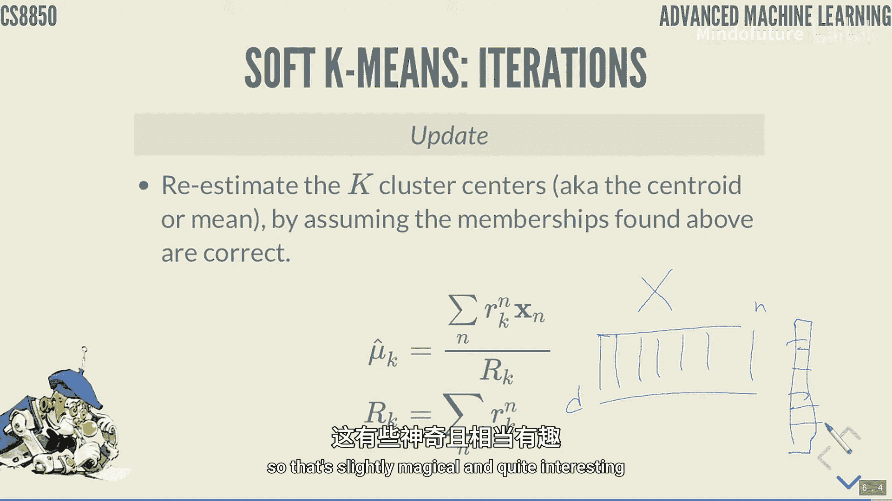
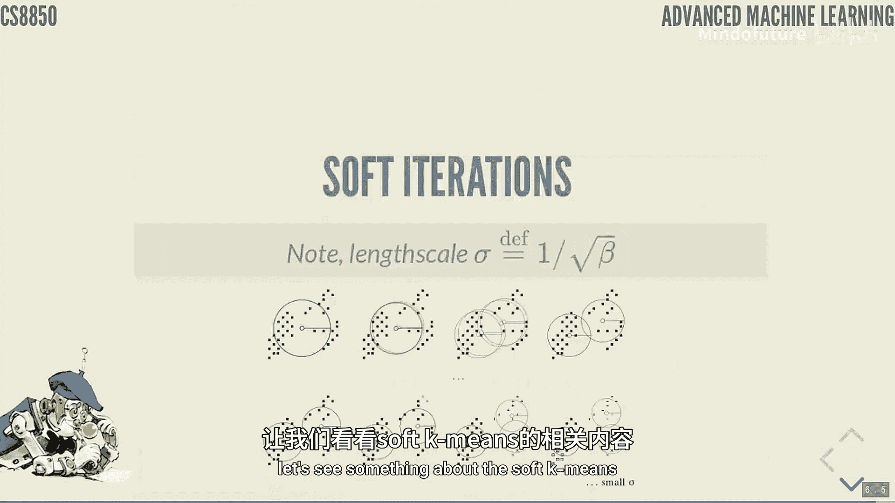
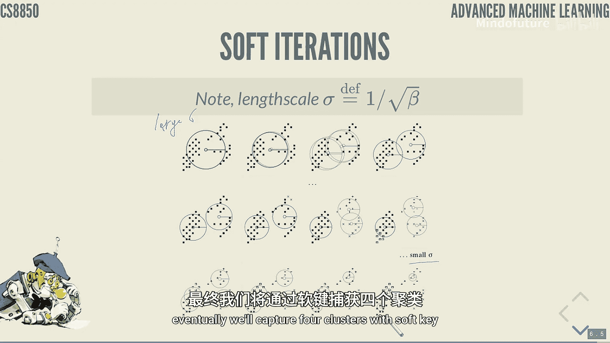
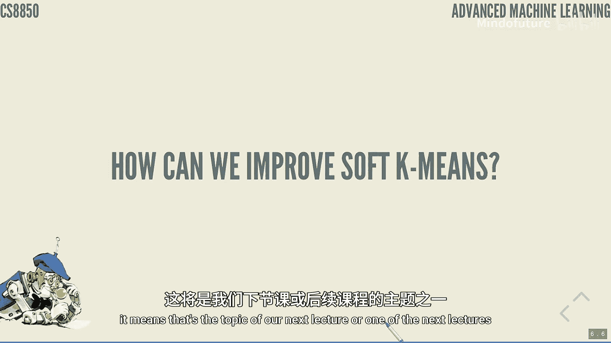

# 高级机器学习主题-CS8850-｜-Advanced-Machine-Learning-p44-P44_软k均值--BV1sapPz4Ewx_p44-

Okay， soft game means it's。Which softer than the heart game ins， of course， oh well。

 because you we find out why。 but as you saw in the previous episode。

There is a problem with K means that the points that closer to the student boundary are accounted for equally with the points that are lumping。

 clustering together right in the heart of the cluster or particular cluster and。The。

 the point is that。This， borderline points are only assigned to one class and assign hard。

 and then they shift them mean the words stem， even though only if there is one or two points。

 but still， I don't find it。Specifically helpful when。Now， this happens。

 And people were thinking about it for quite a while。 So here's what。

Was suggested， derived and works quite well and also has an interesting。

Patas and consequences in the。Density estimation。 So what we need to do is relax responsibilities。

 Let's try instead of hard responsibilities when each point had a binary vector with it。

 of whether this particular point X N belongs to one of the classes。

 Let's make responsibilities continues， so。Let's say it's kind of likely to belong to the first one。

 not so likely to the second。 And then。Maybe you denser to the third。 So soft responsibilities are。

 it's possible to make them learnable。 So it's relaxation。

 We took a binary vector and relaxed it into a continuous vector。What does it think about it。

 think about what it reminds you from the modern machine learning deep learning and such。

 But our goal is sum to one to make sure point is assigned at least one cluster， right。

 Not only we want to have continuous assignment。

Instead of。Hard assignment。 We also want to have。There's assignment to be convex again。

 that the sum of the coefficient is equals to one。Additional thing in soft gamings。

 we will need yet another parameter that is there just to signify how much of data is needed or belongs to one point。

 and we need that stiffness parameter。 So soft gamings， the algorithm stays。

Chris the skeleton stays exactly the same， and there is only one slight change now with the soft assignment。

 because our responsibilities are now continuous here， how we define them each point。

For each point， we can view the soft assignment to each cluster or compute responsibility for each data sample。

 this is our distance function and this is the distance function。For this point。

 to every other mean or every mean， all of the means， all of the centroids。

 This is just the distance to the current centroid of what does it remind you of， Of course， softm。

 So basically， what it says。Blah， blah， blah， is that in every column。All of the evidence。

 sum to one。The injured。 That's it here。For any。And。

Softmax in in and exhibits this property that everything maps to one。

 But because the weights are continuous now。

When。We take this。P in the next step in the。嗯 update。They will be used。And utilize to greater good。

 Here。 Here's what happens。 Oh Nothing happens。 The update step is exactly the same as before only these values here now is that。

Let's denote our X， again。Each column here is our x， and it's de dimensional。

 But if we take this binary vector。Or make it known by in our eyes by multiplying next times step。

Indicator or scaffolding vectors as we're discussing here today。And you get your。Min。So， that's。

It like been magical。

And quite interesting。 Let's see。

Something about the soft gay means。😔，So in soft k， we define a stiffness parameter。

 but our linear scale， a length scale can be defined as defined as one over square root of beta。

 So let's see what happens from the large。😔，Sigma the small sigma。 When the sigma is large。

 all of the means are the same。 So when beta is small， all of the means are the same。

 And they this is the four means example。 And they're sort of a getting stuck at the coral reef。Yep。

So， gradually， we're increasing。啊啊。Or decreasing， actually， we're increasing our stiffness。

And decreasing our length scale。 And the more we decrease our length scale。

From sort of the smaller the tighter the clusters， eventually we capture four clusters。佢 soft机。

How can we improve， So K means that the topic of our next lecture or one of the next lectures。

