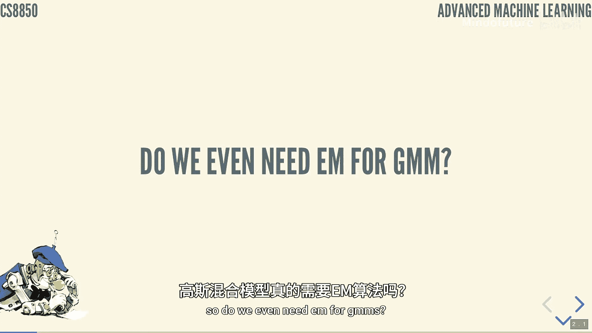
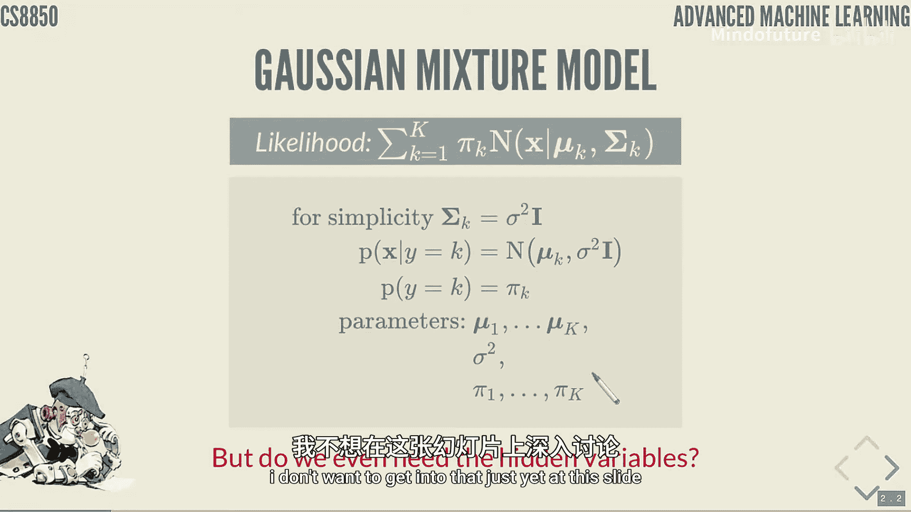
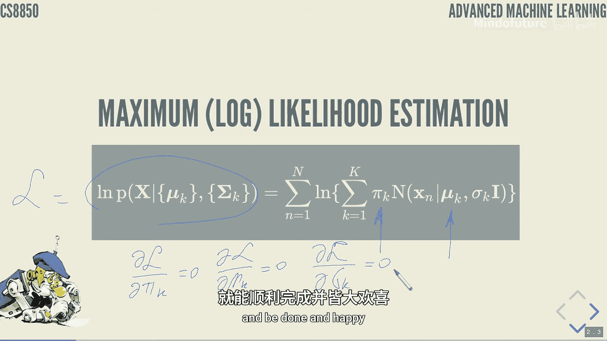
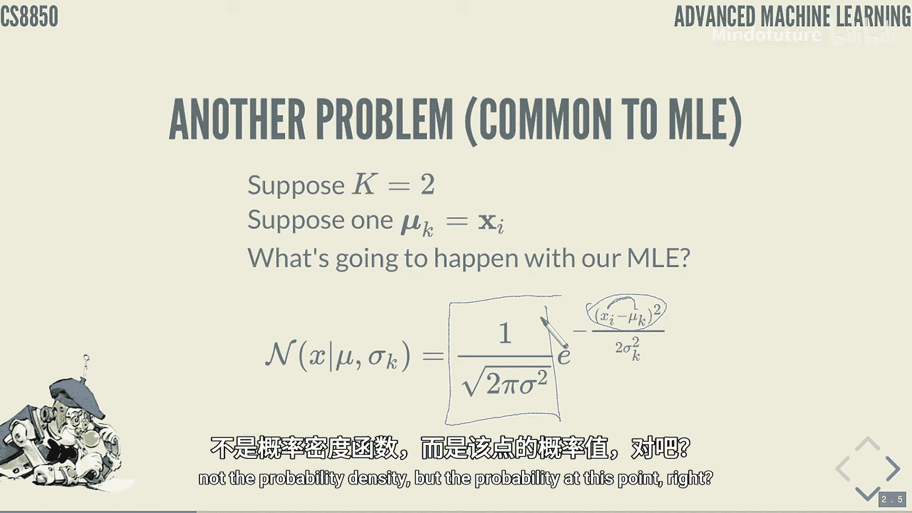
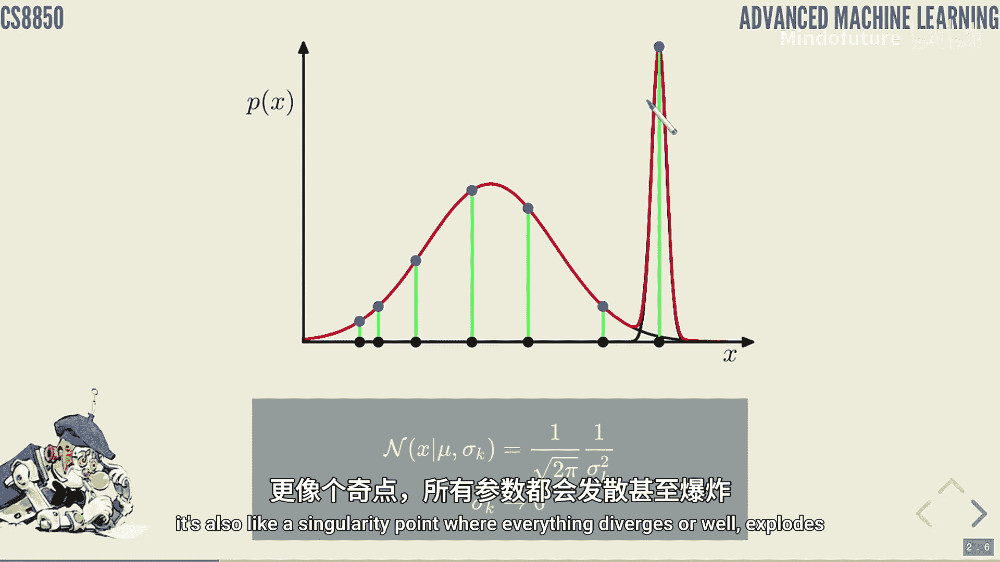
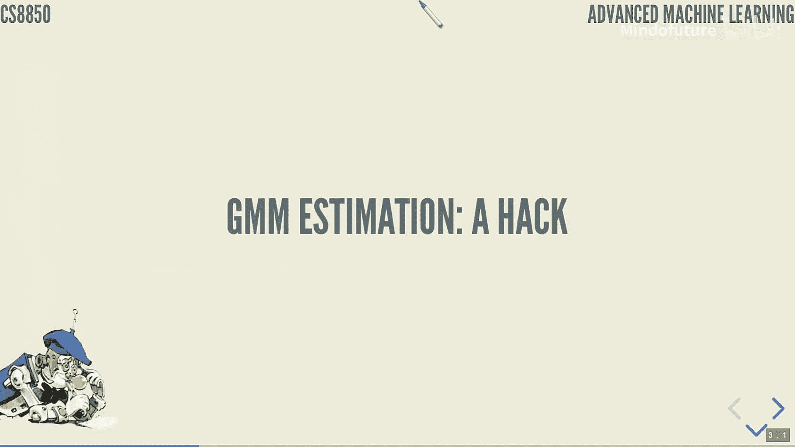

# 高级机器学习主题-CS8850-｜-Advanced-Machine-Learning-p45-P45_GMM甚至需要EM吗--BV1sapPz4Ewx_p45-

Hi Vigan， our 17th lecture expectation maximization。

 hopefully everything will come together in this lecture for you and for me as well。

 because the ideas that we've discussed in the logistic regression。

The ideas that we've discussed in estimation， the ideas that we've discussed in clustering。

 and plus some new ideas that we've touched last lecture。

About latent variable modeling all comes together in today's lecture。Well， despite of that。

 that's not going to be。To diverse lecture， it's just all of those ideas and in just one package expectation maximization。

Should be easy， can't be easier。 Let's try it。 And what will we cover。Is the outline。Of course。

 And okay， let me。Small pose。Not ideal， but also about looking good。

So do we even need EM for gauss and mixture models？

We' considered guys and mixture models already will come back to them again today。

 and you will come back to them again in the homework。

Guss and mixture estimationimation a hack we will consider， well。

 you will consider that is your homework exactly， we will consider what we can do。

In this difficult case， and then the easy part， hopefully。

Maximum likelihood estimation via expectation， maximization and。In the presence of latent variables。

Okay， let's come。So do we even need EM for GMMs？

So just to remind you。Thats an mixture model。 Here's how the likelihood looks。Like， right here。ただ。

It's just a sum of K components， how many mixtures in the mixture we have。Each of them is a Gaussian。

 has their own mean， its own mean， and its own covariance matrix。And there pie。

Sub K are the prior probabilities or the probabilities of each of those Gaussians。

 But for the purposes of what we're doing here， because this likelihood is a probability distribution as to sum to one。

 those pi subcase，Okay， they also some unfortunate inconvenience， but that's fine。

 They also need to sum to one。 I don't know。 if we say it somewhere。 probably not。 Oh。

 but you remember。 and for simplicity for simplicity in this。Episode in this subjecter。

 let's assume that we have a diagonal covariance matrix。 and not only this diagonal。

So identity times some values。Of manyions。Or it's spherical because each component of the cavevariance has the same variance。

And it is physical and the same for each of the Gaussian。

 so all we're doing is placing our Gaussian balls in just different places in space。

 but they're exactly the same in terms of their volume， yeah。Then the， the probability of x。

 given that the class is K is。What I said， normal distribution or Gaussian with a specific mean。

 and they all have the same。Covalance matrix， diagonal covalance matrix。And it is also spherical。

And probability， prior probability or。Margiinnal probability of getting available from this class is Ps sub K muse。

 the means of those distributions are parameters。And yeah， the rest， as I just。Other I just said。So。

 but。Do we even need hidden variables。 Do we even need to do what we've done with K means， right。

 First estimate hidden variables and then estimate the。嗯。

What did with the first we estimated the means then we estimated the membership so first estimate the means and then estimate。

Clas a exteriors， I guess， okay， well， well we'll see that in more detail。

 I don't want to get into that just yet at this slide。

So， well。Let's， let's just。I write this down。 So we have。Hidden variables。

Because if we knew which class we sampling from， we would just like if we knew those probabilities。

 then it have been slightly easier， I guess， but not too much。

And we have unknown means and unknown sigma in the general case。

But the problem with this maximum likelihood estimation。She。

The problem with this maximum likelihood estimation comes。From the following， we can。

 we can just like say， okay， what do we have？call it。Log likelihood。That are perfect。

 Let's differentiate our long likelihood with respect to。hi。with hands at to0。

 let's differentiate respect to muse。And set it to 0。 Let's differentiate it with respect to。

Sigmas and set to zero solve this altogether。😔，And be hard。

Dn and happy。 Let me check slide。 Yes， yes， but。This would be difficult to optimize so remember the exponential family that we've considered in one of the lectures。

 so probability distribution belongs to exponential family if it can be described。A casting in this。

No。Shape in this form that you have。Some function of x。

 some function of Eta and E is your exponent power eta transpose of some other function of。X， and。

One of those G of N is normalization factors so that guarantees that probability distribution sums to one。

 but when we're dealing with the probability distribution from the exponential family and compute maximum likelihood。

 remember we start for all of the maximum likelihood we start with the ID assumption。

 so probability of x given some parameters。But then we're saying to simplify our lives and get rid of this product。

 we're taking a log of it。And which we。Shall we end up with。Lluug。B X。Great。

When we're taking a log of probability distribution from the exponential family。

And sum is over all of the data points that we' just collected。

Then we conveniently get this expression without any。without an exponent involving x。

This is usually easy to deal with or easier。 It doesn't involve X at all。

 This doesn't involve the parameters Eta at all。 So we factored out parameters from。嗯。

The data and how in in those two。哦。Factors and。We got rid of the exponent and usually have a nice form。

 Now， if we look at the sum of distributions from the exponential family and obviously Gaussian is from the exponential family。

 So if we look at the sum there sum of exponential family distributions is not in the exponential family。

 Furthermore， for example， for Gaussian， the sum of Gaussian's weighted sum of Gaussson is a universal function appator。

 we can approximate any function。诶。In theLike with the sum of Gausians or to say it in different words。

 we can expand any function in the basis of Gaussians。So， when we write our。L likelihood of。

Gussian mixture model or gaus and a Gaussian mixture。 What we get is。This。Expression。That is。

Hard to deal with， because we have some under the log。 And if we want to differentiate。

 and then we want to。Set to0 and optimize。This expression has multiple。

Well have multiple components and willll be the best to optimize。

So people usually try to avoid that sometimes maybe there are special cases when it will work and will be okay。

 but most generally it's a difficult optimization problem。So another problem。

 But this problem is common to the maximum likelihood， but it's worth mentioning here。

 So suppose we have。Two components in the Gas mixture。 and suppose by chance。

 either at one of the assignment problems， because one point was an outlier and the mean was closer to it。

Or just imagine any other possible way this could happen。But suppose one mean。Just by chance。

Coins with one of the data points。So。What's going to happen with our maximum likelihood estimate。

So here's the Gaussian， just for simplicity， for simplicity， just one Gaussian。 So when the mean。

And the x are like when they're equal。This。Its going to be 0。 and E power 0 will be one。

 And that's what we're going to end up with。As our probability， the entity。诶。

Not the probability the Institute the probabilitybil at this point， right？

So let's just split this expression that we just saw and。

They are otherwise just normalization constant， but now because x and mu are equal。We get this。

 And when we try to maximize the likelihood of this expression。Of佢。One of the mixture components。

For which， by chance， the mean fell right on a data point。

To like it's easy to maximize just push our sigma to0。And the closer to 0， you get the， the the。

Larger your likelihood becomes。And that means。An explosion， right。

 we have an explosion here that we get a delta function。That goes to infinity and the whole process。

 If we're doing it numerically， it just blows up。All you going to说 don't do it。It's just probably my。

那。Nothing else。Will happen。 It's like a local local minima or local maximum since we're maximizing our our local maximum since we're maximizing our likelihood。

 But the problem there is that it's not only a bad local maximum， but it's also。诶。

Like a singularity point where everything。Divergs or well， explodes。

Okay， that will be our next。