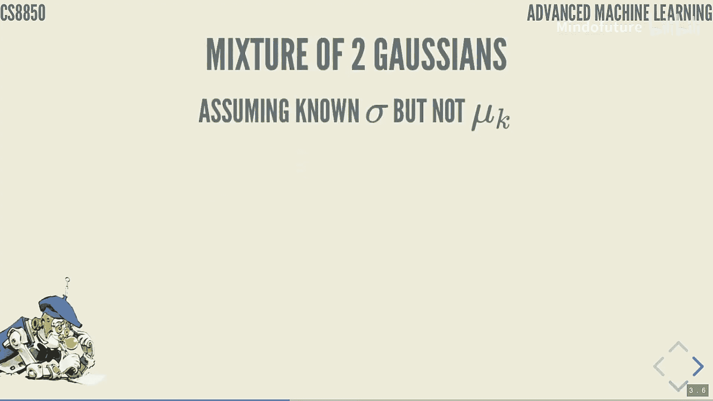
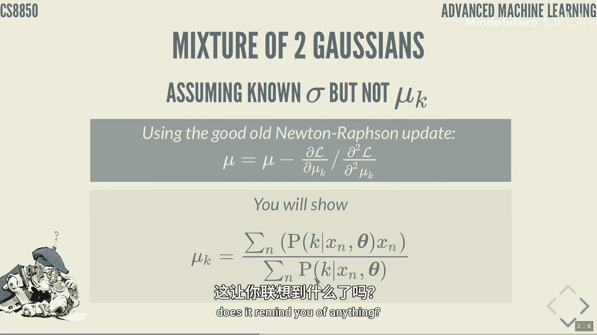
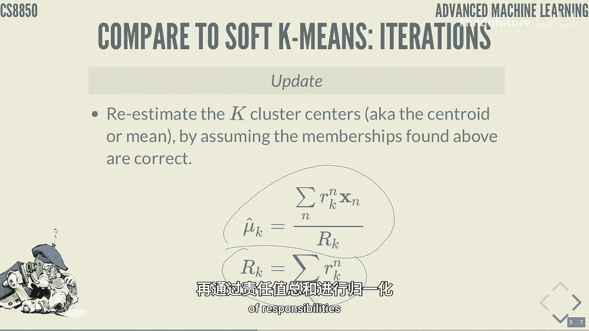
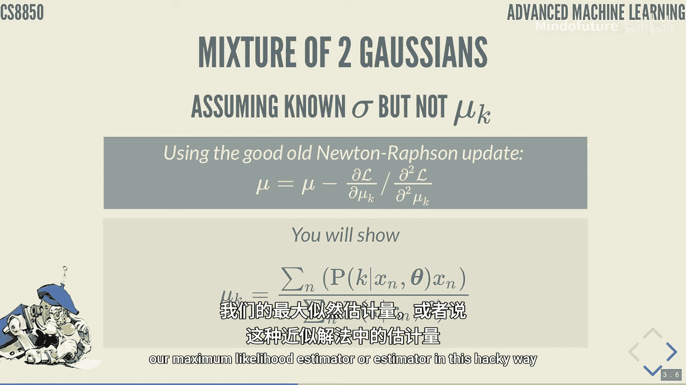
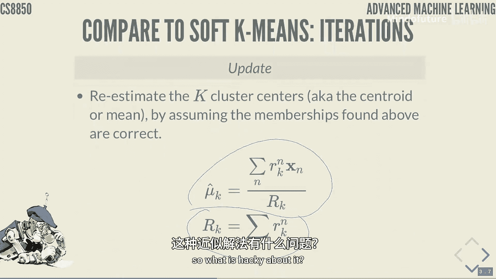
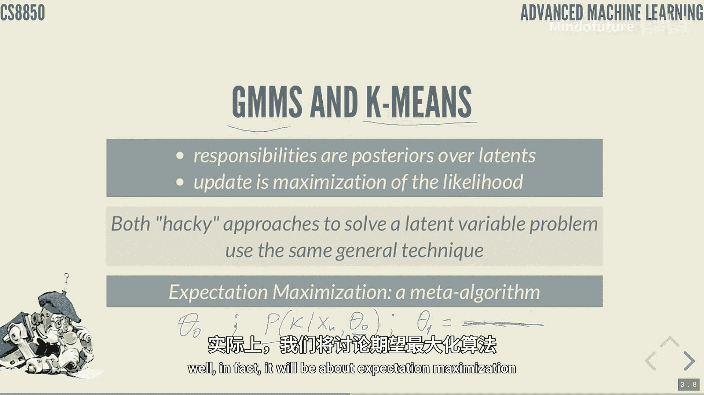

# 高级机器学习主题-CS8850-｜-Advanced-Machine-Learning-p46-P46_一种粗略的GMM估计--BV1sapPz4Ewx_p46-

Ges and mixture model estimation。 Let's try a hack。 So right now， we sort of don't have any proof or。

系。Any。Formal intuition of why would this hack works， Why would this hack work。

 I won't give it to you in this section， but。Let's try something that we saw in Kamins。

 why don't we sort of follow a similar approach and to do it by hand to go step by step is very important。

So this is like all of the steps。 I will show you the conclusions or results。

 But all of the steps you will fill in。As your home。So you can appreciate。

 and I see with your own eyes and hands and brain this what is happening。 So a mixture of two Gausss。

Nothing by by by that。 So we have a probability distribution。Likelihood。Of parameters。Fortugas。

Those are the。weights of the Gaussian probabilities of class k and class K plus1。

And expanding the Gausss。So that that's what we're dealing with and。

Let's make a few assumptions for this。 Let's assume that the garcins。Are equally likely， so the。

Glass probabilities are12。And that's just。Fold all of our parameters， mu 1， mu 2 and Sigma。

 Now we are in the two class case。Not in the arbitrary K class case。 So just two gars。

 one dimensional situation。All of the parameters are folded into。One single vector theta。So。

If we assume that mules are known and Sigma is also known。And we well。

 just a note that sigma is the same here for both Gausscins， just the muse are different。

But everything is known。If that is true， then， as you will show。In your homework。

Probability of class 1 given a data point and probability of class 2， given a data point。

I can be expressed by this expression， and class 1 is e to the negative linear function of x。

And class 2 e is the positive linear function of x。Well， does it remind you of anything， I hope so。

Because if we。To know this by say。Z。And multiply this expression。By one what is he？

Then what you will get。Is。嗯。It's still a。This part bite the。That would be more interesting。

E to the minus Z。E to the minus Z。That yeah， okay。 And this one is E to to plus C。

 So what we will get is E minus C over。1 plus1。是。So if you look at the first one。

 one over one plus E minus。AndI had the second one。

 You immediately see that this is logistic regression。Linear boundary and probability of the class。

It'll behave like that around the boundary。Right。Ha the boundary it will be。0。5。

And then go towards one class。Andandor it's another class。Or this is actually the probability of。

Plus  one。This will be the distance。 that's your decision boundary。

 This is the distance where your point is located。And that's， that's。How it will look like。诶。

 and you will play with this derived what W1 and what is W0。😔，He will derive this expression。

To make sure that I'm not lying to you that you can trust me too much， you know。

 and then you will also then explain if this is probability distribution， why it's sigmoid。

 white doesn't integrate to one。L you will understand that too， don't ask me that question。

 That's your homework。And， yes， another thing is softms。 But imagine now that we have。

Makeixture of multiple。Components in this case， right？ So that's。

 that's where those ideas come together with the calcium mixture model。 But that's not everything。

 So what we've gotten here is。Class posteriors， right， given the data， what is the class。

 what is the probability。Of this data belonging to class one， that's the best stated distribution。

Let's make another assumption， assume that we know sigma， but we don't know muse。

So before we knew everything and we figured out what the class posteriors would be the posterior probability distribution of the classes now。

Ium the mules are not known。 how would we go about it， Well。

 let's look at the mixture of our two Gausss again。And what we see is。

No nothing knew what we saw before。Our likelihood for all of the end points。 This is for one point。

So this is exactly this。likelihood of one point。 And then we are still holding on to our idea assumption。

And by this assumption， we can say that probability of this data set。

Of observing this data set is just the product of the local likelihood or the likelihoods of。

The parameters at each of the point。And as you will show in the homework， the。

Deliative with respect to the mean。Of this likelihood， actually， of the log likelihood of this part。

 if we take a log。Love this。That's what the calligraphic health stands for log likelihood and once we have the log likelihood you will show that the derivative of the log likelihood。

Is nothing but。The posterior class posteriors that we saw in the previous slide。

Probability of K given x。Sa man。Let me show you this。Depending on gay。

Times x minus normalized by the。So嗯。No， were getting somewhere already， but not quite yet。

So just a reminder， we know the signals， but we don't know muse and we now need to estimate the muse。

 we know how to estimate the class posteris。For every data point。

 we can compute the class given the muse and the sigmas， right？That's what that meant。

 that slide meant。No。诶。You will show what's the derivative of the log likelihood with respect to the mean。

And next， you will show what's the secondary which involved the log likelihood with respect to the mean。

And as you see， well， that's easy if we ignore the the derivative of。Pisters。Clas bys。靓。

Dative two of this is nothing but one over sigma squared。 Well， the minus sign follows off。

Over there。So simple algebra。I'm already solved it for you Okay now I have to think of a harder homework just kidding and let's continue what will happen next well what will happen is you will use the good old Newton Rason update that we've used to solve logistic regression already in this class。

Which is an updated meal。Equals the old mu minus the ratio of the first and second derivatives。

And once you do that， you will show that。The new estimate of the meal。我 that。

A the optimal for this sort or the well。Not the optimal， but the new updated value of the mu。

Is nothing， but。Some of the bester times the point value。 So some across。

Integral or some across the complete data set。Divided by the。Some of all of the posterior values。

Does it remind you of anything？

I hope it does because remember in the last lecture。诶。

Kmeamines So As and heart Ka means update was exactly this。

 It was the sum of across all the points with responsibilities and。

The values normalized by the sum of responsibilities。

Oh， look， responsibilities are class posteriors。So we when we estimate gapuss and mixture models and when we do mixture modeling。

Our。Maximum likelihood estimator or per estimator。In this hack way is just glass baers。

 So what is hack about it。

Well， let's see。 So GMms and cames， right， responsibilities and posteriors over lants。

The responsibilities and Kmins are posteriors。Cllesss。

And the update is maximization of the likelihood because we maximize the likelihood。

When we set the mu to this value。So。Both are high care approaches to solve latent variable problem using the same general technique。

And this technique is called expectation maximization。

Whi is a metaal and the point in both of the concrete methods， JmMs and K means。

And many others is that at first。We set our parameters。So some arbitrary values。Then。Next step。

We estimate class postis， given our data。And those arbitrary value parameters。Then。We。

Computer the maximum likelihood estimate。Of those parameters， given。

The class posteris that we just estimated。So maximum likelihood estimate usually is computed。

With respect to the current parameters。 But we are using previous parameters that we obtained by using the previous。

Values of guest parameters。In the estimate of the new。Parameters。So， it's kind of like。

If we were doing maximum likelihood。Arrectly。Not， not to say that expectation ex is then incorrect。

 But if we were doing just the maximum likelihood estimation。

 then the parameters will be would have been the same。

 like they would have been in the same kind of iteration。 We would know the values of。

Sigmas and news。And we just maximize them。 But here。

Because we do need to use the posterior distribution in the MLE formulation in the maximum likelihood estimation of the parameters。

At the next step。We have to go。Because right now， it's just a hack approach。

 We have to go with our previous。Estimated parameter values or guess in this case。

 hero will be guess and estimated and keep repeating until conversionence will it converge。 Well。

 the next section or episode will be exactly about。That question。In fact。

 it will be about expectation maximization。

