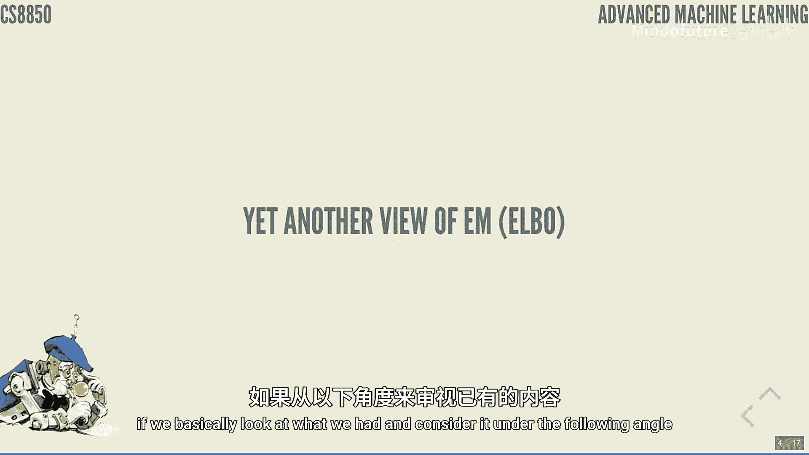
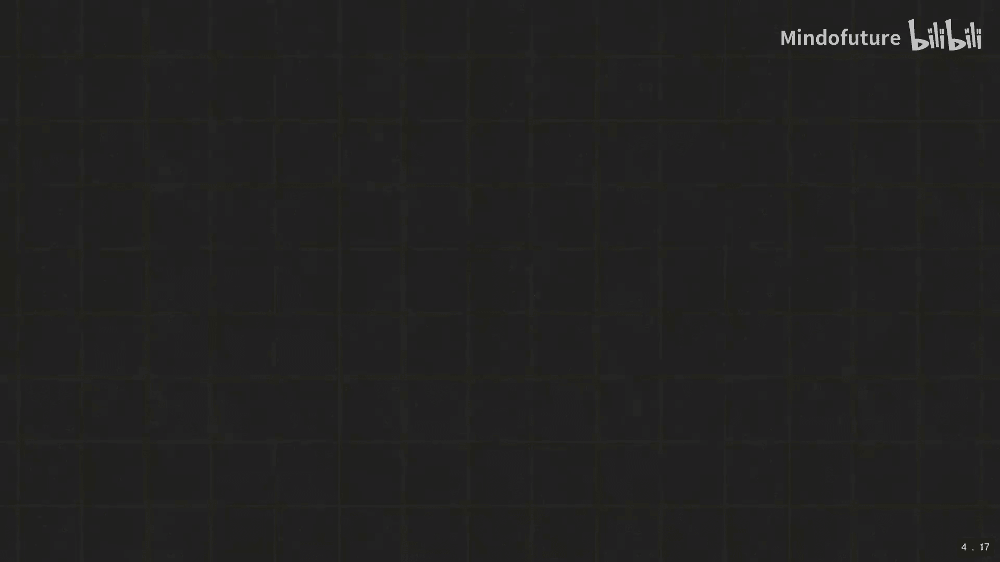
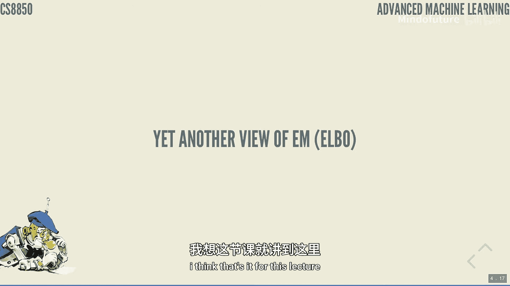

# 高级机器学习主题-CS8850-｜-Advanced-Machine-Learning-p47-P47_通过EM进行MLE--BV1sapPz4Ewx_p47-

Yeah。Okay， maximum likelihood from incomplete datata。By the EM algorithm expectation， maximization。

December 8， 1976。The paper by Dster Laard and Reen。 That's a great paper that we can't miss。Because。

It's just too important。 It was presented in the Royal Scientific Society。Right， os。done yeah。

 Royal Stat Society and discussed by many people。 and most of them are top people in the world that are famous and。

Have made a substantial contribution to the science of statistics。Of course。

 the exposition here will be slightly， if not completely different from the paper and then。

Only later。This。All notion of expectation likeimization as presented back then， has been。

Be considered and cast as a。Basically a variational inference problem， but we well go following way。

 We'll need a few definitions or few concepts。 So first of all。

 its the convexity and function is convex。If。We have for any of the two values of x1 and x2。嗯。

The value of the function。In between them。And on the line。

 like this is a linear interpolation between x1 and x2。And of course， in one dimension， it's just。

Here。Well， that's a linear interpoation point， but in one dimension。Sat anywhere here。

In this interval。That's， again， convex combination。Lambda belongs to0 and1。

And so lambda plus 1 minus lambda。S to one。By shifting this point。

 we're computing linear interpretationpo。 Well， it would have been easier to just say。

Any point between x and x1 and x2。 But what we mean is。

In multidimensional space as well in a multidimensional space， x1 and x2。

 we have a line or vector connecting x1 and x2 and what this means is any point on that vector。

 so a function defined at any point between x1 and x2。Is less than or equal。嗯。

AThen a linear function line。That connects。Point of at F of x 1 and F of x 2。

 So this is your F of x 1。 And this is one。it's to if we evaluate at any of the points in the interval。

 we evaluate。function at this point and then find corresponding value of。Ne function connects。

Have one。Of of x 1。With F for x2。It works in any dimensions。TThen it is less than aco。 So basically。

 you can see it here if we。Pick two random points on。This function and connected by a line。

 the function has。Either at or under this line。Similarly。

 you can define a COVx set as well that of a conVx set。Annnu line。Between two points。

 connecting two points on the curve。Is inside of that set。Okay， that's and v， simple enough。

 familiar enough。나 듣 몇 살까。he。Oh。There are flavors or shades of convexity。

So the function on the left is conx。喂。It does obey the definition， and anything with anything。

And the。诶。The value of the line connecting that two points will be higher or equal to the function。

 So equal to if we put two points， say， if we choose those two points right here。There。

The equal the equality is strict F lambda x1 plus 1 minus lambda x 2。Just just on this line。Has。

Strictly equals。啊。There our。没有发现。这里。And strictly convex is then when。

There is no equal possible at all。Exponential function， logarithmic function are strictly conveed。

For the same equation， I won't repeat it here。Maybe only partially。Okay， just for you。

P it the same equation。The value of the function is strictly。嗯。Lower and technically。

 in this graph that I'm showing only this functions is strictly convex。

 but they're all both convex because change the sign。 and okay， you can call it concave。

 but that's a。The same notion。As in here。 so we。This is convex， this is conx。

 and this is also convex。 So what is the different this can have a quality this function。

This function， andnot quality。But it's strictlyly connects。

 an even stronger notion or a different more interesting notion for us is strongly convex。

It's when there is a single optimal。 This function has。Intent number of minimum values。

 it is complex， but there are many solutions。Say literally oh， or unlike。

The parabolin strongly convex。 It is convex。 both of them are。 all of them are。

 and there is only one solution。 Okay， moving on。 So convexity， a theorem for convexity。

 if F of x is twice differentiable on an interval A And B。

 and second derivative is greater than or equal to0 on the same interval。

 then the function is convex on that interval。Okay， so。The thing to note is。银历嘅节节 of。

The second derivative or Hasian in the general case is important。If ASN is not negative。No。

 non negative， definitely。Then our positives are different。Then we're find the function is complex。

 but in this simple one dimensional case， it's just non negativity。Well， look at this。

Minus log of x is strictly con on0 to infinity。And now you know what we mean by that， right。

 that's strictly complex。And then we introduce Jensen's inequality and Jensen's inequality says。

 okay， let F be a convex function on an interval I。If points x1 through xn belong to that interval。

With。嗯 call嗯。He conductx coefficients， actually Lada1 through lambda and not negative。

 and such that they sum up to one then。This convex function。Of a sum of weighted combination。

 of a complex weighted combination of those x's。Is less than or equal to the sum of the weighted combination of the function of those x's。

C呃。We were able to put F inside of the sum if those conditions hold， then we can do that。

 but only it's not anequ anymore， its inequality will get a larger guarantee to get。

At least as large function as before。No。Glogarithm。Is convex function。

Stricly index if you talk about minus log。But。In， in， in this case。

 log of sum of a convicx combination of。Some data。On the interval， where this function。His complex。

And that interval is 0 to infinity。So。For positive or non negative values of x。

We can use Jensen's inequality and pull the logo inside of the sum by changing the inequality sum。

So now we're ready now we're ready to talk about expectation maximization。 we have。

Most of the bits and pieces that we need。Let's derive the E algorithm。

 So our goal is to maximize the likelihood function。 L is the likelihood function。

Fction of the parameters， as you remember， well actually。

It's the log likelihood rate as I write it there。Equily， if at step N。We have。Some set of parameters。

Some set to some values， theta n。We want。To pick such the。

That the likelihood at that data is greater than the likelihood that we have。At the current value。

 we don't want greater or to because then we're not maximizing anything。 We're staying put。

 And definitely we don't want less。 We don't want to minimize。

 but we want to maximize the likelihood that is we want to obtain a value that is greater than what we have right now。

And yet equivalently， we want to maximize the difference of what we will have minus what we have right now in terms of the log likelihood。

And。Just by definition， this difference equals to the log likelihood minus the log likelihood at a specific point。

 right？And we want to maximize that difference。I'll overload this term later in the slides。

 but just for you， so we want this delta to be maximum。Right， but how do we do it。

This looks difficult well， just by looking at all of the state conditions。And it's。Unclear。

 how can we do it， But let's introduce。Pranandum variable C。

 Let's introduce latent variables that are not there yet。

So then our likelihood becomes marginalization over marginalization of the joint distribution。P of x。

3。So。X is our data。 We are observing it。 Z is our latent variable。

So expectation maximization algorithm applies to the cases when we。

Sort of fudge those later latent variables we。Add them to the model to simplify the process of maximum likelihood estimation。

Or there are actual latent models when latent value variables。 When we know they're there。

 we just fail to observe them for some reason。 So this is the joint。er。

Who said includes both of them。This union of those two sets， X and Z。

 And then we want to integrate out those random variables or。And that's what we do。

 This is nothing but。Feneral probabilities factoring。

Are joined into the product of conditionals or conditional and fry。嗯嗯。

And we're integrating how the Z。But。Back to our definition， we want to maximize this expression。

 The difference of log likelihood at the new parameter values minus the log likelihood at some old parameter values。

 Let's plug。This。In。After we do that。Here's what we' got。Okay， we'll see。Okay。So。

 let's do some manipulation。哦。It's see。We started。We责。Okay케。So， we started with。

Difference that we want to maximize log likelihood at the new value or。

The final solution of likelihood must be larger than much larger。 as much as we can。

 And the log likelihood has a current guess or an estimate because we were maximizing this difference and。

Whire just rero。 This is what we're。Trying to achieve。

 And this is the log likelihood at a given value that。

That' by authors that presumably presumably we can just compute， as we did with。

As you were doing the homework with the two Gaussian cases。So because when you compute that。

Low likelihood that given parameter basically can compute the besteri。As well， lucky， no。

Without introducing any。Changes to the equation。 Let's multiply our。

like joint look like marginalized over the。The latent variables by one。Namely by prior postor of the。

诶。Sata n divided by posteri D at theta n。Then after we do that， we can rearrange the equation。This。

Goes into。Where so， and well， both of them。Basically become， okay。

 I found an easier way to explain that， basically。Take this。Please sit down。

While leaving this beststhe area here， that's what we get。Now， so we have low likelihood。

Of this expression。 And now this is， we just introduced this ratio。Which is legal。嗯。

Then we use Jensen's inequality。 and according to Jensen's inequality， this expression。

Is larger than or equal to that expression Lo of the sum of convex combinations。 Of course。

 this is a posterior distribution over Z。 When we integrate probability over Z， it's one。

 So everything。Is whom based to the conditions or assumptions of inequality。

And we have now convex combination of the log of those values。 And if we pull in this minus log。啊。

S ideas。Handum， define。This quantity。Yes。그。Yes， some killed them。Then， we have。

L likelihood of theta minus log likelihood of theta at the point N greater than our equal to this quantity。

We just arrived。衣服。Orccly。Our new value is。Lower bounded。系。Are all value plus。好。That's啊 one自。Okay。So。

This is exactly the lower bound。Because our。呃。New value。Can it be。

Less than the lower bound that which is different。So when it equals to the lower bound。😔，是的。

That means the boss like it when， when when。This is the。Glue and lower bound。Basically， again。

And the values。你个。Let's plug in。What we get。 So let's， instead of。Seta。Here in the。

This expression everywhere where we have data， let's plug in。啊，睇得 hand。And once we do。

I'll get the following expression， but this is the joint。Of X and Z。

As well as this is the join of X and Z。But then we get log of 1。

 but log of 1 is 0 and our lower bound。Equals to。sta n。No。Ins to look likelihood at the State sub N。

Graphically， it looks like that。 So this is。A a low likelihood that we want to maximize。

As a functional theta。This is our lower bound， and。When they're equal。

So lower bound is lower than the likelihood。 And when they're equal their。They touch。

So if we pick the value that maximizes the lower bound。Then。That is higher than where they touch。

Then we get to the new value of the likelihood。Where we can continue the process。

And maximize the lower bound again。Bak the new value。Thank you， the you lower bound。

And maximize it again and represent again。 So how do we do that， How do we maximize when。Well。

 we maximize the lower bound with respect theta。 And again， this slower L is the。嗯。Oh。

 telegraph hell。So， we， we expand。The expression， as we've derived it。

And drop the terms which are constant with respect to theta。So， we did。That。

Because this will be minus log of this value。That's that value， Sir。This。Will disappear Not that。No。

 no that this log is just the top minus the bottom。And。嗯。Basically。

Deenominator for goes into minus s， but。It doesn't affective optimizationim， doesn't affect maxim。

 we end up with this expression and now we need to maximize this expression。哦。

And we a theta that maximizes the expression。Again， we。对。嗯嗯嗯。Okay， so what we do is， again。

 we do a edge factor with this is the joint distribution right here。同。Okay。

 probably I need to write this， so probability of x Z theta。😔，エちんし。So。re change嘅问题噶。Is the joint。

of the and they的。Thanks。没ace。不。L or rule of conditional probability。

 and the same probability of x given Z and theta is nothing but the joint of X Z and theta just writing。

 I mean， I'm not even。InIntroducing many factors there， those two are equal。And then， we can。そ。

That's out。And what we will go next。His probability。X。てた。Thank it。Which is。

The joint distribution of X and Z given theta。That's what we have here， but。This is。An expectation。

So the log of the joint of our latent variables and。哦。ごンであります。They did。

With respect to the posterior that we estimate separately。

 So once we know the posterior with respect the theta and we can plug the disease here and maximize。

The value， because now we have the X。 We have disease and。诶。

We can find theta n plus one that maximizes the following expression。So we run by。Kale divergrgence。

Multiple times in these deris， and you already know how it works and what it is。

And we can have another view or an equivalent view。哦放。maximumaxome likelihood optimization。If we。Ba。

Look at what we had and consider it under the following angle。

We had our log likelihood。It was。A lower bound。Let' scale their virgence。Of our posterior。

 lets call it。嗯。Yeah， our old posterior era are new posterior distributions。Yeah。So， if we。

Or our low likelihood。Is defined as before。And we started， right。The girl over see好运。是。嗯。嗯。

that would be true on leave。It was conditioned on Z。

 but we're actually marginalizing the joint rate and once we do that。

 we're getting back our log likelihood and I mean。Love here and love here。If we define。Push。Yes。おちちす。

And don thank you little。The disc did not kill the versions of U see。H。Do see。Have。Justte here。

Of the hidden values of x in that。😔，And。ing our lower bond。诶。C。に。Hello of the joint distribution。大伙儿。

OhShe。So， this now is variational。Infer formulation， because。We are using。You。嗯。Or using Q。诶。还是。

our approximation。And we're adjusting Q as an approximation to the。Perior distribution。

 So if we define you has。Oh， pret here。And then呢。The key process， what is happening is we need theta。

 Theta parameters are not known and in the mixtureer model。As calcium mixture model。

 we first will guess the parameters and use parameters and the data to estimate this function。

 the besterior probability of the glass membership。Or responsibilities。Or well。

 the besteror probability of class members or responsibilities。Once we do that。

And plug in estimate here， the kde versionence will become zero because the distributions will be the same。

😔，Well use the value at the current value。The current estimate of data， but。Then。tp go。Picture。

Thanks， too。Bishop， if。This is our。A likelihood。Then it consists of two components。Lower bone。

And the K versionence。When we estimate the posterior distribution， we set scale divergence to0。

And now our lower bound， our maximum likelihood is completely defined by the lower bound。

 So not just Q is here as well in the lower bound。 So once we change the Q and set K L diveence to 0。

We also change the lower bound。 Now we are at that point。Aware。

Lower bound is a new function now because everything changed here， it's a function of Q。Of data。

 sorry。You has changed。This is a function of data。 Let's start changing the function。

 This is log likelihood。And this is our lower bound So then we maximize the log likelihood and get in here。

 So once we maximize the log likelihood k divergence also changes， it also increases。

 it can't be less than zero， but it increases because to maximize the log likelihood we are changing the parameters of our Q distribution this is the unknown distribution rate。

 but the Q that。We can manipulate as we know it。We're changing the parameters。 We're changing theta。

 and we maximize the。lower bound。So it's， it's also called evidence。Lower。Attinization。

 elbow process。So okay， at the step after like the first step。Estimate lip postior。Hero out。

 kill the variance。 Everything now is L， the or bond。Then。

Or start increasing lower bound in order to increase。That's our previous value of。Have肥的。

Let me remove that。 Could want me this over some room。 So I've increased this。

And has a side effect in the maximization step， as a side effect， I've increased my likelihood。

 but by my log likelihood， but my log likelihood is a sum of。

My lower bound and kale divergence by increasing the lower bound。

 I pushed my Q outside of the optimal now0 value of kale divergence。

 So my kale divergence is now higher that together maximizes my。Lo likelihood even further。

 But then again， I said by changing Q。Reestimating the besters， I set my k to 0。

 That is I pushed my lower bound higher and the process repeats。Until convergence。

Very powerful algorithm。Used in hidden markov models， for example。

 in factor models in like particle filters algorithms。ItIt's for that to。嗯。

Basically do expectation maximization algorithm。It's also a very powerful proof technique because。

 for example， non negative matrix factorization that we covered in the class。

 the original proof proceeds similarly in a similar technique as the EM algorithm。哦。Converges proof。

 And then。红牛。One of my papers for extension of non negative matrix equalization。

 And I use this similar to me。 And you will see。Ill get items in A again a。

Its not a single algorithm。 it's like a meta algorithm because you have to come up with what you are maximizing and what you are that's the likelihood and。

What you're finding are the expectation step an expectation step， think about it。

 you're finding placetheor probabilities and maximization you're maximizing the likelihood。

I think that's it for the past lecture。

