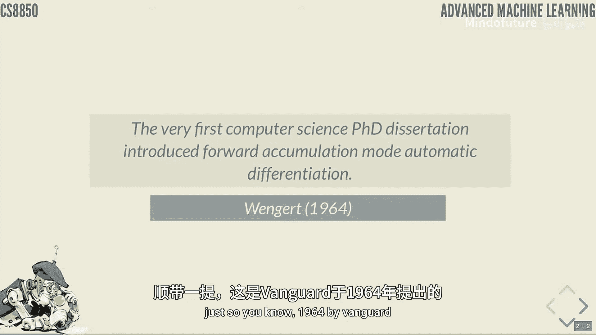
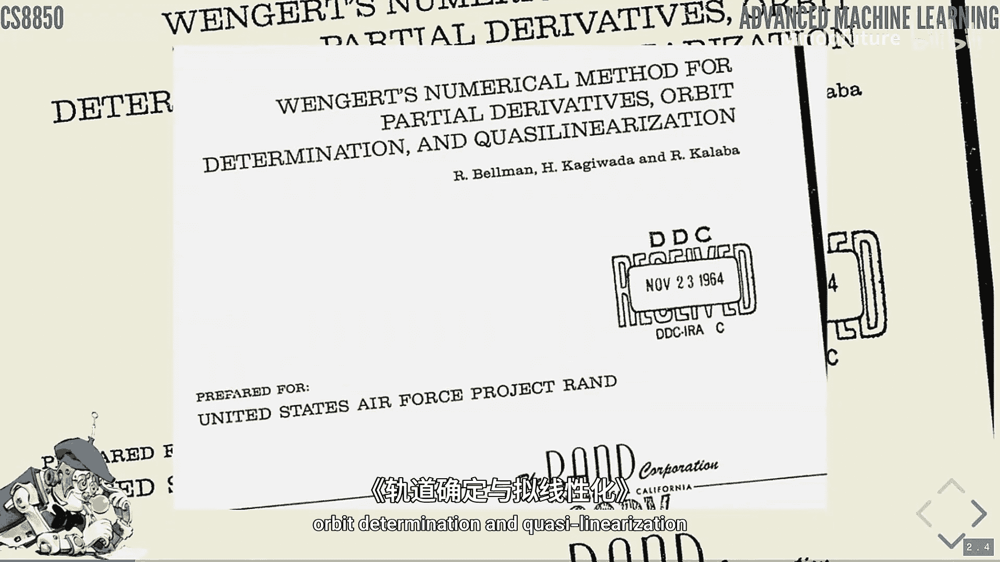
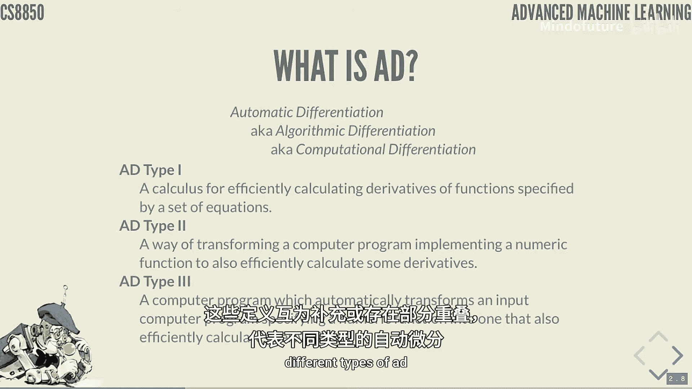
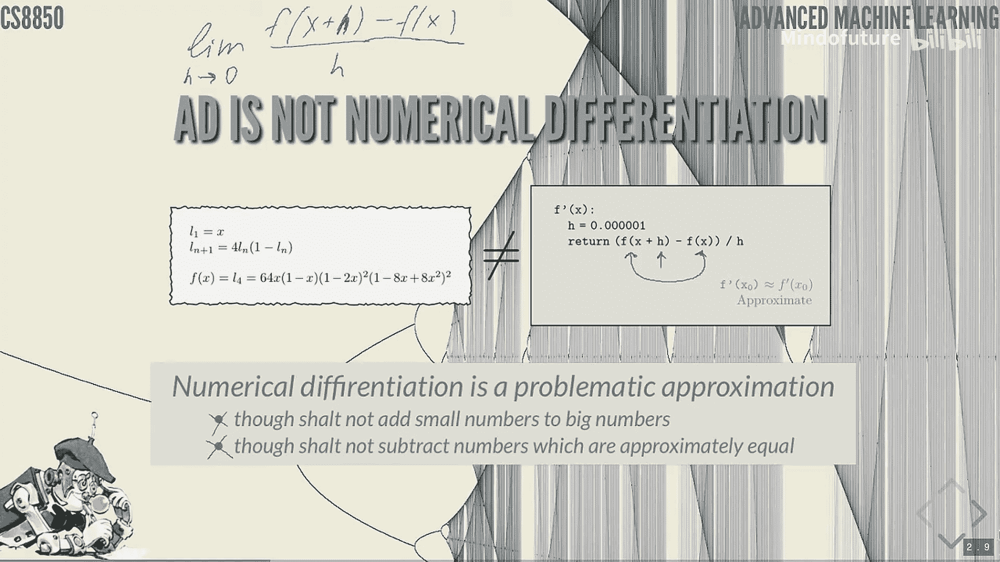
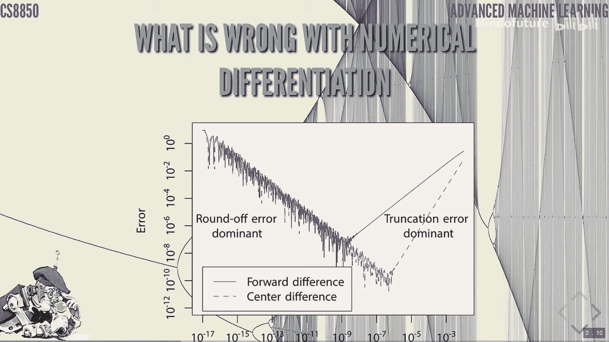
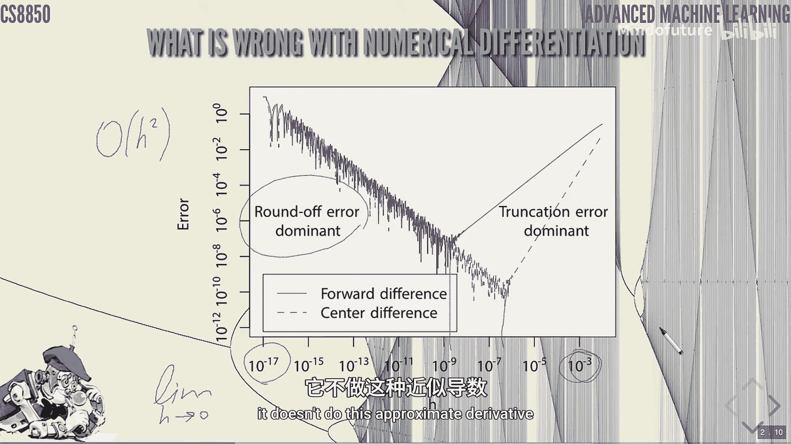
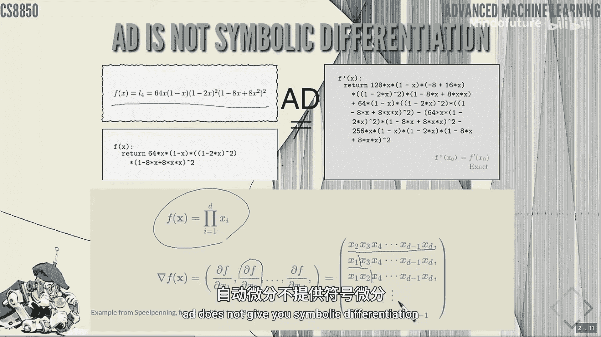
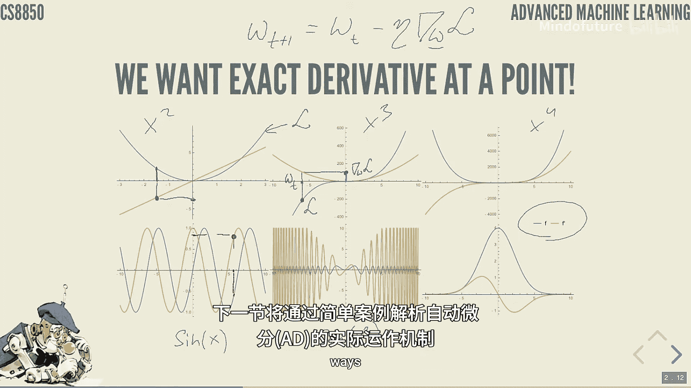

# 高级机器学习主题-CS8850-｜-Advanced-Machine-Learning-p48-P48_自动微分简介--BV1sapPz4Ewx_p48-

Hello， today's class is Li's lecture is an algorithmmic differentiation。We have considered。

Grading descendants， theastic gradient descent and other ways to optimize our models。

To get to predictive or discriminative solutions。In all of them。If you recall。

We needed a gradient of a function。And。It was kind of assumed that we can obtain it somehow。

 and when you look at those derivations， when you look at the algorithms explanations， of course。

 for analysis， we need the analytic form and when we write down the gradient。

 it feels or may feel as if we absolutely need an analytic form to get a solution。In this lecture。

 we'll see that。Well， we'll just confirm that actually what we need is the numerical value。

 the number， the value of that gradient all of its parameters at the particular input。

And there is a way to efficiently calculate it。 It's called algorithmic differentiation。

 As you see in this lecture， it's existed for quite a while。Let me see， more than。50 years for sure。

56， maybe。And it's actually a lot of implementations of general use of algorithmic differentiation。

Existed as well， but there weren't mainstream。Right now， you。

 most of you who've played with deep learning or worked with deep learning is using a small subset of algorithmic differentiation。

That works only for matrices and matrix computations。But the， the idea。

 the dream of with which the algorithmic differentiation was created is much grander。

 and although some。Languages that try to realize this dream and even get quite far along exist。

 They are not yet， unfortunately， mainstream。 Okay， let's see。What is what am I talking about。

 Let's see what we we learn in this lecture today。Ill get differentiation。

 I will give you some overview and history。And then we'll talk about forward mode， A D。

 forward mode algorithm differentiation。Reca a little bit of back propagation。

And then talk about reverse mode， A D， as well。So let's start， algorithmmic differentiation。

As Alex Raul put it， may one of the best scientific computing techniques you've never heard of。

The very first computer science PhD dissertation introduced forward accumulation mode。

Aomatic differentiation。Just so you know。1964。

I angered。Soir， Robert angered。Publish this。Paver， a simple automatic derivative evaluation program。

In communications of the ACM。And what he basically said is the key to the method is the composition of the given function into a series of elementary functional steps。

Seems like this could be anything， right？The community thought otherwise。

Pelman Kagiwaada and Callaba and Richard Belman is of the dynamic programming Fame。

 wrote a paper specifically or report specifically titled Wegert's numerical Method for Partial derivativeatives Ordetermination and quasi lineararization。

So what did prompt them to write that paper specifically about Benger' method？Well， importantly。

 when they say， Weger's method permits the treatment of large systems。

 which might not otherwise be undertaken。So computational savings provided by the methods are huge。

Were huge at the time， and still are。Well， so what is algorithmic or automatic differentiation AD automatic differentiation mechanically calculates the derivatives of functions expressed as computer programs at machine precision precision and with complexity guarantees。

We will decipher all of that。 We will open all of that。Soon。

 so the calculating derivatives is a dream that。Hunted。Godfrd las and。

Fed him to create calculus in 1664。诶。The goal was to enable。Human。

 weak human brains with powerful tools。And by， by at amazing。A lot。 and as you know。

 Lenitz was also the one who invented binary。Calcus but。

Finallyary numbers and like thinking along along the way。

 how to automate everything he also designed。Complicated。Calculation machine。

 but I'm not sure if he even build it。But anyways。No。That might take differentiation。As you know。

 de function that maps from n dimensional space to n dimensional space is an M by N Jacoban matrix J。

And we've considered that we've seen that already。A D in the forward accumulation mode computes Jacob times a vector and。

Vangert introduced that in 1964。A D in the reverse accumulation mode computes Jacob and transpo times some factor。

 everything will become clear eventually in this lecture。And spew painting。

 B spill painting introduced that in 1980。This is basically solving the problem that the back propagation currently solving。

But actually doing it in a more principled way。So and also about a zillion other modes and tricks exist for algorithmic differentiationation。

 it's a vibrant field with regular workshops， conferences and community portal Autode。

 you can check it out for yourself I will get you interested。So what is A？Nethematic differentiation。

 also known as algorithmic differentiation。Also known as as computational differentiation。

There are few modes or a few flavors of it， so AD D type1。

 it's calculus for efficiently calculating derivatives of functions specified by a set of equations。

A D type 2， it is a way of transforming a computer program， implementing an numeric function。

To also efficiently calculate some derivatives。So think about your neural networking。

 neural networking， its forward path。Compututes a number。So。They implement amic。Function。

But things like systems like Pytorgen and others are they efficiently。

 also efficiently calculate the derivatives。 So you。

On this forward path you add some complexity and you get some scaffolding for calculating the derivatives。

 we will go through that in this lecture a little bit and there is also AG type3。

 it's a computer program which automatically transforms an input computer program， another。

Specifying anaic function into one that also efficiently calculates derivatives。

Kind of complementary definitions or slightly overlapping definitions or different。Types of A D。

So first of all， we need to define ID， we need to remove some confusions because I'm sure most of you who are listening to me now have confusions about differentiation。

And derivatives with respect to A D， especially because A D is not numerical differentiation。

 The language may may make us think that it is numerical differentiation。 But let's take this map。诶。

You can iterate。する。Start with L1 equals to some。Number x。 and then keep iterating this map at step 4。

 what you will get is this expression。If we go by。No medical differentiation。

 We will either use left， right or central approximation to the derivative， basically。

Will define some H。 And by using。The definition of derivative as a， as a limit。Of。It goes to see。

It's the ratio of。Yeah。O。So， increment。In the function by the increment in the value。

And if our step quite small， then。We hope we will get a good approximation to the city with you。诶。

The first day which have at least。 so well， it turns out。

Nmerical differentiation is a problematic approximation。

 it simultaneously commits two scenes of numerical computing。嗯。Or numerical medical stability。

 So first scene or first。Commandment is that shall not add small numbers to big numbers and。Yeah。

So we are doing that， right。 We are adding a small number to some large number。

And another scene or another commandment that it's。诶。Violating is that shall not subtract numbers。

 which are approximately equal。 Well， when we。Add a really tiny value to the argument。

The function will not change much。 So when we're subtracting two numbers。

 which are approximately equal or violating。Both of these assumptions， right one by one。

So but what is wrong with numerical differentiation？

Besides what I just said or opening it up a little bit。

 So there are two types of errors that happen in the medical differentiation。

 first one is truncation error because we defined our derivative as first like we took the infinite Taylor series。

And we define the derivative using only the first component of it。

 And whatever we throw away is our truncation error。 And it is about。嗯。So depending on。

Where we truncate。The series and this error， even if we are at infinite precision， it still persists。

 So when age is lagish。Yeah on on the right here， then to the main three， when it' largest。

 crncation error is dominant and here this plot from the survey on automatic differentiation that I'm heavily boring from in this lecture by piging and others。

Shows central difference and forward difference to two types of approximation of the numerical medical approximation。

Obviously， it's important to medical differentiation。 as you see up to some point。

Currentronation error。Dominates， but then for central。

Difference earlier and then forward difference later， roundund of。

Kicks in and starts starts dominating the error。 So round of error is when。

Your precision in the Mantia， your you need precision。Such a high precision in order to。

Maintain correct values。That。Bloating point numbers。

Number presentation just are unable to hold numbers with the required precision。

And error accumulates。 So because in in the tail of theisa there， the number are just noise。

So that is round of error and。While trying to get higher。

Accuracy of your estimate by pushing this limit。The0。Going to hear， you are actually， well。

 on an infinite precision computer， you'd be fine， but on。Any computer that we have access to。

Those that we want to be fast。That are using。Medical co processor。Or similar techniques for those。

 yeah， we。We are in trouble。The medical issues so。Just must be clear all although we did say or I did say and。

The definition did say that we get an numerical value of derivative。

Add an numerical value of the input。With。Machine precision。A D is not doing。

No medical differentiation doesn't do the sub approximate derivative by differences。

So it is also not doing what the symbolic differentiation would be doing。

 We're still considering that map at step four。And。What we could do， We could。

Represent this map as a function F O X， that returns。This expression calculated。

Evaluated this values。And then we could just take。And manually say differentiate this expression。

In the right of function that returns evaluates this expression of the derivative。

 This is symbolic differentiation， and it is exact， but。

Imagine the need of differentiating symbolically like that。Something like a transformer。

Or network or a convolutional neural network or a recurrent neural network or something something a large and complicated model with multiple moving pieces。

So here's an example due to spell painting， imagine that their function。

 a simpler example than a transformer to see the problems with symbolic differentiation。

Not just that， you know， you have to do it by hand。 You could say。

 we have those symbolic computation engines， mathematic， maple and other derivative over maxa。

It's just plug it in and it'll return us Itll return for us some kind of symbolic。Solution。

 we didn't care what it is。 Well， usually what it does， symbolic differentiation。

 even though correct， it may be highly inefficient for or like， well。

 it may create multiple terms that are not。Simplified or reduced。

 but there is even a more complicated problem or you will see that it's not too complicated to show imagine that you need to compute the gradient of this function。

 product of access。And the gradient is nothing but D F by D， X1， D FY D X 2 and so on。 So， well。

 product of all of the excess is。Differentiated by x1， it's everything。Product of everything but X1。

And then。Divivity with respect to x2， it's everything but x2。And then everything， but x3， everything。

Notice the redundancy。The redundancy is there。 You keep computing。Stme quantities。

All over and over again， D times well。Yes， T times for the。Number of components。 So this redundancy。

嗯。Is a problem with symbolic differentiation that it does not。Basically， it's inefficient。 First。

 you have to run some kind of a solver symbolic。Solver that will return this or will return that。

 And then you have to either evaluate all of this every time or again。

 run some kind of optimizing compiler on top of that that will figure out the dependencies。

 and will return a black box function that will evaluate the gradient for you in an optimal way。

AG doesn't do that。 A D does not give you symbolic differentiation， So what does AG do？

What here's an example of a few functions， those are polynomial。But I U big and power 4。

 those are just us， this is just a sine function。And this is a sign of like squared。

And this is a tricky normalized exponent。The point。

 like I don't want to write the expression of it here。 But the point is that。

I did plotted music using a symbolic differentiation engine。 I used math to throw this together。And。

嗯。When our brains with all of the years of education are biased that what we want。

 when we have the blue function， what we want is the。Orange function。

 We want the function of derivatives， but that's not always true。 And mostly。

 it is not true when we're solving our。Crading descent problem。 T plus1。

Es W T minus the learning rate and the gradient to respect to W of some functional。 So J。

It's not use J because theyve used it for Jacob。 And let's say it's the likelihood。嗯。This L function。

Is this？Right。But。This function。Is already add some value of W at the previous value。

 So say we are here。When we're computing this update， we just need to know this value。

We need to know this value， the value of the derivative。Where are we three， So let's say we are here。

 This is our old W C。嗯。Take this bad move。And all WT， then we have our function value。

At all the WT with all of this the old settings at this particular batch。

Sample of whatever method you're using。 So then we need this value， no medical value。

And I'm specifically， of course， on purpose showing you very simple two dimensionional examples。

 but think of a multidimensional cases that is much harder well you see by mentioning mentioning that but now you obtained here okay。

 that is your gradient well it's a number one dimensional So now take the W the value of W and make the step according to the to this gradient to this。

Make it chill。And you can show that。Most of the time， all you need when you are here。

In this function， you just need this particular number。

That's all you just need this number or the full gradient factor。No the full。직嗰边。But for update。

You just need a gradient。That's all I wanted to know as an introduction。 Next section will。Unpack。

What the AD actually doing for us in one of the simpler ways？

