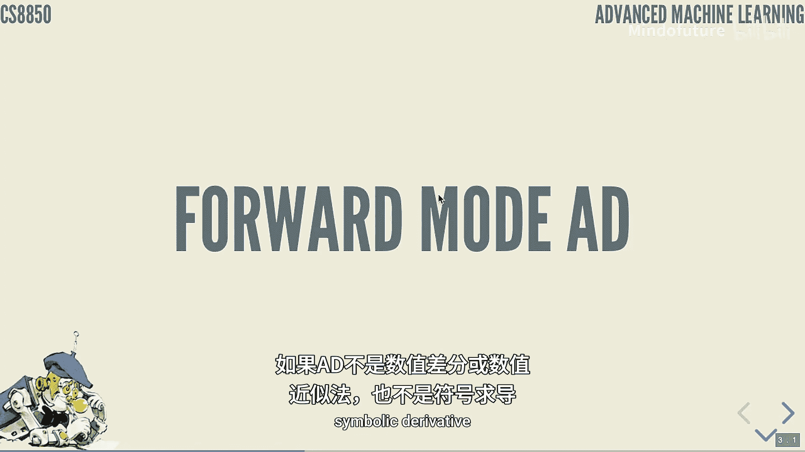
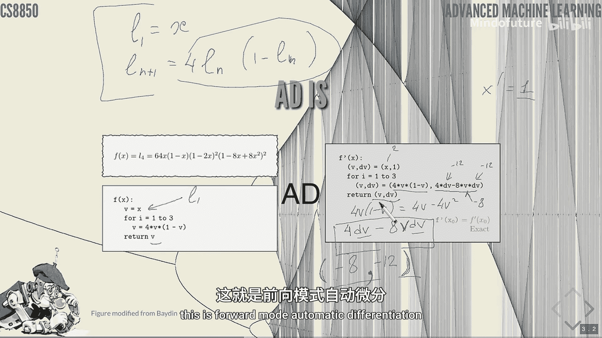
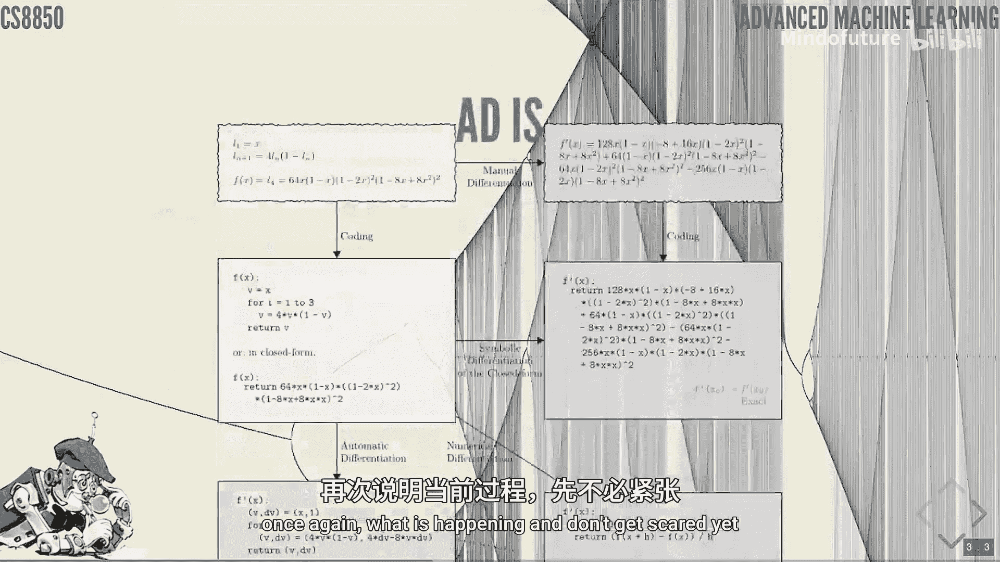
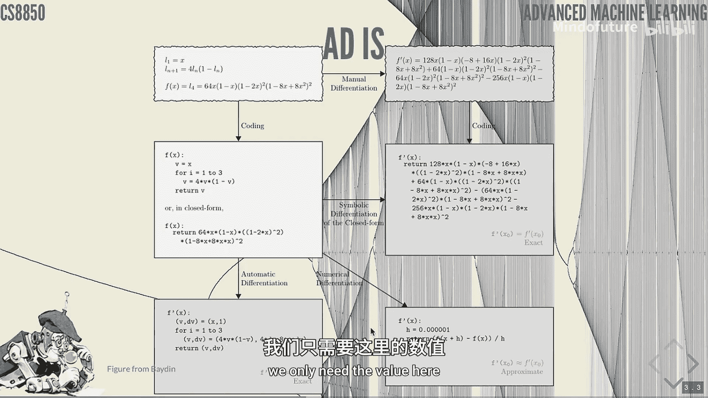
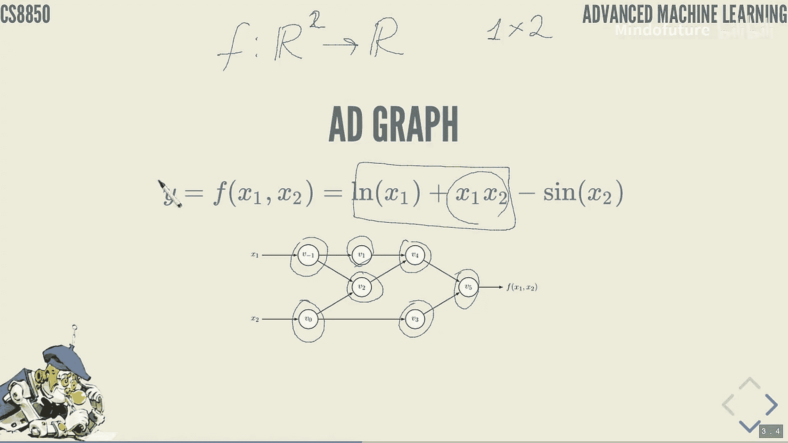
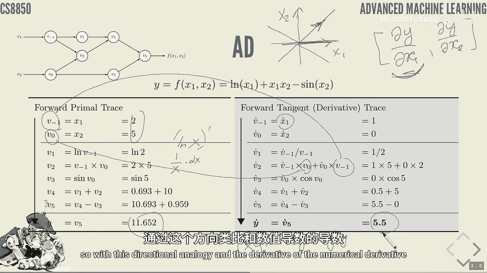
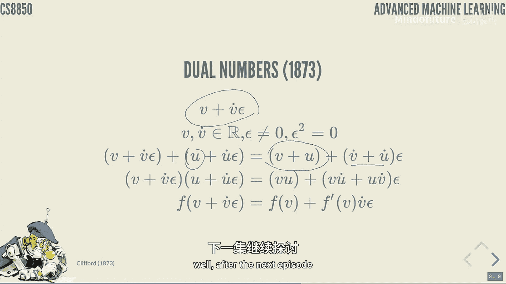

# 高级机器学习主题-CS8850-｜-Advanced-Machine-Learning-p49-P49_前向模式AD--BV1sapPz4Ewx_p49-

Forward mode。A。For mode automatic or algorithmic differentiation。 So if a D is not。

No medical differences， No medical approximation。If A D is not symbolic derivative， what then AG is？

What does it do， So here's an example。 Let's go back to our。Step4 of the map。

Of the dynamic map that we're considering， remember。The definition was。1 is x， and L。N plus  one is4。

에 뭐。고。Only， of course， there is no minus1 there。我。그。Okay。That was our definition。 So well。

 we can just take and bruforly write the loop right for number four。

 we start with one and go to3 and we'll get our L4 because this is one。This corresponds to L1 step。

And it would go through the steps， iterate them up， and return the value L4。So， look at what。A does。

ED says， instead of starting with V。Equals to x。What is the derivative of X？Oh。It's one， right。

So we'll start with this tuple with this pair。Of x and its derivative。

It is easy to calculate the derivative at this point， right。

 we are using symbolic differentiation So just an aside to the previous episode。

Even though AD D is not numerical differentiation by differences or non symbolic。

All of the methods have a don't fall into primribalism of my method is better than your method。

 there is no point or there is no intention here every method has its own use and it's just a tool。

So here we do in I， we do use the rules things to labibs of symbolic differentiation to。

ToComp simple derivatives at at each point。 we just avoid computing complicated derivatives。

 and numerical differentiation by differences also is a good tool when you're developing A systems。

 It's a good debugging tool because it's very easy to implement and you can always just throw more cycles and test your system on numerical differences。

 So let's， let's go back to the map。 So what we do， we simply repeat what is happening here。

 step by step。But in the following way。We take。而 function。In。Are the derivative。

But we evaluate the demat。At the previous point。So when， we plug in。

The value of the derivative from the previous step and the value of the function from the previous step。

Into this next step calculation。 And we calculate， because we know。What。

 what is this value automatically， right， So we have。Yes， to simplify。

 we need to compute derivative of。4 V1 minus v。😔，Or，4 v，4 v squared。

 and derivative of this with respect to B is nothing but4。纸边。Remember the differential。

 Now we need it as ever minus-4 V TVV。So that's what is happening。

 D or this differential that we brought。We just plug in here。So， and also。

 we plug in the value of x that we started with。And we can start。Yeah， we。

 we are evaluatingating derivative。At this point， and if we started， say， with x equals1。

Just for example， and this whole thing will be minus-4。And then we started with x equals1。And。

4 times 1 minus4 squared，41 squared will be0。And then， this number。No。

We'll go into the next detereration。And then we'll plug0， plug0 here。 Well that was bad。No。

Quickly converged。So some yeah， it collapsed。 Let's let's， well， let's try something else。

 but you'll see where I'm going， right， your x could be 2。

 Let's start with x equals 2 and derivative of x is still one right。

 doesn't matter what its numerical value is。 it's a constant。嗯。We started with， okay。

 now it is 8 times 2，16。 So 4-16-12-12。 But when we plug to here of 1-2，8。诶。诶。-8。

 and then you continue， you take these values。And come here again。So， plug -12。-8。And-12。

And keep it raising and in the end you are returning numerical value of derivative together with the value of the function。

This is forward mode。

Automatic differentiation。Once again。What is happening and don't get scared yet， we're not done。

 There will be more explanation。

So， we have this map。And of course， depending on this coefficient4， if it's higher than four。

 then you will get this nice bifurcations in this map。

 depending on the starting point and everything， so we have this map and the goal is to compute derivative for L4 manual differentiation。

 we can easily do that。Manual differentiation， we can easily do that。And then we can call it up and。

Produce a function。This will be more ofva。I little approach。So we can code up the function。

Or code it up in closed form and apply symbolic differentiation to the closed form。

 and we will get this function again。Athematic differentiation。Transforms。Are a regional function。

Into something else。It does take as an input， like interface is the same。Turn value changed now。

 So instead of returning just the value of the function， it also returns the value of the derivative。

Of the function。So。That in one dimensional case， that is simple and numerical medical differentiation just returns。

Difference approximation to。呃 deative。The key point is that。Athematic differentiation。

Deturns the value at machine precision。The same as the manual1。

 So if you if you are computing something with gradients， you can manually differentiate。

 analytically differentiate your function and write。

A function that computes the derivative for your MAlab or whatever for your solver。

And then pass it on， and then the solve will call this function to compute the derivative。

Instead of taking an approximation or。Your solar could have used AD。

And every time it evaluates the forward of the function， it would obtain the derivative of it。

The numericalical value of the derivative important to note here， not the derivative function。嗯。

It's a much harder problem， and plus we don't need it。 we only need the value。Here。

Assumer function is。As simple as that， it's a function of two inputs， x and1 and one output， So R F。

Goes from R 2 to R。And。Yeah。The Jacobian will be one。P too。Vectctor， right， the gradient。

So when when we're talking about solving functions like that， think about compilers。

 how compilers would decompose this and construct。 you need to store all of the intermediate values somewhere right。

 So here's a computational graph of this function as a compiler would construct say， well。

 going from syntax tree parsing and everything。 But then in the end down on the hardware。

 this has to be converted into computational graph X1 and x2 have to be stored somewhere。

 So they are stored in this values v0 and be -1。 and then intermediate value of the product is here。

 we do you multiply those two an intermediate value of。嗯。Say either sign or log， say log is here。

 Then you add them up together。 log and sign and the product。Has to be stored somewhere。

 the intermediate value when it's not your compiler。It's not your code where， where you write like。

 oh， I don't have to store it in the intermediate value。 But when it is computed。

 it has to be placed in some register somewhere on the raw hardware down beneath。

 And then the sign is computed here。 And then we subtract and。

Here we go with our computational graph， we've got a result。

Okay， now memorize that computational graph well just kidding。 so let's see what happens。Once again。

 so imagine x1 is 2。 X 2 is 5。 We pass this values into here。 They are obtained and stored in some。

Let me the register。V-1， and v sub 0。When。We1 is our log。We can compute it and store it。We're here。

This value is here。Hello， natural logo 2。And then we compute the product， and then we traced。

 we compute the sign。 We compute the sum。 We compute the difference and that in some intermediate register。

The value was produced， and then we stored it in the output y and returned 11。65 terms。

650 to 10000 right。Thousands。Okay。No。What is happening in parallel。

When we are computing the forward mode， A D。So forward mode I D。

 what it does is let's assume we want to compute derivative。What the specs do them。First value。

Just that。Just the X1。And。So what willll obtain at the end。Is the first component。Of our gradients。

 right， we have。Our Jacoban contains of two。Elements。And so， think of a basis。

In which this Jacoban leaves right， we have x1。And x2 I'm sorry。And next2。

So right now we are computing。诶。Dive along。This dimension， right？What if what happen， what that。

 what happens to why when。The wiggle， the change happens along its one dimension。

 So we'll put a value of one。Into the derivative of x。

 and we've put a value of0 into the derivative of x2。

 not just we could have done both one here and one here。

 then what we would have been like evaluating in this case。

 we would have been evaluating when both of them are one。

 we are evaluating derivative along this direction。So just running a little bit ahead of myself。

 we're evaluating derivative of that we're evaluating a directional derivative when we are evaluating forward mode ID。

We could。Evaluate derivative along this direction as well by setting those values to。

One and minus one or minus one and one。But for now。

 let's focus on just evaluating one component of the gradient。Okay， so。We want。We know that it's。

 we know the delivery freight。It's。Logo， X。Prime derivative is 1 over x times the differential dx。

That's what is written here。1 or x times the differential。 What is that differential。

 We're bringing it with us。 It's one。 Okay， let's plug it in。And divided by two， then。嗯。

The differential of the second differential V2 here。We're just going in strict correspondence。

And again， what is the symbolic derivative of a product x times y prime。Equals x prime Y plus。X。

 Y prime。Well， but in fact， this has D X。 This has D Y。So we that's what we have。어  응。1 takes 5。Oh。

 okay， that's， that's the thing。 So because。To do to x is one。 So okay，2 to is1。 Okay， that's。

 that's why we have this。Then we go to be 3 sign。 Okay， it's cosine times the differential。

 The differential is back。To corresponding B or next2。 So we get this。Z times something。 And then。得。

Since we don't have any coefficients， right， it's just a was B。

 So one and1 only differentials per a role。 And in the end， what what the whole procedure returns。

 it returns numerical value precise up to machine precision value of the derivative at this point。

With respect to the first component。And see how it is at this point，2 and 5。

 because the values 2 and 5 do play a role。 Phi 0 is defined here， so they are connected。

V minus-1 is defined there。 So when。This execution happens in parallel in your computing。

 both the derivative and the function value and your return， okay。Here is turning this and it's it。

With this directional analogy and the derivative the the medical derivative， I hope you see now that。

What this。Procure is doing the forward mode。 A D。 It picks a column of Jacoban in a single path。

In a single bus。So we have Jacobian over function F， and that's what it is。

Just all of the corresponding derivatives of every output with respect to every input component。

 every output component with respect to every input component。

So that's why it is dimension of the output components by the input components M by N。So。

 directional derivative。Is nothing but a product of this Jacobian。Times a vector。

We're not actually evaluating it the Jacobian is unknown to us。We are。In effect， what AD does。

 it evaluates this without actually expanding the Jacoban or constructing it。

It's not doing element by element， but the result is effectively what's written here because matrix vector there is a matrix and whatever you plug in here。

 you will get a directional derivative。Result， so think about the following now when your function is。

 I case you start with the next。A single number。Going through some complicated process function that returns。

Multiple outputs， a vector。hy。Why1 through Y am。And x is just one number。

So your Jacobian in this case is just one vector。And youre derivative。Every component。Of your， your。

 your whole。C1 by Dx。The x is the same。So you go G Y， g2 by the x， and you go through。

Do I am by jazz。In one forward pass。You are computing this whole and I've transposed this， of course。

 you are computing this whole gradient when you have a function that takes one scalar and converts it into a vector。

 you're computing this whole gradient in one pass。一条。If you add， say second number here。

So it's two numbers， x and sorry， X 1 and x 2。I just don't want to overload X1 and X2。

Then you cannot just set one here and one here because they will not be computing gradient。

 You will be computing directional derivative。 That is。Along the diagonal in the x1 x2 space。

So you need to separately take another step and once again。

 run the forward process and compute the second part of your， the second column of。Near Jacobin。

If you want the full output derivative。So this is a pain and in the next episode。

 we'll talk about how to what it took。Quite some years to figure out birds spill spillling Sp planningning。

 did it。But we'll talk about how to efficiently compute the derivative using backward mode ID when you're in a quite opposite situation。

 so when you are in this situation。You can do it easy。When this is the function。

 but when your function。Is。Multiple inputs。And one single output。Then you need something else。

 We'll talk about that。 But now， here's an interesting。Curiosity or amazing ingenuity。

 So Clifford in 1873 introduced something called dual numbers。 Now。

 you represent your number as the sum， your number plus the derivative and。An epsilon。

 So as long as Epsilon is a known zero number and has a property that when you square it。

 it it equals to 0。The following operations are possible。

 and the results that are generated are amazing。 So take two dual numbers and add them together。

 So you add the。Like， you cannot mix the differentials with non differentials。 So you separate them。

 So you add the。The sort of。A real part and the differential part。 And oh， look。

 this is derivative of the sum。Okay， let's do the product。 Let's multiply u times V。

 And when you cross multiply those two terms， you get epsilon squared， which is 0。 It cancels。

 And look what you've got you've started with two dual numbers and you got another dual number。

With the。I don't know what is called actually real part or non differential part。

 but this is the product rule。Just emerged from the way Clifford has cleverly constructed the dual number and then。

Other other rules emerge as well。Function of a dual number is nothing but function of its real part plus the derivative。

Of this function， of the real part。 So it's it's the compound function derivative or complex function derivative。

My。Yeah。Well， after the next episode。

