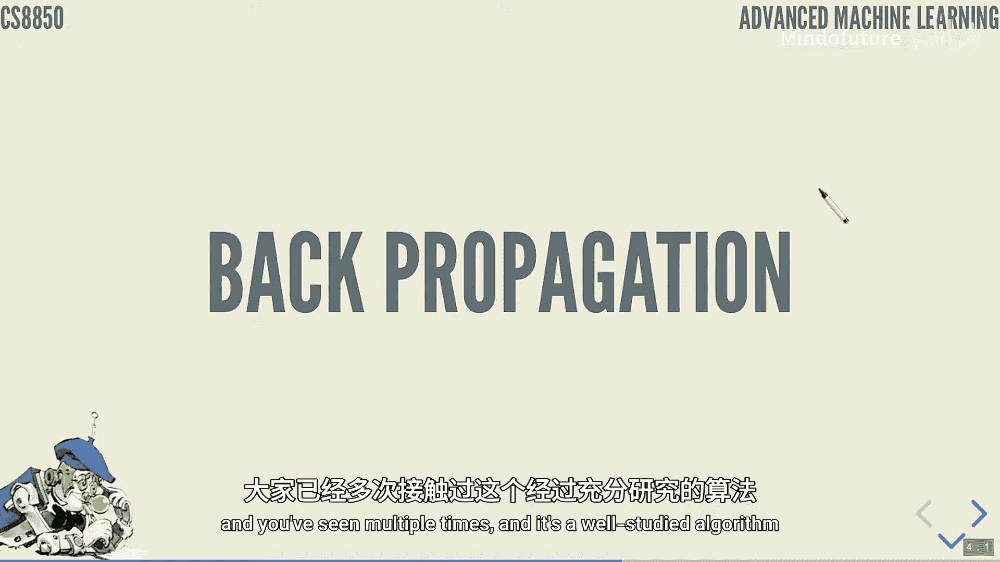
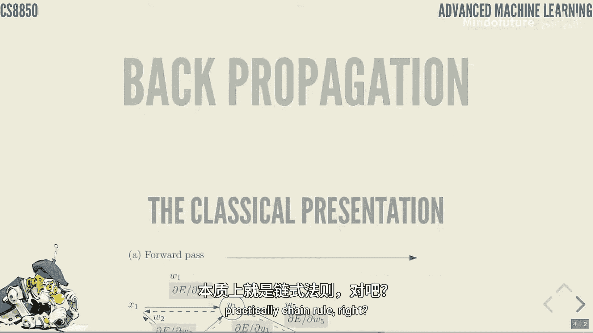
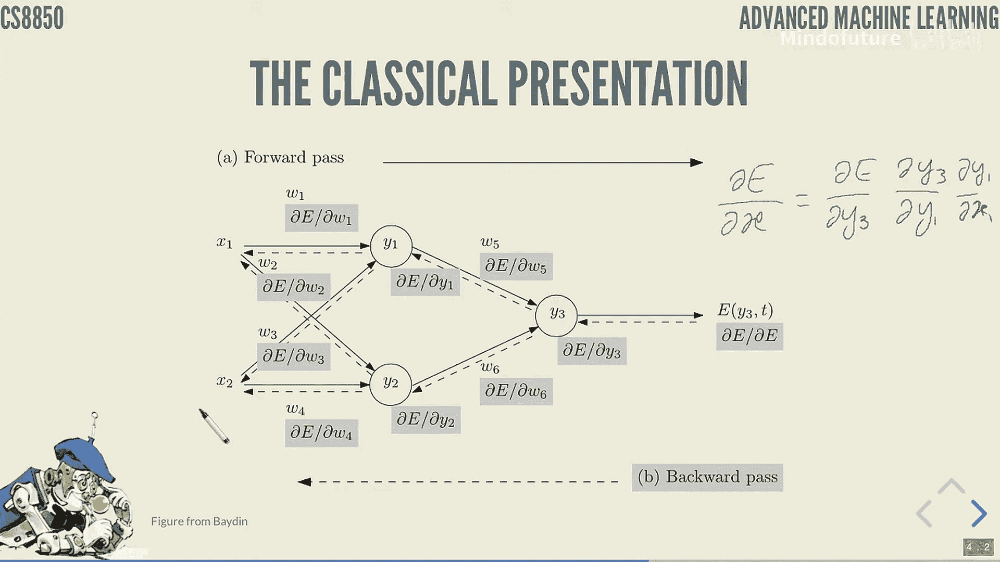

# 高级机器学习主题-CS8850-｜-Advanced-Machine-Learning-p50-P50_关于反向传播的一分钟--BV1sapPz4Ewx_p50-

Now a little section on back propagation， something that all of you know by heart。

 and you've seen multiple times and that's a well studied algorithm。

Practically change the rule， Right。 So let's look at this figure from the Biden's paper。

 So we have a simple。

Neural network。Well we have two hidden neurons， one output neurons。SoThe output is here。

 what is happening on the forward pass。We compute。The values。 And then what we call now the loss。

 We compute one output。When there are multiple outputs we still combined them in one loss and we optimized the loss。

AndBy back propagation， actually or by reverse mode A D， we can optimize。呃。All of the outputs。

 simultaneously。But back replication in general， you sort of collapse everything into one number。

 the loss and you optimize the loss。Ass a single number。

 so you first compute the error with respect to that。I would put target， and then you back。

 propagate the error。 It's basically the goal is to compute the。Deliative of our。Ls with respect。

 say to x。With start with the by。G， Y3。And then D， Y， D， E Y， D Y3。

Is nothing but the with respect to say。DY1， and then Dy1 expected D， X1。And those， in turn。

 depend on Ws and things like that， but。B propagation on the backward past computes those little things。

