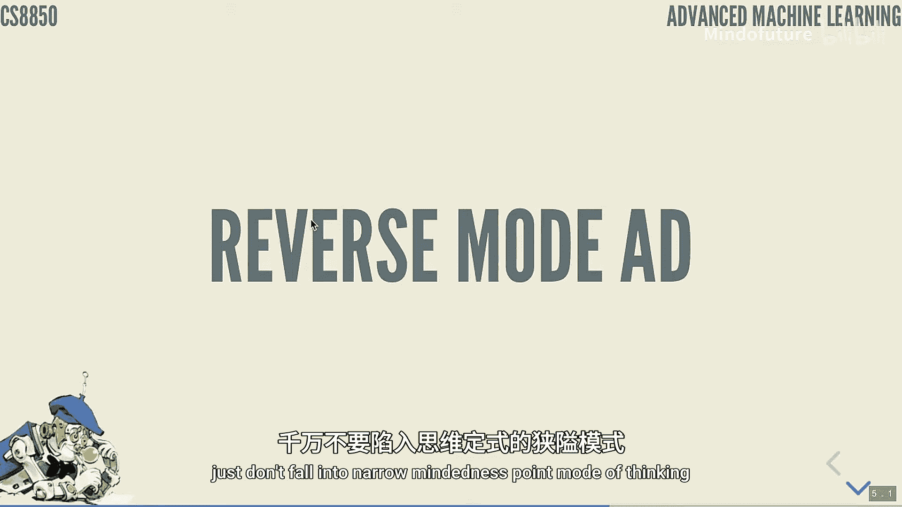
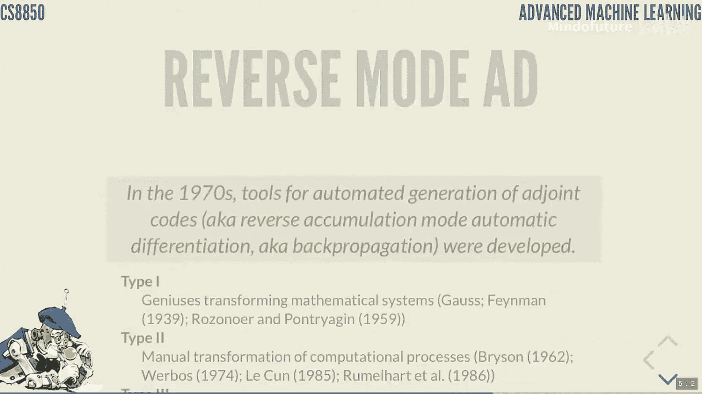
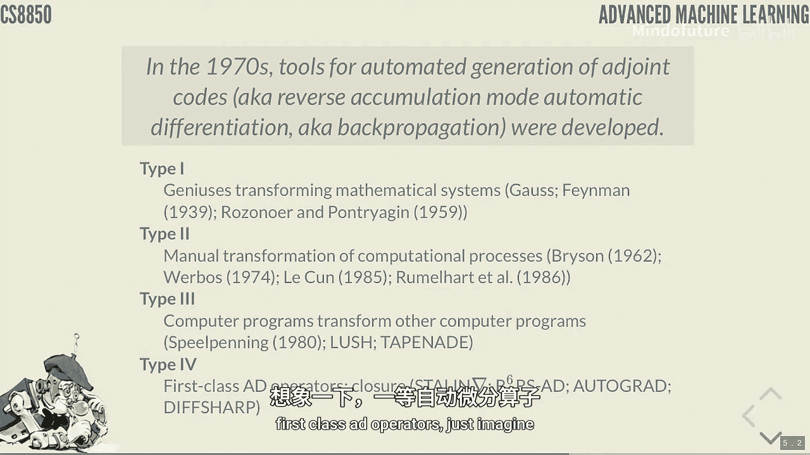
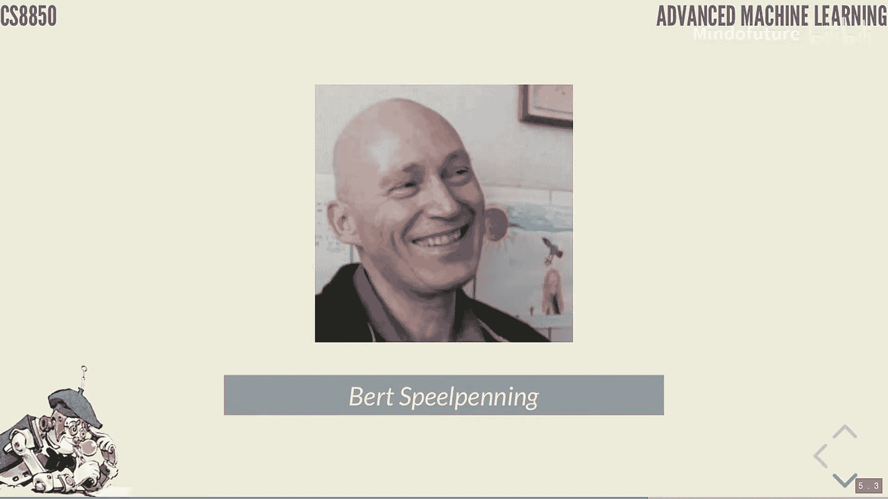
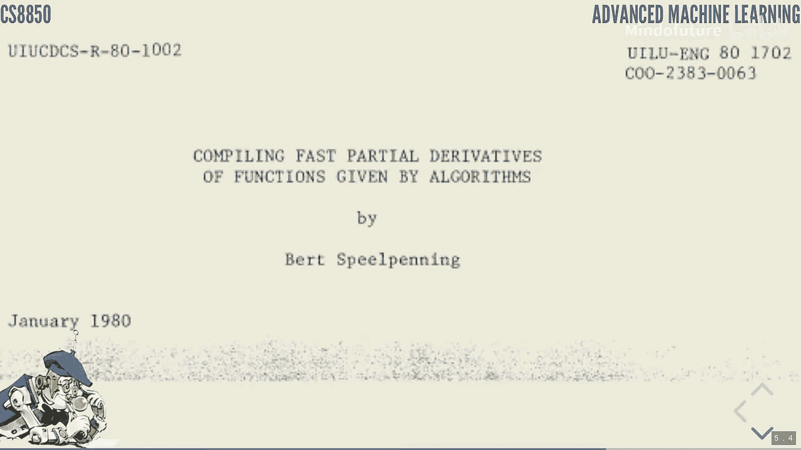
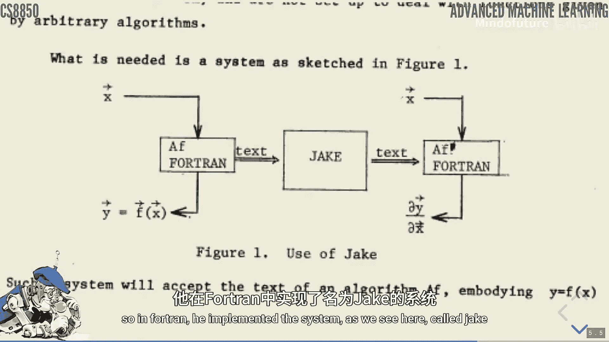
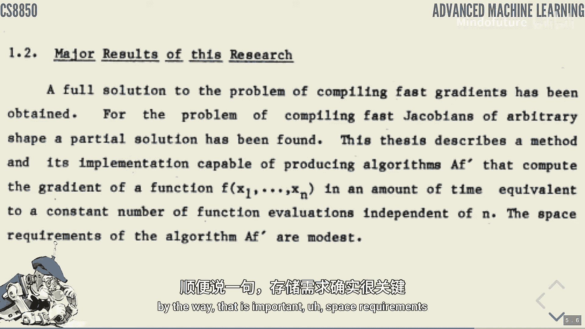
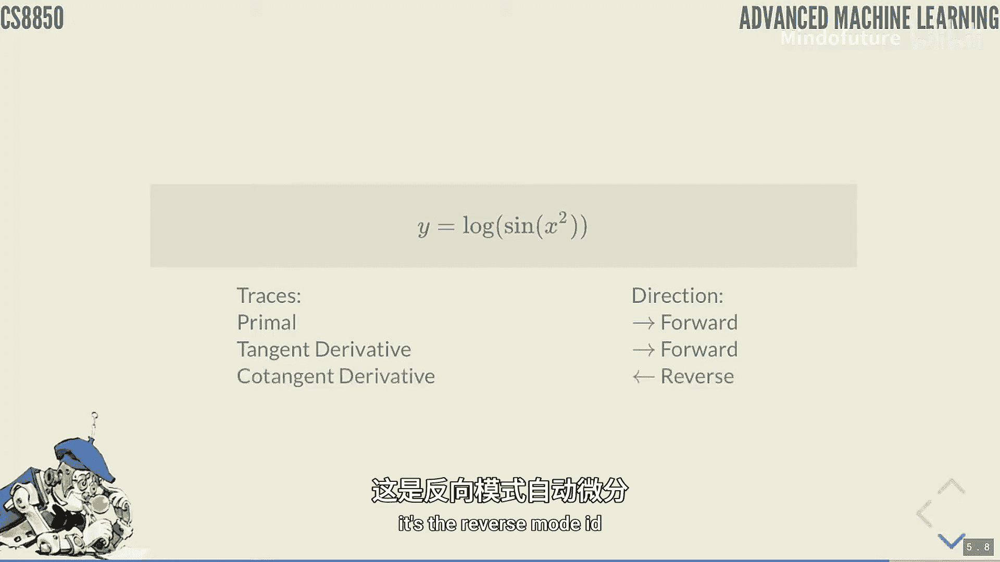
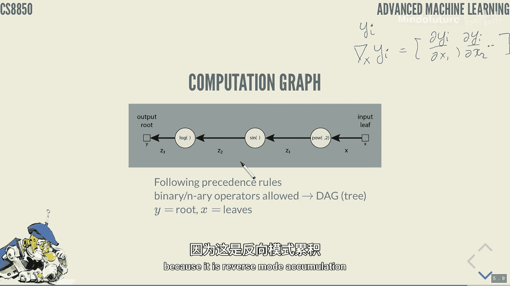
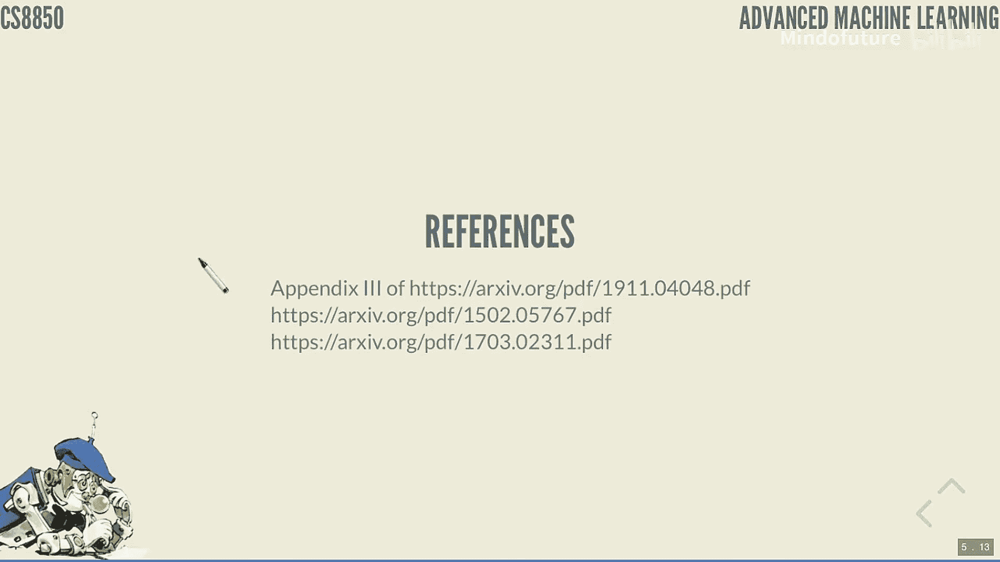

# 高级机器学习主题-CS8850-｜-Advanced-Machine-Learning-p51-P51_反向模式AD--BV1sapPz4Ewx_p51-

Now， a reverse small A。Which is essentially a generalization of fact propagation。

 It was invented before then long and interesting history read the Biden's paper for。

This is starting moments are the starting points of that history in the pointers。 But let's。

 let's go。And choose only one way how we can talk about it right now。 But just have in mind。

 it's live。 and it's very versatile and much more interesting than a textbook or pad professor can tell you about you have to explore for yourself or just having why just don'tfall into narrow mindedness。

Point mode of thinking。Rverse mode I D。 So in the 1970s。

 tools for automated generation of a joint codes， also known as reverse accumulation mode。

 at the magic differentiation， also known as by propagation were developed。 Here's some history。

 type 1， geniuses transforming mathematical systems， gas， fineynman。

Rino and Pentagon back as far back as 1931 and 1959。 Yeah， Sur。

 Feynman in 1931 discovered something that is。Diddy， would you throw a fixed point。

A lot of interesting stuff。 type 2， a little later， manual transformation of computational processes。

 Bryson in 1962， Verbuus in 19674 and Laon in 1985。

 And then later Ruelhart in 1986 found specific ways how to code。The differentiation。

 you can write a code that will differentiate your specific。A computational process， or you right。

Computational process。That is computing derivative of your computational process。

 That's what we used to do when we manually coded back propagation without。 well， I did。Long ago。

 but anyways， but also not long ago or very， very way。

 way after from the after the time when Atmaic type 3 computer programs that transform other computer programs were invented in in Ben spew painting。

1980s published the truly first system that automaticallyomaically does everything one needs So lush due to Licon and Leon but2 then its predecessor1988。

 S N， I think already had that built in as well。 And then type 4。ButPros。

 it's when A D operators are first class and they have closures and everything。

 So things like Stalingrad， R 6 R S AD， Autograd， deep sharprp and others。

 So those the type 4 is truly differentiable programming when you're in the in control。

 first class A D operators。 just imagine this。

So birds feel thinning。Here's our hero。

191980， right， compiling fast partial derivatives of functions given by algorithms。

That's what he did。 So in Fortron， he implemented a system， as we see here called Jake， that。

Major result of this research would be a full solution to the problem of compiling fast gradients has been obtained for the problem of compiling fast Jacobants of arbitrary shape。

 a partial solution has been found。This the describes a method and its implementation capable of producing algorithms AF sharp that compute the gradient of a function F of x1 through xn in an amount of time equivalent to a constant number of function evaluations independent of n。

 The space requirement of the algorithms are modest， That's important， by the way。

 that is important space requirements。

So here's a little more interesting stuff that Bt is writing， birdss scing and writing there。

 the separation of numerical analysis from software is virtually complete。That's 198。

And a few people care to breach the gap between the areas in the medical analysis。

 the notion of programs that produce programs rather than numbers is largely absent。Conversely。

 people involved in writing software tools may have a tendency to write only such software tools that aid in the writing of other software tools。

What seemed required is well。Sorry， think of all of the。Anngular Js and other。To kids and。

Deaf kids and all that any sorry what seems required is efforts by people with a certain minimal understanding and interest in both areas。

 Yeah， yeah， like。At the later， when you have time。

 do read what every computer scientist should know about floating point numbers。So here we go。

 Let's take an example。A different function than before。And the function is。

Slightly more complicated， maybe a y equals log signine of x squared。So we'll need do traces。

 the primal trace is in the forward direction。Is from x to y， and then the tangent derivative。

Can be computed in the forward direction， engine derivative。

Our directional derivative we just discussed in another previous episode is forward mode A。Co。

It's the reverse mode ID。

It's what we will or what we are discussing now。😔，Slightly differently organized， but thankfully。

 linear。诶。Computation group。The figure is thanks to Rogers Silver， so we have X。

Then we apply the power， then to the result， we apply the sign， so there are no branching。

 so it will be easy to follow what's going on， and then we apply the log and then we produce the output that are done。

So。We just followed business rules。And then binary and and energy operators are allowed as long as we have a tag。

 you have seen a computation graph。 It's the same computation graph your compiler constructs。

 But now we will do something else with it。 instead of。Computing the elements of our。

Jacoian or elements of our gradient one by one， we will compute them all at plants。

So for every given y in the output。We will compute the gradient。

Of this Y I with respect to x as a gradient vector， D Y of I， D， X 1。GY IG x。2， and so on， blah。

 blah， blah。In one。Just pass， so why is the root excess。

 the leaves because we're going backward because it is reverse mode accumulation。

So we have intermediate variables。S a by in this case。 So each intermediate variable。

 we need to make those assignment when we an aside， this is an actually a downside of back prop。

Or reverse mode。A啲。Because you need to store all of those intermediate variables。

 You cannot just get rid of Z1 and then produce why we need all of them， Z1 Z2 and thisD。

Why do we need them， We'll see， well， there is another notion of a joint， a joint of x。

 or a joint of z， it means the outputs y derivative with respect to that variable。

 So take any variable and intermediate variable is is3， So what is a joint of this。

 its dy by d3 d z3。Let's continue the example， so we have our example。

 the forward computational graph is done， pump pump pump。

 we went through all the step and we computed the output。Let's go backward now。

 So let's compute the joint of Z 3。 So D by the Z 3 is nothing but D by D。 So a joint of y is one。

We will we've started with this a joint。 So now imagine that we had similarly Y1 and Y2 as in the previous example。

If。We will set1，1 to 1。 and y 2 to 0， we will end up computing the gradient or。

They could been trans by。嗯。A column of Jacobin transpose。Okay， first， I joined。Is down。 We got it。

 Second joint。 Z2 is nothing but D by Dz2， but what is it， Well， it's divide by Dz3。 and we have it。

 It's Z3， a joint， which is why a joint here， which is one and Dz3 by Dz2， What is our Dz3。 Okay。

 so derivative of log 1 or Z2， and that's what we got。And then the same a joint of Z1。

 It's d by Dz1 and chain rule again here。 But we already computed everything。 So Z2 and。

好啊这ele from the signine， cosine。Got it。 And now we have a joint of x。

 and we already computed the previous part。 So and well divide divide by D1。It said。Yes。

 and were computing D1 by thex， x squared to x。T， so essentially。

 we've computed one by one all the chain rules， the chain rule and in the end with computed X。

 And this is one dimensional example。I made it easy for you Well， actually， Rogers。But we can。

Kin of combine and compute it。Altogether， and interesting。

 you can use the point of this example and the point of this lecture is。

Not to give you in one sittinging。Give you a full course on everything about automatic differentiation。

 about A D。 The point is to introduce you to the notions。

 and then you will figure out in your homework and later in your life and career。😔。

How the little details of it work。The whole baby， but right now。Bighttor chainer。

 those two kids they are doing truly。I'll get it in differentiation and then Tensor flow and。

The late Tano and other similar。Packages， they're doing something else。Why am I saying that？

 So the dream of differentialiable computing is an A D。

Supports it and fuels that dream is that all of the like you're evaluating while computing。And like。

You're going backwards through your computation trace。 That's why the word trace in the last slide。

 So you're evaluating your derivatives and keeping your intermediate values。

 depending on how you went forward。 So you're running your code。 and if then L statements。

 forward loops branching and everything is naturally supported。 next iteration。

 you go through a different branching in the if and L statement doesn't matter。

 you can still differentiate that。 And when I'm saying again， note。What I mean by differentiating。

 I don't mean you're computing the function， the derivative。

 but you can compute the value of the derivative。Of this function that took that particular branch。

s that's a different function right now， nevertheless。You have the derivative value as well。

 So you can keep building。Maatural。expressions of a numerical。Programs and the derivative will。

Be computed at the grid the medical value will be computed at the mine screen for you。

 Another application or interesting tool。That。Probably wasn't expected， but。

Is that you can actually use reverse mode ID to manually differentiate functions。

You can use this technique that's on the board and that is in the first reference at Pan3。

You can use it you can use it a reverse mode ID to obtain a symbolic derivative manually。

 it simplifies the process of differentiation of a complex matrix。Function。Sometimes。

We need this for a paper， for proof to figure out what's going on or to actually symbolically implement it in our code。

 And so reverse mod enables。That manual computation and or simplifies it hugely。 Well， that's。

 I think that's all for this lecture。 You need to understand the difference between reverse mode I D and forward mode I D。

 You need to be able to。Compute derivative function in forward mode。

 and hopefully in the reverse mode as well。 But forward mode would be a must。

 and you need to understand。Why the forward mode is directional derivative and what does the rigorous mode do。

 Hopefully， this is。Deserve for you to go and learn more about A D。

 It's one of the advanced topics that we cover in this class， but maybe it is not as advanced as。

Underrated。诶。Fun stuff。 Thank you。

