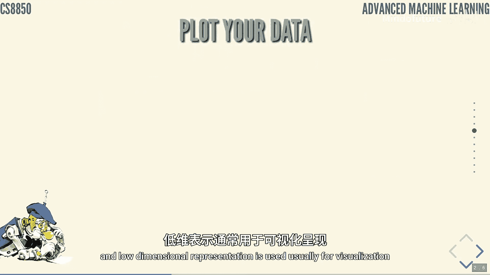
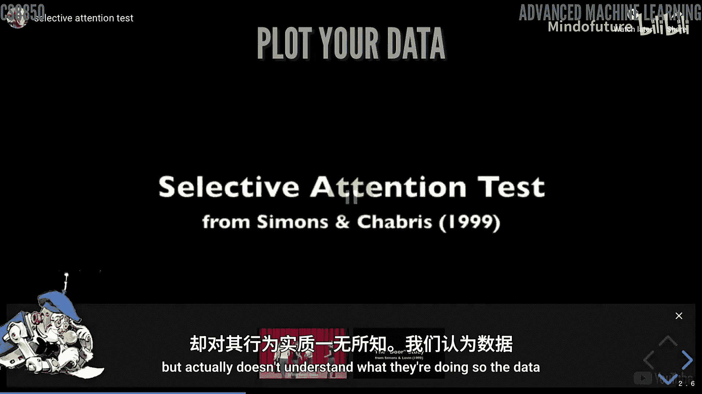
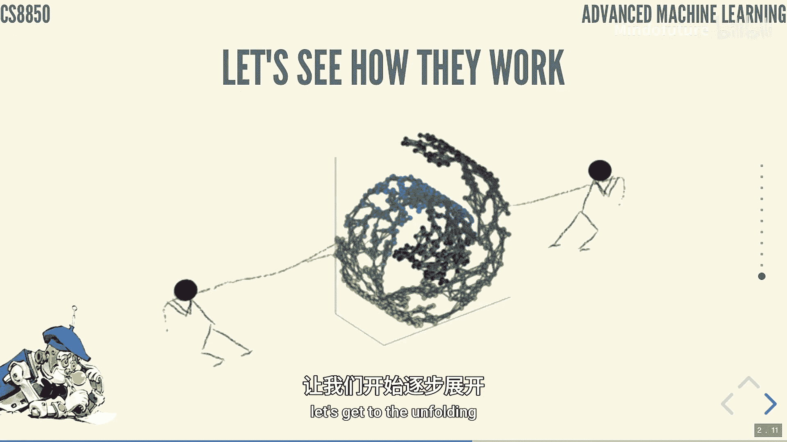

# 高级机器学习主题-CS8850-｜-Advanced-Machine-Learning-p52-P52_流形学习--BV1sapPz4Ewx_p52-

Hi class， today's lecture is on Manifold learning and as usual we'll give some motivation and a preview of what's going on。

啊。你都しぶ。没ever。Perfect， again。Ially， what we want to cover in this class and what topics are included in today's lecture is the motivation for Manifold learning。

And then a little bit about a little bit on multidimensional scaling， Mgs。

And a section on locally linear in Beijing。I sum another。Maybe not related。

 but interesting approach that is doing the same。 All of those methods are striving for the same to solve the same problem that I will cover。

In the motivations section。And then， despite existence of。

A plethora of other methods that do the same thing or strive to solve a similar or the same problem will jump into。

Relatively recent this one， but very remarkable。Cease me。

A tea distribute stochastic neighbor em bedding。And talk about something unexpected， I guess。

 after all of those complicated methods， we'll talk about simple random projections。

 which actually are related to some of the goals that these methods are trying to achieve。

So here we go， motivation。What are we doing， What are we solving。 So， first of all。

 data is inherently lower dimensional。And I did say that in the PCA lecture。

 And I will repeat that again， and the the。诶。Lower dimensionality or the dimensionality of the data is not in our measurement because we can measure a lot of things from a different angle。

 but the underlying processes are quite simple， a fewer， much fewer。

Moving parts than we actually measure and there well， it all depends on scale。

 but usually we are operating on one scale at a time like we're not simultaneously operating on atomic scale and driving a car scale。

 were not analyzing individual atom movements， but we're analyzing what those atoms。Our。Constructing。

 so another car that drives past us。It has made of atoms。

 but we usually don't need to analyze each of them because at this scale， their actions combine so。

That's just an aside。 But at any given time， at any given。

I would say spatial or operational scale that is inherently lower dimensional。 and what I mean is。So。

 let's take。This driving condition， if you look on top and pretend that it's a color image。

 then it could be a megapixixel image with well， mind my resolution of the animated chip that I found online。

 but it could be a megapixel image where each point on the screen。有咩。Can be plotted with time， right。

 intensity with time。 So each point， each pixel here。Can be considered as dimension。

 And all possible values of that pixel is。嗯。So of the。The main。

Like fit this value of that big Soware are。Function could leave。

 or our measurement sample could leave， and。If we took all of them。

 it's a highly highly multidisional space， but really the intrinsic space is all we care about that this blob is a car and this is also a car Well。

 maybe we do care about。Utility car or you know， some a larger car I a truck separately。

From the rest， but。In any case， road is a road。 We really don't care much about every pixel there on the road that at the time of driving at least。

If we're not paying attention for whatever reason that prompted us to switch to a different scale to the cover of the road。

 but so my point is look at the number of colors you only have。Very few dimensions。

 very few components in the underlying picture of the driving conditions。 So another。

 another situation as well， is the way we operate our brains。Our brain gets millions of inputs。

 sensory inputs from the neural bundles that come to the brain sensory areas temporal for the hearing。

 exhibitital for the vision， then we have factory that。Is very important。 And we're like。

Smelling a lot of things and have a lot of sensory inputs that enter the picture and touch every little hair on our skin has touch sensitivity sort of mechanical sensor and the brain perceives all of that。

It's again， mega， pixel， whatever， millions of dimensions。Sensory input， but。Like。

If you touch something， there's only inherently one thing that matters that is happening and the dimension is very low there。

 it's not that。Every sensor。Is。嗯。Delivering。AUn information。 So one way to think about is。诶。

Like the sensors are correlated。But it's more complicated than that， yes。

 that the sensors are correlated， that that's what I'm trying to save。But。

 but the thing is that there is an underlying dimension。

 It's like a PCA where we're finding a hidden dimension by rotating our original coordinate frame。

 Like we're measuring two sensors。 But， in fact， what is happening is not in those sensor space。

 It's in。Different related space。 But what could be happening and what is likely what we believe is happening in。

Reality was the brain or the way we're measuring our data。That the processes， that this data。

Unintentionally represents like we're just casting a wide network measuring something。

 but the process thats happening in that multidimensional space are happening within a thin layer within a dimension。

In that space or a surface or what we call a manifold， I will talk about it in a couple of slides。

 that is much lower intrinsic dimensionality and what we assume is locally linear。So how do we， like。

 what do we do， How do we。嗯。Extract information。这是。To to see how。

Of the day they structured and to see if there are。Excuse me。 Any dimensions in the。

We use exploratory data analysis， and that is。嗯。The methods fall into。

 the methods I'm describing here fall into that category。

 So the goal is to find hidden low dimensional structure in the data。And。

L dimensional representation is used usually for visualization。

 So remember this invisible gorilla experiment and the famous。

Viral video on YouTube where people are playing ball。

 and you're supposed to count how many passes are made by people in the wild and。

Something interesting happened in between， but we usually don't notice just because we're too busy counting the passes of the ball and so similar study。

 a similar experiment was done with。Data。诶 they诶。I didn't have a link for that。

 I couldn't find it but so you will have to transmit it so students were split in two groups and one group was given a set of like they both were given the same data set column of X and Y coordinates and one group was asked to just try to find something interesting and another group was given more specific tasks like is there correlation between X and Y and things like that So。

The data， actually， if you plot X against y， you will just see a picture of a gorilla that was a referenced to this particular video you just saw to the invisible gorilla。

And it turns out that people who were not given any particular task。

 they actually bothered and plotted the data more often and found the gorilla than people who were given the task of finding correlations。

 So instead of plotting X against Y， they would fit a line and report beta coefficients and things like that。

 So when you work with any data。Or any information。 And before starting to blind the apply。

2 box data from S scale learn or from whatever your professor taught you。

 it's always good to think from the basic principles and to look at your data。

 So to just see what's going on， Maybe all of your data is mislabeled。

 Maybe it's full about layersar， Nothing in common between the data or anything。

Look at your data first， play with your data and make sure that you're not working with garbage and because garbage in garbage out。

 you know。So that exploratory data analysis allows us。

 gives us tools to not fall into the pitfall of。Smart but stupid person。

 sort of person who knows a lot of methods， but actually doesn't understand what they're doing。

alk about。So the data we believe lives on manifold。

 what is a manifold and I'm not going to burden you with formal explanations here and most of the slides again here are。

Borrowed from Barnabaash box。哦，个人经买完了。So manifold informally。

 is any object nearly flat on small scales？Well， linear money falls。One， obviously。

 flat on all scales， and we can approximate。Ccle or the。Tungt， so basically a smooth surface。嗯。So。

 so this line is also manifold。 It can be approximated by well。

You can always put a tangent and pretend that it's flat at small scale。WellFor 3D。

 those are just a few examples of manyi faults， but there could be anything。嗯。

As long as they're an near flat， that's small scales that's。So manifold learning is。

 can we find those flat regions in the data？Imagine this is our money fault our data。

 And can we display those flat regions map them to a two dimensional space for visualization。

 Sometimes it's three dimensional space， but more than three。

 it's harder for us to visualize and grasp。哦。Okay， so let's。

 let's look at what I mean in a little more detail。So let's look at this three dimensional picture。😔。

Oh mamas bully mamas or bully mammas skeleton rather。And what is happening here。

 a point I'm pointing to is。Dronone here in black and it's also reflected here in the circleco so the 3D only mammoth is projected with some algorithm and don't pay attention which one it doesn't matter at this point is projected or mapped into two dimensional space we usually when we say projection。

 we kind of imply linear projection， but。Think about this as mapping， because。No， it's not。

 it's not linear and doesn't have to be linear。 So there are a few parameters。

 We can vary like the neighbors that are participating in。This locally linear。ADeciion of what like。

 what is the neighborhood that is local linear and we're flattening it out。

 And as you see the points。I like the tasks and on。The pole got separated， but。

If you increase the minimum distance， you're getting a different picture so you can get this mapping where all of the points sort of flat。

 but。No less or you maybe you can get some idea of your data。Read。By this process。

 even if your data over here on the left is high dimensional， not just three dimensional。

 maybe plotting it in 2D can help you figure out。That there are some hidden structures in this data。

睇下。It'sAnother way to plot， and。Yeah， the corresponding points。Those are just two methods。

 one against another。 And you can。Change。is and he how sensitive and weather is。

It's the point of this visualization。😔，But in practice， there。

 those two methods of striving to achieve the same goals。

This is not as interesting because the death is3， but。Look at this fashion and yeast data， where。

Each point。Is it fashion item clothing？Whatever bags they would beia and how they grouped。3D。

 so even though the input is a 3D。啊。Set of 2D pictures we can simultaneously analyze this whole dataset and this is not clustering。

 we haven't clustered anything this we are already new which are the trousers。

 which are which but the algorithms didn't cluster the algorithm just represents the data in this high dimensional space where each of the images lives in 3D so you can play with it yourself。

After the lecture， or I just follow the path here。So there are lots and lots of algorithm for moneyifold learning quilt。

 PC is one of the。Simple style it is beautiful， of course。

 but he is learning a linear surface or hyperplan。And there is multidimensional scaling that we will consider salmon mapping that is kind of part of it or very related and maximum variance unfolding。

 locally linear embedding， a fresh wave or this methods that attracted a lot of interest to the problem and IomAP。

Fless and eigen mapps from the recent to the era。And then the distributed stochastic neighbor embedding that is remarkable in its own。

 right， random the projections in。Many more。 So let's。Get to the topic。

 Let's see how all of those methods are， frankly， just some of them。

 how they work to unfold data sets that are locally flat， but highly intricate。

 Let's get to be unfolding。

