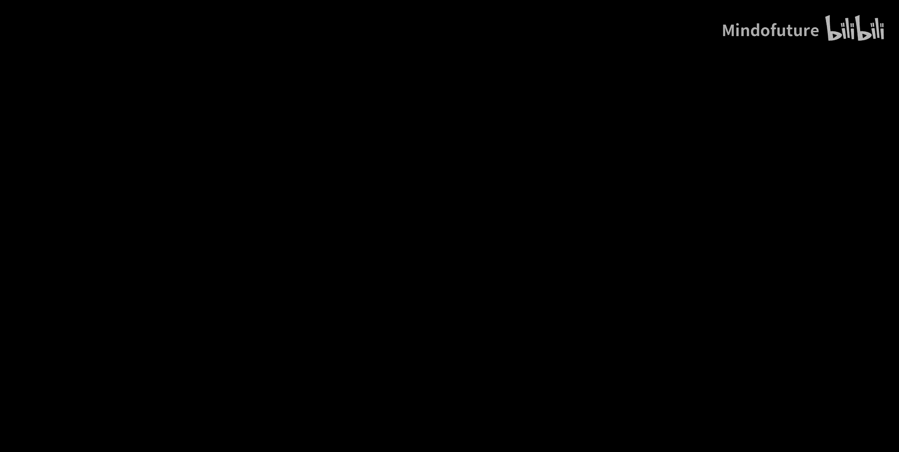
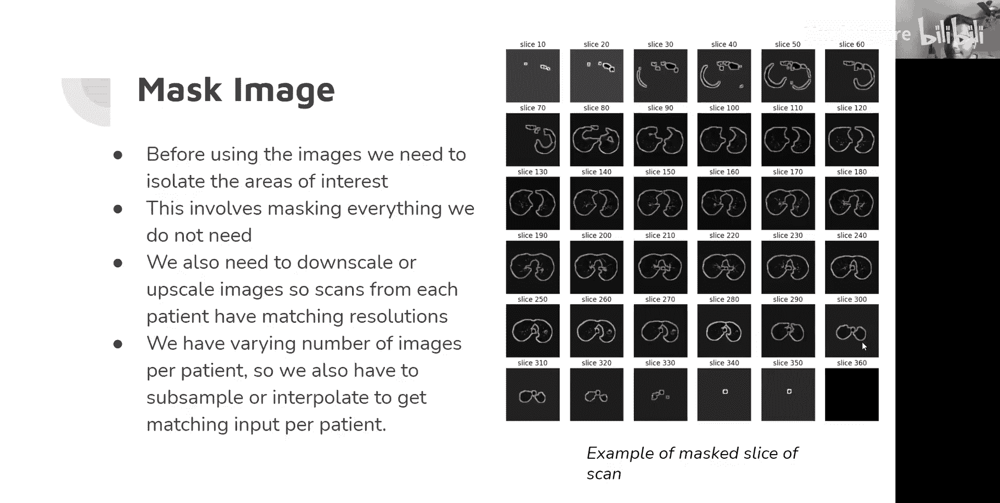
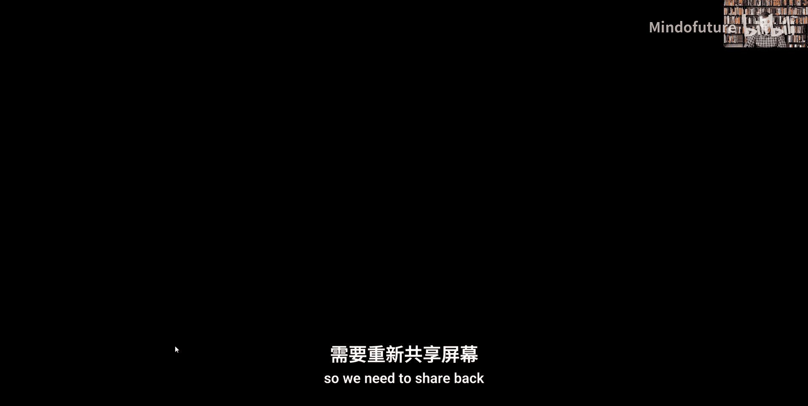
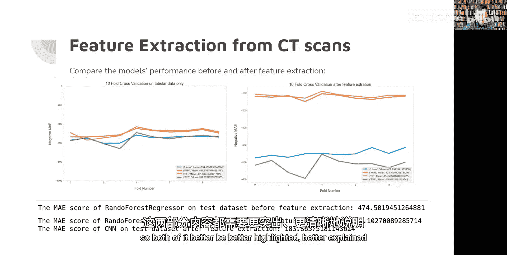

# 高级机器学习主题-CS8850-｜-Advanced-Machine-Learning-p54-P54_CS8850_AML-待办事项_赢_--BV1sapPz4Ewx_p54-

想钱 on。

Oic pulmonary fibrosis progression。 And our team name is to do win。So。The names。Here are my。

Seeeen members。Honey， when。Pvan Maxwell。One me and myself。So this is motivation。

Pulmonary fibrosis is a disease with a disorder of unknown cause， and。U。我谂企。

That is created by a scar of belongs。 So it's a particular disease that's。

Has been proven not to have a particular cause。Or particular key pointss。

And it's actually created by discardcaring of the lungs。So the diagnosis news comes。

In in a range of stability from stability to rapid deterioration and doctors cannot easily tell the patients which spectrum they actually fall to so because they don't really have an idea of how the lung is going to function over time。

They cannot really tell patients how their lungs will perform。

 whether it's going to get it retired or it's going to get stabilized over time。

And so there have been several metals that have been proposed to solve this particular challenge。

 but the challenge is most of those metals are virtually all of them actually difficult to treat and。

That's why if fact didn't have access to chest city scans。

 they don't really have a solution to this particular problem。

 so because of this we intend to work on how to。Predict。The progresses or the in。

In the function of the lungs over time and that is what are telling motivators。

 there is no particular solution， an existing solution to this particular challenge。

 and we need to find a solution to solve this particular challenge So that's our motivation。

And so that brings us to the objective of our projects， first of all。

 we need to see how to look at the overall goal， which is predicting a patient severity of decline in lung function based on on the city scan of their lungs。

And we also determine the function of belong using the LVC that is the output from this parameter。

 which machine measures the volume of hair inher and exed。

 So these two particular entities C scan and the LVC will actually be used to determine。

So predict how the patient's lung is going to function over time。And。Of course。

 we are making use of machine learning technique to make use of this prediction and where a prediction is successful。

 patients can actually know how their function is going to and how their lung is going to function over time。

 in other words， if our prediction is actually successful we'll be able to solve this possible challenge of determining。

How long is going how long of that particular appearance is going to function。不发唱。

So the data sets that we used were actually。Collected from Hoick database which is open source imaging Consortium and Hoick is actually in nonprofits。

Cooperative group that walks to fight IPF， which is idiopathic pulmonary fibrosis and some other related disease。

And。From the data sets， what we did was that we used。Just Citcan， which is the image data。

And related clinical details for for each patient。 So our data set contains two different entities。

 image data or discharged C scans from each patient。

And the tabid data that gives information about the status of the lung of each patient。

 I will collect these two sets of data from OA database。

So in order for us to be able to carry out our experiments successfully。

 there's a need to do some preliminary work on our data set。

The first thing that we did was that we worked on the tableular data。

 we tried to handle atliers in our data， we also normal data。

 so we remove atliers that are inside the tableular data set and also we walked on the C scans。

 we extract the image from。The compfines， we process the images and we fed the images to CNN。

 so we try to mask the parts that are actually useful for those in our experiments。

And we reduce the size of of each image。And we also tried to do what we call feature extraction。

 so we extract the features from each scan that we actually use to carry out our experiments。

And this is just the summary of the data that we used。

Each column actually represents a parameter of specific attributes from different patients and each of the patients that we have in a data set has unique numbers。

In totalA， we have one in 76 unique cases in the training data sets that we use。

And each of those records that we collected has。Or taking between different。

 I mean with different visits of doctor I mean with six and 10 doctor visits。

 if you see the table here represents the。The data sets each。For each patient。

So each patient can have different pieces of records。For example， for the weeks here。

 if you say for negative value， negative value means。Record I was actually taken before。

Everything was measured。And after， after everything was actually measured。

The positive value of weak here indicates that。We have。Measurements after， I mean， kinds of。

T after AVC was was measured。So。And this is the statistical summary of our data sets。 we have。

For each patient you can see的。嗯。The different statistics of educations。

 the age ranges and also the agenda， which is the sex。

Within different numbers of each patient based on their sex。And they are smoking sts as well。

Then we also。So each patient has unique ID just likeam said。

 which is between and contains 12 to1 10 18 baseline chaity images。

 so each of the patients that we take into consideration has different number of。Of scans， I mean。

 of the images。So it ranges between 10 and 1018 scans and the resolutions of those scans as well ranges between 54 and 12 by 5 and 12。

 so 1302 by 1302。And each of those images are stored in decom formats。

And so we use each of the images。And there are every measurements in order for us to run experiments and make our prediction。

So the next presenter is going to talk about our baseline models。

 well before we go into baseline models， I want to quickly talk about I will prepare the city scans。

So because the picks of the images that we have and raw values。

 so what we did was that we converted each decompies。Intohos。Measurements。

And we focus on the loans so that we can eliminate。

Every other parts that we don't need in the data set in the in this scan and the conversion was actually dependent on the scan calibration。

 so。We try to make。To convert the decomfiies to whoms measurements so that we can properly train our model easily on those scans。

 So oneed is going to talk about our baseline models from the next line。Yeah， hello， professor。

 can you hear me。helello。

Yes， go ahead， can you。Full screen Oh， we're replacing the。

Slides now somebody she was supposed to continue sure Yeah， the slides disappeared。

 so we need to share back。

Yeah。Can you present it over session， Yeah， thank you。

So the first step we did while preprocess our data was creating a set of mass images。

So initially as we had seen earlier， that there was this a base of images and a tableular data present。

 but then we we kind of tried to make a mass slice of each scan and then combine to make them a data set。

And so before using the images， we needed to isolate the areas of interest。

 which we would process into the model to create a targeted model。

So we downscaled we downscalelld or either upsscaled images to have a normal matching resolution of all images to create a consistent data set。

And also we had varying number of images per patient。

 so we also had to subsample or interpo to get matching input per patient。Going ahead。

The score measurement that we did for our baseline models was more or less the regression based measurements instead of the classification based measurements as we cannot use the standard scoring measures for regression models like rock curves and AUC and confusion matrices。

So we use the R2 score， which is a percentage of response variable。

hich is explained by the linear model， and we use the mean absolute error as well as the mean squared error。

呃。I mean， yeah， these are the basic definitions of all the three scores。And going ahead of。

OneYeah going ahead we use the baseline model as a regression layer。

 the we try two baseline models to start off with one was an SPVR model and one was a random forest regression model。

For the SVR model， we used the following variables as in its parameters a C is1 and the degree is 3。

 and we used an RBF kernel。As you can see。Going ahead also we used a random forest model comparing both the SVR as well as a random forest model。

 we concluded that SVR model had a better vertical performance on the given dataset set and we would continue with SVR as our baseline and then use a CNN based architecture to build on the baseline model。

PPan would talk you about talk more about the。CT scan and the feature extractions。Yes， is it good？

Okay， so as we mentioned before so feature extraction is one approach that we came up with to handle the challenge that we have that each patient may have a different number of CT scans so we so we wondered if we can like get some features helpful that are helpful to predict our FVC values。

So that would be make more making more sense than than just taking a number a same number of CT scans from each patients and another advantage that we we think is that。

It will be trained more and much more quickly than images。

 so before we before we do feature extraction， we tried to train several several regression models on our tableular data only so and the the plot here。

Shows that the the。The tenfold crosswork validation scores for each models and before before we do like we do this model selection。

 we also like implement grid search for KNN and we are to pick the best parameter for those models。

And the。So and among， as you can see， among。Those models。

 we like we pick our best models by the mean of those1fold cross validation scores， so。So here。

The random forest request requester is our best model for tableular data only。 So。

 and you and you can see we take the。We take the negative M AE as our like measurement of。

Moal performance。 And you can see。After training， after training on。

 after training on this model on test our test data， the。Ie score is like a。400 something。

so and then go ahead。And then we started our feature extraction so before。Before we。We do that。

 we need to like， as， as we said before， each pay each city scan may has a different resolution。

 as you can see in the。In the table on the left。 So we like first step that we do is is to reces the all the city scans。

To like to4，121 by 412512 by 5，12。 So， and after reizing all the。C all the city scans， we have to。

Like to do masks。 So like there。NextNext next page。So。So when we do like when we do masking to。

 to C scans， we have we have  six un successful patients that we cannot like the the masking。

Did not work。To them So， so in order to like in order to compare our model performance。

 we the on the same train and the test the data set。

 we like the records of unsuccessful patients were dropped from from both both tableular data and the data after feature extraction so so that we can make make sure we split the patients consistently so and next phase。

Yeah， and。The features that we came up to calculate were first would be the the volume of of the long for each patient and the next would be the。

The statistical characteristics of housing units。 So according to those two discussions from Cago。

 So we like we found。Like those features that may may be helpful to predict the FBC values and we also。

Assumed that the largest city slide may provide more information about this patient。

 so we also take those those values from the last city slides for each patient。And that's crazy。

And okay， so。After like calculating all those features， values on a。

We have now total 27 features and then we train we train the same models on on our new data so and we also train trained of five layers CNN and because we want to see like if a complicated complicated model can improve somehow。

 So this is the the model summary the CNN summary and。On the， on the right， the plot shows the。对的。

The training process。So， and。Yeah， next。And as I said before， So we need to like， keep consistent。

 So we trained our between the the same models。On the same data。

 on the on the same same data training data set。So， at a。

We do the we do the model selection and great， great search again。

On those four models and pick the best one。By the the mean of the 10th fold cross validation。

 and you can， as you can see on the。Pauluse。So。The I would see all the models improve improved a lot。

 especially for our baseline model of random For and KNN that there is a big improvement。

For those two models。 So， and then we use the best models on our test data set to， to see。

诶 what's the诶 the m a e。A course。So as you can see。呃。The the FMAE reduced a lot， so。

So then we can like conclude that the city feature extractions works well for our for our data set and next next page please so and we also they we also thought about what we can improve further so maybe like。

We can use better masking algorithms because when we do like when we do image masking。

 so the masking method that we used did not work perfectly so。

So we wonder if we can find or create a better method masking method for our data set， so we may。

Like further improve our model performance。 and also。Another idea that'll be。We had is。

If we can do like feature selections after feature extraction too。Select the。

 like the most important features。 So that might also help。And the last one so like is that we。

 I don't we don't know if we can like improve our model performance by training on a more complex model like many layer C。

We don't know that， so if we get a chance in the future， we can。See the results。So， and that's。

Pretty much about feature extraction and the next presenter view。Present our another method。

For our project。Thanks so much Andrew， the next method that we try to implement that plus still of work in progress is trying to leverage deepplan technique and verify if a conution neural network based model can perform better than the baselineside models that we have seen so far like guess we are in landforest so the idea here is to use these master sample images that we have pretsses before and feed that to our con neural network model and check the performance of it。

So the input to this model would be the data of each patient where in after masking and reampling。

 the number of images per patient is about 364 and the size of each image is about 346 into the 346。

Now the target for the Kation neural network for estimating the FEC would be the FEC measured for every CT scan that is same in that tablet data now based on that tablet data you can very well see that the FECs is measured after each。

visitor to the hospital by the patient that is after eight CD scans taken。

So the way we went about formulating this problem is based on the number of weeks that I've seen here。

We find out the minimum and the maximum and then the target value would be such that that is all。

Transformed into a single 1D a， but as you can see from the transformation so this kind of makes the problem much more challenging and difficult。

Cs the FEC measurements taken for patient visits as different for each patient that is not constant that。

Each patient was at a particular job。Perio of time and then takes it it can vary between different patients。

 So the way we have formulated that。Yes， we understand that this is a quite challenging task for model and the model has to estimate about 138 different values for each patient。

 that as for each visit to the hospital。Next slide please。

So the CNN model is based on the Linet 5 architecture where we have a couple of convolution layers with a couple of max pullinging layers in between and three fully connected layers in the end。

 we have used the learning period of 0。001 and optimizer atom。

 the loss scattered in and we are trying to find us the main squared errors so far。Next slide。

 please。Thank you yeah， as mentioned before， a couple of challenges that we are facing right now while you're trying to find the performance of the model is that the data set is quite huge there are 176 different patients and after resampling and resizing we have 364 images for each patient。

So at the moment we are facing quite a bit of memory constraints working on a local machine or a laptop now as mentioned before。

 the target has been changed from to 138 different values of 1D tens。Now。

 much like an imbalance data set， which could you know。

Cause a model to be biased towards the majority class an imbalance target data set would also throw off a model in the same way case over each iteration or each epo the loss card。

Any loss c， regardless of whether it is MSC or any loss c that you choose。

 since most of the values in that answeror are zero。

 the loss is going to be quite high even a minor change that has been predicteded by the model。

 so over each iteration that would penalize the model further。

So we are still trying to work with the memory constraints so far because。

If you can go back to the previous slide， you will see that yet over each layer we have been trying to reduce the number of features that you have taken also。

 can you go back to the previous slide please？Yeah。

 so if you can notice in the slide there that we have used about batch size of five a 364 channel input tensor 346。

346 size at each layer we have more or less basically tried to reduce the number of features and this is not probably ideal but we just trying to this is done more or less on trial and error basis where we try to come up with a figure or the number of features which would run on a toy data set on our open machine。

But yeah， then again we understand this is not the ideal of the right way to go about it。

Can you go to the next slide， please？The next one。Okay。

 and this is the evaluation score that we tag in computation request to。No， see in again this is。

This is a modified version of lapless log likelihood。The performance is yet to be measured。

 like I mentioned for CNN。Next slide， please。And yeah。

 following the structure of the that was suggested， this is the process。

 these had a couple of screenshots of the immediate H that we have as a team。Next slide， please。

And this is the draft of the paper that were working on。Next slide， please。Yeah。

 coming to the results and conclusions， we did find that feature extraction improves the performance of most of our models went up when you walk in with just say tablet data after feature extraction。

 we did see that the performance of our models have improved。To a long web and among those models。

 we did see that the random forest has been giving us a much better result than the other models like KenNN。

 Noria or S weR actually we've used。And。When coming to the models that we work with for master images data set。

The random forest and SR methods that we implemented both give a pretty good idea of how to perform and split the data set。

And we do agree that some of the baseline learning performances scores that we have seen are pretty errous and we're hoping that the CNNNN model that you're working on could improve。

Comparatively。And if given the time， you know。Based on what we find from the CNN regression world performance。

 we would try and test further by integrating the extract features table along with the image set。

 concatenate them both and then feed it to our CNN network and see if the performance changes or improves。

Another option that we haven't exploreer but like to explore is that these baseline CD scans。

Slics of these CD scan so when they're stacked together they form a 3D image of the entire lung so something that we'd like to explore in the future as the con 3D option instead of the con to2D。

I think that brings us to the end of our presentation thank you so much for listening I would be happy to take your questions now。

Eep。Great thanks just five minutes over time， so I was worried where you going， it was unclear。

Let me ask my questions and then we'll go the to the next so one like I'll go just from the start of the presentation。

You're talking about spomes and breathing as part of your dataset but breathing can be affected by lots of things right and so it can be affected by stress by other stuff are you doing any are you making any effort to deconfound or you're assuming that the data is already clean and what you're working with doesn't have any confounding factors there？

Anyone？So。One thing in is that in the columns of our data set， we have an F score that moral risk。

You know compensates for the what you call the extra parameters that he just said and also we found that there were some patients who had like some of the experiments of some patients which had erroneous vi and which we dropped and we thought that you know。

 would hamper our results in in the I believe they were around six to seven rows in columns that that were erroneous and so we removed them。

Just so that we can。Try to maintain our results。What do you call Er， I。

Well'll say if you go to that slide where you talked about dropping six。Vals。I guess it this， right。

嗯。I'm not sure keep going。완전。Oh I think you， you went ahead。 keep going back。Yeah。

 I just wonder like how do you identify errous。No。Okay， well anyways。

 I have a lot of questions this is just the first one so。And let's skip this one。

So your data is like I'm confused by your presentation frankly it is not structured in a way I like that would help me to understand like everything is spread around like I start thinking show me your data set or your features and you show it in the end instead of in the beginning so maybe that question was answered later but I was confused so you have a CT scan and you have tableular data too so。

Or do you have multiple CT scans or like what is your data set。

 how many subjects and what each subject has like as a feature space or as data and what is the signal that you're predicting so let's start with a simple question how many subjects？

There are 176 patients that's what you mean by subjects。Yes，100。76， yes， oh so it's a small data set。

 okay， 100 zone is six。And each one has one CT scan or longitudinal multiple CT scans。

The data provided does。Slices of one baseline CD scan。

So one baseline CT scan and then there were measurements that are tabulated， right？

Like are you using you're using your。Gender and so on and so forth。

 those are the like additional data set there is not time。

 it's all instantaneous or there is time involved。So it's depending on the patient visit doctor visits so each patient have six to 10 doctor visit each time they will take a CT scan and those tabular value are thevalued that they recorded at the beginning so they're all the same value it's corresponding to the same patient with the same I a different visits there is time involved right Yes。

 yes， so the CT scan is time involved and the tabular data is just。

The feature that has been extracted from each visit。But you did not model the time。

 you just combine it in one feature vector。Each subject has one feature vector。Right。嗯。

Like there is no subject one at time zero subject one at time two。

 you did not model time right there is only subject one and everything that relates to the subject one is a vector feature vector。

So if you go down to the Tau data section。嗯 one吗。那么。Yes。

 so you can see there is a column named weeks， so the weeks is actually the time data that you're talking about。

 I believe， so the negative value means the pre visit and then the positive number means after the how many weeks after the visit after the first visit。

So for random forest， the same subject would be present multiple times in the data set。Yes， yes。

 and that's only the time the data set。Yes。And what are you predicting， is it here。

 what is the mean absolute error against of means mean absolute error of what？The FVC。

Is the score that we're trying to predict Okay okay， so that that wasn't clear to me。

So you're trying to feed the FVc。At this visit for this patient。Using the rest of the tabular values。

 right？Yes， as well as the image data that we can extract it to help predict。For FVC in the future。

Okay thanks， so another question lungs， so you've converted using HU and you've looked at your data and it was all different resolution or something right。

 did you register those lungs， or like did you somehow feed them into the same space or your fitting was okay。

 we'll just stretch into a square 512 by 512 block that was the processing？So I'm sorry。

 so each when you say that for each patient we have a particular CT scan right。

 there are multiple CT scans for each patient， we can have like I believe the minimum number of CT scans for one patient was I think 12 and the maximum number for a certain patient was more than 100 believe。

So what we did was we combined them together and then we resize them to a 346 by 346 standard range。

Combine and resize what do you mean each scan is one sample。Or each scan。

Like you can somehow concatenate it into one sample that was not clear。Yeah。

 so E scan is one sample and we created a data set of one patient and all their scans together that's what I mean。

And okay， so for each。Value for each row in the table on the screen， you had a CT scan。

That is that is one instance of a CT scan yes。So you had one CT scan for each row。

 regardless it's the same patient or different patient for each visit basically， so your row visits。

 each visit had a CT scan attached。Exactly so when you use random forest what did you do with the city scan just enter the volume in your columns or what did you enter because it did not flatten it and put it as run lots of。

Lo of columns， right you didn or did you。So we did put it as a lot of like we combine all the images and all the I mean I mean all the CD scans and then passed it into the random forest aggressor to to get a FVC prediction value Well let's talk about one sample。

Not all the images， not by one sample， one data point in a vector space。

 it has dimensions from zero to d， how many are there and。

Is weeks one of the dimensions is percent one of the dimensions like x sub 1% is x sub 2 H is x sub 3 or what we're seeing on the screen you know it's not data you don't use it。

 you only use CT scan this can you explain that what is your data point in the vector space is it a CT scan or something else。

No， it's the value of the features that be extracted from the city scans。As I were at a vector point。

And those features are volume and and the mean and school and。And what is kosis， I think。Okay。

 of the city of the city scans for the patient。嗯嗯。And so you only use those features when you were evaluating。

In your negative。Mean absolutely there， right？Yes。Okay。Yeah。

 that's the that's one of the approaches that we used to to handle the the to handle our city city scan images。

 so。Because we were facing the challenge that each patient may have a different number of CT scans with a different resolution。

Yeah， yes， yes， but you still used all of them right you just normalized them by this feature selection because feed it is a data point Okay why negative mean absolute error Because you're minimizing when it's mean absolute error you minimizing the error now you have to max that and if you're training and using it as a loss you usually minimize not maximize the loss why did you flip the negative on the is it just for the images why or it there is somehow explanation Yeah。

 I think there were two reasons So I think the first one is when I try when I like fit this model into crossreitation from high scale learn so。

Dear is that' the only an option for for for mean square mean absolutely absolutely square。

 So theres no positive M E。 So dear is only like a option for negative。 and I。

 I I also also think that that that is somehow to like。

To make this to make the plot looks like the scores of like the accuracy of the models like as you can see in the plot the hair the hair。

 the line is so the。The better the model performs， I think that's。Yeah。

 so you're maximizing rather than minimizing， but you're still trying to get it to zero。

 minimizing minimizing the positive MAE， but maximizing the negative MAE。ok okay。

So then then mask patients， did you drop them or correct it manually。

 you said there were six patients we just simply chop those six unsuccessful patients。

 the records from off those six six unsuccessful patients， I guess there is black。来来 than。To Raers。

 I don't remember。Okay， you dropped the patients completely and all of their visits Okay I guess because we want to keep a consistent because we like we need to train and test on the same on the same patients for our like models。

On tableular data only and。The models for the the， the the data with the extract extracted features。

 So that's， that's why we， we dropped the those features those records。

So then coming back to 176 patients， a quick digression visits， total visits。

Total business is like a。11493 records totally Okay。

 so around one and a half thousand so then the results。

 it looks to me that your best model in the mean absolute error is nearest neighbor， though， right？

I know。 the rain forest。But if you look at the well， I think of。next one。 The next， next。Yes， yeah。

 so yeah， as you can see， like we picked the， the model with the， with the the the the。

The largest negative MA E。Man over the the 1010 for the cross validation scores is our best model。

 So as you can see the。The main spur on the they don't look different to me at all。At least。

So if you do did you do like four folds， nine folds， right， ten0 folds。

 if you actually you can do a T test or some， it looks symmetric。

 but you need to plot the distribution or box plot。

 then you'll see that can name and random forest are no different， right？哦， ok。

But did you also control because you have for some patients you have 1000 visits。

 so if you remember this patient just once anything of the same patient will be close to that patient and that will explain the high performance of nearest neighbor and maybe your model is not learning。

 maybe your random forest is not learning anything as well right？

So imagine of like a patient with thousand visits and it's in the testing and in the training set and that then it will be easy because it will be near the same patient will be near itself。

 so have you tried testing when you leave out patients completely and not visits？No， we didn't。Okay。

 okay， good and well you all use， well， I don't know the numbers how on this plot。

 where would CNN be the 2G CNN？truly CNN is。So I， I didn't plot the CNN on this plot kill。呃。

Because the second model that I that I use is is is from car， so。So， I just。あるの。

No just just don't want it， but just tell me what what the values I I just wonder it's on the it's on the you see the the last。

Is it 200 to minus 500？🎼No， I just compare I just compare the scores on on our tester data。

 So as you can see at the very bottom of this slide the CNN。

The the M ME score of the C on test data is hundred， hundred83。Okay， so it is。 Okay。

 so it's closer to-200。 Okay， it cannot outperform our baseline model random forest， so。

Oh but maybe because you're using 2DCnN instead of 3D because they depending we can try 3D later Okay well anyways。

 okay anyway good good that's all my questions thanks everyone for waiting now please ask your questions or if you have any if I didn't ask them already sorry。

thank you。It。It isn't wasn't an interesting or no interesting talk did you not have any questions at all don't leave your friends wondering if you didn't like their talk ask some questions it's kind of awkward to and no one asks questions this is my job to ask questions so they don't treat it like as a praise but if you ask questions they will understand their talk is interesting come on。

I wanted to know if this was a tile competition， then where do they stand in the competition with these results？

I forgot to ask this question， Uma， thank you。The thing is。

 we didn't make it through the kgo deadline， so we didn't submit our results to there。哦，O。Yeah。

 their deadline is a month after our clause。So we don't have much progress by them。

So the deadline was in September and October 1 week， and then we couldn't。

Get anything substantial by then。 So yeah， yeah， okay。Thanks。Yeah。

 maybe we can replace a late submission if that's still possible， I don't know。

If you want bonus points for Kale Reorboard， then you better make a late submission and report。

Where you are， give me a link so I can see。Yes， for。That reminds me。Well。

 the comment seems like interesting project， there is not a question。😊，Yeah。

 so that's in the chat that reminds me of another question you did use。

GitHub or Git channel there did you use。Some kind of project management methodology instead of just like okay。

 let's all write the code together but how did you split the work between all the members of this large team did you use Kanban did he use Scrum or like what Kanban and Asana to an extent but those were for like bigger ideas and for smaller split desk spliting we just connected on Slack？

If you can send or attach independent the appendix of your report， snapshots of Asana。

How the project was going I will give you bonus points for Kanban board or project management if you don't want the bonus points still bother well attach it Okay we actually had them in the slide somewhere soon。

I only okay， okay， I saw the Gi Gi commit history or something。 So both of it better be。

Better highlighted， better explained， so let me stop Rick。

