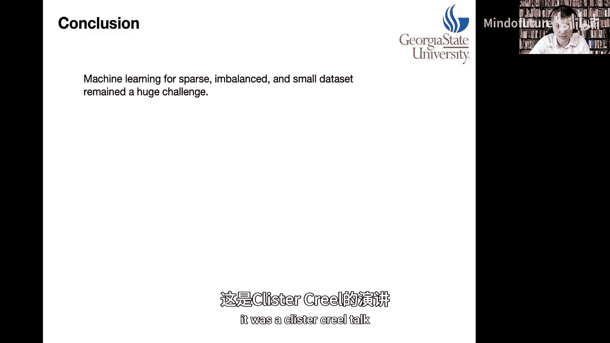

# 高级机器学习主题-CS8850-｜-Advanced-Machine-Learning-p55-P55_CS8850_AML-最终项目演示截止日期--BV1sapPz4Ewx_p55-

Assume that like the session answer to， so I'll be like quick。

And this our team， we got like 16 numbers。This is a false。And I'll begin。

The presentation will be line of four parts， the first one motivation， and then the data description。

And there's methodology and the finally experiments。嗯。Okay， here we go。

Still like we're working on the data。Of。Of the。What happens to the buildings after the earthquake？

This is like very meaningful because。Through this process。

 we can predict how likely a building is going to be damaged after an earthquake and for example。

 for the government side the work is going to help to evaluate the degree of safety of the buildings to help from a more quantitative score for the reconstruction or。

To just tear down the insecure buildings even before in advance the earthquake。

And for those areas where the earthquakes is most likely to occur。

 this prediction can actually save lives and also even。During the building is under constructing。

or the preparation of the construction， the government can decide whether to offer the permission for the building to be legally built。

And also this that is for the governments and also for the insurance companies。

 the evaluation scores is going to help better the calculation of the particle insurance rates so is it can make money。

 it can save life and it also can make money， so I think this is a very good project and we're highly motivated。

So。诶。😊，This is it the lot of countries are porn to earthquake。

 just like Indonesia and also like in 2015， the Nepal。

 like there's a great example that the buildings are damaged are damaged to like by different degrees。

 like by different levels。So some of the building are good。

 some are done not and after like right after the earthquake。

 the medical teams can go to the more damaged buildings like Quaer and save lives。

So this is how the raw data likes the data is split into two parts the training and the testing the training part of the data consists of 26 oh no i'm sorry like 260000 data points and each point got like 78 features so the total data is a matrix of。

260 rows and 39 columns。And because the first column is the data。

What that the the building ID so each data point is a building's information like 78。

Kinds of features。 And the data sets is the total size of the data set is 32 MBgaby。

So it's not the large。诶。Is just not that large it's a relatively small data set and the target which is a label is that is damage great like it's a numerical degree like one。

 two and3。And the inqui 38 features are each feature stands for like different meaning。

 like geographic origin， like building information， the number of the floors， age， normalized areas。

 the height， surface condition， something like that。And。😊。

Each of the feature got the description like。On the by the publisher of the data set。

They describe the how the feature is measured and how the feature is concluded and collected。 So。

 for example， the foundation type is a categorical。

cateateorical feature and it is indicating the type of the foundation used well building。And。

So the features are there are three kinds of features the first one is numerical features like just like the geological levels like the height of the building something like that。

And then。Is the categorical features like the surface conditions it might be like。

Wass that like the steel or something so this categorical thing。

And then the last will be the binary binary features like the or the Boing features like the s or not while zero。

So this is how the data looks like。😊，So each row is the data is data point and as we can see the first three features are the integers are the numerical continuous like feature and then like the two from the third feature I'm sorry from the fourth feature to the。

13s are the categorical features like they got eight categorical features and then all the rest are the binary features。

Oh， I'm sorry， this one， this one sell up like。When we are done the projectja we just moved this feature in from。

And how the data looks like， the data is highly imbalanced。😊。

The three different kinds of damage level， the first one is the lowest one， so it's manually damaged。

诶。Is the safest building it contains only like 9%。 and then is the second。 So is Mule is。

Damage in the medium level。It can dislikes 56， 57% of the whole data and then over 30% of data its。

Is highly damaged。So the data is very imbalanced， which means if we just predict each of the data point as the mediumly damaged the correct score the accuracy score will just go up to six almost 60%。

So。Alogize for interrupting， but what you're saying doesn't match with what I'm seeing right。

 so low damage is 57%。 you're saying medium damage is 57%。 So how does that match。Oh， I'm sorry。

 like this。The high damp， No， the， the color is a little bit like messed up。 I'm sorry， is a。

Like the two graphs like the colors are like we is like the color just messed up and here the label the low damage is not like it should be like average like average damage like the blue one。

 the blue like in the chart， I'm sorry like in pie chart。

 the blue will be the the average damage I'm sorry。Okay， that makes sense。 mistake， okay。Yeah。

 it's the limitation。Labeling is just it。Okay， and then this like the numerical。

Is that the numerical feature。This is the building's age， the building's age。

 some of the building are over100 years old， okay， and but more of them are less than 50。

As in fifth day and we can see。嗯。This is kind of like significant for predicting the different categories because。

嗯。呃。Yeah， yeah， it's it's of great significance for predicting the final label。😊。

And there are the categorical features the categorical features are。

Are also if visualized are also like some of them are very important， but still like。

A part of the features are very skilled， or like。Ibalance， because some of the， for example。

 for this one， the the ground floor type， the Z and M。It count of like two like。

Too little or like too few of the data points contains of these features as Z and M。

 so when predicting like the weight on this feature will be like need to be dynamically changed and it's really extremely hard to conduct is such a experiment。

And also for the plan configuration for this one， over 95% of the data is in the category of D so is almost meaningless to。

Include this feature when predicting the final label so we。

Designide to do the feature selection before applying any。Playing any predicting model on this data。

And also the binary features， the binary features， for example。

 this one has the superstructure s motor stone。Over like 96% of the data。Are zero。

 so like which means no。So this feature are also like discarded。When in the real experiment。Yeah。

 this is how we。After we visualized it， we realized how the teacher selection importance is。Okay。

 so here comes some mythology。嗯。We。We first select some of the machine learning new models to try to apply to this task and then we select the features for the prediction and finally it's the hyperpar attorney for different model。

The mission learning learning models and to have a final experiment score。Yes。

How they measure this competition is the F1 score we learned in the class as a recalling。Precision。诶。

Confusion metrics。And this is the scoreboard。On cargo and the benchmark algorithm is a random forest。

 I got like。Accuracy of 5 to 8% and。On the， on the board， even to the 50s。

Position it got like over 75% of accuracy actually finally we didn't get like such high accuracy。

What's the。What's interesting we can like present later because actually in the finally it was still like utilizing the model of the。

Random forest there must be a reason it was the baseline thing because the baseline thing is provided by the。

The data set provider or the competition organizer。Okay。So firstly。

 we try to use K&N because the data， the features are very sparsely balanced and we just like from the beginning。

 we use most the easiest model to try to do such a thing。And the can In。

 we use the distance as the main calls key distance and when we're actually doing we use the Eucclean or Manhattan。

 so it thisqueer or just one degree of the distance。And we select like K。

 which is like finally five or 10，5 to 10。 I remember theres8 a nearest a nearest neighbor to predict the where our data points belong to a label。

But however， this canon model didn't work well because。

Because the features need to be weighted differently， so the importance of each feature is different。

 but in this model the distance hard to calculate because for the category categorical features。

 if it is different the。The discent needs to be one and also for the binary thing。

This can also highly rely on the numerical data and。Almost only rely on the numerical data。

So data feature， so it works like not that bad， but still like is speeding the baseline model like by 10% of the accuracy。

 but it didn't work like that well and meeting our expectation。

And then is the logics regression and neural network models the logics regression is total disaster like both of them are like really total failure because。

Because of the nature of the neural networks models。For example。

 we try the 1D convolution neural networks。And the convolution kernels。

 there is an assumption for the convolution thing because when we were convoluting like there's the convoluting filter。

 convolution filter， right， the kernel。呃。It assumes that like the correlation between the。

Between the features。诶。The the spatial like respect the spatial location of the of the features means something just for example。

 like the facial recognition thing like where the eyes are located and where the nose is located like the triangle here it means something and also for the just for the last group presented just like the chemical。

Notation。Like if the C is in the front with carbon and the next one is is H it means something like the the relationship between the two features like how the data is listed the order it means something but in our case it means nothing so each feature。

Are like it， it is like almost independent。So the convolution thing is。Is very。It's wrong。

 it's wrong from the nature when applying to this task。So it was very unprofessional to utilize this。

 so we didn't put it like on the final report and also。So for the just fully connect neural networks。

 because the data are not done much in various parts and。

And especially after we deleted like some of the features it。It does not support to。

To to train a converged neural network in。The final result are。Are not even closed to the 70%。

that was like the bed parts for us。And then we turn to the random forest。

And we did the hyperparmeter training and this caused like hours and hours to set the n estimator。

 which is like the number of trees to 160。And the max steps to 20 and the max feature is to 16。

And this are the the hypopara after we we tried it like。

Millions of times and we got it like finally for this model， we got like to 71% of accuracy。

And then we're going to establish how we。How exactly selected the features？

How we do this projects actually like because we got like six people we got six people working on this project。

 so how we do it is we develop into three groups and we do it like as a little competition between the three groups like each of each of us are like developing。

😊，U。Against each other is iss like it's like。Generative a network training。

So so we are fighting against each other and finally we conclude out everyone's like the best model together and try to make a better one。

And in one the group we focused on the work of data processing instead of model selection。

In this one。We can see。We， we， we， we used the u what is a like the the high score test。

A high squared test to test the categorical data page one。

 and we try to find the statistical significance for using the categor data to predict the final label。

And here are the scores for the eight features of the categor of data and we just eliminate the last last three one the last three yes。

And then， this is the。Binary data， the binary feature， the binary feature。We make a very。

Straight forward filter that like if the ratio， if the overall ratio is over than 95% or less than 5%。

 which means like 95% of data are。they all have the value of zero。

 we just eliminate this thing because it's not like very significant and。

It might cause more variances when we're protecting things。And the right columns are the。

Are there results， we can tell like there's even00 one。

 which means only more than 98% of the data are contains zero for this feature。

And it makes no sense for us to still like utilizing this feature as a predictor。I here is like 00。

001， which means over 99。9。Percent of the data does not like have one in this， so it's very trivial。

A significance to the like prediction。And here here is what we did to。

What we had what we had that like after the hyperpa returning and the feature selection。

 we finally got the cross validation score for the random forest classifier as 73%。

73% of the accuracy and the importance of all the features are listed as follows， as we can see。

 the geo level1，23 are the numerical data and they're definitely the most important ones。

And also the area percentage age。So。嗯。So this， like we almost come to the end。Here， so finally。

 the random forest thing we had we used or the highest score we finally achieved is 73% of the accuracy and。

This is tested on the test test site。And the picture here is the most voted or the most voted and the most bill。

Notebook from the cargo website and they got the points 72% of accuracy and they're still using the random forest。

 So I think through this project， we learned that like the feature selections are very important and also the。

嗯。High training。 and for the selection of the machine learning models。

 it's really a very hard task for。For like。Some of the data set because it is because it is due to the nature of some data set。

 the construct， the the component of the features is very sparse and balanced and very hard to be learned by the very advanced machine learning data sets。

 the state of art things like the convolutions and like。

R and something like that and what is fun is we also found online some of the researchers or computers they use the LSTM model to predict this thing it makes just no sense it's a there's no time series there's no time involved in this。

In this citizen set and also there' is nothing correlated between the the features。

 but still like the the。The accuracy they got like 60 something， it's got 60 something。

 And as as we mentioned before that like if we just all predicting the k of two。

 which is the average damaged the the accuracy will be like 65。

So we can see like a lot of researchers， they tried their their ideas on this data set and。

Still the best of the score。The best of scores so far is 75。6% of the accuracy。

We cannot beat it and the accuracy the submission did not like bring us any information about like what kind of prediction model they used。

 what method they used the submission is only a。呃呃。

A matrix that like a matrix of the predictive labels for the the test data set only for the competition used。

So we try to submit that on the board and。呃。But we did not even beat the lowest the lowest like  the 74 or something。

 so on this picture it did not show our submission。😊。

That's the bad thing we try our best which a good thing is the competitions dig a one year left so。😊。

嗯。😊，That is like almost all so for the conclusion is that the machine learning models for sparse andbalance and small data set remain a huge challenge like we tried we spent like hours and hours to find the suitable model。

The algorithms and also this work is very frustrating because we finally realized the random forest。

Is the best one is the best one。 So for this competition from our from our perspective it's more like a。

😊，A competition for。Understanding of the。Of the features understanding for the nature of the machine learning。

嗯。😊，How we view the the correlation between the features and final label， what's the learning itself。

 so something like that。Thank you so much， I there any questions or。Yeah， as usual， lot of questions。

 Yeah， so interesting talk。Interesting problem and important。 and you still can。

'Go one year to win the competition if you continue to work on it。

I have a few questions before everyone will stay silent when they're given a chance to ask your question。

So why do you think the publisher provided all those detailed descriptions of the features and was the description useful like in the beginning you went through。

Each type of feature， what the building is made of and everything。

Did you actually use this description it's a lot of effort for them right though describe all of that Was it useful or why do you think that because because we're trying to because we're trying to for when we are on the phrase of the feature selection we use the very stupid method because we're so desperate we're we try to like we we try to understand the。

Like the the features， like the meaning back of it。

 so we we try to select the features that we naturally think that is definitely more important。

And however， this is a little bit against the idea of the machine learning because for the machine learning thing。

 the machine should like learn the importance of all the features right like it should got the。

It should get the the ability to。To view the features like differently by the machine itself。

But we're just trying to help the machine to filter out like the important features， for example。

 for the。Foundation type here， the foundation type， we thought like the foundation type is super。

 super important because it's definitely different when an earthquake coming if the foundation is by the o or the by the dirt。

Like it's definitely a bit different， but actually。

It was not that like not that important like to the machine。 So this is one thing， and。Finally。

 we didn't use the。Like human selected features by nature， something like that。 We didn't use it。

 We just still like want to illustrate the。The data set as is interpretible like other features got the meaning behind of it it's unlike the other kind of data set like like image data set like each feature or like each yeah like each pixel is a feature right so like independent pixel does not mean anything to like to human beings or like independently。

 but in this data set like each feature itself even just like a zero or one。

 it got some like physical meaning like realistic meaning behind of the number。

So that's the like one of the huge。呃。A difference between like our data set and other， like maybe。

S data set or like visual image data set。Bring to Ken neighbors that you've done。

 Why not L2 or L1 or， you know， why did you jump to Minkovsky， Why not？ Oh， Because actually。

 like this L 2 or L1 are。Are just a subset of Minkoski distance。 We， when we're doing it， we try to。

 we try to use L 1， L 2 and L3， and the difference are not significant。 So L 2 and L 1。

 L 3 are all like almost the same。 They're all just distance。So。To the final result。

 So the thes the problem about the key and N is is because at the distance of the the categorical and binary features。

Are just merely one and0 and something like that and and we tried to get the distance of all the features weighted I mean。

Like we tried to learn a weight list or the weights metrics for like all the features when applying the distance like thing。

So for example， like the age， the difference between the age can be like 10 or 20。

But the difference between the roof type， it can only be one or0。

 So this is very unfair about the very unfair to like to the category con features。 And finally。

 we cannot like solve this problem very correctly。 Like so we abandoned the。

The idea of canN was that？I'm sorry it's not on this slide。It me just it's like 69。

Where is it Oh Okay， so it's on the last slide。And the question is then don't move away from this slide why you're using accuracy at all because your data set is in balance。

Your competition is using F1 micro as a for evaluation， and you kept saying accuracy。Oh。

 I'm sorry like and it doesn't like what is wait， what is that metric is this at school。Yeah。

 it's like its always says accuracy and you always said accuracy， so I'm I'm not sure right。

 especially with the baseline。Zero58， and that means predict。Class two all the time， right？

And you'll get that。Accuracy， if you go by accuracy， yeah， Oh I'm sorry。

 this this should be like the F1 score right， this should F1 score actually So for it to cross validation。

 we just use F1 score and then when predicting we use the as well Okay， but it is F1 micro right。

 the1 score is also for binary if you do F1。So you've used what's on your slide or。

Just kind of confused what metric is there。I'm sorry like plus plus you kept saying accuracy and'm like that was like like kind of mistake。

 but because we're coding like all the accuracy function are are like roled as like F1 score so all the accuracy should be F1 score like it is F1 score。

 but when we're writing and presenting like it mistake。

So how many results are like the same matrix F1 score？In this blog post that you're showing。

 they're also using F1 score。 Yes， yes， everything is in is in F1 score， everything。

And on your kggle submissions， how many submissions did you make？We， we haven't， like。

We haven't made one yet because even even if if we make it， it'll not be on the leaderboard。So。Well。

 it will not be in the top three， but that's not how people start right you were supposed to go Okay again they were actually like we we we generated the submission CSV already we just don't like we just didn't submit it yet because。

诶。Because we were like a bunch of PhDs in China。Oh you're ashamed of your results come on it's not a shame it like we like still like we have potentials。

 you know oh my god。Well， you have still one year to win the competition and yeah I still get a isn' that make a startup with your solution yeah earn some money so a last question to the whole team how does random forest work because we didn't cover that topic at all and it's good that you're exploring something outside of the class can you like quickly any of you or all of you in turn just give a brief explanation of random forest and how it's different maybe from what we have covered in class weve looked at。

Quite different geometrical models， mainly。Can you comment on that？Anyone。

 that's not going to be on the final exam because I didn't cover it， but it's interesting。

An alternative model that we didn't cover in class similar to GNN that the previous team was talking about。

 we didn't cover it。I would have liked to hear more about it。So just briefly。Okay。

 anyone I want to do this。 My dear teammates。Yeah， give us an intuition。

 so your classmates who you know they listen to all of my lectures that use the same terms like how do you think it's different than what it does？

Okay， I'll like I'll make like brief introduction to this yeah， yeah， just。嗯。

Bund known for like it' based on decision tree and the decision tree is made at the if you can see my mice is from the root node and then like is going to make a decision by the inputted feature。

 inputted data to different nodes and then the internal node and again like classify it and finally it makes a decision。

嗯。Like a random forest is a。In our like implementation。

 we use like this kind of like similar trees of 160 like different trees。

And the depth means the the levels of how many like。

Internal notes there are like I don't know how to I don't know how to spread this。

The different levels of the or the height of the tree。And also the max feature， which is to。

For each nose to use like different features， Wait， I don't know。

How how do you think how do you think they are combined in random forests so you have the different trees are like different trees make classification and categorical like results differently and then the all like added together and as the final result like the most classifications like the they can't the different kind of like class like for for for。

For all the trees like each tree gotta make a a final score， I mean。

 like the final prediction and we can't like。The most voted， like okay， majority vote。

 That's what majority voted。Okay， okay good thank you and I I kind of missed you did not show any of your Kanban boards like how did you manage the idea is competition is great like internal competition but maybe。

How did you manage communication and project management inside it？We used。

We use the Slock and wechat too as an advantage。And we compete with each team and which is fun is that like actually my team lost because I used the convolution thing。

Okay okay yeah thank thank you I think i'm done with my questions just don't forget to submit the report on Sunday okay by Monday never little this at night anyone wants to ask a question about earthquakes or randomon forest or whatnot please go ahead。

The class。等 be shy。No no no。Okay， well I'm stopping the recording， no questions。

 it was a Cister cre talk。

