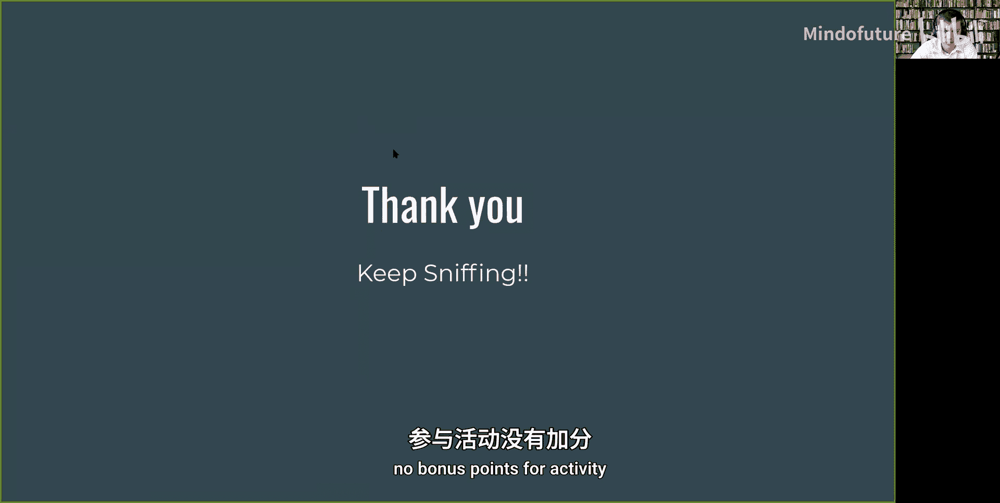

# 高级机器学习主题-CS8850-｜-Advanced-Machine-Learning-p56-P56_CS8850_AML-TeamChem最终项目演示--BV1sapPz4Ewx_p56-

Okay， Tian。You ready？Yeah， I'll switch when you just say。O。All right。

 so our team will do a project on learning to smell。可以 switch。

Object is to match the chemical structures with smell sentences。

 So here's an example of how we try to do that。 This is a small representation of molecules。

 And we want to see that how this will represent the smell sentence。 So here we have is iterio other。

Are they headache and footie。So， we are。First， we the reason why we motate to do this is that we have a lot of olfactory receptors in our nose。

 which help us in detecting smell。And。In recent research articles。

 they investigate that human can sense a trillion different audit。

And not is not well understood how humans can distinguish so many different smells with only 400olfactor receptors。

嗯。So it is likely that orant molecule may bind to multiple olfactory receptor。

 and some of those receptor activation could be responsible for our sense of smell rather than a one to one correspondent relationship between olfactory receptor and the sense of smell。

So despite the complex relationship， certain senses are strongly associated with some molecular features。

So。We choosing smell for a bunch of different reasons。

 The first one is because it can use for medical diagnosis。

 This costs like around 167 billion market in 2019， which is a huge market for。This kind of of sense。

It can be used for extratertry or exploration。And in reality。

 we see that they use a lot of these techniques to detect drug or could protect population from bomb sniffing。

 so it's for policy and security， it could be a disaster response mechanism because they can use it to smell people bur in rubs。

And it could be used for environmental monitoring。So in the， in the stage of data preparation， we。

our dataset set contains the description of molecules at the smile strings and the orders is possess。

 so smiles here stands for simplifyimplified molecular input line entry system。

 so it is specification in the form of a line notation for describing the structure of chemical species using a short ASI strings。

 so example you can see in the table belows we see that this string lined of representation of chemical。

Moles is represented here as an ASI strings。And the sentence does the artist sentence。

That associated with it is。In the second column。So the challenge of so you can see that for each of these strings。

 we have different type of sentence of smells associated with it。

 so the challenge of this is a multi class classification problem。

And each molecule has multiple orders that written in the form that we see up here and it's separated by comma。

The training data consists of around 4，360 molecules and 19 unique smells。はい。

So the submission format in the。Fang。That is required for for our computation is that the predictions columns has to contain the top five predictions of our model separated by semicolon。

 where each of the orderss in each sentence is separated by comma。

So here's an example of a smile string。Right。So， we use。

This is our evaluation metrics and because this is a chemical informatics prediction problem。

The our evaluation is a bit different from normal problems。

 So there's a large number of molecular representation exists。

 and there are several methods to quantify the similarity of molecular representation。

And here we use the most popular one， which is the similarity index。

 and they call it Tenimmoto Jaka index， and they use it to compare chemical structures represented by means of fingerprints of molecular。

So here。A And B， let's say， A And B is are two。To like the target and the prediction one and we want to see if sorry it's a two molecular so when you see A and B has if we want to compare the similarity between A and B so T is the index that trying to to do that and it's。

Is represented by the equation here where n is a number of bits set in the fingerprint of molecular。

And see， see is the。Intersection between A And B。 So it's basically。

Defined by the size of intersection divided by the size of the unit of two sets。嗯。And the score。

 the Tamodo similarity score is computed for all of the top five sentences in comparison to the ground truth。

And the best score across all of these fat prediction is consider for a set molecule。

And the overall score is computed by taking mean of the set score across all of the molecules in a test set。

So to explore data， we have the most common labels and the least common labels。And that saw I go out。

Five of the most common labels， which is footy， floral， woody， herbal and green。

Which is all about 500。Occurrences and the right hand size is the least common labels。

 which is overri amred， ammoniac， phenol and blueberry， which all is below 10。

 so this is the gap between the most common label and the less common labels。

This is just like a weaponization of data associations。

 an AceT COO appears to be the strong indicator for Futi。So here at the top 20 auto association。

 auto association is not that strong， for example， the most common auto association is foot T and floral。

 given foot T label appear in over 800 times they are associated about 20% of the time。

We have a heat map that shows the foot is indeed associated with a variety of other orders。

 it's a bit hard to see but。嗯。Fru tea is the， the one that is associated with the the most。

And we also normalize the heat map， so the white spot represent that two orderss appear together 50% of the times。

 for example， automedical appears in a sense along with phenolics， 50% of the time。

So next will be preprocessing， one of my team members will continue with this section。哎呀。Hello。

 can you hear。Noello。系 you go ahead。Thank you here is the pre processing for the auto machine autom and polysifier and random forest the features extraction we used Madrid is that is molecular descriptors and bio uses。

诶。We have we have over 1000 features extracted。 And here you can see the and the figure we have the smile。

 the strings， and we can。 we get the。Ch structures and from the chemical structures we can also get the me we can from the chemical structure we can get this property。

 this chemical properties， as you can see we can the first column is called in an acid it means when property and there is about 1000 properties。

 we extracted。And the next， please。And we also use we pre processingces the G and this one。

And this one， name。嗯。This one is we used the multiple packages。

 It goes from the CSP file to a dead data frame and to a to array of molecularculars which are generated by biomolecular graph and。

And the features are generated from this molecular and the levels we use in the in hot encoded。

And that's it I'm from the next， the next slides。And the baseline line model。The method one。

 we use multiple algorithms with。With the policyette。嗯。Okay， the training， yeah。

 the training we included and the smiles structure best based on the the embeddings and smells using the one hot。

Including and created a data set of the pair of smiles and the smell。A structure。

 And we also train a K， A A model， using the above de。The performance of our baseline model achieved。

134， which which is the the high league board is is point473 next。The the， we to go to this slide。

The march with the pifier。 we use the the poifier with。They had already including the KAA。

 the naive base logistic logistic SVMry and random forest。

 they already included in the package Next we using using the Madrid to extract the fishes which is over 1000 features the chemical fishes。

And the labels， we use a simple numeric code for each class after the maximum number of the smells and for example。

 if we don't have enough smells we're going make it as the minimum one to make it work and。

Here is the example， for example， we have three the smells and the fruit rose that we miss one smell。

 we're going to put the minus1 in there。And next。The baseline line model。

Is already talked about we already talked about this baseline model this one this baseline model we already achieved score is 0。

1 0。134。You can see the top score is the quantum。473 we still have a way to achieve the top。Next。

 the next slides。No。The method too， the method we after we we running the policyifier。

 we found that the random forest had the best the best performance and we use so we use the random of forest to reach all of the data with the best parameters and after training after training we we pick the top top the top highest pro from the final results caused random forest give us the possibilities so we can sort it and get the first three top three smells。

And for this one， we get the performance we have five foot cross validation on this training data and we also get we also did the JA similarity is about。

21 minus plus or minus0。01。That's the final checkout similarity we got。The next one， please。诶。

I I think this。Jack is your turn。Okay， yeah， so the third method that we tried is a graph convolutional neural network with tension。

嗯。And so the reason that we chose this model is because。

Graphs are a natural data structure for encoding molecules。You have。Bonds。

 which are the edges and atoms。Which are the nodes of the graph。And。When we use this architecture。

 we can encode both molecular and atomic features and that's desirable because。Um。

 it just allows us to put as much information that we have about the model into our framework to try to get as much inductive bias out of it as possible。

So。And we can do this with different size molecules。And the way that this works is that。うん。

You have a message passing framework which essentially looks at every single node and edge and then there's a。

A specific weight matrix which defines the transformation from one edge to node and from edge。

From node to edge and edge to node。 So those are two different weight matrices and those are the same basically。

For every node and every edge in the graph and。You can just stack these layers up on top of each other and then the output is going to be like n where n is their number of nodes and K where K is your number of features。

 but you just sum all the nodes together， you just reduce it over the number of nodes so you just have a vector of link okay。

And that allows you to input this into other differentiable models because all input sides are the same。

嗯。So the way that I set this up is we wanted to take advantage of。

Both molecular anatomic features so。We generated these in prepro and。

The atomic features we run through the graphph neural network。

Which is this gatcom layer here and the molecular features。We just run straight。

Into this feed forward network。 So we can catnate the two outputs and then just run it through a feed forward layer。

 And， I mean， you could put a feed forward layer。And。After the Gtcom layer。

 or you could put a feed forward layer after the。Molecular features layer。

 if you want to augment this a little bit， but since my computers not that fast。

 I just tried to keep it simple。嗯。So。I did have some。Some troubles getting the cost function。

To get training to work correctly first I was using legget cross entropy after I。嗯。Yeah。

 I was using legit cross entropy， and that didn't work very well。 I was running into a lot of。

Local minimum and the gradients were going to zero。 And it was just。

 it was just causing lots of problems。 So I just sort of naively tried the dot product。

 and that didn't work at all。 And I did a little bit more research about multi label problems。

 And I ended up。Using a legit sigmoid cross entropy and that seemed to work pretty well。嗯。

And so then this is just my little code here for calculating that。And you have to。

 it's like numerically unstable you can you can get overflow problems if you don't。

Like subtract it from the maximum so you try to keep everything。Cl to zero。In that makes sense。嗯。😊。

So over the training procedure， we use just the atom with learning rate point3。诶。

We have many batches， size 50。 I tried 50 and 100。嗯。They're both they're both about the same。

 but I wasn't able to get a lot of model calibration or cross validation done me because it was hard enough to just。

Get the training error。To even。Convertge to something reasonable。

Just because of speed and because of lots of local minima。嗯。

So that's it for our three methods and we can talk about the process that we went through。

 so we communicated。With Slack and Zoom， when we wanted to meet face to face score。

 what was the score on the last one。The score， like my， I had that in the results section， but。

I got around。t13 was the best I。I'm running it again， right now。But so low， lower than canon。Yeah。

 lower than Canan。 In fact， I'll talk about that in a little bit and you'll see。Yeah。It what。

I lost the time here I want to make sure I don't go over hold that Yeah。

 so then we use GitHub and Trello。And here's our Gi commit history。嗯。

There's not much to say about that， but。And our Kban board。

That we use to keep track of tasks and delegate。Okay， so。Our results for the model selection。

 here you can see the cross validation。mBetween the different models and it was very close between nearest neighbors and random forest and and voting。

嗯。So there was， there was a previous。Competition called like dream something and。

In that the random forest was the winner and they use a bunch of different。Feature extractors。

 chemical feature extractors and just stuck it in a random forest。

Google was able to beat that in a competition with a Graph neural network。

 but I guess they had lots of big computers。And。We're able to do some。More advanced。

Like architecture exploration。But yeah， you can see nearest neighbors is pretty close。

But all the results here are pretty bad and I think even like the state of the art results are around maybe。

Point， like， they're all pretty bad， so。嗯。Yeah， so for the graph neuralural network we got as high as a Jaard index 。

13 this is an example of a bad training oh we do that a bad training run here。

 just exemplifying that it's pretty unstable。As is and the momentum sort of carried it up to this local minimum around 11 and I actually ended up running this overnight for 150 epochs。

嗯。And it still wasn't really going anywhere， it just got stuck。I like 11。Okay。So。

Here's our leaderboard and I want to point something out about this leaderboard。嗯。

So first place all the way through everyone tied for third。

They all have the exact same scores as the fingerprint。Community contribution， so essentially。

Aside from the community contribution， which was the starting code， where in first place。

And this is actually just with the baseline model， which was the K&N。model。

That turned out to be our best result。And all these people are all using another K&N implementation。

 but they have they use more feature extraction in their K&N and so apparently。Canon。

 a random forest。Is about anyone's as good as anyone's been able to do。

It's just all about the feature extraction。So。Some concluding takeaways。

 the Gph neural network is pretty hard to train and much。Harder than the auto L models。

And the pifier results。And for the GNN。There was lots of local minimum it was it's very sensitive to the initialization。

 so even just between one run and the next it it。It may converge i've gotten as low cost as like 01。

08 and sometimes it gets stuck around 11 or 10 or who knows anywhere so it has lots of local minimum it's。

I wasn't able to do any hydroparameter search and I think that the framework that I use is a little bit immature。

 it had lots of bugs that I had to sort through and。

Like some type instability issues and so I think that if I were going to do this or if you wanted to do this in the future。

 I would use Ptor geometric， which is。A much more mature package and it has more methods available。

And for the auto amount。The generalization error was very large。

 I guess it's a small data set so that's somewhat to be expected。嗯。But。Yeah， we learned that。

 and that the hyperparameter search is。Was still too expensive， even though the models are cheaper。

 So we were only able to do a limited。Amount of hyperbrameter searching。

 and that's a way that we could improve。嗯。For the Gph neuralural network。

 it would help to have more powerful computers。嗯。So we could do more hyperparameter searching and experimenting with multiple layers to try and skip connections to try to smooth out the cost functions。

 there's less local minima。A more advanced training schedule would probably improve。The results， and。

Right now， it only has。A few features and so I think adding more features that's probably the main reason that this has much worse performance right now is because there's only five molecular features and seven atomic features and like the Google one that you had about 109 atomic features and no molecular features。

Yeah， so our good results with random force and K&N are consistent with what we've seen from others。

 but we still have room for improvement because our code is lagging behind the top。Codes。

 and presumably that's because of either hyperparameter。You searching。

And finding the optimal hyperparameter and getting the right features。

So some sort of feature engineering。 could be。Helpful beyond what we did。And。That's all for now。

 thanks。To everyone。And just have two minutes for questions。Yeah， thank you Jack。 thank you team Kim。

 I have some questions well， as usual， I still have some teams so a lot of questions。

And I'll start from the beginning， so how many labels in total this end the binary vector， 109。Okay。

1 hundred and9 and how many。Samples you had。4300 and something。 Oh， that's not small， but 4000， I。

 Okay，00 H and digit pride data augmentation。No， so you're saying， okay， no。对。W。

 like just a curiosity， can you explain why your normalized heatm in the beginning is asymmetric。

 it's supposed to be symmetric， the relationship， right？I don't know。 Nik you。

Can you say the number of smells were very different。

 so we normalized it with the number of the frequency of the order count so we can look better like what how the orders are associated with each other。

嗯哼。Okay， well， that's the more important question that I don't understand。

How did you use area under the curve so you have the molecule label problem right for each of the moleculeles you need to predict a few labels。

It's not binary class problem， it is not even multi class problem。

How did you turn it into something that poifier would draw on or how did you turn it into a classification problem？

you have 4000 you have 43 yeah， can you explain I think that that actual validation figure came before we used the multi label。

Package in the original model that was done was just predicting whether it contained a single。嗯。

Like you would basically be predicting is does this smell fruity or no and that's obviously not the right way to do it so we changed it。

 but that's。That's the so originally， you focus just on fruity， fruity non fruity that the two。Yeah。

 that needed to be to be fixed， but。It's what do you do now like what do you like how do you can and。

Multiple labels。 What， like， what do you exactly do Like， by I'm liking clarity on。

and like for the baseline model， what we read is for any given input。

 we took k nearest 15 nearest neighbors and plotted them and weordered them in the form of top five similarities and submitted it。

So like for a molecule if there are there is a fruit nearby or there is another label nearby。

 we pick the top 15 nearest labels。So that's the baseline model we tried initially。

But the the labels that are nearby， they're also compound， right。

So you it's not the distance between labels， the distance between your features。

 and then each the each of the K neighbors has a 4，000 or 4，300 binary vector and some bits are on。

So how did you return which one they all would be different， right？

 There is no like majority vote because you end up with different combinations of smells for your neighbors。

So I think。That was， I think it's confusing because。

Nikil implemented K andN originally as the baseline model。

 but then we have also this pifier and so is the pifier model that is the one。

I'm asking for both I'm asking for the final I'm asking for the final model that you submitted in the Kale Yeah that was baseline model。

 So yeah， that's what I think that was N， you could probably say better than me， but I think that。

Were just looking like the input to the model would be。Just a to the model。

 like if there is a smile and there are three different smells to it。

 we converted the data into something such that there is a we for each smile。

 there is only one smell associated with it。So we repeated the smiles like。

So like it's a baseline model so let's say we have a H20 and there are two different smells associated with it。

 so we created two rows in the database such as H20 smell one H20 smell2 and we did one hot encoding on the labels and you had you had different samples with the same location in the euclidean space if we're talking about original。

And different labels。Yeah， like this is just for a baseline model we tried in。Well。

 but that's the winner right that's what you submitted anyways that that's what gives you 0。

21 or something like that that。One of them like or random forest as well， right you've done the same。

Or what did you do for random forest？Your high scoring model that beauty reported in your slides had this Jaard score of 0。

21。Yeah，' that's for the Cane and Mori， which I talked about。Can then not random forest。

 because I felt the highest was still random forest。 That was the highest of the pifier。Yeah。

 in the policyifier， that was the highest。But they were comparable anyway with Cana。Yeah。Yeah。Okay。

 like a quick question those more because I just another chemist multiple graphs are they planner or it doesn't matter for graph neural networks or like think of。

Backmin fuller the fuller ends and yes， there's no。There's no non planar graphs in the data set。

But I don't think that it actually matters anyway as long as。

Like the message passing protocol just has it's basically just。

From any node you send out the data to every single edge and then what is that data what is that data for each molecule that's my next question I don't see an architecture picture unfortunately so I don't understand what your model does。

So you you take basically everything that you can calculate about it so maybe the molecular weight of that atom。

 the formal charge， the like electroeggativity effect all the different metrics that and they're the same for all of your molecules Yeah it's the same way the same vector yeah yeah well no I understand how it works with yeah for clarity if you should have added that and architecture of how the message passing is actually happening rather than。

Yeah， and then do you try learning rate scheduler？I tried an exponentially K。But。嗯。I don't know。

 and I also tried just manually doing it because I didn't know how to schedule it exactly。So I just。

Ted changing it according to what I sort of intuitively thought and that did help a lot。Yeah， yeah。

 that' coincides with my experience and other experiences as well。You have to kind of cook the model。

 So and another one last question from me， why do you think naiveb failed so basically。

If you look at baicifier naive basis it just。Completely and close to 0。I don't know anything is it。

I mean， know it's on your plugs， yeah。O wo。Wow， that's like really abysmally。Yeah， yeah。

 what do you think， what is specific about this problem？M theys behave like。

 do you have ideas hypothesis？I mean， the first thing that pops into my head。

Is that it's high dimensional and there's a much smaller amount of data， but I mean that's really。

 really， really zero， basically。Yeah， it looks like it failed or something happened or something。

 okay， anyway yeah it looks like。I don't know。A。Maybe， for example， there is only one one order。

 but is in the testing， but not in the training or in the training or in the testing is made these results。

嗯。Yeah。Did I get plain clear。嗯。I think I have a final exam question because I think I know why it failed。

It didn， by the way。Okay， I mean what the random chance ist isn't that low。thinkOkay。

 we'll have fun on the final thanks other questions from the from the team from the rest of the people。

 I mean not from your team， but anyone please go ahead a couple of minutes。No， not。

 not too interested in smile。 Nothing interesting， nothing kinda。Excited you。 Yeah。

 Jack didn't talk like it's all boring。 No， I don't know。 Come on。 it's an interesting problem。

 Intering question。 No one can solve it， right， Looks like even on Kago。

And Deep Mind just was valued at 30 billion after they did the alpha fault。So。

You can be the next billionaire if you solve this problem。No， lesbie Hols。嗯。Okay， okay。 Well。

 anyways。 thank you。 No questions。 then from the class， no bonus points for activity。

