# 高级机器学习主题-CS8850-｜-Advanced-Machine-Learning-p57-P57_偏差-方差权衡--BV1sapPz4Ewx_p57-

O， I will have to continue this。Without movies visa otherwise， I can't。Okay。

 it doesn't seem that I can't write notes on。The slides and it will be harder with。そいよ。

Explain the cost。 So bypen， trade off， revisitor。We have seen it before as a means of bandwidth selection for kernel density estimation and lecture alone。

The task was。The curl with。That is。么。To minimize the error between the estimated density and the true density。

So for that， and I'm just repeating the slide from before。 for that， we agreed to use the。

Squared error。Let'sT to raise this。So the mean squared error is nothing this a difference between our estimate。

And the true density。Squared then we want to minimize that distance。

 even though we don't know the true density in this case， but。

The point was to show that if we open up the square。Will get that， if you want。To use that。

 I'm doing nothing but taking advantage of this。Good old。Before。If you can derive for yourself。

In this case。It's a minus B。ピス。I supplying through you can get yourself。So， well。

But what do we do with this， you know， expectation is linear。So。We can just。Take it inside。あぶれだ。

Which we do here？An expectation of。Something that doesn't change。

Gues the true density stays the same。It's just a。Costant constant to order the quantity by itself。

And then， we。Do the trick。We add and subtract。Square。Of the expectation of our estimator。

Add this part and subtract this part。But after we've done that。We' have completed the square here。

And we get。2 quantity。Which back then I said are。Exle of requires various straight of。

This is just the bias。The well， its actually by squared。

Because this is the expectation of our estimate minus the true value。

So we will converge in the limit of the data points。To this quantity。And if we。Are unbiased。

If our estimator is advised。We will practically converge to the same quantity。

On the right here in Egyptianctions will be 0， but it doesn't have to be 0。

 our estimator may as well be biased。And this is bad。 Let's see on the next slide。

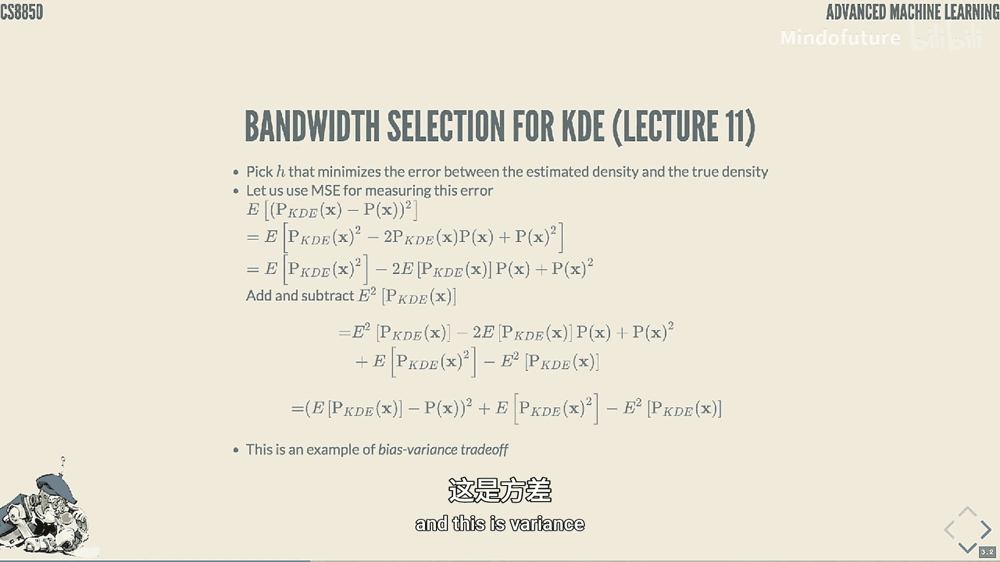

What is bias and what experience？This is just an illustration。Of how we can think about it。And。Here。

 in this target。We see that we have low bias。That means， well， we're not right right on target。

 but we're pretty close to it。And we have low variance。 the spread of our shots。

Of our bu is not too high。When we have low bias， we're still our center of mass， or I mean。

He is somewhere close to the。Target。But we have higher variance the spread of this point。

And then we have high bias， right。That is where way of。But low variance， we can have them separately。

 we can have， as you。See here， high bias。What a difference between where we want to be and where we are。

But still， we're pretty sure if you use sometimes variances used as a matter of certainty。

If our model is very certain， love it is。OfA， that doesn't mean it's correct。 That's one point。

Another point， we can have both。 We can be。Haaiili。Incorrect。That is。High bias。And。H， the， that is。

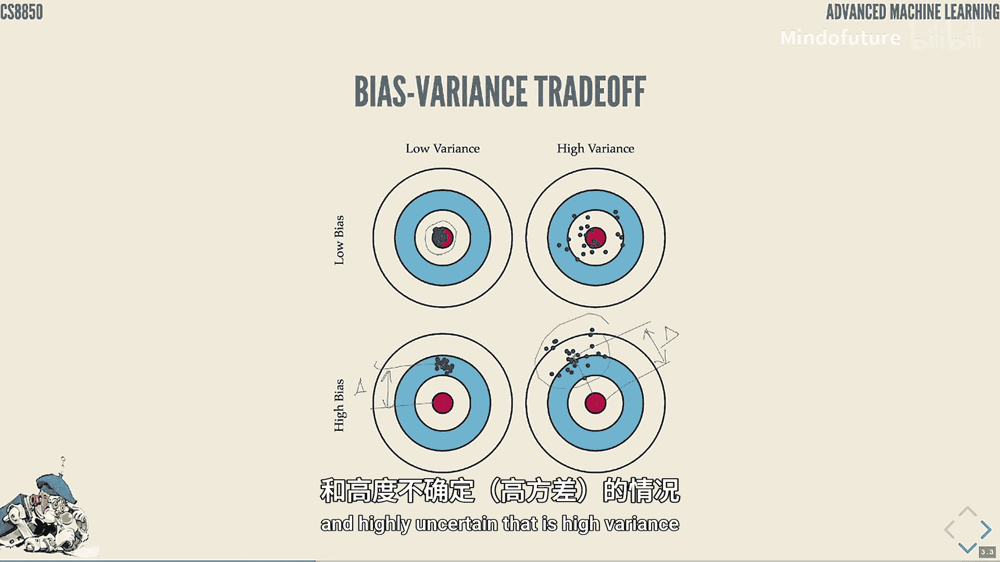

。 So let's see a specific example。A bias variance toposition for mean squared error。So， theyta ahead。

Here。Is our estimate。Of the parameterid。In fade are。A truee but。

This is nothing but the means square their expectation of this difference with respect to the date。

Let's do the same as before。We opened up the square。Weiyi。Completed the square to OL inside。

 we opened up the square， the expectation。As a linear。Quantity operator went inside。

Since this parameter， the true parameter is a constant。A value， not a random variable。

Expectation of this。With respect to data is the same。Expectation here。

That expectation of our estimate with respect to date is still we need to compute it， right。

 This is nothing but。耳明。ほ。The center of mass of our expectations。

Of parameter estimates for each of the data points。

We use the same trick as before we add and subtract square of the expectation。

Of our parameter estimate。Then， we'll get。This quantity， which is completed square。As before。

This is bias squared。And this is variance。waitait。Isn't variance。The difference between our。

The the square of the difference between。Our estimate and the mean of our estimate。Did we get there。

 So let's start with。Or classic。Dtation。That's what's written there practically。

That's what you're used to seeing。Let's start with it， and。We open up the square。Here。😔，Clear。

 no magic。And then。不异议。Take the expectation。And。Im using not using linearity property。Obtain。

This expression。 So what happened here again， remember。After we compute this expectation。

 it will be just a number。 It is the same under this distribution。

 and so computing that expectation twice doesn't change anything and computing the square of that expectation doesn't change anything。

 so we have。Just one expectation， this quantity。Because here， without any changes。It's the same。Yet。

😔，Well the saying is true about。This expectation or the mean。

 the expectation of the mean is just the mean itself。So those quantities are the same。

But the expectation of parameter squared and expectation of the parameter and the estimate of the parameter。

We're still there。So what happens next is。We observe that。This expectation。

 time style expectation is nothing but。The expectation of a parameter estimate squared。

And their difference。Will be。Precisely。That expression。So， this is。A very。Mis。What we see here is。

Thecomposition of the mean squared error into pi squared。And the bed。So we can minimize the bias。

 of course， when we minimize the bias， we minimize the variance simultaneously。4。と me。

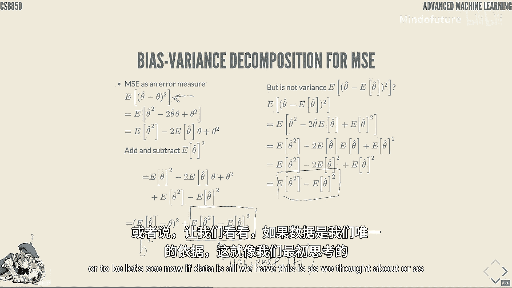

Let's see。No。If data is all we have。This is， as we thought about， or as we started with。

Comput learning theory， right。In the Beijing world， with the Beijing approach， we have。

Distributions of the data or at least assumptions about the distribution。

 If if we know the distributions exactly， then we can compute。esttators exactly。

 or we can compute our classifiers decision boundary is exactly。But if the data。

That we collected is all we have。 Then how do we know if were doing well in terms of。

Training a classifier。 And also， if we have few hypothesisses， we have few classifiers of few models。

 How do we know which model is better。So， traditionalditionly。

To answer those questions and having in mind that our goal is generalization。

We don't simply want a classifier that we're working with to perform well on the data that we have at hand。

 We want the the same classifier work。Work well in practice in the wild。

 We want to be able to deploy our medical scanning device， or we want to be able to put our。

L credibility。Application such that new users， new people。Who come to the hospitals， new patients？

Are classified as correctly as a training date。But all we have is the data as we started。

 and how do we know that what we're training， the classifier， we're training is doing well。

And one way to know that is to split our data into few parts。You read three parts。

Sometimes people start with just two。If you only have one model。That you training。And this。

Model is parametric， but you don't have any alternative models。Theinging。It will work well。Then you。

Split your data into train and test， you train your model on the trading data and you test the performance of the model on the test data correspondingly。

But that is。Still。我来 you。Because。wonder。Because。Well， assume that your model has hyperparameters。

How do you decide which are parameters to use like。For example， K means clustering， right。

 you want well， although it's unsupervised learning like get with。You want to set。The best option。

 okay， or if you think about the。I think about your naive base example in your homework。

If you want to select the widths of the kernel。Such that the width of the kernel is optimal and the performance of the classifier is optimal。

You don't want to use your train data。For we selection， because your。Kin of。Being over optimistic。

 you will be over optimistic， because you。Optimizing your kernel width on the data youre training。S。

It's well， technically， it's overfitting。 Of course， you can always do that and be， you know。

 find the best performance。Because you're simultaneously optimizing kernel width and the accuracy。

But you can't do that on the test data either because then it's double dipping as opposed to。Overfi。

So double dipping means you're using your test data for your training。 So for example。

 you could train。In order to。Optimize。The performance of the model。And then you can check and test。

How the model is doing and based on that on the test data。 and based on that， you can decide。

What hyperparmeter。Value to set。As it was the case in your name base classifier。

Since we can't use neither train nor test for hyperparameter saving。

 people usually go with this third。Subdivision validation。 So basically。

 what the test set usually is also called called， sorry， is a holdout test。

The model or you as the experimenter， never see the holdout part。 you only see。

The train and validation test。So you optimize your hydroparmeters on the validation test。Seid。

 sorry and。You're a training model on the train set。Okay。Let's see if we have the split。

What we can do with it。

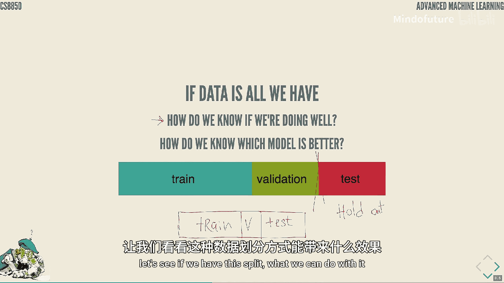

This is from。Hi， steam T sharing Friedman book。Elements of statistical learning， the figure。

 So model complexity is the number of three parameters in the model。

 the number of parameters that you're training， for example， if you have。A polynomial of degree。Ki。

What we have here， your model complexity is this K。It so。Q。是。

That is your model complexity in the number of parameters， basically in your。

Which are those coefficients。For the preliminarylennoial case。

 but it could be the number of parameters。In your support vector machine。

 number of parameters in your。Other classifier， neural network or whatever you choose to train。

And we see that。The higher is model complexity。 That is the larger is the model。

The lower we can get the training error that。Blue line here。Weiqiang。We contrast them。

Underly with the red color。The anyway。At the same time。Fat lie。Is the test error。And as you see。

 another thing is。Depending on the data subset。Initially。

 those little thin lines are different data subset that you chose to train or different split。

Of your data the train and test。Initially， when， well， initially， when you have。Just few bar。

In the model。You have。Low variance in your test。But then you have high， high bias。This。Hi， Ed。

But once you're。Tuning。Once you continue to train， you have。Lower buys。Your error goes down。

But you have high variances。 And so。High bias and low variance together， they form your error， right。

 Your error is high。Then at some point your bias is lowest。

 but your variance becomes well starts to grow。 I will show this on the next slide。 Look at this。

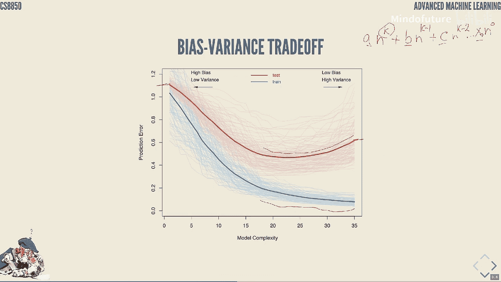

So if we look at this animation in the corner。Then you can see that when your polynomial is of low degree aligned。

 then the feet is obviously wrong， but your。Varance is low and then your variability becomes to grow like those wiggles。

But your bias is low because you're now going through each of the points。😔。

So the line goes through each of the points， that means you。

Get a perfect feed or we call it overfeeding。So， if we。Look at this traditional diagram。

Or classical diagram， algorithm complexity is basically the number of parameters in your model。Lets。

Stick with the same。Family of vgart Es。A number of parameters could be。

Say number of layers that determines number of。Weights and those weights and in a fit forward neural network are your parameters。

 So this is it deeper or wider。Otherwise， more complex neural network。The total error。This。

The true parameters。And the estimated parameters， that's the red line。That the total error。Performs。

 and this is。The test error or generalization error。I very interested in。

And generalization error goes down， so it decreases。With I'll get it in chemical City。

So when we're here， this regime is called underfitting。In underfitting。

 basically we are unable capture the complexity or our model is unable capture to capture the complexity of the data。

Say， I'm in the animation there。If our data is truly。能理你。And we're trying to feed a line to it。嗯。

Ipologies for。Bigly line， the wly line there。But if we're trying to fit a line to a polynomial data。

 we're clearly underfi。So if we're feeding second degree below an Ml。

We're probably somewhere here in the optimal regime， but then once will start。

Going higher and higher， and so on。We will be over here。Yes， our error will be。The lowest。

But our buy our variance will be our error。Meaning our bias will be the lowest。

But our variance will be the highest。As you see here， with time bias decreases。

But as algorithm complexity grows， our variance increases。This is true， and。Multiple ways。嗯。

In order to avoid。This part。We spoke about inductive bias。

 introducing some regularization to our models instead。Well。

 to to avoid or to prevent the model to simply memorizing everything or to prevent。

 to punish the models。In the beginning of the course， if you remember。With our example。

 with the square。Or we have tasty papayas and not so much。For feature  one and feature 2。

And soistic bias， we could just remember all of that。

 and then all by each of the point and the inductive bias is a way。

As you remember to avoid that memorization。Because again。

 the whole point of field of machine learning is to generalize beyond the training data。So。That。

About training one single model。What if we want to choose。

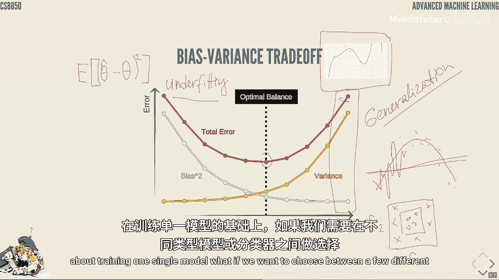

Between。A few different models or classifiers of different kind。Which one is better。This。

Choice or the problem of choice is called model selection problem。

And we want to select a model that will generalize best， right， We want to build a gas。

Our an estimate of how well our model will perform on the future uneen data。And again。

We look at the mean square there。 Let's look at the mean square there between our。嗯。

Estimate of generalization performance is little G。

That depends on the parameters the model of the model and the data。And。The true。

Howimimate generalization performance of that model。That only depends on the。Arameterters， basically。

 this large G is performance on all possible data that we will ever see of that kind， right。

 And D is the data that we have our data set。That we have for training and for testing and for everything。

elseSo imagine we found a model that has very low bias。 It's basically an unbiased estimator。

And if we look at。

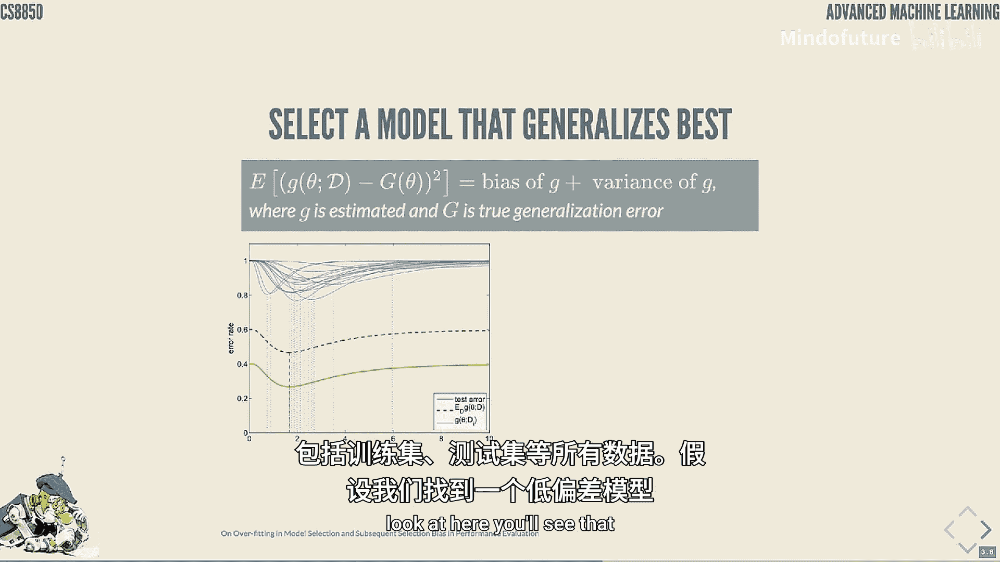

Here。😔，You'll see that。That's what basically is happening。That。All。Zi。Is our。Well， again。

 test error is our generalization error right。R G is an as our estimate。Of the generalization error。

Or else， what is our estimate of generalization here is how well our model performs on。

Some hold out date set or。Some validation data set rather。Which is D sub I here。And， as you see。

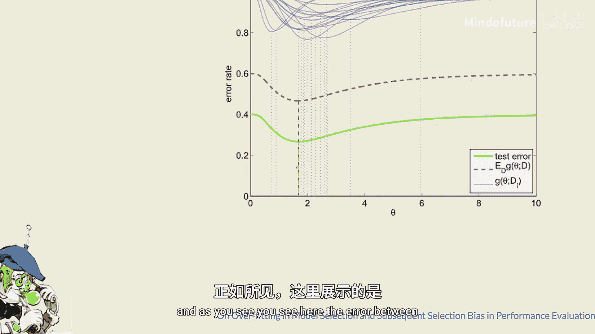

Mmhm。You see here。The error between。No。The expected error。Of our estimate of the generalization。

 the little G。Is the same as the actual tester， the green。But the variance is high。Look。

 if our D sub I was one of this。Then we will be very optimistic。 We will select。A model that is。

Minimal with respect to G。But we would be very wrong。If we would。

BeUnlucky and get this data set or subset， then we would be still very。

 very wrong even more than before。And yet， according to our criterion。

 we would have selected a model that is best。Right now and our model is low bias in high variance。

Well， turns out。L bias model， low bias and low variance is good， of course。

 but low bias versus current bias to an estimator and high variance is not good because we can get unlikely and most of the time we are unlike you look at the spread of this blue vertical lines where they could end up with to true generalized generalizing estimate of the crime。

Yet， if we take lowvaris and biased。Look here。😔。

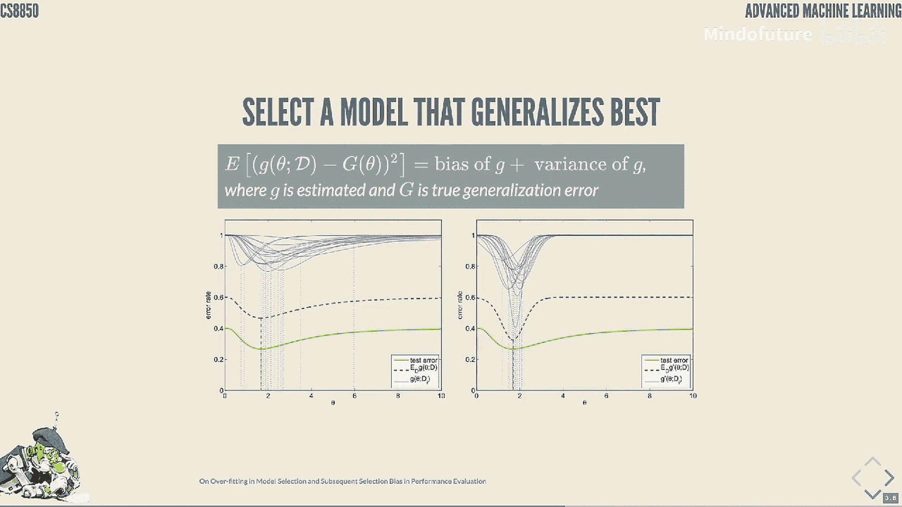

Its not precisely the same green and red， although they may look the same， but they are not。

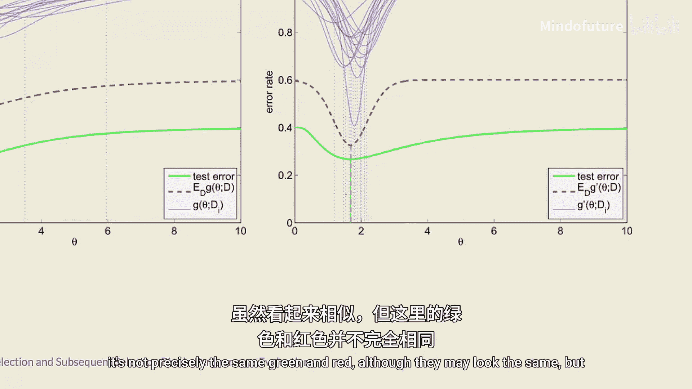

So this estimate is biased， but the variance is low， so we can be extremely unlikelylucky。

 We can be somewhat unlucky with this data set when we select。You know。

 value closer to one rather than2。 But look at this。

 We could be 6 rather than two it that it's like twice more wrong。Sir。

So when we're doing a model selection。It is important to be aware of this。Things。

 and we'll talk about in the next part of this lecture about。

What to use for model selection and how to avoid the problems I have just described。

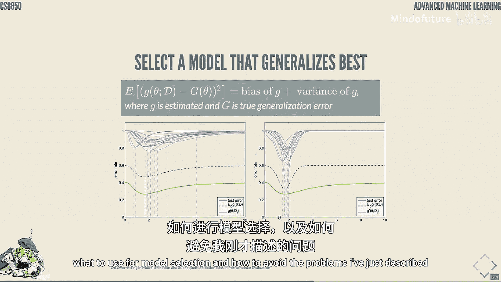

And again， just to bring those points home about biovari trade of and our kernel density estimate。

 I remember。The bias is。When our estimator is wrong， so we wanted to estimate this blue line。😔。

But we're way off。Now， we are estimating on average。The blue line， but our variance is high now。

Yeah know。Move slightly。Left slightly right。 and you get very different value on。So。

That's all about classical。Approach to buy experience trade off。And model complexity。

It's been a while。Sorry。A dogma。 like truth。 gold's truth。That。You know， avoid。嗯。Overfi。Don't select。

Very comp complicated model or。And select a high capacity model。

 select a parsimonious model with fewer parameters。And regularized with sparsity。Remember。

 non negative matrix factorization was regularized with non negativity as proxy for sparsity that we can regularize with sparsity L1 norm。

Again， another proxy directly or LP norm L0 norm。We can't optimize this in hard。 Well anyways。

 try to push the the。terization。Common sense。 And actually， truth is that we do want。

To keep our models somewhere here。 so we don't start overfi。So what people in this paper。

 Miha Bakin and others quote， they found that。Eially well， actually。

 with the neural networks with large， complex model with lots of parameters。You do see the classical。

By variance trade off when you have a。Underfe and overfe。And again。

 not just the dashed line in both of those figures is the training error。Your training error keeps。

Gueng。And if you were watching your validation set。Or you are watching your test set。

He will observe that the if you use more complex model， with more parameters。The test error。

Grows starts growing。 So well， okay， you're already seeing。My error is growing。 I don't want to use。

 I probably want to use。More parsimonous model。But if you persistent。And you want to avoid。

Confirmation bias。You keep increasing the number of parameters。Bing and not and。

Coaths knew that surprisingly， very large models perform really well。 what they observed with this。嗯。

And you can observe with them together。In this bias variance trade of figure that at some point。

 your model becomes。Over parameterized。And then the test error starts going down again。So look。

 you keep training。Or you keep increasing the complexity of your model。 And it's not the。

There is no time here。 is capacity of the model。 So you keep selecting a more complex model。

 and the model， of course， can key configure data。The training data better and better with increased accuracy。

It's not surprise， but after some。Interpolation threshold after some point。

 surprisingly more complex models， which are called over parameterized models when you have way more parameters that are needed to just remember everything in your dataset。

But yet， still generalization。Improves your test header goes down， and its。this figure shows lower。

Then。They optimally achievable。Test error， generalization， error。With a classical approach。That's it。

 for now。

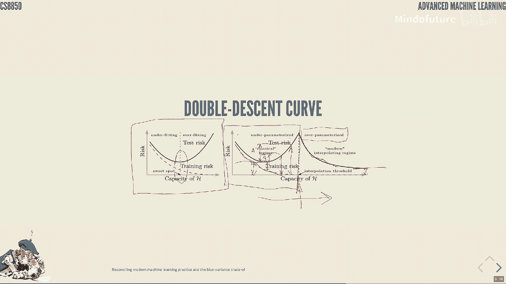