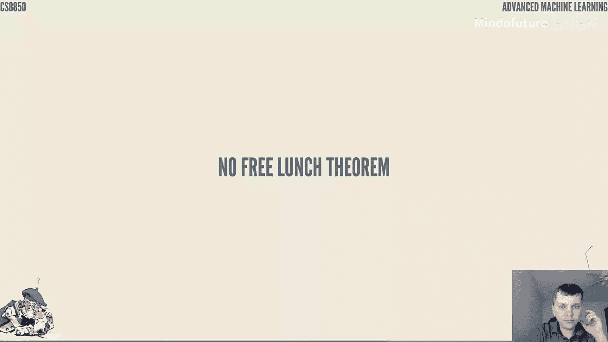
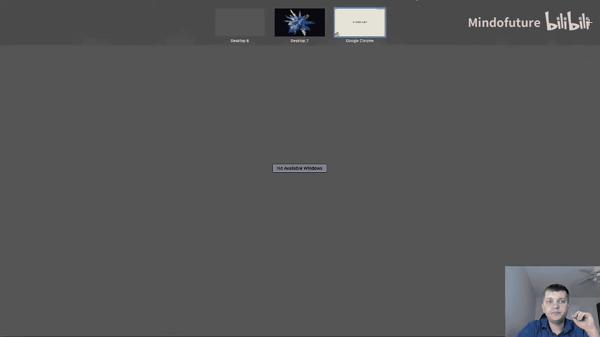
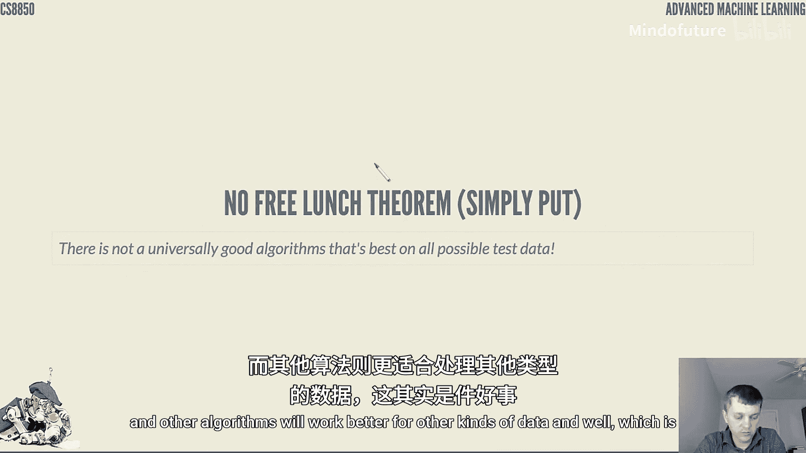

# 高级机器学习主题-CS8850-｜-Advanced-Machine-Learning-p58-P58_没有免费午餐定理--BV1sapPz4Ewx_p58-

Let's look about the Noy lunch theoryorem。

So we just covered by surveillance tradeoff。In viceice veran tradeoff was about model complexity。

 but not only we have models of different complexity from the same model class。

 but we can also have models。본这种 glasses。Mistication or supertyping machine or perception。

 which one to choose。はい，伟 good。Think about millions of different models and variations of them wouldn't be nice instead of doing that。

 because sometimes a machine learning course feels like。Just an inventory of different algorithm。

Like when I don't think about it， it feels to me， okay， well， it's like a bookshelf。

 I have tons of tons of options， and I just need to know which option。

Apply like which problem Like which option or which algorithm applies to which kind of live situation。

 right， so。It feels lead or it can feel that machine learning is， in a sense， a recipe book。Pick one。

 pick another， of course， recipe cannot be used or can be more efficiently used if you understand why peak1 versus another。

 but couldn't we publish。one model。Once and for all， and forget about what's happening。

The world of other models and on other details。And yeah that would be of course nice because it would be nice even for industry。

 that would be a saver than we wouldn't need any data scientists or machine learners or anyone there will be a model that you just train on your data and that's it that youre guaranteed to have the best model ever and the tricky part is that machine learning is experimental science and as an experimental science we。

Don't have the power of inive reasoning， as we would have in mathematics， say。

Because we never fully know the generative process of the data that comes to us。 And if we knew。

 then we could predict。The result or actually generate the result ourselves。

 so we wouldn't need to know how to go in the wild and do any experiments。What I mean by that。

 for example。Say we're building our classifier or a predictive model。

 diagnostic model for some medical condition。If we knew exactly。How。系。Looking at。

 like not looking at anything。 How would a city of。Say tuberculosis look like we or coronavirus。

 then we wouldn't need to train any model， we would just try the set of rules。

 okay this is how it looks like or we would just generate it and match， does it match or not。

But usually we don't fully know the generative process。

 we don't know how CT of a person with coronavirus will look like at any given moment for any given person and any given place in the world。

 for any given strain right， so we will have to assume and conduct experiments。That。

The data that we've seen so far generalizes。 That means if we've seen some sequence of。

Or a set of data examples。嗯。Let's go here。They with you， and the examples would be。

y is your remember right where。X is our feature vector。And why is our？内部。

So the onces we're here in this。Aging and we collected lots of data。

Which we did in the following way， it's just said。We。Couldition we've seen everything。

 and the next ones will be just like that。 But unfortunately， as David Hume put it back into the day。

 even after the observation of the frequent conjunction of objects。

 we have no reason to draw any inference concerning any object beyond those of which we have had experience。

 Well， that's。A very strong statement， I would say and。That statement was used by。

A man who we owe to no free lunch Theium。In all of its version is David Wilbert。You see him here。

So remember our function F。Labeling function from the beginning of the class。

 from the beginning of the semester in the computational learning theory part。

So that function assigns labels to examples。 So this is our。

Target or label assignment label assignment function。

 If this function is totally arbitrary or we cannot know anything about it。

 or it is uniformly sampled from all possible labeling functions， then for any two algorithms。

 A and B， there has many targets for which A has lower expected generalization error then B and vice versa for loss functions like01 loss。

 which is classification， right， and equivalently in optimization or for our purpose on a high level。

The statement goes as for any two algorithms。And I'm here right now。Or any two algorithms。

 any elevated performance over one class of problems is offset by performance over another class。

 Well， that's sad， right。呃， world。我们给你。Of course， it does mean that there is not a universally good algorithm that's best for all possible test data。

But it also means we are an experimental science， we can conduct experiments。

 we can choose our priors are basically what the Nore lunch theory says we have to choose our priors。

 we have to assume what kind of data we will encounter in the wild， what will be the test data set。

What we what do we have to generalize to and certain algorithms will work for certain kind of data and other algorithms will work better for other kinds of data。

 and well， which is good。

