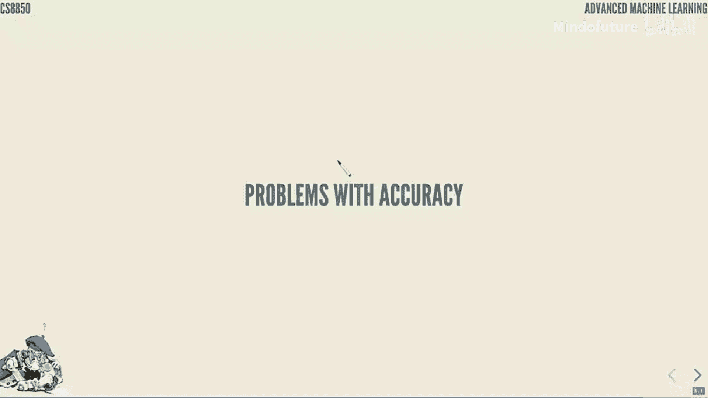
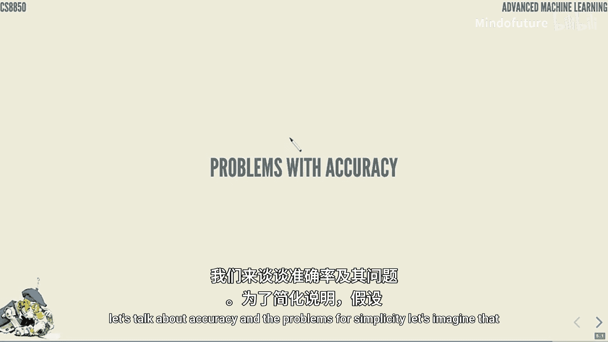
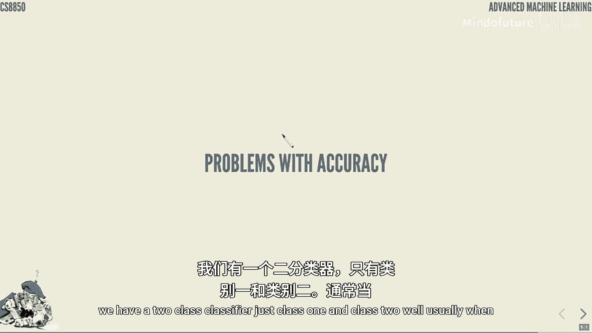

# 高级机器学习主题-CS8850-｜-Advanced-Machine-Learning-p59-P59_使用准确率作为性能指标的问题--BV1sapPz4Ewx_p59-

Let's talk about accuracy。And the problems。

Firstci please， let's imagine that we have a two class classifier， just class one and class two。こを。

你 usually me。When we talk about performance of a classifier。We mean accuracy。

 and accuracy is nothing but。Number of correctly。Predicted values。Our labels Yeah come welcome。

Correct。Predictions。Our number of total predictions。Well， and of course。

 this is all on the data where we know the labels。Otherwise， we are unable to measure accuracy。So。

One problem with this approach is the following。 Imagine that。This is。Our complete data set。

This is the dimension over data。And we have one through n points。And each one of them has a label。

So if we go x and a binary vector y。Yeah。So now imagine we've got a data where we're measuring our accuracy。

Such that。Well。0 and ones， right。Such that the class。Split。Hes uneven or highly skewed。

So we have 95% ones。And 5% zeros。So in this case。Any percentage of。Will be a large penties。 So。

 for example， or any percentage of error or plus one will be a large penalty if we have 10%。Eor。

Over class one。And we have 10% error。For class0。 So for class one。

 were missing all 9 and a half percent in this case。And。For class 0， we're missing。

Just half a percent of the total。Accuracy， so now when you're training a model with this highly imbalanced data。

The model or the training algorithm may fall into the following problem。

 It may decide to just focus on this class and the learning rule or the resulting model will be。

For all X。Pdict one。So the accuracy in this case。Will be 95%。Because。The error is only 5%。

 but the problem is there is only 5%， and it's always on class 0。

 So the problem with this is that class 0 may be the class that we most care about。 for example。

 class 0。Maybe the class where。The person is unhealthy or a person has cancer。

 needs treatment or something like that。 it's a rare event， but if we miss it it's very dangerous。

So that's one of the problems with the accuracy And then what could the solution would be and then you'd say right。

 an naEive solution is， well， okay， how many samples do we have， What is N？Imagine our N is。

Yeah know。A million and if n is a million， we could say， well。

 do we really need a million data points to train and classifier or don't you remember our support vector machines。

 we only need sparse supports， and even if we drop some。Of the。You know， some some of that。

Training examples we still should do fine。 So why don't we take out of that million5% of class 0。

 That is everything and 5%。Of plus 1。Or 5% of the total， but 5% of class1， so 10%。

Of the total training data。No。So we have 100000 training examples now and。50。

000 is of class zero and 50，000 of class1 Okay， well， we can do the training。And this is our。

Nive solution。This is our training data。We just took this 10% magnified and placed them here。

This is class0， this is class 1。 Now each of them is 50%， right？And then when we're training。

 we're basically comparing two algorithms， which one is better algorithm a or classifier a。

Or classifier B。How are we。Imagine， again， a situation。When class a。Well， sorry。

 classifier a gets class zero perfectly。But misses。Almost the fifth of class 1， right。AS of the zero。

17%。Of class 1 is assigned to class 0。And。What is it，83%。Cl one。ItThis is00%， of class1。

This is really character。 So now。What happens。To less me。What B does on the other hand。つこいドし。20%。

Of course，0 is assigned to one。In 80%。Iite correctly。But plus one。Hit kids。Fooully correctly，100%。So。

If we look at this。Then。The overall accuracy of a， the overall accuracy when we make a choice， right？

Is。92%。Because you，17% of the have。嗯。Is there error。And then that'll be around 8%， as you see。😔，No。

7 half。For B， classifier。Our accuracy， our total accuracy， is 90%。Okay， so three。

We chose a because the overall accuracy。It's higher and we don't know better。

 so if we choose a as a classifier of our original data set。This one。

That's how the data is distributed or the class distribution is。不し。

Tread what the classes that are distributed in the wild。Then we。And up。

With the fact that a gets correctly class 0。All the time。Well。Okay。That's tricky， right it。Over。

Over and for it a little bit， right， it assigns。20% or 17% of class1 to class zero， which means。

That the actual accuracy of this class on the data on。This true data is 84%。

The actual overall accuracy is 84%。Whereas if we pick。Plus B。The actual overall accuracy。Is 99%。So。

Let's think for a moment。We knew that our data is in balance。We've forcefully balanced the data set。

 because our。Samples size allowed that it was fine。 They use 100。

000 of the data points instead of 1 million。But then in testing， it turned out that overall。

 well and one re balancedance data that classifier a was better， but in test data。

 classifier a overall accuracy， and again all of those numbers are aacies essentially here is number of correct to total predicted。

So turned out we are picking。Perfect classifier or a winner classifier on the balance dataset。

 manually rebalanced dataset， but in the while it only gets 84% correct。The worse。

 the inferior classifier that is almost 2% worse in our training data。Is， in fact，99% dagg。

But all of that doesn't have much sense either because if we think about it， well。

 what does it mean to predict 0 incorrectly， What does it mean to predict  one incorrectly。

 What does it mean to predict 0 as one and what is it。In terms of the cost or the harm。

To predict one as 0。