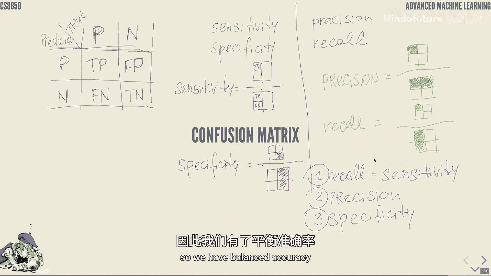
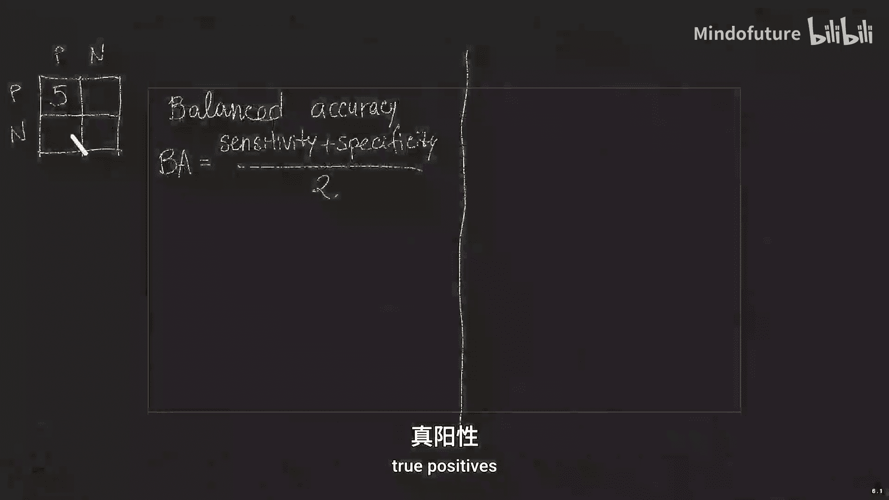
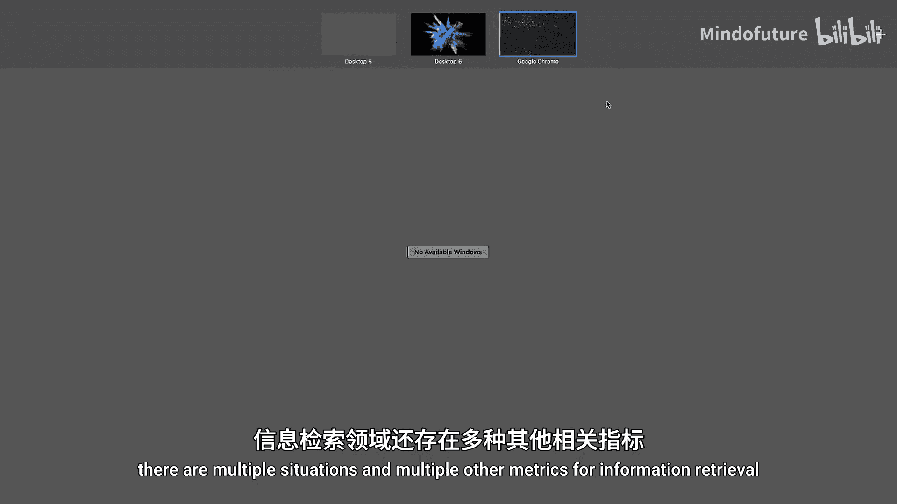
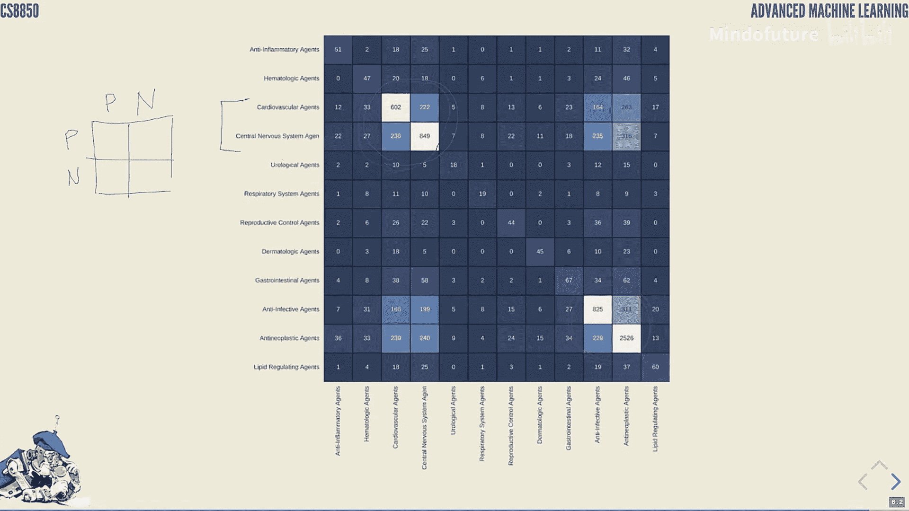

# 高级机器学习主题-CS8850-｜-Advanced-Machine-Learning-p60-P60_混淆矩阵--BV1sapPz4Ewx_p60-

Okay， before we go into talking about what's the best way to split the data or measure performance or。

Look at evaluation of models， or before basically we'll go further， we need another tool。

 a very convenient tool， which is called confusion matrix。It works in the following way。

 imagine we want to。嗯。Just focus on two class problem， two class classifier。

So we have positive examples。😔，Which are true positives， right？Iine that this。Or I， rather。

Assume that the top。Labels， positives and negatives。They are true。And。Positives。

And negatives here are predicted。So。🤧嗯。When a positive。

 the true positive in the data or in ground truth is predicted as positive。

We call them true positives。When a negative is predicted as as as positive。

 we call them false negatives。Oh， false positive， sorry。And when。A negative predictive。

 it is predictive as negative， we call them true negative。

And when a positive was predicted as negative， we call them。False negative。Okay。

This structure is called a confusion matrix。So， ideally。Ideally。

 we want zeros in false negatives and then false positives。

But since ideal situation is rarely possible。If at all。We need to understand the trade offs。

Between the numbers。 So one of the things to talk about is。At measure。

Or a set of measures that can characterize。This matrix。Any more。Compact forum， right？

There are two sets of metrics that people use。嗯。To measure model performance or a classifier performance。

One set is operating with something called。Sensitivity。And specificity。In another。

Temporase for something。Clled precision。眼内口。So， sensitivity and specificity are。

Easy to describe for the start。So sensitivity。Did I spell it correctly。Yes， sensitivity yes。

It's easyas to show graphically in terms of the。Whatus matrix。想信几月几。

Is nothing but through positive rate。So we have true positive。Over。All predictions。Of positive class。

 of Of the true positive class。And specificity is basically true negative rate。sThis part。L最后那个几。

This is sensitivity and specificity。Precision。On the other hand。Is。slightlyly different。Eventually。

 it's a new metric。Precision is， yes， true positives。Similarity。True positives。

Over everything that was predicted as positive。So notice just sensitivity is through positive rate。

How many samples of the positive class were predicted？Correctly。How many samples of the positive。

Recision is。How many samples that。Were predicted as positive or actually positive。Ply call。

Is the same as sensitivity recall is。Not precisely the same as sensitive。😔。

So this come from different。Ces。The precision that call from information thattri and sensitivity and specificitivity is。

What about class performance。And。As you say， well， as you see。We only have steam。

Measures and each one， a classifier can cheat。Excuse me， don know for each measure or glassifier。

You can cheat if we maximize only one measure。So it say。

I think it would be nice if we have the following。嗯。Thank you to Minister for help。Yes。Re口。

Is the same as sensitivity。And then we have a precision。什是分析只要住那个地方。So different camps use different。

Metrics， for example。If it's information that you you will imagine a search engine and。

Search engine precision is very important because。诶。

Precision is whatever was correct among what was returned。So we want high precision。

 we want to return thequeties， or when you search， we want to only show you those。嗯。

Pages that are relevant to your query that are what you're searching for we don't care so much about recall it's like okay。

 there are too many pages we don't care about how many we didn't find that are still relevant but we don't want to annoy you。

 we don't want to show you pages that are irrelevant so we want high precisionion and we don't care about recall that much。

But。Say recall a model that optimizing recall， just recall。Can return everything。

 every prediction as positive class， and then it will retrieve。

everything in the positive class right it'll assign positive class to everything so the recall will be high sensitivity。

 okay the model can cheat if we only well oh sorry specificity， if we only maximize specificity。

 a model can return negative class for everything and again through negative rate will be very high because everything in the negative class will be labeled as negative。

Also， everything in the plastic。AndThen precisionioners also can be cheated if we only maximize precision。

我 then。We can be very cautious and only assign positive to very high probability。

Well very high assurance confidence classes， we will set the threshold so high that only。

Those that theymobilize are absolutely sure。It will return so。As you see， each one of those。

I wanted to say four， but they're actually one。Three， each one orders three。Right， so。

It's not that interesting， but there is something that。Yes。There's something that。Emers。

That is useful。The thing。Sorry。The thing called。Balance thaters。So， we have。

Balence， and。Let's do the word here， so balance accuracy here。Is sensitivity。Bas。嗯哪 village。

Of sensitivity and specificity。So imagine。This problem。Those are positives。

 negatives as predicted or as actual， and those are as predicted。And we have。F。5。Through positives。

T0 false negatives。5。positives and。1000。Noな。It's a very imbalanced data set。In this case。

 the accuracy。What is the accuracy， by the way， so were looking at the balance accuracy。

 but our accuracy。There's nothing but our correct predictions。Number of correct。

 the number of total predictions。10000。Divided by what do we get10 plus5。Plus15。Pluss 10000。

In our accuracy， in this case。It's amazing。 It's close to 99。4%。What can be better。

 but we know that actually， if we predict everything as negative class， then our accuracy would be。

Just don't predict anything for the positives0。Predict everything as the negative。And。

we don't predict anything as the positive。We get。Better accuracy so by completely ignoring positive class。

Get weather accuracy。Just total crap， right， that's not what we want。 Let's see for the same thing。

What is the sensitivity。Sensitivity is through positive freight。515th， which is about 33%。

And specificity。Its true negative rate。确实。嗯进来。5%。So我 is very high。And they're balanced。Acurし。I。33。

3 plus 99。5。by2 and。This is 66。4%。So balanced accuracy。Seem to make sense， but wait a second。

What does the balance accuracy give us when we totally。The project。The positive class。

 what is the balance accuracy of the classifier？呃。Here。That so good。Great。

 balance accuracy for that classifier。牛逼。Let lets again compute sensitivity for this classifier。

Which will be okay。0 over 15。Whi is。Sensitivity or true positive rate here and specificity。

Through next afraid。Is 100% because。Remember， everything is negative now。

Just predict everything as negative。So all of the negative classes will be guessed currently。

But then our balance accuracy in this case， is totally random。At chance level 50%。 So that's one。

Allanced surprise measure for accuracy， but if we are in a precisionary cold camp。Decision。你口。

And it's more preferable or another。电了按按个这。一个应电日。Of course， file accuracy is F1 measure。Or F1。Score。

Since a call and sensitivity are exactly the same。Look how interesting。 That is then F F1 measure is。

Re morning。Mean of precision what it means。We divide the product of precision and we call let sum of precision。

Yeah那 again。이제 베닝은。Where you玩。What is your task， What is your problem。How years我给 it。

Either F1 or balance accuracy are good matters。But there is another one。Wish we will discuss later。

 that is also important。Maybe even preferable to use。We're only starting to dig at the。

This whole area of model comparison。It's like。You know。Don。

Think that I'm recommending to you or use balance accuracy or use F1 score or use this use that there is not a golden answer。

 there is not one size fit all that what free lunch no free lunch theorems are telling us you always got to be careful and look at your problem that you're solving and look at what applies so again decision and recall is about information rerieval。

Bolence seccra is about evaluating a classifier。 Think about diagnostic tool。

But there are multiple situations and multiple other metrics for information re that would be irrelevant。

SoLet's。We'll look at something else。Here is your confusion matrix。

And this is a typical case for two class trouble。But confusion matrix is also very。

Useful to or class problem。So this is 12，34，5，6，7，89，1011，12 class problem。

 this is from one of my papers and just a real life example。So we have different kinds of drugs。

 or actually we were trying to classify the or predict which drug。Was applied to a culture of east。

And。As before。We only had before we only had。Two options。In the truth， positive and negative。

 and two options and the prediction positive and negative。So similarly here。

 we have 12 options and the truth and the same 12 options in what's predicteded。And interestingly。

 what what you can see， you can see a structure of your classifier where it is making mistakes。

 for example， this， if you see it， let me put some red there。Yes。And tells us that the model。

Consistently confusing。Those two classes with each other and those two classes with each other。

So I just， I don't know。Just a curious fact。What we were looking for in the paper。

And why this was helpful， what we were actually looking for is drug repurposing， it's very expensive。

To conduct a clinical trial of a drug。Look at some some novel drug for new disease， but if we have。

An already approved drug for some other disease， and if we find that it can treat something else。

As effectively and we don't need to go through the expensive approval process。 We can just you know。

 go an expedited route and apply it。To a new disease。

 start marketing it and helping people with a different disease that we didn't know that already the approved drug。

嫌かと。And by seeing that classifier confuses。One drug with another and seeing that one say drug is cardiovascular。

 another is a drug for nervous system。We can find opportunities and I'm talking about those too right now。

 we can find opportunities for drug oring。Okay给。

