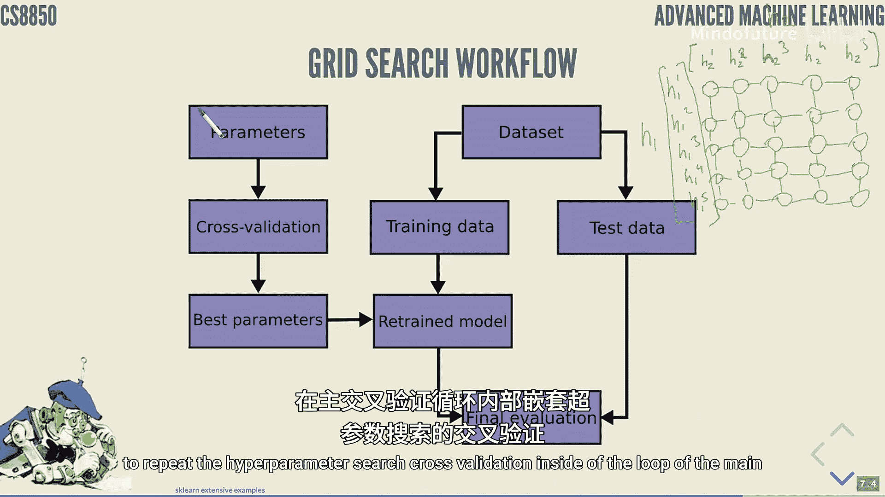
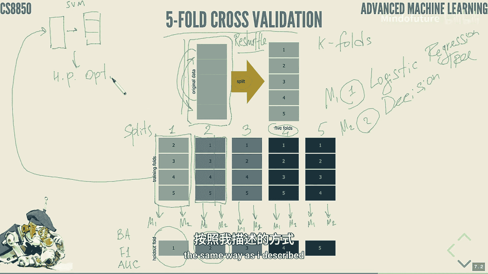
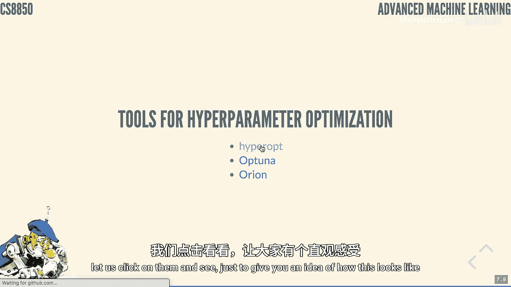
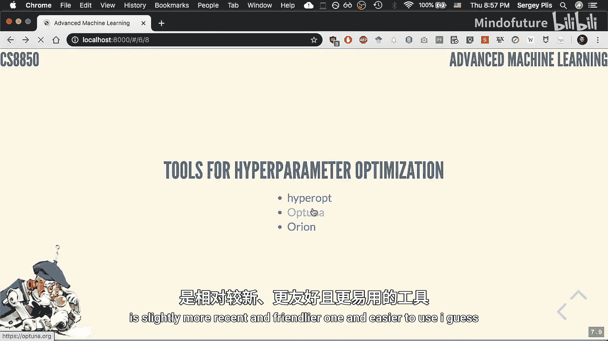
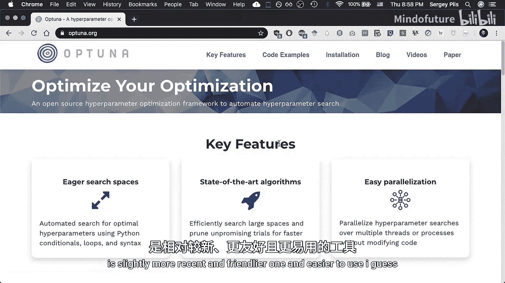
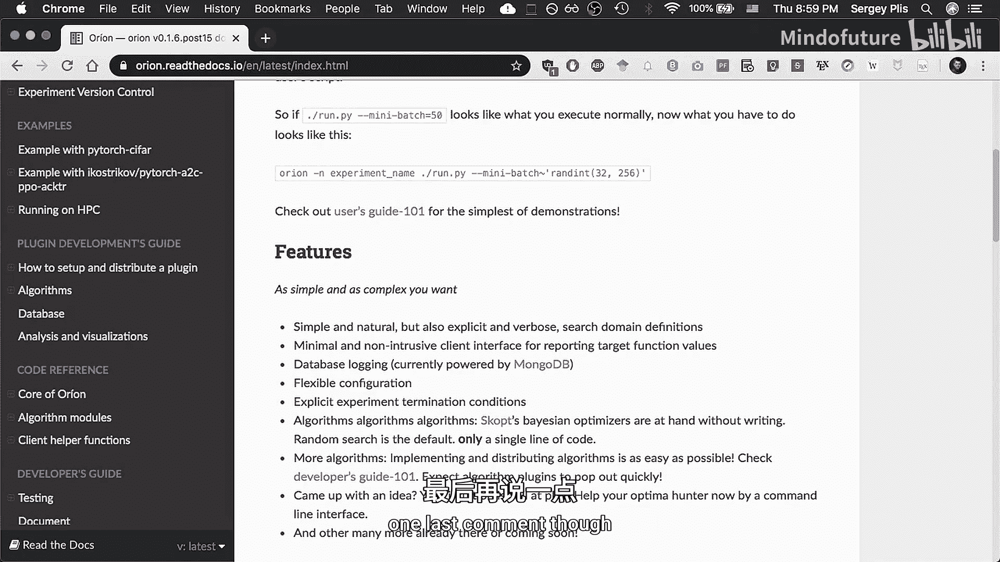
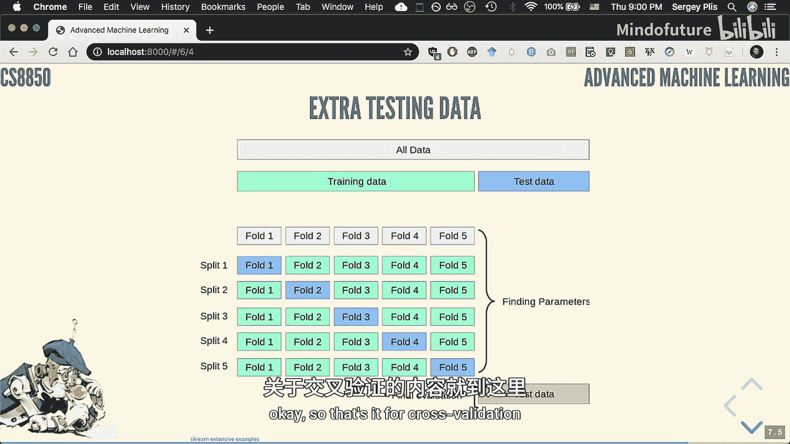

# 高级机器学习主题-CS8850-｜-Advanced-Machine-Learning-p61-P61_交叉验证和超参数优化--BV1sapPz4Ewx_p61-

No。When we have some metrics， some metrics。Balance accuracy and F1。The question is。

How do we select a model that's best。Or how do we。Peak hydroparmeter， for example。

 size of the model or settings of some coefficients that are not optimized on the training data directly。

For instance。Like put I aurs in a person Toronto in neural own network。How do we。Yvan。Gage。

How variable is the performance of our model。Basically， how do we measure anything？Given the date。

And cross validation is to the rescue。It's a technique that is extending our original approach。

To data split。Remember， we split the data initially into train。And test。

And test was basically haul out。 We never used it。To do anything with the model。

 besides the final check。And there was something else validation。Which was useful for。

Precisely hyperparmeter optimization， not just。Learning but controlling overfe and things like that。

But can we， Well， this is still。Just one final number。 This final number。Performance on test。

ItDoes't tell us anything about variability of that result。

 because imagine we could have selected a different test and a different train， even from the same。

Data， as we have， so。We could have selected this part in that part。 and randomly， this part， say。

Altogether。To form our test set。Or any other location of those。Subsets， right。

 Let's move it over here and we'll get another split。

 What if the performance by chance just totally change， What if。In this particular split of the test。

 we got 20% very hard examples and they'd never been present， just by chance。

 they'd never been present in the train date。So how do we deal with that， do we。Avoid or。

Cope with the situations where。And this could have happened。 or how do we know if it happened or not。

 So cross validation is a technique that。Its to help。So， our original data。Is this everything。So。

 what we do。Is we randomly。Reshuffle the data。Just。Uniformly or randomly reshuffle the data。

And then we'll split the data into what we call faults。And。We split it into cave folds。This example。

 this figure is for A for fivevols。But。It could be 10。The roll of thumb is usually the 10。

 but it really depends on the size of the data that you have。And。Could be whatever。

 So kfold cross validation， that's how it's called。 That's why in our specific case。

 it is fivefold cross validation。So after splitting our dataset。

 the complete dataset available for us for training。Imagine our goal is to select。

A better model out of the two。 One model will be logistic regression。

Just to give you a concrete example。And another model will be a decision tree。

We haven't covered decision trees in this class。But I am assuming you're familiarulating with them。

So what we do now， we have five folds and correspondingly we have five splits。This a split one。

This split 2， split 3， split 4 and split 5。What that means is we。

Or sequentially take one of the faults。And hold it out as a hold out fault。

Not just one is missing in our training faults。Or training data。

2 is missing in our training data and the split 3，3 is missing and so on and forth。

 So the task now is。To take our two models，1 and 2。And train each on this complete training data。

And then， we'll produce。Model1。Whi is。Logistic regression and Model 2， which is a decision tree。

In model 2。After we。Trained those two models on this training set。We can compute our accuracy。

 measure。Which is either balanced accuracy or F1。 Now we know better not to use accuracy any。

So we can compute those two numbers or one of them， depending on one which one which is。

 or we can compute something else which I will talk about in the next episode and one of the next episode。

 which is called at0 end of the curve。So we have two numbers， one for each of the methods。

Then we move on。To this data set or to this split。And train。On new training data， it's now different。

 it excludes two， but it includes one。And again， we compute the performance of each model。

 not just that。Model 1， and model 2。Produced on Sp 1 and Model 1 and Model2 trained on Sp 2 are slightly different or maybe completely different。

 depending on which difficulty or what kind of difficulty problems were in the fold1 and in the fold2 that was included here but wasn't included here in lastpers。

That it be the process。You can do that。Whether you have two models or even one model。

Imagine that your task。Is not to compare Model 1 and model 2。

But just assess the variability of your model。With a specular data。Is it consistent。

 does it have high variance depending on data。Or it's pretty much returning the same result。

So after doing that。We can look。At the results。Well， and this is the result。

Of a different cross validation in this example， as you see， its it。Tandfold cross validation。

And we see performance of logistic regression with the mean at 64， and we see performance of。

Decision tree with the mean closer to 69。And we also see variability。

 So now we can select which model which one of those models we want to select。 So。

 but well which one to select number one， number two。

 like which one of the faults is the best model shall we select this model， But wait a second。

 it hasn't been trained on the complete dataset set， It has only been trained。On a subset。

Of the data that didn't include10 fault， right This is 10th split。So people from acalur。嗯。

Let me and go out of order， describe the following following procedure。

When we do our model selection， we leave some true holdout set。 So after we。嗯。

Do fivefold cross validation。 This is exactly equivalent to what I was describing。

 And from this fivefold cross validation， we found say。Was it accuracy。 Let's check。 Well， accuracy。

 so bad。 Let's assume it was balanced accuracy that we were looking at。And we have two models。

 logistic regression。And decision tree， decision tree， as you remember， gave us something around。69。

 we will be using our box plot here。And啊。Logistic regression gave us something around 64。

 The variability was about equal。😔，If find it call correctly。Now， what we do。

 we take this complete dataset set。In the retrain on the complete dataset set。The winner。Decisionary。

And then。We report the winner's performance performance and test data。

 that's how we know what to expect in the wild。嗯。But。Cross validation is not only a good technique。

Not ideal。 by the way， there is no silver bullet it can be cheated。

You can overfe to cross validation。 There are leakages to reach out。 So but anyways。

 it is a good technique。 It is much better than。Testing and training， you know。

 training and testing only on a single split。Because when you do that。

You have no idea what's going on。 You can't report much about your model。So。

 but another use for cross validation is。Hyperparameter optimization。For example。

Shall we take two layer neural network， one layer neural network or three layer neural network shall we take。

10 hidden unitss per layer， shall we。Take 100 hidden units per layer。

 shall we take 100 hidden units in the first layer and then 15 the second and all of those things are hyperpara。

 the architecture of our model。This diagram from I scale learn documentation describes how to cross validation process of choosing those best hyperpar for the model and then returning the best model for using and production。

So what you could do， you could say， okay。I have a few hyperparameter for simplicity so I can draw it for you let's assume we have just one hyperparameter 1 and hyperparameter 2。

I will presentsselect the values of hyperparmeter 2 to consider。

I have some reasons to believe that it will be age to1， H to2。H 2，3 and H2，4， and H2 5。

So if I pre those， they could be anything。That comes from my prior。

Knowledge of the problem or my ignorance， pretty much。That's with people。Usually go with。

 but will try to avoid this in the future。And the same for H1， let's move it out。We will select H11。

 H12。H1，3， and H1，4。What am I doing？H1，4。And say， H1，5。In this particular instance。

 our data science scientists happen to select equal number of parameters。

 A equal number of values of each hyper parameterameter to try。 That's what I should have said。

 So for each。Candidate for Hyparameter 1。And for each candidate for hyperograms are two。

We have a note here where they intersect。And regardless of the value of H11， H12。

 and so on those candidates， regardless of those values。We will have。That creed。So。

 hyperparmeter search。I is traditionally called grid search for that reason。

Because we need to run a model for each intersection of hyperparameters。Of hetero parameter values。

or hyperpar candidate values。So， let's see how the same。嗯。Cross validation procedure。Could be used。

For hyperparameter search。No。When we've done our first split。And this is our test data。We will train。

On this training data。All of our models that include all possible combinations for H1。NH2。

So we will train 25 models here。And test them on the holdout Then again。

 we will train 25 models on this can or green color greenish color and test it on fold2。Then。

From there we will have our 25 models with all combinations of H1 and H2。Candidate。And say。

 we will have not only their means。Averish performance。As we decided， or as I decided。

 we will use balanced accuracy。But we will also have the spread， so。Technically， we can see。

Statistical significance of the difference between。Those values。 and I assume。Somewhere。

There is a candidate。In this particular hyperparameter settings for H1 and H2。

Our balanced accuracy is the highest。What do we do next。Well， we say， oh， this is the sweet spot。

Well fix those hyperparameters。That's our candidates。 And with fixed。

Values of these hyperparmeters will train a model。That we can now test and see if it really performs well。

 and then often production goes。But。Let's go back。To。Moal selection。

 So now we have say logistic regression。Decision tree。I don't know。 randomand forest。Multil layer。

 perceptron。SVM and lots and lots and lots of models we need。By a cross validation。

To select one of these models that perform best。And one of the one of our previous lectures。

 I showed you。All the ML tool。That is our homegrown tool。 You can just。Keep install。Or Google it。

It's multi multiclassifier。Just give it your。Training data X and Y or x is z。Matrix N y is a vector。

And it will run all of the classifiers for you。Cross validated。And give you the result。

 But wait a second。 what which one of the SVMs we on， which kernelel。Which soft margin。Prameter。

Because depending on which one we choose， we will get。

Different accuracy will get totally different results， some of them will be better。

 some of them will be worse， what if by chance， even when we're doing our cross validation。

 we selected the support vector machine。Boice parameters theres the just。No。

 it's based on further data。More more interesting， right， MLP， how many layers。

 how many what kind of linear nonlinearities and all other choices right。

 and the same for any other model。So， can't we do。Somehow a better can we select an optimal。

Hyperparameter choice for each of these methods。 But how do we do that？

If we select hyperparameters on the same data that we're training in the cross validation。

Then we will be overly optimistic。So traditional way or recommended way actually and very good in practice is。

To repeat the parameter。Have a parameter search。Cross validation inside of the loop of the main cross validation。

So when we have selected those training faults。Test data。Let's pretend now。Let we have a data set。

Which is not this anymore。Not that。I try the， the smaller data set and say where。

Working with support vector their machine。Where doing a。However， depending on our data。

 threefold or tenfold or somefold split and repeat our hyperparameter search。Feder parametermeter。

Optimization。The same way as I described。

And here。Then， for each fault。We select the best hyperparameters or the best set of hyperparameters that is possible。

 and in the end when we select the best model， we retrain it with the best set of hyperparameters。

So that is nested cross validation。 and as this。Ploot shows， again， from my scalurn。

Is that if we don't do nested cross validations， so our score on training data is higher because we're more optimistic and when we do nested cross validation。

 we're less optimistic， but we're still selecting or more likely to select the highest performing model。

No我。Sorry。O。So grid search， right again， what if we are in a situation like that that one of the parameters。

Can give a super high performance And another parameter doesn't affect the performance as much。

 right。Anywhere we choose here。Along this line will get super high performance。

 If by doing our great， great search for hyperparmeter optimization， we just uniformly。

Put the values on the grid as in this figure， then we will oversampble the unimportant parameters the parameter or well imagine that it's a hypercu right we need all possible combinations of the values。

We will oversample this value， but by going uniformly on the important one。

 we will never be able to get。做。The maximum。Or the optimum。The value of hyperbrometers。

So there are lots of ways， various ways that are very complicated Bayesian。

 Gaussian processes and so on and so forth， more like active learningning。

For hyperparameter optimization， let's not consider that in 2011， 2012。

 Berktra and Beangjo have shown that if youre actually randomly sample，The space of hyperparmeter。

Then the chances of hitting that optimal point are higher this guy。

So this combination of H1 and H2 will give you the highest balanced accuracy。嗯。

Or whatever metric you're trying to optimize and the chances that you will find it are higher， said。

Do lots of other enhancements since then exist， but I was surprised that not too many lets not cover it in this lecture。

There are tons of tools that will make your life easier。

 such as hyperOt that is from the original author of the method that they've just shown。

 it includes random search and other tricks on top of it when you're atically optimizing your model。

Hyperparameter again， not just parameters。 And then there is apt2na。 a recent one。

 and a has a is something else， but it has tools for。Search， letless。佢你紧灯。And see。

 just to give you an idea of how this look。

Like， so。This is hyperparameter optimization， yes， by the way theyre all distributed their work with a patches park and sm clusters and so on and so forth。

 so random search， as I said， and then three of parisan estimators now you will be able to read this paper and the examples because you know what is a par and estimator after our lectures。

Gnapas Park， based Mongozibi Abtua。Is a slightly recent， more recent。

And friendlier one and。

Easier to use， I guess。Although the algorithms under the hood。Pre similar。

 And it's all nicely sleep even， and itll。WellLet you in couple of lines do hyperparameter optimization should be helpful for your class project All。

 let me show you quickly。

It's quite a different beast， but it minimizes the effort for hyperparameter optimization as well as parameter optimizationim by making it all bash scripts with just one lineers and also includes Bayian hyperparameter optimization so that's it for cross validation for now。

 but the topic is very deep and lots of papers if you want to dive into it and learn something useful for you you're model welcome to there are lots of。

Ways to get lost in the wealth of knowledge that is being accumulated by the people there。

 One last comment though。

Notice that。Statistic。Statistics has existed for years， right。At least 420， as far as I。😔。

And people knew that single point estimates are not the way to go。

Imagine we just have one model and we want to do cross validation for hyperparameter search。

 one model， couple of hyperparameters， a couple of values。Look like how many。

Evaluations or how many training runs of this model you need to do to perform in order to perform5fold cross validation。

 It's quadragic， right， It's about 35， I think because you need to train on this train data。

 but then you need to train on the whole fold in the end， So it's。You know， multiple models。

 multiple retrainings， multiple comparisons， so that that's very。

 very computationally intensive and it only became possible relatively recently when we have， again。

 the relative abundance of computational resources， if you compare with statisticians of the past。

Okay， so that's it for cross validation。

