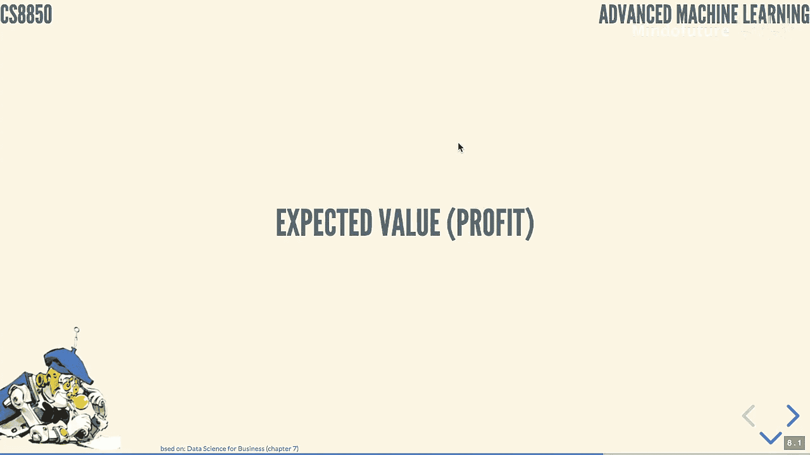
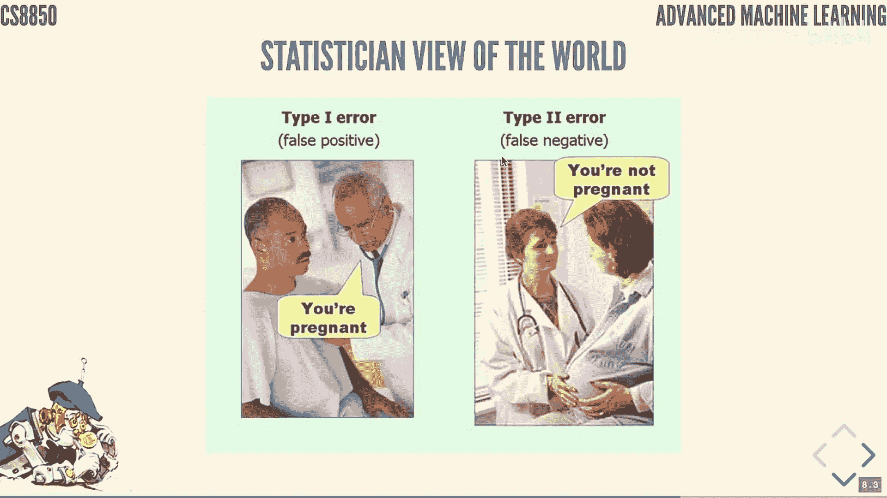
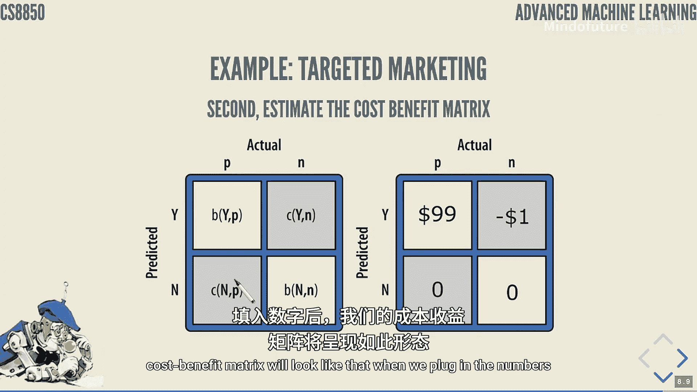
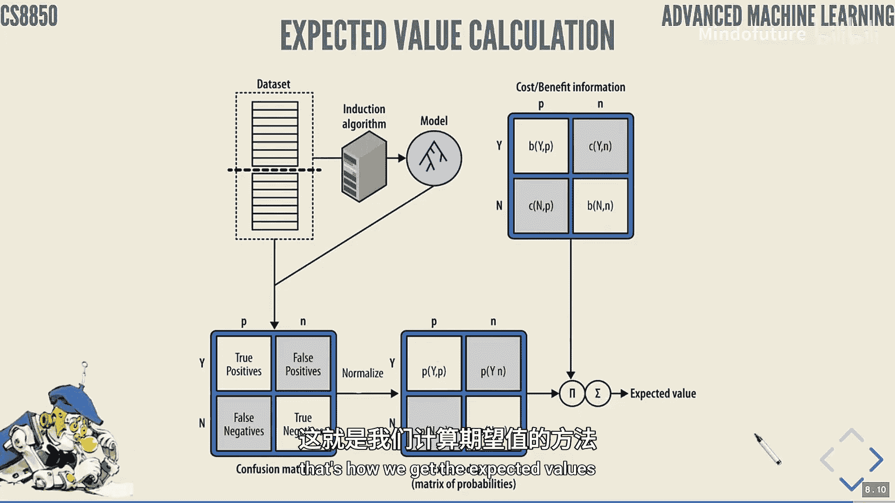
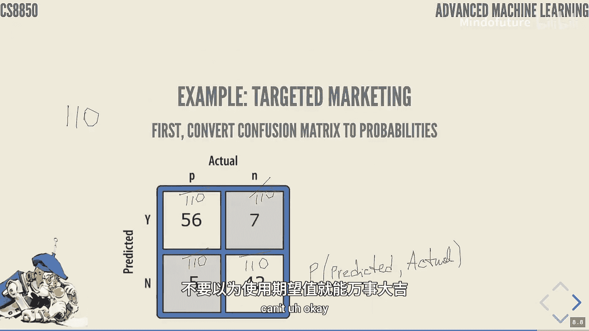
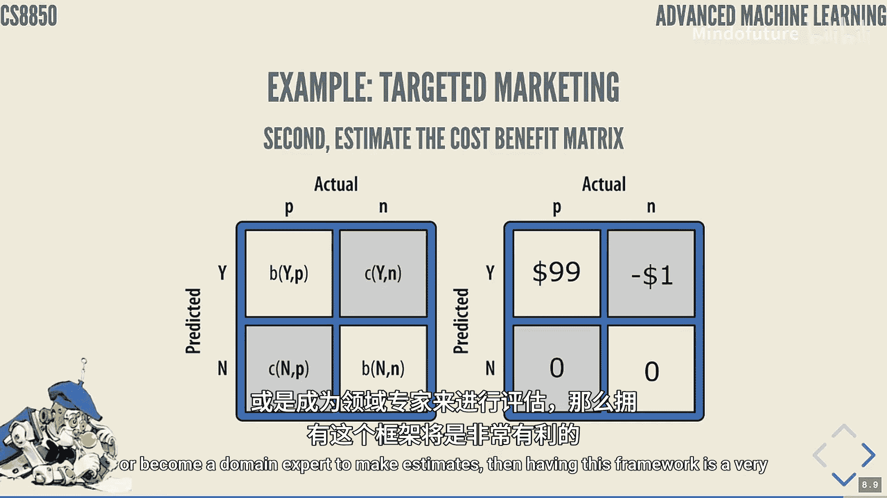

# 高级机器学习主题-CS8850-｜-Advanced-Machine-Learning-p62-P62_期望值(利润)框架--BV1sapPz4Ewx_p62-

Should we just always use balanced accuracy？Or maybe if one scores is one of the one was used。Now。

 in addition to many possible single number metrics。

 different cultures call the same thing by different names。And it's unclear of。

Just from the recipe standpoint， I won't be able to give you a recipe of。Yeah know。Just the。

Very reassuring use this and you always be right。Just。Okay。

For example， statisticians call the same things that we usually call them machine learning false positives。

 they call them type1 error。And。In what we call false negatives。

 statisticians usually call type 2 error for historical reasons， I guess。

And I believe now you will never forget what false positive is after this picture， right？

Just kidding。

So which metric is the right one if you notice there is a ton of metrics here that people use and this is just a subset actually for inter retrieval from Wikipedia。

 but there are many， many others for different other purposes for ranking。

 we would use a different one in some of the metrics are not here。

 for example that mean average precision and average precision and so on and so forth。

 but those metrics here they are all based on our confusion matrix。With。Positive。

 negative and predicted as positive， predicted as negative。 all of them are based。

On the true positive。Falls positive。出那个。放死那遇钱。Okay。So confusion matrix。Is。Pganized rate。

 it does contain everything， all of the information。

 but it's very hard to use as a single number to say， oh， okay， look， my model is better than yours。

はい。Yours。Or for other purposes like that。So。Different different metrics， but different。

Cases and thanks to no freeance thes and thanks to this situation of the metrics。

 you will never be out of job if you're smart and hardworking and grow into your field and understand what's going on because you have to look at the problem all the time and decide every time you see a new problem it is not just a simple recipe how to do this and will be done you have to understand the specific。

 you have to understand what your stakeholder， your customer wants and what are they evaluating and their metrics what your model will be doing when it be deployed and all sorts of things so all of those metrics。

嗯。Very useful， but the answer to the question， which metric is the right one is it depends。Because。

Matrics by themselves as single numbers。Including accuracy also our bad for the following reason。

 it's not。For example， in the case of accuracy， it's not bad just because it doesn't handle imbalances in the classes。

But it also is bad because。It doesn't take into account。The decisions。That will be made。

After the model that we chose as the best is deployed。呃，播。

We need to take into account not the decisions themselves， but。The consequences of these decisions。

 their costs and their values。And then make our decision about which model is the best。

Depending on the cost and the values of downstream use of those models。

One way to take those into account is expected value。Well。

 you already know expected value from probability theory and we're using this all the time recently in。

Ja and I algorithm with expectation of eximization。This is similar， the constant is similar。

 so let's still note an outcome I as outcome I， also I。

And the probability of that outcome as probability of ob buying surprise。And the value。

 now we're outside of machine learning， we're in the real world use case。And the value will be。

view of O Ba。And then expected value is nothing but as you will， must have I already predicted。

Is just the sum of across all of the possible outcomes。

With the values weighted by the probability of that outcome。So let's look at an example。

 targeted marketing evil， evil， but very frequent one。If you work at a company。

 all companies do that， some companies who just do marketing do more of that。

 but still easy to explain and very pretty much real world example。

 so say a consumer bias the product for $200 and our product related costs are $100 that's $100 includes manufacturing。

 delivery and everything。Oh that guy。So to target the consumer with the offer， we also in costs。

Let's say that we mail some flash and marketing materials and the overall post。

 including postage is $1。Buildielding a value profit of $99。Which is 200 minus100 and minus-1。

All of that。嗯。Proceeds， minus everything that we spent。

But we will get this $99 only if a consumer respond that is buys the product。Now， what about。

The volume。Of the negative outcome， not the responders， if we send our marketing material。

 but the consumer doesn't respond。The value。Is。Negative dollar because we still made the marketing materials and Carda costov。

$1。Or which is convenient， more convenient to think about it as a benefit of minus $1 or negative benefit。

So shall we target this specific consumer， how do we know this is how we can use the model that predicts pro based on the expected value framework。

So。Probability of responding times the value， 99 minus probability of not responding。

One minus probability of responding in this case。Ts the dollar。

That we spend to send marketing materials and to prepare them。

Must be greater than zero if it's greater than0 than its worth doing because we are making money。

If we rearrange the inequality and solve it， we see that if the probability of responding。

It's greater than 1%。We need to set marketing materials， look how low the probability of response is。

 but in our case， the cost of acquiring a customer。And all。

It's so low that even if probability of this customer。Responding is just 1% we're making money。

But this is how we could use expected value。Framework in order to use a model that is been already trained and it's predicting based own features from a customer it's predicting。

What is the probability of responding or not， but can we use the same framework for choosing one model over another？

So。It turns out we can and we will see now how first we will convert confusion matrix to probabilities。

I assume we've trained a classifier。That reduces this confusion matrix on 110 test samples。

So let's normalize the count， those early accounts and how many out of those 110 were predicted as positives when they were indeed positives。

 how many， seven were predicted as positives when they were negatives。So， when。We normalize。

Everything by 110。And if I was in a class with you， I would。Ise here and ask you， what is this。

 what are we getting， what is this subject is called， and you would of course。

 after hesitating respond that this is the joint probabilitybil distribution。Of predicted。

And that true。We will get。This's giant probability distribution after this process。

Now we need to estimate the cost and benefits matrix。So。The cost and benefit matrix looks like that。

Benefits。Is something that we gained when we made a correct prediction。

And costs is something that we incur when we make an incorrect prediction。But in fact。

 mathematically and even for reasoning convenience， it's better to call both of them benefits。

And just when we plug in the numbers， the benefits in those。Qudrants will always be negative。

So negative benefits or positive benefits。So if we。Are here。In our example。That is， we've sent our。

Materials， marketing materials and the customer。I responded and bought the product。

Then this is true positive。And how much do we get here， we will get $99 of the benefits。If we are。

Here， when we sent something， but the customer did not respond。嗯。Didn't buy our product。

 then we incurred the cost of negative $1。But what if we correctly said。

 don't send the customer wont respond well。We didn't send， we didn't lose anything。

 we didn't get anything， so it's zero。The same cases when we said don't send they won't respond。

 but they would have responded。But anyways， even then。

 we didn't incur any costs with Se zero and our。Cot benefit matrix。

We look like that when we plugged in the numbers。

The overall process looks like that the following。Diagram， basically， we take our data set。

 we take train test split。We train an algorithm and get a model use。

The tests lead to compute the numbers and evaluate the model。

On this confusion to create this confusion matrix， then we normalize and get our joint distribution here in this matrix。

 then we take cost benefit information and then element wise multiply and integrate。

 that's how we get the expected value so if that is the process what will be the profit in our example。

Just writing out numerically or mathematically， symbolically， actually what I just said。

We multiply each benefit。The negative benefit and the positive benefit with。Probably lose too that。

Event or well the probabilitybil will already confuse it。But before we compute this numericalically。

 let's reuse the chain rule of probability that will make something clear， clearer。

 at least and we will conduct it in the next sections of this lecture。Let's。For probability。

 each of them of the joint probability of prediction and action truth as。Condal。And the prior。

So as you see。I did that。For each of those probabilities， then observe that probability of。

Responders are positive。Is present in those two。Terms and probability of nonreconence is present in those two terms。

 I took it out。And now observe an interesting。Relation that we have those two quantities。1。And2。

That are weighted。By class probability responds and non respondents。

We also observe that those conditionals are actually true positive rate， false positive rate。

When well， it false negatives is when it's positive， but it predicts a negative。

And then through negative rate and false negative rate。呃。I said delivers is a true negative。

And this is false positive。Falls positive。Fallse negative。Through negative， true， positive。

Those are the raid and。Probabilities。Class probabilities say if classes have different size。

 then we're just weighting those two expressions by the corresponding size of the classes so in our case。

We had 110 test examples。And probability the responders number of responders was 61 and number of known responders was 49。

 This is just coming from the original。Confusion matrix。Its to six。7。5，4，6，2。

If I sum everything up together， I get110。If I sum just the positive 56 plus5。

I get probability of respondents， responders， if I sum just the negative I get probability or。

Number of known respondnderers， sorry， and then from here， I can compute probability。With responders。

61，1，1。And drug known responders。Basically45。And then my true positive rate。Will be a 5 to6。

Devis it by 61。Through positive， the number of true positive。As a fraction of all positive。Which is。

N2 and then false positive rate。It is， again， the fraction of。They it takes it as positive。

I don know all of the negatives。14%。And then false negative rate。5。This is as negative。

When they were， in fact， positive。Is 8%？And true， negative rate。Those that were negative。

And predict it as an negative。So now we have everything to plug in and solve for expected value。

Let's first plug in our probils。And leave the benefits aside。

The probability is that we have just computed。Then let's play in the benefits。

 the benefit of true positive is $99 and the benefit of true negative。Is。Native。Wait， wait。

 wait the false positive。See， even I'm making mistakes here better the false mistakes so be careful when you work with it。

 what you call what and how you treat it， especially。

 so expected value of a single customer if we use this model。Is $50。 So if we send it to。

Lots of customers on average we expect from each of them。A $50 outcome。Nice， right。

 so that' that's it for expected value。It don't the。

Don't yet get too excited that you always need to use expected value and you will always be good because。

You can't。Okay。

The reason is that this matrix is extremely hard to obtain。In practice。

 in real production and real life situations， it's very hard not only to guess those precise numbers but。

It's very hard to guess even ranges， but if you can to work with the main expert or become the main expert to make estimates。

Then having this framework is a very nice benefit。😔。

