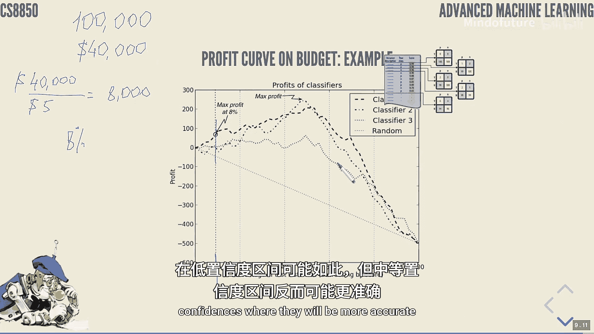

# 高级机器学习主题-CS8850-｜-Advanced-Machine-Learning-p63-P63_模型性能可视化1--BV1sapPz4Ewx_p63-

Okay， we spoke about。Measuring model performance by a single number right well。

 you can carefully construct a number in one way or another way such that it captures what you need to capture。

 but is it a good idea？To。Given how many unknowns and the many specific requirements out there。

 is it a good idea？To use a single number for representation of all of that complexity， well。

 generally note generally it's better to demonstrate and show as much as we know about the problem and a visual map of model performance would help then。

And furthermore， even specialists would have a hard time understanding your results if you only show them one number。

 you know， a figure is worth  a thousand metric numbers or is it thousand measurements can make a good figure。

 right？What I mean here is that when you're talking to your stakeholders。

 they may be better convinced if you show them。How your model performs in a picture rather than just a number or a bar plot of comparison of two numbers or。

So remember expected value， you can calculation。We had。

Something that came to us from the sales department， cost benefit information。

 well sales department and kidding， we have to be very creative， as I said in the previous lecture。

To actually compute this matrix or fill it with values。And。Benefits everywhere。

 just the negative ones， as you remember。 And then we had this after we train or classify our model decision3。

 in this picture in this case， we took a test set and computed the。Confusion matrix， trueositives。

 false positiveitives false negatives， that's all we have right。

 this process is deterministic so expected value is the result that we'll get where would the thousand numbers come from。

Well， remember that Bay in decision boundary and this is a cartoon。

 but I imagine we have patients with cancergene it with a red curve here and patients with。

Without cancers in those with the green curve。On the left here。So decision boundary。

 optimal Bayesian decision boundary is right here where those curves or probability density functions。

 posteriors intersect， right then。Anything from the red that felt on this side。

Will be predicted as a negative as no cancer and anything。On。

The right here will be predicted as having cancer or any patient on the right will be predicted as having cancer。

So。Overall， risk is minimized。By having this decision boundary， basedesian decision boundary。

 but false positives and false negatives are not equally costly or not equally expensive。

 we don't want to be false positives in generally right we don't want to predict a a patient。Well。

 actually， in this case in the cancer， we don't want false negatives， we don't want to say a cancer。

patient， a patient with cancer that they don't have cancer and let it go into stage four you know so with rather overtest。

 patients without cancer then let a patient with cancer die right so let's look at slightly different picture of the same thing so we have two probability distributions one is for one class another one is for another and this is healthy notice just conveniently flipped so we can see those regions better。

And this is and thiss cut off the Bayesian optimal decision boundary。It's not anymore optimal。

 it's just a decision boundary if our false negatives。

Are less costly than we can allow more of them and false positives are more costly。

Are moving a cut off to the right， so。We will have less of them。あ。Okay， well， with respect of cancer。

 those figures don't。Fully aligned， we do want to move the cut off further here， because。

We are okay with。Not false negatives， we're okay with like we can't say were not okay with false negatives。

 sorry， we cannot say that the patient doesn't have cancer when they do as easily as we can say and don't get me wrong。

 yeah， it's still an emotional stress for a person with cancer or a person without cancer who is told they have a cancer。

 but it's still worse not to notice a cancer and let a person go with it。So you see everything is。

Flexible if we're in the Bayesian world and we have decision boundary， we can move it back and forth。

 change it as we wish and every change see false positives are changing and false negatives are changing。

So our。Confusion matrix is changing。As we move the decision boundary back and forth。

So this whole matrix will change， the numbers will be different so depending on threshold。

 the numbers are changing and confusion matrix changes。And our cost。expected cost。

 expected benefit with the cost benefit matrix multiplication of the probabilities will also be different。

 not just depending on a different model of different hyperparmeter settings。

 but also dependent on how we set that threshold。But not all of the models。

I are actually probabilistic because， for example， support vector machine and remember we had the decision boundary。

 we had our supports。And。We could rank。Maybe our soft margin。We could drunk our。Samples。

By the distance。From the decision boundary。But this distance。It's not probability。

 even if we normalize it to one by the furthest to go from0 to1 by taking the largest distance and defining all distance。

 but still it's not probability is just a score of how close is the model or how represents if the sample of its class。

 I guess。But even when we're estimating。AProability distribution。

 like in your naive based homework example， where you were using kernel density estimation estimators to。

Arrive at the estimate of the probability， but even then we may not be able to get sufficiently representative training samples。

 so those are not truly probabilities either， so what do we do in this case？So。A classifier。Is a。

Equipped with a confusion matrix once we have a classifier test set we can reduce deterministically a confusion matrix here it is right when the threshold changes the confusion matrix may change as well and the numbers are true positives and false positive change and as we。

Discuss so with a rankinging classifier， a classifier plus a threshold。

It produces a single confusion matrix。Note that not all classifiers return a score。

 some of them are truly just zero1 loss。But for most of them you can generate a score as like support vector machines。

 say it does not return a score whereas logistic regression returns US score that we're looking for and if we're training a neural network and using softms we're also getting a score from zero to1 but don't confuse it with models probability of model assigning probability to the assemble。

 it is confidence score， it's still a score or confidence value sometimes。

With a ranking class plus5 plus threshold threshold produces a single confusing matrix。

 so let's take all of our samples， all of those instances that we have。And those are your features。

Instance descriptions， right？And of like green。Yeah。

 let's see it's purple and each of them has true class we know this is our test set right。

 we know this is positive and this is negative so for some model。Let's call them， let's call it。

Clssifier one。Yeahtypo， lets call classifier one。We run the features through the model and it returns our scores。

 we sort all of our test samples from highest to lowest score。

 and now we can choose a threshold in this core space so for example，Right here， this line。

We set the threshold to one， let's just do one。Oh， wait。し。No true positives。

 no of false positives either we predict everything as negative。

 100% is predicted as negative or 100 samples in this example in the picture for convenience right they all well。

There are 200 of them， they all are predictive as negative。If you look at the。Tす。

We have 100 negative samples in this test set and 100 positive samples in this test set when our threshold is one。

 everything is predicted negative。This is what springs exactly remember， this is what is actual。

Then we set threshold2098。5。Slightly above。The last sample， but the second or last sample。

 so only the last sample makes it。This last sample makes it through this threshold。

That means the model assigns it。とうこで。A responders class or to the positive class。 And in this case。

 it happened to be true that。The model is correct。 It's assign that that one to the positive class。

 and it is in the positive class so now。It moved from false negatives to true positives。

And we have one through positive and 9 and9 false negatives。Let's lower our threshold。

With the second example， the model happened to be correct as well。

 so we have two true positives and 98 false negatives。The true negatives don't change yet。But oh。

 look， if we move lower。We start getting negative examples。The model incorrectly assign a high score。

To a sample that is really negative。But the high score means positive。

So we are getting two true positives as before， but one false positive now。

 so our true negatives samples， number of true negative samples is changing is lowering so and then we'll go further and further lowering our threshold and we get。

Changes in our confusion matrix， it is different with every。Almost with every doesn't have to change。

 but it's different with every shift of。The threshold， the cutoff。So note。

 different classifiers produce different scoring of of the sample， the same no， sorry。

 the same samples。That means。This figure。For classifier， one has。

One order of true class and one order of corresponding instances features。 But when we。

Apply a different classifier and sort by its score。The number of samples is the same。

 but the order is now different。Get itオッケー。So the question is now。

 how do we compare our different rankings？So we have few classifiers and few rankings。

 how do we compare which one is better， how do we choose a proper threshold？

So the answer is profit curve。With a ranking classifier。

 we can produce a list of instances and their predicted scores ranked by decreasing score and then measure the expected profit。

That would result from choosing each successive cutoff point in the list。Let's look at it。

 Let's assume。Just to understand what a profit curve is， let's assume our profit margin is small。

 an example。 So we're still in the。嗯。That in the marketing。Okayase。

 so and our marketing material and sending our marketing material costs us 5 in each responder。So，$5。

to。Ship。And each responder。Pays $9。9 responder。So in the end， each responder brings us $4。

You probably want to pause the video and try to construct cost benefit matrix yourself。

But here it is for you， so we have true positive。Brings us$ four dollars。And falls negative。

Brings us。어 어 응？No no， false positive brings us negative5 dollars， so we spend $5 dollars。But。

We spent $5， but。We don't get anything back， we don't get another9 that we hoped for。

 so for this example， this is our cost matrix。Cost benefit matrix。

And we're considering three classifiers， one，2 three。Here。

And we also considereded in a random classifier that randomly assigns the。

Responder or not responder shall we send？At the package or not。So or yeah。

 or just randomly shuffles the order， basically。In this case and the score， I guess。

 in a random classifier is linear， we not just that we all start at the same point。

That's one thing to observe。 Another thing is observing that。If we put this line here。

 notice that profits can go negative。By working too far down the list and making offers to too many people who won't respond。

 we're spending too much on the cost of the offers， right？

We just keep spending but people are not responding， so we're not recovering our investment。

And the curves begin and end at the same time， well， when they begin the threshold。Is one。

And everything is assigned to negative， right， no positives with this threshold。

 but the same happens at the end， everything the notice not one important thing。

 the test set is the same。 And although it may look this exercise may look for your academic don't be fooled。

 this is very practical， like。Very practical knowledge that you're gaining。

 This is important in deciding in production how to use your。Tools。

 your machine learning classifiers or regression models such that your stakeholders are happy。

 your company is earning money and saving lives right so the end point is the threshold is zero so everything is positive for all of the classifiers。

 anything in between is different because the order of the ranking according to the score of each model is different。

So what do we observe？We observe that our maximum。Profit is here， it's somewhere above $200。

 maybe 250 or 240， I'm not sure。And it happens。Around。50%。Of our test population。

So now we want to say， okay， look。I can overplud。My score。1。The confidence or this。A columnn。

And by that。On its axis， I can figure out what the threshold is now in production I should use classifier2 as the one that gives me a maximum profit with this specific threshold。

呃。I could also guess。That I will。Send using this classifier and the confidence。

 I will probably be sending my package to half of the half of the。

Customers that I pass through my classifier， but that's okay because I will still get。

On average profit from， you know， I just want to be more than zero。

 that's already good I'm making money。呃。But imagine a situation。When you have limited budget。

It's not that okay well。Just take max profit and keep sending stuff out for half of that。

Customers imagine or know， think about a situation when you have 100，000。Customers。But only $40。

000 for your marketing campaign。What shall we do，Profit curve can help us there as well，$40，000。

With $5。嗯。Marketing brochure or marketing material gives us 8。

000 customers that we can send the money the offers to。So instead of sending them randomly。

 we can send them to。Top， which is this 8000 out of 100，000 is 8%。So。This line and this line。

 if we observe now classifier one is better。And we pick if we're on a budget and only can send marketing material to 8%。

 then we should send it to。Using then we should use classifier  one。

 so the important point about those curves。Like what does it mean。

 why are they jumping up back and forth， why are they growing at different trades and then going down？

Is that the models and are not as accurate at every。Confidence intervals。

 So when they're showing some of the models， when they show high confidence。

 that means they will be very accurate。 some of the models that show lower confidence。

 they may not be as accurate。嗯。You know， in the lower confidence， but maybe vice versa。

 like in the medium range of confidences， there will be more accurate。

嗯。So this is important in practice that I want to show you something。

诶。Let's see， so let's come back to accuracy。And let me note here that yes， accuracy is a bad metric。

 it has lots of problems and as a researcher as a machine learning or data scientist or a person solving problem using scientific method。

 you should know that it's a bad idea to use accuracy。

 but if your stakeholder say already has accuracy in all their marketing material and that's how they sell their product that's how they will be convinced if you show them accuracy。

 you can come to them with F1 core and。You know， you will spend a lot of time educating them。

 use F1 score for your for yourself， deciding on which models to use。

 but come back to them in with accuracy。 So what we've seen with profit。Cve。

Is something that can translate into this。Acuracy coverage curve so this。10red percent。

This line is coverage， it is the same。Exactly the same as before as with the profit curve。

And let this be balanced accuracy， accuracy， or any metric you stakeholder uses。And of course。

 you sort your samples by the score。So again， one or maximal possible， right， so can't be higher。嗯。

Imagine we have one classifier。That is like that。Another classifier。That is like that。

And yet another classifier。That's just like that。So the question is。嗯。What which one is better。

 Which one is to prefer。嗯。One thing I want to stress out is when we take our whole test set and compute one single number。

 we are computing this number， the average performers over classifier and so those are like really bad this one well that couldn't be the case。

I think this will be 0。5 line than when it's easier to deal for us so this classifier will plummet at some point while even 0。

5 is not realistic could stay with me the point is that at some，At some。Part。

 the classifier is just always wrong， it just stop predicting and everything is wrong。呃。Similar。

Cutoff is for this blue classifier， similar for that happens somewhere。

 although it keeps trying up until here some of the predictions are correct， but for this green one。

 all of them are wrong after this certain point so which one is better？First thing to think about is。

What is your stakeholder？Equirement of。Permissible accuracy。

 and if this requirement is somewhere here。Look what happens。This happened by accident， but anyways。

This is the coverage at the requirement that I will get with the green classifier。

And this is the coverage。And to compute this dot， we don't go from here。

 we go from this line because on bulk on half of the data， the classifier。

 the red classifier will provide the required accuracy。

 the fact that it's very bad when it's highly confident。

It doesn't mean that on average 50% of the population。

 if you choose an appropriate threshold for the classifier。

 it's always about choosing the threshold as I described before。嗯。

It will be good so for the blue classifier， the coverage。Is。Even， you know， even lower。

 so if this is the requirement。The orange line on the quality of your classifier。

 then you should select blue and you don't care that your average performance on this test set is the lowest。

Because it can get highest degree of automation to your customer。Or your company。

 it will auto 70% or close to it of cases and be correct within the tolerance。On the other hand。

 if your threshold， if your requirement is higher。Then potentially the blue classifier will become the best。

If you know， because it's very accurate， even though on a very small。Percentage。

 but still none of those classifiers give you that coverage。

You have to have all those things in mind when you're evaluating your classifier。

 just blindly evaluating one number on the complete test set。

you throw away the baby with the water basically if you do that。

 because there is a lot of richness and possibilities there for you to solve the customer's problem。

 at least on to automate away large portion of their manual labor that they're currently doing。

