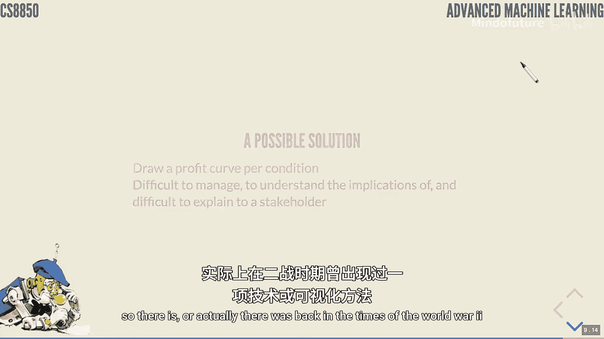
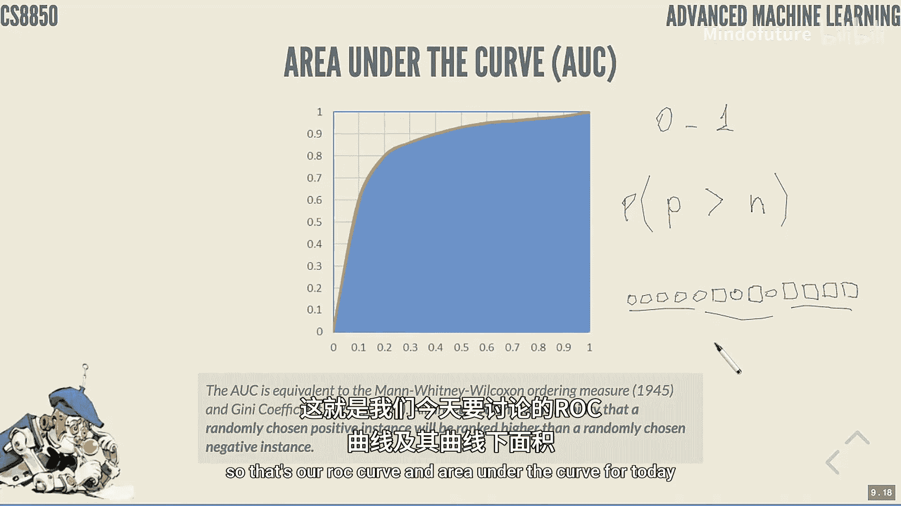

# 高级机器学习主题-CS8850-｜-Advanced-Machine-Learning-p64-P64_接收者操作特征--BV1sapPz4Ewx_p64-

So we've covered the profit curves， right， but there are some problems with those。

In order for them to work， there are two critical conditions that have to be observed。

And the one is class priors and the other one is costs and benefits。So if both are known。

 profit curves may be a good choice to visualize classifier performance， okay？Yet in many domains。

 this is not the case。So it may them means these conditions are either unstable or uncertain。

 for example， the amount of fraud changes from place to place and month to month。

 this is our class priors， right， they're fluctuating and they're changing。

And in terms of costs and benefits， marketing campaigns have different budgets and offers may have different costs。

There is just too much variability in stability in order for the class prior and cost benefits conditions to be stable and consistent。

 so our decisions made based on profit curves are also consistent。

So what is a possible solution and a possible solution is just generate multiple profit curves。

 you know， think about various conditions in advanced and plan different。Curves。

 so you would have instead of the one single profit curve that we've considered。Yeah， you'd have。赛文喽。

And say in condition one and then condition two。Your situation will be different。

It'ch is easy to imagine right。In this case， say classifier one will be the winner and in this case。

 classifier two will be the winner。But okay， how many conditions and how many curves to store。

 so those conditions quickly become difficult to manage and to understand the implications of and difficult to explain to a stakeholder。

Which is also important， why are you recommending this model to use it's recently。

 especially with deep learning， there's been a lot of talk about model interpretability but。

Have in mind that you as a specialist in your own field also have this problem for a specialist in another field or for a customer or for a stakeholder because you are。

Also a black box in a sense， right， if you're just telling your customer。Stakeholder， okay。

 use this predictive model and you'll be good， this is a black box prediction。

 you need to be able to explain it， why is this model better and how what will it bring。

 what the benefits and what is the downsideize of not using another model。

So that's why being able to explain to a stakeholder is't important。嗯。Quality， but what can we do。

 So there is not actually there was back in the times of the World War I a technology or our visualization developed for radars that were detecting。

Anies enemyime planes， and it's called receiver operatorator characteristics curve。

Basically， in order to assess。The accuracy of。Rads or radar detection。あ。In back in the 40s。

 in the 1940s during the Second World War。The engineers came up with this。

Representation known as receiver operator characteristics， or for short。

 we usually call it an ROC curve。ROC curve。Well， you'll see the curve soon enough。

So it's receiver operator characteristics and on the X axis， we have false positive rate。

And on the Y axis， we have true positive rate。So remember， let's go back to our。Confusion matrix。

Where we derive everything。FromSo this is true positive and true negative。Fallse positive。

So this is what is actual and this is what is predicted， yes， and no。And this is false negative。

A positive value that's predicted as negative。So， if we。Graphically represent what。

That's true positive rate is。Will， get。Sorry， this will be false positive at the corresponding axis。

So false positive is a number that is negative。Let's predict it as positive and the rate is that ratio。

The same for true positive rate is the number。That is。The number of predictions that are made as。

Positive that we're truly positive。And the ratio。To all of the positive cases。

Also notice that from one of the previous slides， this is nothing but conditional probability of a number of a prediction being correct when it was indeed correct。

 so true positive rate and a false positive rate is a conditional probability of a prediction。

Of being。Well， when it was incorrect。But being predicted as correct。

It's especially if you don't use this every day for what is false positive， what is false negative。

 well of course， when I pose。And process it， I immediately know what that is。

 but to add some mnemonics people sometimes。Called true positive rate as heat rate。

And false positive rate as false alarms。Just so you know。False alarm rate。

The wood is the difference between profit curve and this curve what we're just playing here。

This angle is。When true positive rate and false alarm rate are low， well， they're the lowest。

 they're zero。That is when we assign everything to negative class， our threshold is so high。

Say it is equals to one or something like that it is so high that nothing gets assigned to the positive class。

 so our true positive rate and our false alarm rate or false positive rate are both zero because nothing is in the positive class the same is here when we have both of them。

One is we assigned everything to the positive class and of course， all of the positives were caught。

The the。Accuracy is 100%， but sort nothing is in the negative class， nothing is here。Right。

 nothing is here。But also， all of the negatives were assigned to positives。

So false positive rate is also maximum， so imagine a random classifier right。

 a classifier that takes a sample and flips a coin with 50% chance it assign positive versus negative right so this random classifier will end up here because。

The true positive rates， so it will be correct， 50% of the time and false positive rate。

 it will pick that random classifier， the fair coin and random classifier， let's say。Will be。

Pick white color。We'll be right here。It's 0。50。はい。But imagine another random classifier。

 a classifier that says， okay。I pick。Assemble。And in 90% cases。I will assign。Yes。And in 10% cases。

 also randomly， but with this frequency。I will say no， I will assign the classifier to。말뻔 있어。

When we pick up a positive sample。By chance， the example happen to be positive。

But in this distribution， we will with 90% chance assign it。To correct distribution because， well。

 okay， here's a positive sample with 90% chance， we assign it the correct distribution to the positive distribution。

So， our through positive rate。No busy to point now。But。The same will be true for the negative sample。

 so our false positive rate will be also 0。9。 The same will be true。

 I mean that we'll take a negative sample and with 90% chance， we will assign it to a positive class。

 So our around 90% random classifier will be on this line Well if get the idea。

Like this E classifier is。The green classifierifies with a 60% chance。For any sample， it assigns。

 yes， this is a positive class。And with 40% chance。It signs no。But that means。Negative。Samples。

Those n samples right， will be assigned to the yes class 60% of the time， so our false positive rate。

Will still be 60%。 That's how we get this slide。 This is totally a random classifier。

 but with a different。Different weighting towards one class or another。

So that that's what that line is。 The perfect line， of course， is here is the star。

Because in this case。We assign。All of the all of the positive rate。

 all of the positive samples we're correctly assigning to the positive class and so we don't get any false positive rate either because we are assigning。

No negative samples。To the positive class look this is important not only we need to assign all of the positive class samples to the positive class。

 but in the process we need to avoid any false alarms。

 that's what will be here So a classifier is conservative if it is in this area what it does is okay。

 only when I'm100% sure or only when I'm super sure only then so high high threshold only then I will return a prediction that this class is positive。

So for instance， in this example， a is a conservative classifier because it's。

not returning like it returning any。Low number or low rate of false alarms， false positives。

But the price for it for being conservative is it's also not returning or not predicting positives when they should have been positive。

 right？Classifier C is on the other way is more liberal in the sense of like， oh， okay。

 my my threshold is low and as soon as it's higher than b。 now， I will predict it as is positive。

 It looks positive to me， so it does get more positives， but it also makes more mistakes。

 It gets more false alarms。 Well， which one A or C is better depends on the cost of。

False positive versus。Versus false negative not catching。嗯。A positive when you should afraid。So。

 in general。A classifier is better when it is。Sort of to the northwest。Of another classifier。

So I better classify。Would be。Closer to there， right to that point。So another view。

 we can take the same classifier。The ranking classifier， something that returns a number。

W whichch is。Confidence score。 And for each of the confidence scores， we have。

Different confusion matrix。 This is the same classifier。

 say it is a support vector machine in all of the cases。 and we're just changing our threshold。

 So by changing our threshold。For all possible values。

We can trace a curve through the space and this is the ROC curve and again each point on that curve is a classifier with its own corresponding through positive。

おネ。Basically， confusion matrix， right？You get。How do we build that RORC curve？哦。

The same as before now we just the picture sorts the scores descending or ascing actually。

 so we start with the lowest possible or the highest possible threshold trade we don't include anything。

As I said， into the positive class。And as soon as we were moving。

Threshold up just by one number or another number。We will either get this prediction correct or incorrect。

 so we will either grow the true positives or false positives。

Once we're moving because we're saying with this line here with this value of the threshold。

 we're saying anything well be， but it's just the picture。 anything above that threshold。

 anything higher than the threshold is positive。 So we got。

A false alarm for our false positive rate has changed since at each shift of threshold， remember。

 we only have。That's a00 okay。Samples in our data set。And。We just need to go through all of them。

And keep recounting since this count is truly a discrete process。

 our curve is a step stepwise function， it's not a smooth curve。Although when we have 100，000。

 it does look like a smooth curve at the resolution that we're looking at it。

So this curve characterizes all possible decisions for all possible thresholds that we could have made and then when you're comparing。

 which classifier is better， one or another， you can see everything about both of them。

For all possible thresholds， for all possible。Decisions for the value of false positives and false negative。

 so。YouYou could have clear cut cases。When。Okay， well， not only。呃。This classifier。

 the purple classifier is better than the black classifier， but also we can choose by proximity。

To the best point， which classifier is best in case when nothing is known about。嗯。

Priors of false positives or false negatives， what is worse to get a false positive or to get a false negative。

So for example， a difficult situation。Although is the RRC curve is helpful。

And the resolving is when we have a classifier like that and a classifier like that。

So they're very similar and their best overall performers are also very similar。

 but one is pessimistic。It doesn't want to give any false positives and another is optimistic。

 it doesn't want to miss any true positives。So either of them could be right。

 it's unclear from just you know without knowing the details of the problem， you can't just say。

 okay， classifier A or classifier B。You have to have both of， but still it is fairly rich。

Display of information about the classifier。

There is。Way to summarize everything for comparison purposes。In one number and okay。

 this number has many deficiencies， but still people use it a lot because it's much better than。

Accuracy and it's a good measure of classifier performance。

 especially if they're very different in the number， as I said。

Before some classifiers may have very differently looking RRC curve。

 but this metric area under the curve basically you integrate in this integral sense。Your square。

 the area under square of the square is one， then area under the curve will be a number between 0 and 1。

And it's been shown a few times before that area under the curve as a number as a metric is equivalent to Man Whitney Wililcoen ordering measure and genie coefficient。

 or basically it's equivalent to probability that a randomly chosen positive sample。

 so we know that it's positive。Is ranked higher than a randomly chosen。Negative sample。 That's all。

 So it's probability that in the rank order。Probability that a randomly chosen positive will be placed higher than a randomly chosen negative。

 which means the score of the positive sample will be of a randomly chosen a randomly picked positive sample will be higher so what that means is if you just sort all of your positives and negatives。

没有。Those are positives that it's higher and say those are negatives。

So what we want is positives and negatives。嗯。Group towards their respective ends and some interming intermingled value values are only。

So that's our ROC curve and area under the curve for today。

