# 高级机器学习主题-CS8850-｜-Advanced-Machine-Learning-p65-P65_关于模型校准--BV1sapPz4Ewx_p65-

I have already discussed one of the most important。

 if not the most important features of a modern models。

Or all models is the confidence scores that align with the actual probability of guessing incorrectly。

The reason is that we often need classifiers and pattern recognition algorithms to automate something that is currently done by humans。

 Even humans are not perfect and we don't expect the algorithms to be。However。

 instead of waiting for a new method that performs3 grade on all possible input cases。

 we can accept predictions only if the confidence is higher than a level that we are happy with。

Yet not always the confidence score by the models corresponds to the probability of guessing correctly is the problem of predicting probability estimates representative of the true correctness likelihood。

So why do we do it？We want the probability associated with the predicted class label to reflect its ground with correctness。

If that is the case， then we know when to trust the model and when to route that model to a human instead。

 remember what we discussed in last lecture is。That whole question of which model is better for automation and the answer is paradoxical that a model because of different requirements。

 different。Abplications that we have for our clients， for example。

 the contract on sustained accuracy。We may choose a model that is on overall。

Worse than something else。 if we consider a complete。Test data set， or even the。

Are actually occurring data set in the wild。 We may have models with better average accuracy。

 which are actually worse for our kids if we have models that are。Through to their prediction， so。

That's， that's the reason to have。Good calibrated models。

Model interpretability is another case is precisely， we want to be able to say。

Which cases are harder for our model， which cases are easier， because， for example， again。

 think practically。Even if our model predicts。Correctly， only 80% of cases， but in the wild。

 20% of cases may be just plainly wrong or impossible to label anyways。

Just because of the use case so we want to be able the model not to return high confidence in those wrong predictions but be totally un confidence so like preferably zero then we can start investigating and find a case for example a printer jam I don't know some specific side that is collecting data is just sending us garbage or something like that so we want the model to be true to the model's confidence to be true to the accuracy of the model so what like speaking about that that collaborationlibration and。

what。

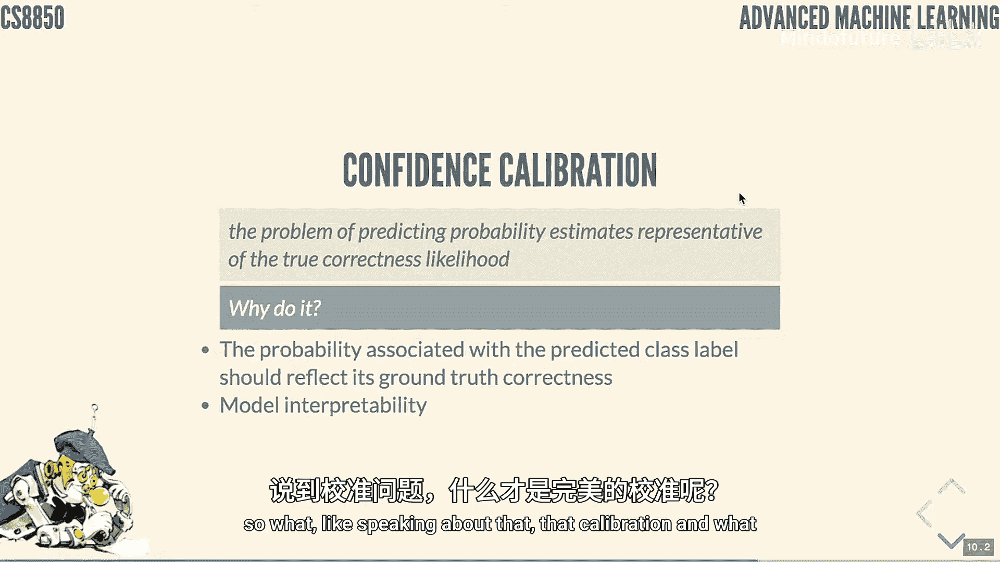

Is the perfect calibration right So let's define well theology see on the slide。

 but let's consider supervised classification problem multidimensional and input data from multiple classes follows the joint data label distribution that can be decomposed into the data prior evidence。

 as you know andcondal which in this form， if you remember we called posterior。

 given the data gives give us the labels a neural network。

Takes a feature vector as an input and it returns class prediction Y， hat and confidence P hat。

So for a perfect calibration， we need the probability of correct result at a given confidence to be equal to that confidence。

So how to assess whether a model is perfectly calibrated or not？

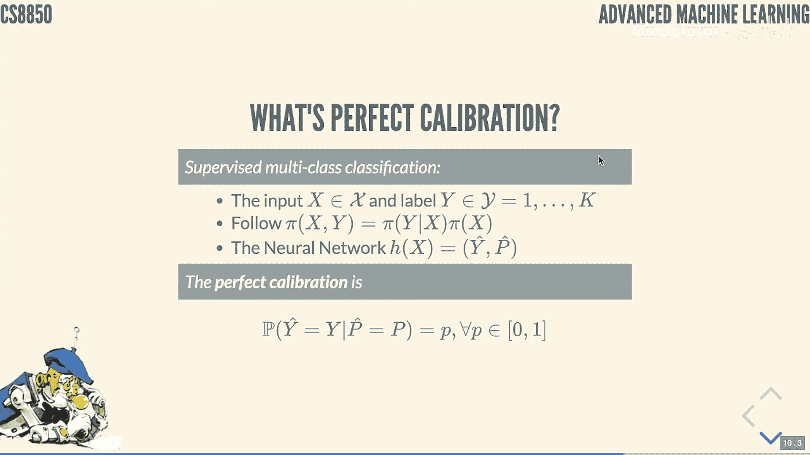

For that， we have the help of reliability diagrams or calibration plots。

 so reliability diagrams are a visual representation of model calibration。

These diagrams plot expected sample accuracy as a function of confidence that the model returns。

If the model is perfectly calibrated， then probability of。

Of the predicted label being the true label at given confidence。Equals to that confidence。

That means that's the definition， as we just introduced of perfectly calibrated model。 Well。

 in this case， the diagram should plot the identity function， which is。

Just a 45 degree line right and any deviation from a perfect diagonal represents miscalibration。

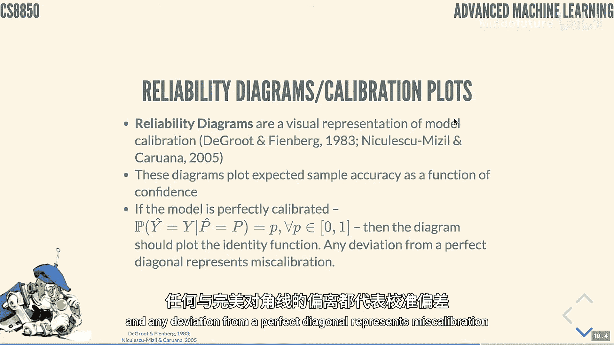

Here's an example of this diagram。So for popular classifiers， this is our。Perfectly calibrated line。

 the diagonal 45 degrees。That means。Say for a model。Confidence of 0。6。

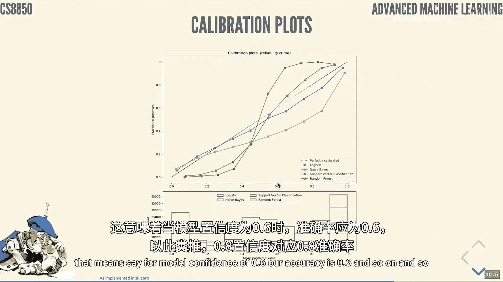

Our accuracy is 0。6 and so on and so forth， 0。8， we want our accuracy to be 0。8。

And we plot calibration plot from this link， you will be able to look at it in the notes。

 I will make it available online， of course， as a PC as always。🤢，So。You may be able to look it up。

SK learn。Help files so what they did they compared logistic regression naive base classifier support vector machine in a random forest among those four we only haven't closely looked at random forest but it's basically boost decision trees but anyways you can pick it up on your own now that you know the basics so what we have here as you see from the first top plot that logistic regression。

Theres。Blue line。Here。Is the closest to the perfect calibration， surprised。

Well why doesn it do that well of course correct you're right it's because it's designed to model probability distribution in the training data。

 so the deviations here are because we're plotting it on the test data and those are mis generalralization or the lack of generalization in this case for logistic regression。

But note in the frequency plot here。This plots are different， this is the calibration plot。

 what this plot tells us， let's take beans and be the confidence in those beans。

So if our model makes a prediction with confidence between 0。9。And one。

Will place or count that prediction in this bin。And so and the same true for other bins。

 look for a logistic regression that glue line here。Logistic regression is surprisingly uniform in。

Assigning the labels to the。Confidence values or returning confidence values for the labels。

To see why it's surprising， look at support vector machine， support vector machine。Is。Here。

 it's the green。So 0。5。Is the most uncertain， right？ I'm not sure if it is 0 or one prediction。

 So support vector machine。Is。Tending to be unsure about。The negative or positive prediction， and。

Say something like naive based classifier。It's quite。By model， right。

 it's supersure in positive predictions and super negative predictions， but it still makes mistakes。

And that's why the calibration curve is not perfect。

 So I hope you get an idea of what is a calibration plot and what is this frequency plot with spec predicted value or predicted confidence。

But another thing is the fact that SVM say。Is 0 and 5% or 0。5 confident。

 Does it tell us that it's more accurate or less accurate。

 Does either of this plot Tell us how accurate these models are。 No， well。

 the top one does a little bit， but。Actually， no， wait a second。 It doesn't。

 There neither of them does。 It just tells us both clothes。Well， especially at the top one。

 the calibration plot or a reliability diagram， it just tells us how close is our model's accuracy to what its confidence is。

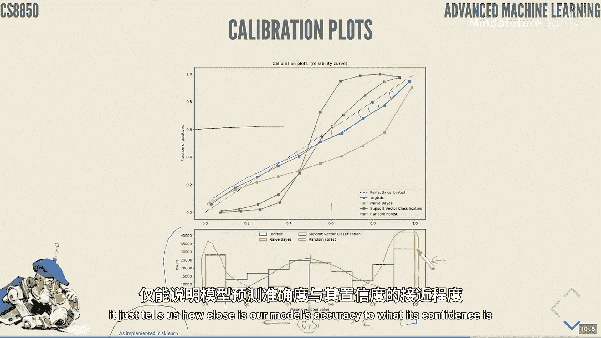

So let's look at the interesting example， people in this paper that they will be heavily relying on in this section of our study of our class。

Notice that best performing models， deep learning models are lying to us in terms of their confidence。

If we look at the top row of the plots。We see distribution of the confidences or the samples across confidences。

 let's say， and then we see that the most modern， well， 2016 is very old by now。

 but still it's the modern model， the most modern model compared to the net 1998， both of them are。

Convolutional neural networks and Lette has only five layers while ResNe 2016 has 110 layers and as you see average confidence and accuracy of Lette nearby you know there in the ballpark while average confidence of ResNe is much higher than its accuracy although its accuracy。

 its higher than the one of Leette on the same scipher 100 data set in example。

 and if you look at the reliability diagram， the bottom plot， the bottom two plots。

The Lineette one is actually closer to ideal。 There is some gap， but still it's very close。

To the diagonal one， while for resnet， the difference is huge from what's expected the diagonal one。

And what the model are。

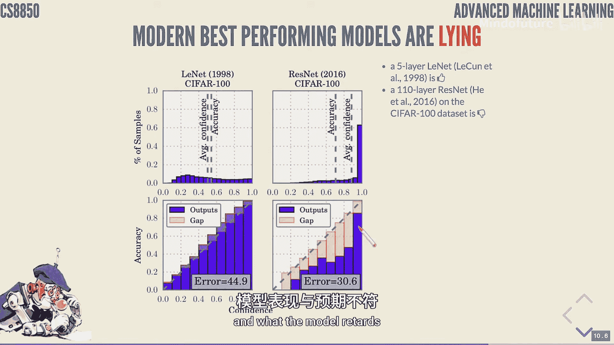

So expected accuracy and average conence are two metrics or two things we will need to define to continue further in this class。

 in this lecture。So let B subm be the set of indices in an interval I subm。

 so basically it's one of the beanss in our histogram。

And then the expected accuracy in that bin is nothing but the normalized count of correct predictions in this bin。

AndWhere。This is an indicator function， it just gives us one if the prediction is correct or zero if it's incorrect。

And this is the size or the of the bean or the number。Of。Samples that got。

The confidence that the model assigned confidence within the range within this range for the spin that works for the spin。

The average confidence within being B sub M is defined。

 so that was average accuracy and average confidence is we just say take all confidence values that for all the samples that fall within the same bin and take their average normalized by the size of the bin。

 so the number of samples that fall in this bin。Then accuracy and confidence。

 average accuracy and average confidence or expected accuracy and average confidence。

They approximate the left hand and right hand sides of our equations for being of our perfect calibration equation。

For being。M。And a perfectly calibrated model will have expected accuracy equal average confidence。

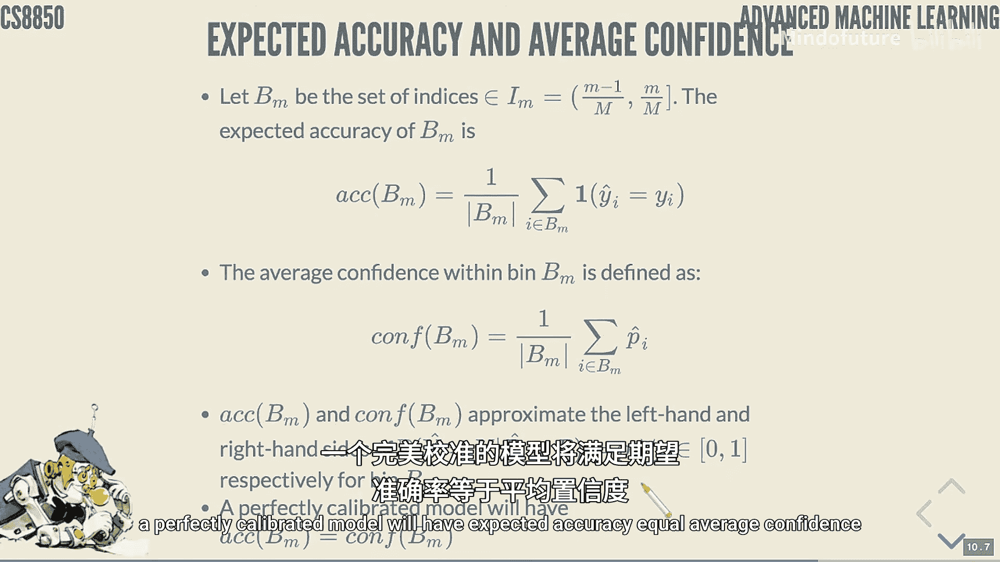

Now let's define a metric， how can we say if one model is better than another by looking at a single number。

 not looking at the reliability diagram。For that， we define expected calibration error ECE。

 and it's used to summarize that they said calibration as one statistics。

One notion of miscalibration is the difference in the expectation between confidence and accuracy。

So this expectation is approximated by。Absol value of the difference between expected accuracy and average confidence。

Waied by the size of the bean， the basically the。A ratio of this being with respect to the full calibration data set。

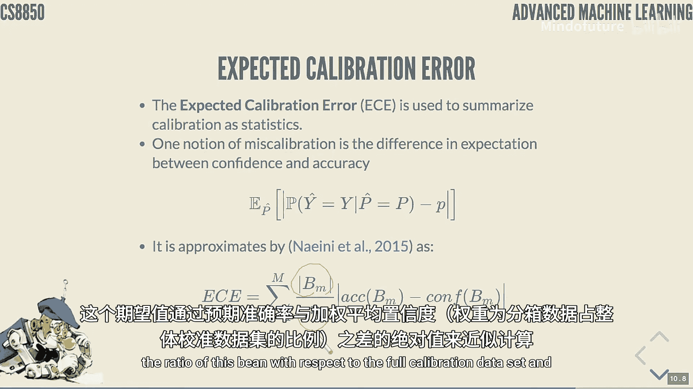

And that is expected calibration adder。Then for some high risk applications。

 we may wish to minimize the worst case deviation between confidence and accuracy。So。

 instead of expected。Calibration error。 we just look at the maximum。

 and this is the maximum calibration error MCE。Which is， again。

 you look at the difference between average。Average confidence and expected accuracy。

The absolute value of their difference。

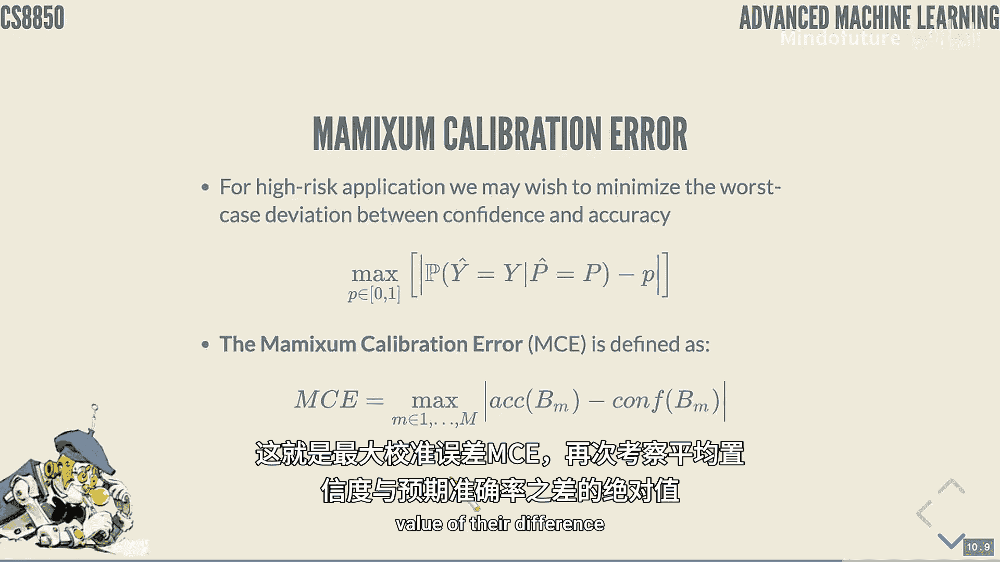

So。Another measure that we often used， and often。Maximize。

Or minimize in this case is negative log likelihood， right。

 we want to maximize the likelihood and so we minimize negative log likelihood and it's a standard measure of probabilistic models quality。

It's an old textbook Friedman has to in Tiprani， and that's what they cite there。

 and it's also referred to as the cross entro pillows in the context of deep learning。

 also in many books and textbooks， given a probabilistic model。

 pi of y given x and n samples negative log likelihood is defined as，诶。This expression。

 the sum of the log of the conditional probability。Or a consonants。

 and it's a standard result that in expectation negative look likelihood is minimized if and only if。

而。Network or estimate of this probability distribution recovers the ground truth conditional distribution pi of x given y。

So what affects calibration which you know what has changed since Lnette。

 which was pretty well calibrated？Albe less accurate。And what has changed now。 So one。

 one thing that changed is we have networks with much larger depth and width。

And as you see in those plots。Increasing depth。And width may reduce classification error。

 but may negatively affect model calibration。So classification error goes down with depth and width。

But calibration error， or expected calibration error actually goes up with the depth well with a slight dip。

 but it went much higher， so another thing that was introduced since Lenet is various normalization technique among which the most successful was batch normalization and one of the effects of batch normalization is the models that trained much faster。

And well， are slightly more accurate。 But turns out， as you see here。

We batch normalization does reduce。The models error， but it increases。Misalliberation。

And another thing is the training with less weight decay has negative impact on calibration。

 so if you don't use weight decay in your training。

 then your model tends to be more miscalibrated or poorly poorly calibrated as it stands。

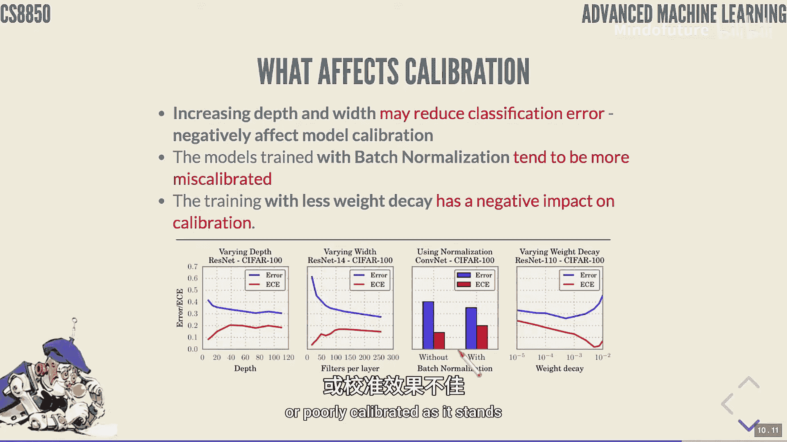

So how is it possible that a model has better predictive performance。

 higher accuracy and it's poorly calibd？So it does look like overfiating is the blame。So。

If we only look at the red test error here， then test error with training with epos goes down and eventually even more down。

 but if we look at the test negative log likelihood。

Then it decreases to a certain point and starts increasing。

 So the price that we weigh is overfitting is happening in probabilistic。

Space so the network does not overfi in prediction accuracy。

 but it overfis in predicting probabilities or confidences of its own accuracy。

That's an interesting observation from 2017 paper。

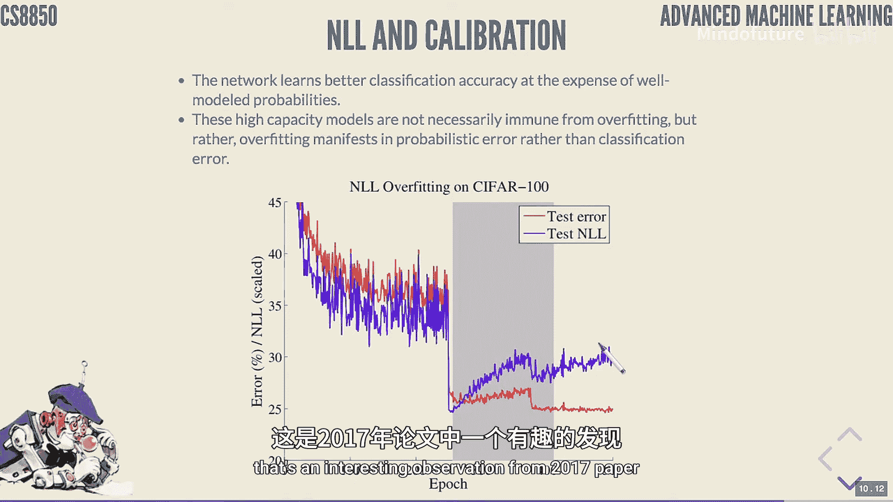

So what can we do not just for our neural networks， but for all other methods。

 well we use various calibration methods such as histogram beaming， isoonic regression。

 Bayesian beamaning into quantiles， and flat scaling。All of them。

Maybe besides baing maybe besides barbecue， but they all were developed for classical machine learning methods way before deep learning was on the radar。

 that's interesting so but the good thing for us that all of them are implemented and implemented in standard packages such as SKL。

The first one is histogram beaming。So given a fix being boundaries。

All uncalibrated prediction divided into mutually exclusive bins。And we predefinine those。

Each beam is assigned a Colration score， which we need to estimate。If。Then at the use case。

 when we start using it， once we have theta for each bin。

 if the model returns a confidence score that falls in that bin。

 we place that score with the theta that we estimated and that's how we use that test time and this is。

Optimization problem。 we need to minimize this function for the first indicator。

Is basically whether the confidence of the model falls within the current beam。

 and then we minimize the square error which turns out excuse me。

 which turns out to be that the solution and thetas correspond to the results in the theta for each being that corresponds to the average number of positive sample in each beam。

That is histogram being， but we prespecified the being width and basically position of those being dividers。

 isoonic recreation does basically the same， but only together with statuss to the parameters of the beanss。

To be replaced with which confidence needs to be replaced。At the test time or at the use time。

Isotonic regression estimates the number of bin and the border between wind beanss together with the parameters of the beans。

Well， we could be differently right， we could be by number of samples per be。

 like equal number of samples should fall within each being then being will be different size and we could。

Place the bean bound that is anywhere in the range between 0 and 1 and choose as many bins as needed。

 depending on the number of samples， I guess。But in isoonic regression and in histogram beam。

 we choose one of the solution， not all of them at once or。

What poison barbecue approach does is basically marginalized out。AOr all possible bidding schemes？

And then we produce our prediction， so it's basic in averaging。We take the probability of。Predicting。

Our probability of returning a confidence given the confidence that the model returns。

And model it as an average， over all possible。As an average of all possible winning。schemas。So。

If we can。Said prior on being skichemas。An average out。All of them。

 then we would basically return the best overall possible。9。That's how baian approach works anyway。

So Pla scaling John Plat is the person I've mentioned already in this class before that was for support vector machines。

 He was studying support vector machines and introduced very clever things such as sequential minimum optimization where codetic programming could be solved by considering two elements two samples at a time rather than solving it altogether and solve it essentially in。

Sttochastic manner like a at a time with heuristic， which player to consider next。

 So we well discuss that a little bit in this class。

 But while studying support vector machines and studying。

How to convert their predictions into confidence values。

 some confidence values that would be useful plot。Introduced scaling。

 which basically amounts to taking the output of the model and support vector machine that would be the distance from the separating hyperplane。

And passing it through sigmoid。Well， think about the seund as a single neuron with a single weight。

 single bias and soid output。Trehold， remember。切。So bias would shift the sigmoid or the the value of yeah。

That origin。系ello。And。A would stretch。 So two parameters to estimate A And B and A And B are optimized by。

Minimizing negative log likelihood on a holdout test。

When a neural network is already trained or the model is trained。

It kind of considers everything independently right。

 it considers each output of the model for the neural network case。

 it's the layer activation layer before the non unitities are applied the last activation layer。

But in this case， all of the classes， these sub I are considered independently。So。

We can generalize this to multilast case。First let's generalize the be schema， while the be is easy。

 we treat the problem as for k class player problem we treat it as one versus all。

And then for a binary classification problem where the label is the indicator， right。

 whether Y I falls into class K and the prediction probability is。Soft marks， basically。So， for soft。

We have seen。First， all of our like we need to obtain all of our predictions。And then。

Our confidences。 And then we just predict the arc marks。So， those queues had。

Are the output of our soft markx function。And then given that setup， we will take our confidence。

And just to renormalize the confidence within H beam。So for multiclass case。

 we can also generalize the plate scaling instead of applying。唔诶。A and B parameters per class。

 We can have matrix W。And beta bias vector。Such that it's now general right。

 we can learn a W that is。transforming。Lially transforming our。

Output of our model in an interesting way and the results that they will be showing further in the slides。

 this W is diagonal because too many parameters， quite a right number of parameters。But in any case。

 a slightly general case of glasss。Scaling。And then， yeah， that's what I said。

 restricted to be diagonal。

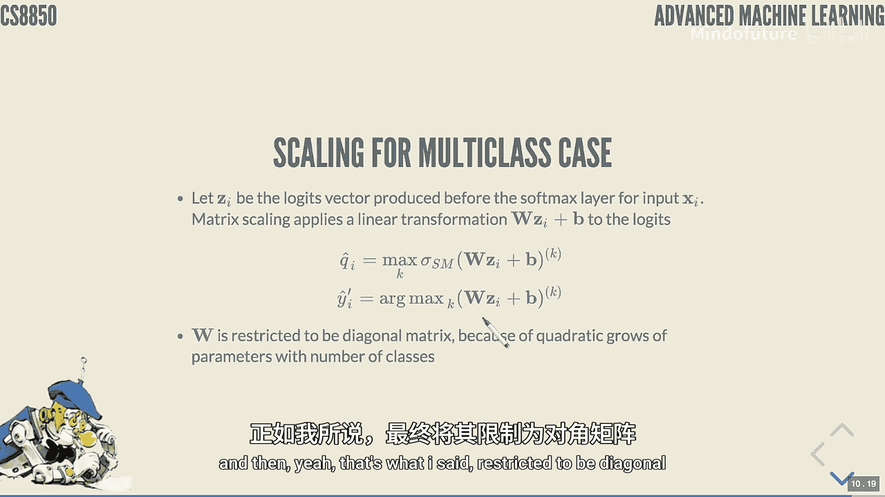

Another case is， well， what if plot scaling and generalization of blood scaling。

 this matrix vector scaling？Is。Too much， what if it has too many parameters and too many things to deal with。

 let's just simplify it and take a simplepl possible extension or rethinking of plot scaling and use only one scalar positive scalar for all classes temperature so given the logicit factor Z the new confidence prediction。

 the z is just the output not unnormalize the output of our model minus infinity to infin theory。And。

Oh no， no， I'm sorry。 It's0 to infin。To the。Aation。And given the logicit factor， the confidence。

Let's just divide everything by the temperature。 So recalibration will equally penalize。

All of our positive and in negative predictions and everything， it basically raises the output。

Entropy or soften this softenens the softm function。When t is greater than one。

 if t goes to infinity， probability or the calibrated probability or confidence approaches1 over k。

Which represents maximum uncertainty and when t equals one， we recover。Our original probabilities。

So when t tends to0， probability collapses to a point mass。

And T is optimized with respect to an negative likelihood。On the hold out data set， validation data。

 well，'s all of our parameters are like that， then prediction remains unchanged。

Since T doesn't change the maximum of the soft max function。It just soften it， not softens it。

And temperature scaling doesn't affect the model's accuracy， so the model accuracy is the same。

 it's just reccolibrating it。For the confidences to correspond to actual accuracyac better。

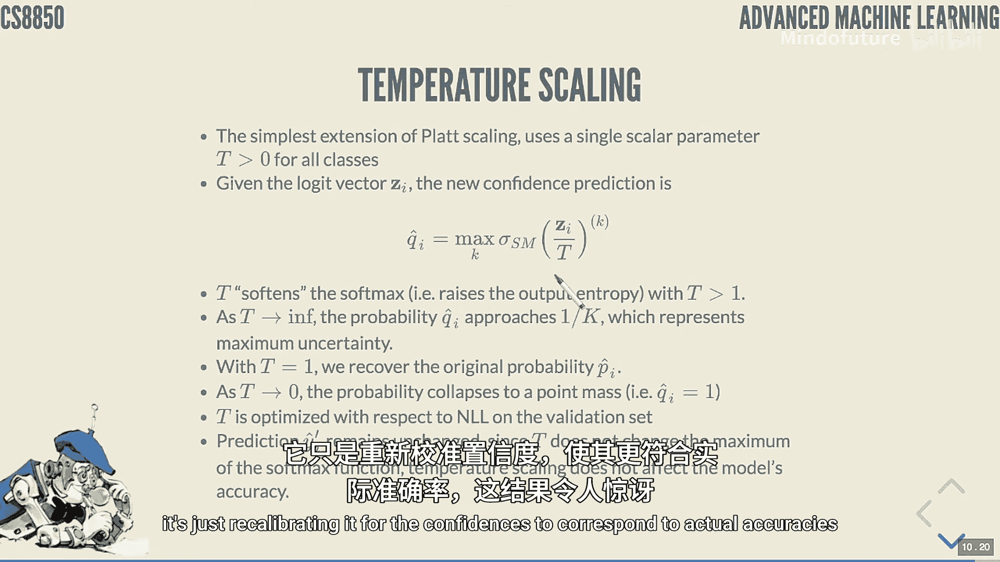

Surprisingly。And this is the paper I cite in the beginning of the lecture on collaboration of Mo Network 2017。

 Suringly temperature scaling works the best and like on the wide class of various models。

 including densenet。嗯。Resonates of all kinds， Leette and。Many others。Mostly， of course。

 these are wide and deep Prenets and denseN， including Leette， so it's a little bit surprising。

 very interesting think about it in your free time。Why that simple abrasion。

 which is just a temperature or uniform scaling of soft max function。Affects。Or correct。嗯。

Confidence of the model。 So this is a result in the。

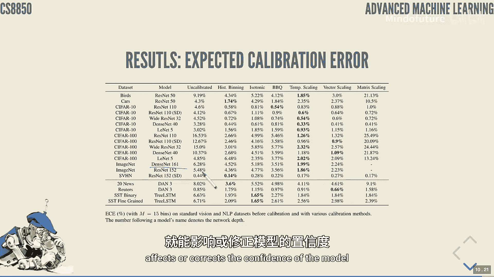

Confidence plots， reliability diagram on the left。You see unscaled ressonnet 110。

 and remember in all of this plots the same network with the same accuracy just calibrated it differently to return different。

嗯。Confids， but not affecting the actual accuracy。 Well， maybe you need to shift the threshold。And。

As well。As in the table， we see that temperature scaling gives us the best fit to this identity line。

Lots of bibliography entries， which you will be able to find in the Pf that I will attach to this lecture。

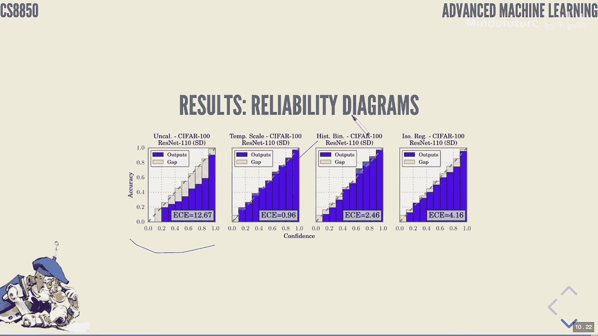

Hopefully you understood some of it， but at least you know now all of the pointers and you know I hope how to scale your model so you can use it easily in production and automate。

Lots of routine operations。 And when the model is less certain， less confident。

Fut the work back to human's hand。

Thank you。