# 高级机器学习主题-CS8850-｜-Advanced-Machine-Learning-p66-P66_CNN-构建模块--BV1sapPz4Ewx_p66-

We covered the history of CNN。My hope it was instruct。

Because usually it's better to know how the system was developed， what group people thinking。

 what they've tried， because nothing just comes in full fl form ready with all bells and whistles。

The way these bells of whistles are added。Ely helps to understand。

How the full S system functions and maybe what it's missing and where you can contribute。

So now let's look at the building blocks。Of convolutional neural networks。

 So you kind of know all of the。Tools in the toolbox。 And then you can understand how special。

 special。Versions of CNN works。And we will start， we will start with what you already know is。

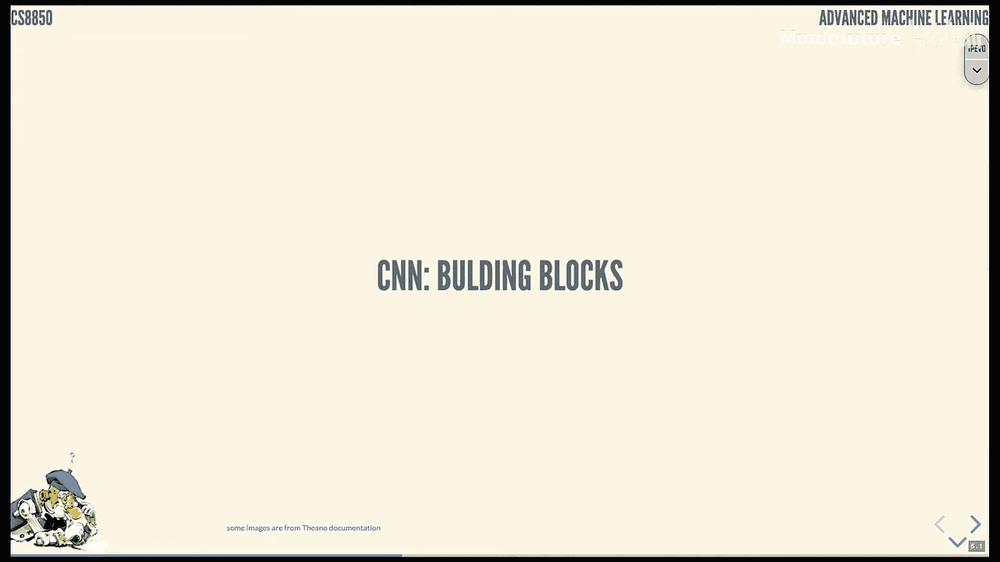

The convolution itself。So we have a kernel。Right here。And I think I have a new tool。You can use。

 So this is the kernel， convolutional kernel。And this video shows you how this kernel is slid across the input。

It could be input image。If it's the input layer or it could be input channel from the previous layer。

This is the input。 Let's call it X。 and this is the output。It's called a channel。嗯。

We' are not doing anything right now in this process。The。Here on the right， the same process。嗯。

Is represented in 3D。So this is a lower level I in this or layer， and this is i plus1。

But what is missing here。Actually， let's， let's move and look at。

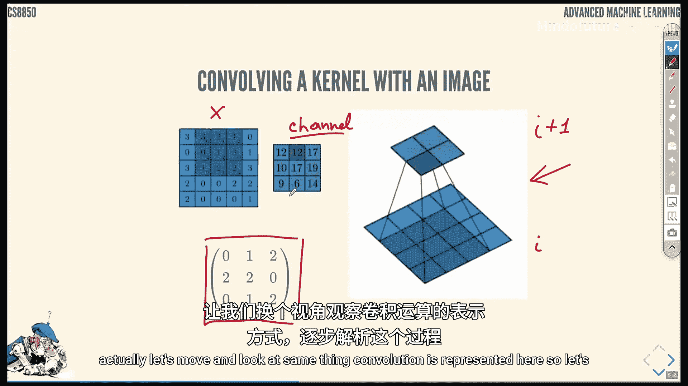

Same， same thing convolution is represented here。So let's step by step one。嗯。This is step 1， step 2。

 step 3。So， our kernel。You can see it here，0，1，2，2，2，0，0，1，2。

Is multiplied by whatever is whatever it's overlago。 But what is actually happening。

 And I want to stress that now。Well， of course， everything is just matrix multiplication。

 but conceptually what we have。Is。Connections like that， Each has a weight。Those are the ways here。

So some weights are0。This like this one。W equals 0， right？For this guy， the way equals 2。

So those inputs go through multiply by the weights。Arrive here， get summed up。 and then。

Push through the。Let's say it s。Let's go on。 S it here well。ない。2 something5hi。

 some of all of these products W times input。Are eye。And that's what is written here。 The example。

 of course， doesn't have any on the edge。 So you could see what is exactly happening And step by step 3。

4，5，6，7。8，9， we eventually scans through the whole image。In this particular example。

 the step from here to here when our kernel。So。Is shifted。Is shifted by one。Step in this。

Step is called tribe。And it doesn't have to be one， but in this particular case， it is one。Notice。

In this example。We start with。The top。The left corner。In the line， are kernelel。

Or filter with the image and slide it left slide it from left to right。

But is it the optimal way or is it always the optimal way to do it？🤢，嗯。

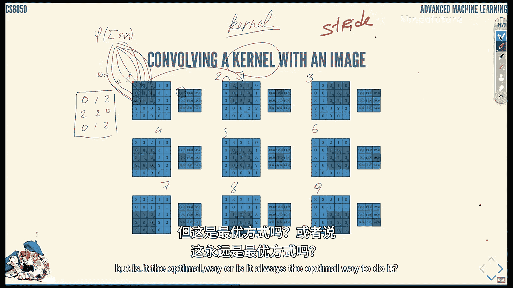

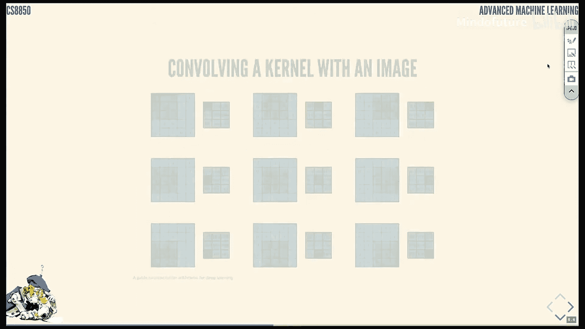

So it turns out it's not the only way or the optimal way。As you see here in this example。

Notice we are scanning our filter， our kernel。Along a larger image than our actual image。Ave。

What from done withve pad it。Our image。With zeros such that are kernel on this corner。

Allance in a way that the center。Of a colonel。Is the corner image itself。 So this particular。

A badding style is called the same。For short。What it means is that。The image that is produced。

The output channel。Under。Like this is one。 and this is say。See the center。So the C in the input。

Will correspond to the sea in the output。Sometimes though， we'll talk about it more in just a second。

嗯。Sometimes we want a situation。When we gave。A chance to each of the pixels， even。

We want our kernel to participate or to scan in a way that it。Start with handling one pixel。

At a time， and only then eases in in into the image。 And this convolution。

 our patting style is called full。Let's look at。

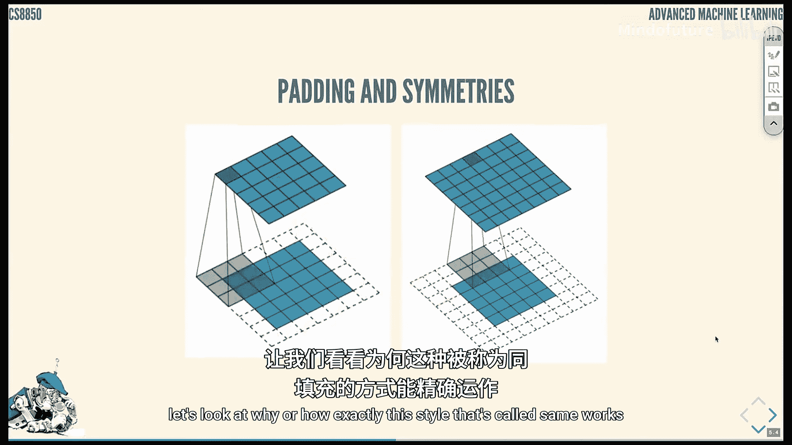

Why or how it how exactly this style。It's called same works。This is the same video just expanded。

So look in the beginning， we're producing a pixel。That corresponds。 well。

 this image is actually not most accurate。But this pixel corresponds to pixel this pixel in the channel。

 the output channel corresponds to this pixel in the input channel， and in fact。

 even though I copied this from this guide copied this figure from this guide， the dimension。

Should be 5， right， the same。Exactly as the input dimension。That's why it is called。

The style of padding is called same。We will find it later very useful。For reparations。嗯。

or tasks such as segmentation when we need to produce a mask or we need to produce a label for each pixel in the input image。

 so our output should be pixel perfect to the input image。

But you get an idea you can pose and stare at this picture， but just。Notice that the。

There is slight discrepancy， although yes， the center pixel does correspond to the center pixel in。

This figure。

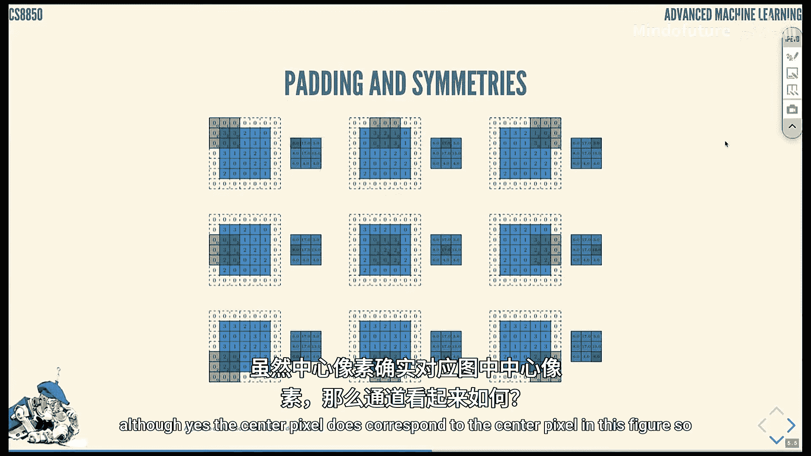

So how do the channels look？So now we have a convolution， you understand how it works。

 it's basically just a vector product， you can think about it， but as I said。

 for efficiency in actual implementations，Those kernels are。嗯。Shaped together in a matrix。

 and so we multiply matrix of kernels by an image。Matrix multiplications are efficient and coa kernels GPU systems are very efficient in handling large matrix multiplications in parallel。

嗯。And this。Mattrix is also called circleent。That is when the kernel actually is rotated through the rows of the matrix。

 but let's slide aside you， you can understand that you can read about it or just do it manually if you don't understand how a kernel is multiplied by an image or how the image is filtered right nine pixels and the input image turned into one pixel and the output。

The image by being filtered。 So if our input。

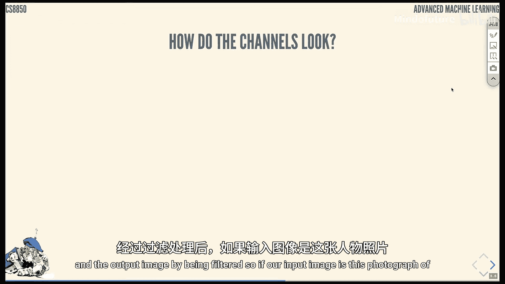

Image is this photograph of。A person， a lady， then。And we have 14 neurons， okay， that is important。

Then how does the first layer look。After this neurons。Have scanned through this image。

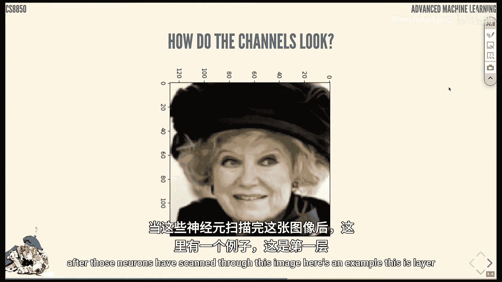

Here's an example。This is layer 1。We have for each neuron， and each neuron。Sa。Is。

A three by three filter。So， we have。A3 by three field with specific values。For each of those images。

And when this 3 by3 filter。Was scanned with the original picture。

 This output is closer closest to the original picture than the rest。

So when it was scannedned with it， as theres。嗯。Animations have shown。In the same manner。

This is what the first。Neuron resist the first filter。And correspondingly for all of them。

 usually we draw those 16 filters when we look at the diagram， we。

The or the 16 outputs from 16 corresponding filters。Wer them like that。

Just to stress out that they're still two dimensional。And。Say this is the input。

The input could be RGB channel。Which was RGB in this case。The picture was color RG P。

And then processing and the next processing so。How did RGV get there， right。Notice this， first。

When we can one dimensional or two dimensional flat image。This is the videos that you just see。

But when we are convolving。Something like。That with RGB。先。What we're doing with our three by3 filter。

Is。This。Our network is now。呃。Our filter now has nine times three parameters for each of the channels that are respective parameters。

The same。The same happens。Here。For the next layer， we pierce with this block。Sort of。Figuratively。

And we scanned this whole blog。Such as a filter。Considers together and merges together in our our。

Avoided some。Followed by nonlinear nonlinear。All of the channels in the previous layer。So。

When all of these channels are pierced and put together。By。27。I think 27， let's check。

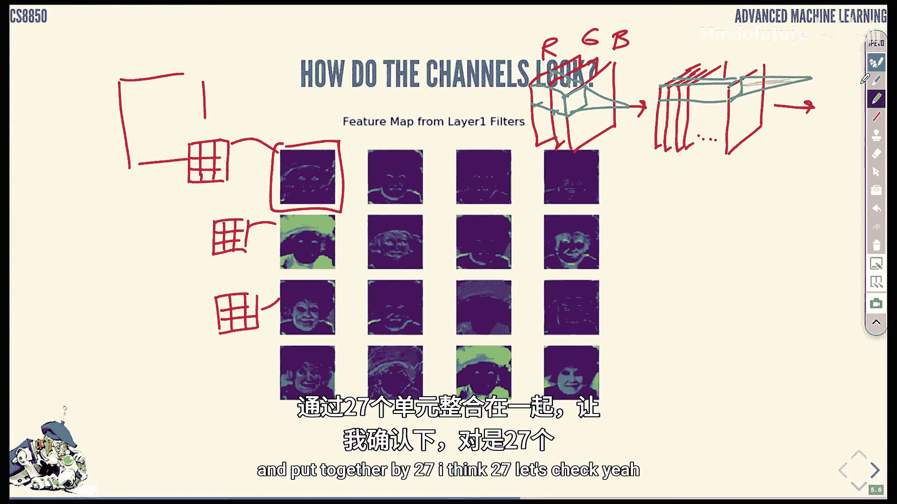

Yeah。5 types 5 plus 2， Yes，27。Neurons or。Filters， kernels， we get those channels。

And this this did use maxpoing， notice our filters get smaller and smaller。

 and I will talk about maxpoing just in a little bit。So and you see。

 some filterers are paying more attention to the eyes， some paying more attention to the mouth。

And something more attention， maybe to the。Like the skin silhouette， like well。

 this is not silhouette， some some of them are silhouette， but I don't see it。

 So different different thing pays attention to different parts of the phase。

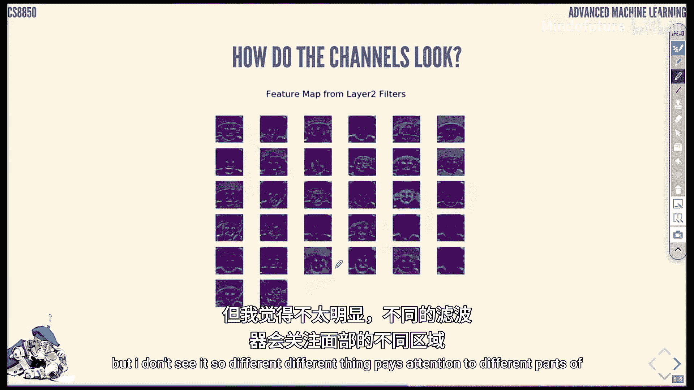

And then layer three is even coarser， but information is aggregated right now and supposedly only the most important information for prediction。

 and I think this task was predicting gender of celebrity。So now it's all grouped together。 Well。

 but there is。Also， a layer， as we spoke about before。嗯。

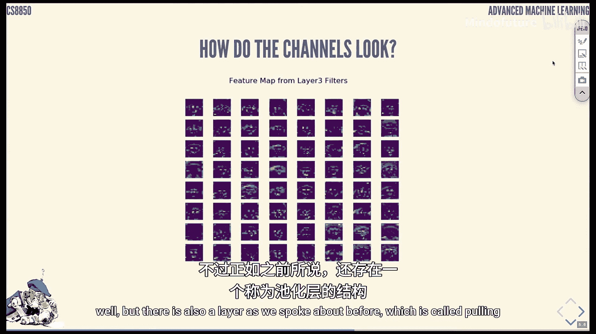

She's called pooling layer。So。We generated our channels， but we know that our。Striide。嗯。Was one。

And we were moving just like that and whatever we summed up in the first square and whatever we summed up in the second square only since the weights are the same。

 only differs by you know that shift actually this additional。Pixels that the first。Okay。

So this bigels。That this first filter didn't see。 So' a very small difference actually in the output。

 lots of nearby pixels are correlated in the output channel right here。

 So imagine this is the output channel feature map or activation map。And what Maxpoing Maxpoing does。

Is。Clearly， animated here。Without stride， without overlap， or actually full stride。

 without over overlap。Tling the full feature map， the full activation map。In the， in the。

Square or filter size， which is set by hyper parameter， just selects the maximum element and pull it。

To the following。哦。Close it to the following stage， to the following layer。

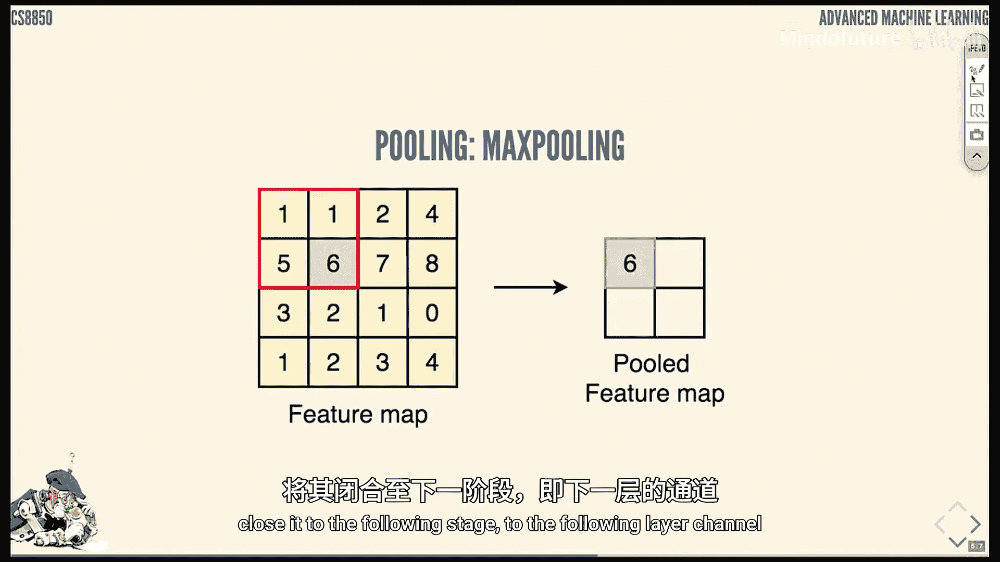

Channel。This is the same max buildinging when opened up， so the interesting part。

 we select a max number， but just a maximum number in this area。

This particular mark pullinging picture actually done with a stride。

 but you can decide for how to do it。 It's a hyperparameter。So， Max。I know， I three， I three。Aray。

 but then we need to take just a side note interesting when we do back Pro。

 we need to differentiate through Max， what do we do then？

Turns out we only care about that maximumimal element that actually。

Took part in everything upstream from this part now。 And so when we are differentiating backwards。

We only are computing derivatives and adjusting values that correspond to that maximal element。

 we do not pass the gradient or compute the gradients through other elements because anything smaller than the max。

 their tiny infiniteimal changes will not affect the max choice。Its it'll still be the same。So。

 just outside。Another type of pullinging is average pullinging when that is clearly differentiable itself。

Mmalized sum never。嗯。Some with a factor。So easy easy to differentiate linear action， linear function。

So what we have here。Is average pulling Max Yeah， average pulling。 Every element is added together。

3 plus 3 plus 2 plus 1 plus 3 plus 1 plus 2。1915， right。Yes， we get 15 and then we divide 15 by 9。😔。

And that's when we got to 1。7。So。Let's go wrong。We know what the pulling aberrations are and how they work。

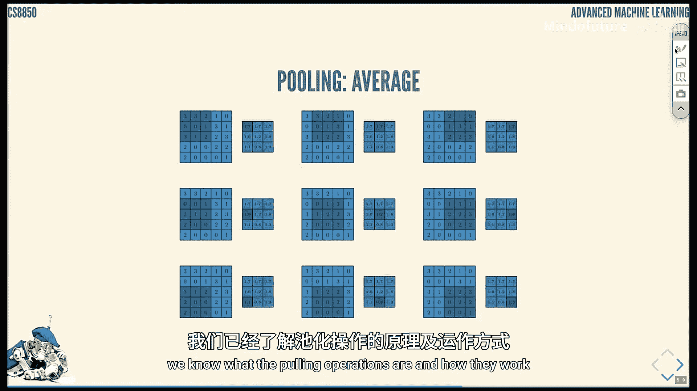

Now let's look at another thing， how do we produce a class prediction？嗯。Eve are。Output layer。

So imagine we started here with some interesting image of a smiley face。😔。

And we went through the first convolution layer right here。Produced3D channels， a lot of them。

Then went on， produced more and more。 And so now we are here somewhere。After many max bullying and。

Other types of operations。And we have a lot of channels。Or fisher maps that are activated。

 they carry some information about。哦。The input， so what do we do here？So one way to do it is。

To just take this all and factorize it。Inter a vector。Just。四。

Take this that this like take all of those elements 1 by one and put them here。 Take another channel。

 put it here， put it here。 And then once you would have it。You can put a fit forward network。

TheF forward network。So basically， this separationation is flattening， right？

Flatten and put them into it。 fit forward network， and project。Either face or emotion， you know。

 neutral。Nutral， sad and angry。嗯。But this channels。

 so all of the operationsations from the input up to here， the layer。

The last convolution layer are convolutional or all of them are convolutions。

 but then we flatten them and produce sort of slapla。Fit forward effort。And produce。

A classifier from the conventionalutional neural network。Okay。

 now we're ready to move to the next part。😔，What part， a building book， one convolution。What is that。

It's just a single weight。Mmhhm。Right here， you have。 you take this file。

You multiplied by some weight， say 0。3。 and then you produce。And output。It's kind of dumb， right。

 well， maybe， but not just this is learnable。This is a learnable parameter， so what we can do。

When we are at this last layer。F convolutional layer that we just covered。

What we could do instead of flattening it。Instead of flattening it。We could put。A one convolution。

Don't confuse this with one dimensional convolution。 One convolution is not。1 Z convolution。

So if we put one convolution here。😔，With only one neuro。We will stitch。

Or produce a weighted sum learnable， So then optimal。

And just produce one layer that contains information or one channel that contains information about all of these channels together。

 And then this could be flattened。 So then we could。In such a way， we could。

Reducuce dimensionality in a much smarter way。Then simply flattening this whole thing and learning with a fit forward neural network。

The next building log。Is up convolution。App convolution solves the following task and you can see the animation。

Here in this corner， while the same animation is kind of laid out in the center of the screen。

Imagine you have an image， and you want to。Absamp it。 So instead of two by2， you create。

 you want to create four by four。How do we do it in learnable ways so our filters are trained on the images that we have in and they produce larger resolution images from the lower resolution images。

This picture diagram illustrates it， so we'll take a large filter。

And we canvol it in the following way， but we canvol it backwards。 You take one input。

Multiply it with the all values of the filter and open up into a larger patch。

And with overlap of this larger patch。You create an image of desired size， when。

The filtererss overlap。In the unknown。Here you can reduce a crop， you can crop the result。

If you need， but the important part is that you can ass sampleble your image。

And you can train the filters to be able to sample your image。That's up convolution。

 We'll come back to it。One， another building block。 Another element is dilated convolution。

 dilated convolution is。Very important， actually， an interesting idea。For the following reason。

 imagine， let's just consider one dimensional convolution。 So we have。3。嗯。Elements in our kernel。

And well produce our first journey。即。Again， three elements in the colonel。And we produce another。

Same。Again。3 o。So look at this point。This neuron this activationivation or this whole neuron。

 when it scans through。If we。Compute。A draw， how I'm done right now。This。诶。

This neuron right here sees those three values underlying feature map。But if you can here。

 those three values were computed from this 1，2，3，4，5。And。

They corresponding the were computing from the 7。Pixels， input pixels underneath。

Not is the following that the first one sees 3。The second layer sayss 5。The third one says 7。

And how far in depth you need to go in order to see。没有嗯。Most of the image are the whole image，0。

This is traditional and neural network。The re field grows very slowly as a function of depth of the network。

 so you need to go deeper and deeper in order for your output neural and to be able to see larger field of view。

Dated convolution n， and those are all parameters。So you have more and more parameters with each step because。

Its。lin宁。Since you have lots of layers， it's three times each layer。

 well it's also times the number of channels。What dilated convolution does， it says， okay。

 let's start， maybe。With a city by city convolution。Just like that。

But then instead of going with larger convolution at next layer， we still use a3 by3 convolution。

But we will only。Leave。But like we leave halls。Skip。Or open up our parameters。 So now our。

Network sees5 by5。TheReceptive field filled of view of this neuro is5 by5。

 but it still uses the same nine parameters as before。If we delete a little more。

Leaving the gap of two， then we see 7 by 7。And yet。Still using just9 parameters。

So there's dilation with depth by doing that dilation with depth， we can。

Greatly expand the field of view of neurons at a deeper layer。

Much faster than a regular convolution would do that。 And because of that。

 we won't need as many layers and as many parameters in order to learn。 But one thing。

 another one interesting thing is that。Think about that。That signal in 1 D。If we are。Convolving。

That signal with this function that has gaps。Then this function will only be able to see just by neck sampling theorem。

 right it will not be able to see。It's like a sample down sampling with the signal it。

Not sampling the signal at a rate that would detect slower frequencies。So the larger the gap。

 the lower the frequencies or the coarser。Smoother is whatever the neural network iss。But。If you。

 if you imagine that this， the first layer does not have a gap。

 The second layer has a gap or dilation in the。A receptive field and another one has a gap as well。

We will have a phenomenon when a neuro。Uptop。Sees something underneath in laser focus。

 but then sees smoother。The parts adjacent to it and then even smoother and smoother until they just run out like run off away from the receptive field or field of view of this neuron。

But that's how we see， right， We have a focus where everything is sharp。And then。We have blurred。

 but informative。Details are the ages。 So what dilated convolution does， it allows。

The network to achieve that property that the neurons up in the deeper layers。

Laser focus C only locally， but they have also global information available and for most or a lot of applications that's enough we don't need to see everything in focus and simultaneously enough to be focused on one logo part and by the way this is not attention we'll get to attention this is di convolution and simple principles of signal sampling and for transform basically。

It's related to it。So take home。You need to know and be comfortable with the following concepts。

What is a convolution with a kernel or a filter， how it works， how it produces a channel。

 how it produces an output how scan still the input。

 You need to understand why padding is used in convolutional neural networks。What is same baing。

 What is full。And why either of them would be used or why none。

What's the difference between those then。How kernels spray use channels is important。诶。

How many kernels is each kernel is corresponding channel and how a kernel takes multiple channels as an input that please be comfortable with that。

 that's very useful and that will give you an insight and intuition why。

CNN doesn't work on any of the applications。So pooling also important that's a way to throw away unnecessary information。

 There are others， but that's a very powerful one。And then how to go from convolutional layers。

The predictions。嗯。Let's。Correct that。What is one convolution， also useful two。

 and what is did convolution？And then what I'm missing here， also up convolution is important。

WellThat's it。

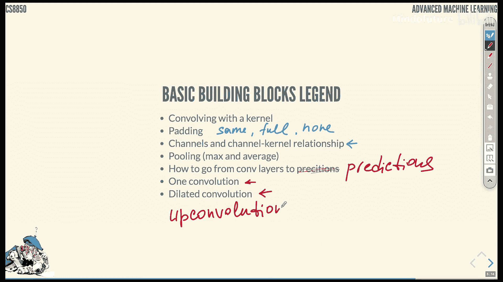

For the building blocks。