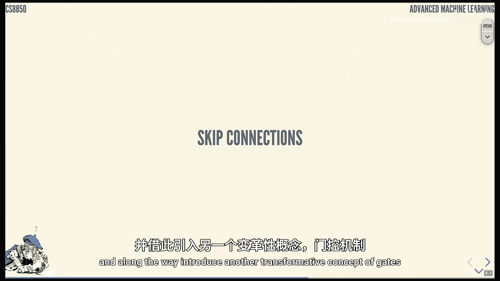
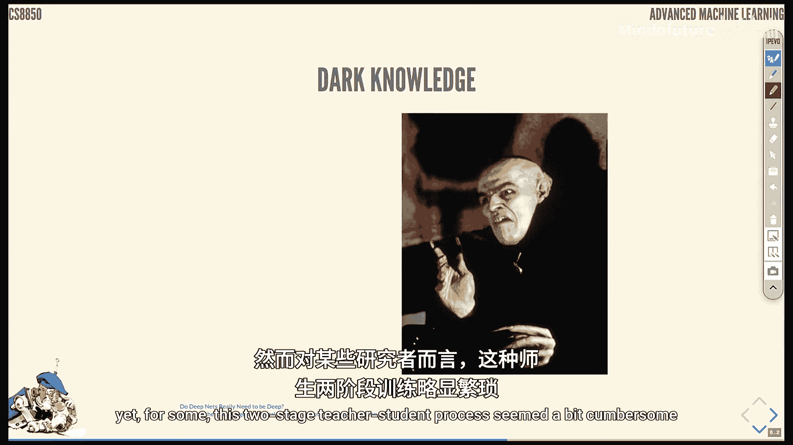
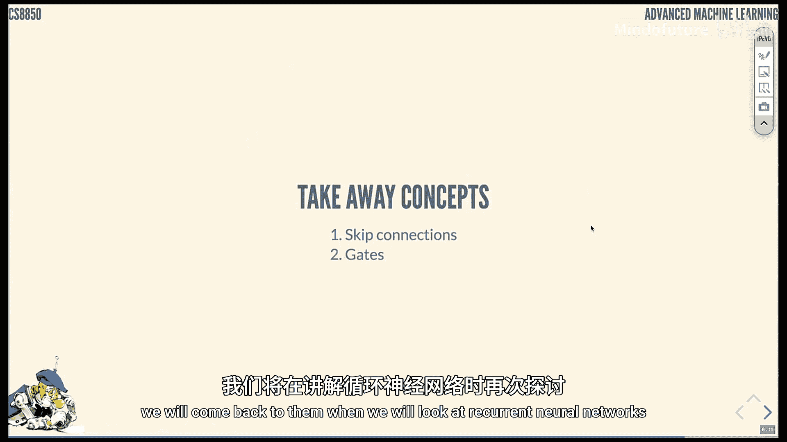

# 高级机器学习主题-CS8850-｜-Advanced-Machine-Learning-p67-P67_CNN-跳跃连接--BV1sapPz4Ewx_p67-

Thanks to the reverse mode accumulation of bird's sppenning。After the forward pass。

 brake propagation works backward along the paths in the computation graph。Normally。

 each edge denotes a computation。Such as a linear transformation followed by a slight linear nonlineararity。

However， there is an advantage in excluding computation on some edges simply using an identity to transform instead。

A trick。That although has everything under the sun been known for a while。

 recently rediscovered to be effective in training very deep learning models。In this section。

 I will walk you through the rediscovery and along the way introduce another transformative concept of gates。

 it's been conjectured quite early。

The deeper models should be more powerful than shallow。

 but we weren't able to train them effectively no matter how hard we've tried。

Vas pretraining approaches when parameters of each layer are initialized in a smart way were helping only to a point。

 the difficulties were discouraging and we didn't know how to move forward to a thin and deep networks。

That is until in 2013， Rich Cara observed the following effect。What Rich did。

And let me use some annotation tools here。Yeah， what he's done。Was。嗯。Observe。In this paper。

 too deep and nets really need to be deep。That。If we train。A large， steep model at the time。

And don't quote me on that， I don't remember how deep was that model， maybe three to five layers。

 maybe a little deeper。But it was surely wider than I'm drawing。And speech recognition， data said。

So after training that model。To its entirety。Like until convergence and until good accuracy。

Let's call this model a teacher。What Karara observed is that if you， in fact。

 take this output layer right before the softm right before the actual prediction。And。Use this layer。

As the label， as the target。For a shallow network。Student。Or they call them a Mu network。Then。

 and instead of training。This one was trained。On a binary target。

And the binary target was zero for those classes that this input doesn't represent and one only for the class the input represents again。

 doesn't matter what it was exactly。Let's say it's a fanmeme that is pronounced in the speech or the whole word in the vocabulary。

 not the point。 The point is that。Take this layer of a trained teacher network。

And use it as a target now。是。For the student network。To train。

 to minimize the discrepancy on the same。Input data。That is。Given an input data X。

 pass it through a trained network。Instead of returning the thresholded softm output。

 take the output layer， use it as you target and train the student and Marla。

The network was powerful and as powerful in terms of performance as the deep network at the time。

 so what was happening？Jeff Hinton。Called the grandfather of deep learning by some came up with the explanation。

 which he termed dark knowledge。And the point was that when you。Have labels。And more and more。

 when you have labels。In your input vector， and this is1 in K and coing where K is the size of your vocabulary。

So imagine you want to train a model to recognize this particular input。Your model。嗯。

This particular input。What。Letby chair。The model works super hard through back probe。Back and forth。

Training with different access， different labels， different targets that is。And eventually。

 it learns some。Reegularities in the layer before soft bags。

When it makes a prediction for the same label that we wanted to return the chair， yes。

 it does assign。0。9 probability or score to chair， but chair is very close to bench。And somewhat。

Four legs close to a cat。And very far from flower。And。The car laywise。

The point of the dark knowledge， as Jeff Hinton termed it， is that。The network。

Did not just simply learn to predict what the model is， what the class of the input is。

 but it also learned regularities， relations between the classes that it was trained on which are more likely or more similar to each other。

 so hidden similarities or not so hidden well not so hidden for us。

 but we didn't train the model to be doing that right。Just a side note also from this observation。

 and maybe before that we started to evaluate our models slightly differently。

Instead of just the cross entropy of the best prediction。

We're looking sometimes at top K predictions。So sort the scores by the magnitude and look at what did the model think was the first guess。

 say chair。And what was the second bench。呵呵。😊，And。Down to。First guess。

 second guess by the magnitude of the score that the model is n down to k and then we say the model is correct。

Our correct class is。Within the top K。 So that that's it。Using that。Reach Karanana's observation。

Jve Hinton's explanation。Yoso Benjas group。Use this to train deep thin networks。

 which they called feed nets。 So basically， take a large fat network。But not too deep。5，10 layers。

Train it in the backpro manner。And then， well， maybe telescoping should be。Wattterature。

 and then take。Say a 35 layer instead of。T0 layer network。And in the same manner。

Is it to train these networks？And these Fis performed well。 they were successful。 and well。

 the most important， they trained through all of that depth。Despite the vanish ingredients。

 yet for some， this two stage teacher student process seemed a bit cumbersome。

In 2015。Ruppesh， U Towerwa， Klauscraft and Jogen Smithm Huber。Made the following。

 a bit elaborate observation If we embel the regular layer in a fit forward neural network with a transfer and car gates。

 we will enable gradients flow along the entire depth of a deep， very deep network。

Let's see how they have done it。 So first of all， let's reannotate or。redeffinine our layer。

Which is usually simply written as。No linearality。5。The element wise not the United。Of the vector。

 which is the result of this linear repar matrix of transformation of x。

 Let's just write it as H of x given。W sub H。 So all that it's it's saying is the same。

 So if we do that。Then we can have the following。We can add to this layer。Which， before was。Take why。

Push it through H。And get。Oh， what am I doesn't want to take X。Sorry。Take X。

 push it through H transformation， and get y as an output。So now what this equation says is。Take。X。

Push it through tea。不ushush through。H。And also push it through C the carry C is the carry gate。

 Y is a gate we will cover in just a moment。T is the transfer gate。This solid line。

 says X just goes through。Here where the gazing is happening。Here or it is happening as well。

 but for a different gate。Then we add whatever can pass through。Let's be careful here。

This is our new X。Or if we call it Y and choose a darker color。

Then we'll repeat the same block again。So what is happening here。First of all。

 I want to point out that all I'm doing right now。Is redundant。To this equation。

Everything is already。Is already written right here。This is Adam Art product， elementement wise。

In both cases。So what we're saying is。The gates。 Well， let's， let's look at what the gates are。

 Each gate is necessarily。I sig more ad noity。After a transfer me a。Tranformation for Trans gate。

And for carriate。That is a type here。They are different s linearities。It just squishes everything。

From 0 to 1 in that range，1 and 0。You know this is to be precise。Logistics signal is function。

Not just the sigoid。 So as you remember from our。Logistic regression。It's that。

The output of a transfer gate。Will be a vector with the values between0 and 1。

When the values are close to one or one。Whatever age returns is passed through the gate。

That means the gate is open when it's close to one。When it's close to zero。

 the gate is closed because no matter what H returns。Since it's multiplied by0 here。

 it's an element wise multiplication。Nothing passes through。

And then we add the original input X untaed， like untouched， sorry。AndYep。嗯。

We add the original input。X。To the result of the separation。If。

All of the transfer gates are open they older ones。And all of the。

Carry gates are open they all are once， then what we're doing is we're passing ourx through a layer transformation。

 but then adding the original X so no information is lost。Kness strange， right？Well。

 there is a huge reason to do that， and this is not about passing additional information。

Towards the end of the network。 Well， not directly， at least。The authors of the He Network paper。

When the following way， instead of having two separate。

 even though they offered that idea themselves， instead of having two separate carry and transfer gates。

They suggested an interpolation between the transfer gate and well。

 between the gate that passes through the transport version of x and x。And as you can see here。

 when this gate is fully open， it's1， the X doesn't come through。

 but only the transformed version comes through。When the gate is fully closed， it's 0。

 the transformation of x doesn't come to the next layer。

 It's only the x itself itself passes through that layer。An interesting observation of this。

as I just said， right， if the gate is0， then x goes to the next level， if the gate is 1。

 then the H goes to the next level。先。What happens advantageously。In this case。Is that when。嗯。

The gradient。Remember， this is x。And it flows two directions。Through H。And by itself。

To the plus sign。Only。There is a gate。That governs how much of x will go through and how much of H will go through when we start differentiating backwards through those units。

We observe。That。This path for the gradient。It's always available or almost always available depending on the gate because if the gate is zero。

 then nothing can go through because it doesn't matter the past didn't affect the future at this point。

 but if the gate was open at the times then there is an information highway that's。

Why highway networks？Such that the gradients。Can always flow and the derivative or the updates can always be made。

To the earliest layers in the network， despite the need of propagating the gradient from the start。

But what if untrained gate is always open and doesn't let gradients flow。In the beginning。

 we may be unlikely to initialize it that way。 So the suggestion remember the sigmoid function。

It's zero。Or open for gradients to flow。All the way back。When the value of the transfer gate is。

Negative， right， tends to。Conency。 so the suggestion is simple。Let's initialize large negative buzz。

And then eventually the network will， after passing the gradients all the way back or after passing the error all the way back。

 eventually the network will train。Correct transfer gate。So no remember。

 the thing to remember is that。Our original layer。First one。Go through the second。

 this is our original structure of the network。Get transformed into something slightly more complicated into a packaged version。

Third。Now， has。The transformation itself。And the transfer gate。And then。This is layer 1。

And respective parameters and then layer 2。The same kind of block， but with different parameters。

Okay。Or are the results good？The networks。That they have trained using traditional layers and higher layers were of depth 1 in 50。

Right here， 10， 2050 and 100。Plae networks right here would trend increasingly poorly with depth。

 So this is the shallowest network。 This is the least shallow 10。20，50 and 100。呃， training。

Cro enter the error。For。Highway networks， the situation is slightly different。

 although the overall performance is worse than the 10 layer neural network trade traditionally。

The performance of deep measures。Doesn't deteriorate。As badly。So， that was。Very hopeful。And。

Importantly， as well。These networks， the highway networks。

Of depth 100 were comparable in performance。To Fi nets from the previous slide which were the Fi were tried by Mimi Ki and teacher and here without any tricks with initialization。

 just random initialization。The highway trick， the gates that allowed gradient flow backwards in the layers。

So the beginning of the network， no matter how cheap。

Actually fixed that problem now the network started to train。Isn't that encouraging？

Write about at the same time。呃。But， although。It took them half a year the Highway network paper was for half a year online before the precisionional learning for image recognition came out。

People at Microsoft realized， oh， wait， why do we？Need this。Mr from scratch。We had this。

Times the gate。Live me， just short time。And x times another gate。Let's just set those gates。回电设。Both。

And if we do。We get this structure right here。嗯。Let me try。Our output， y。Will be， will you。Of。

Wly2 of another。Reilitude transformation， W1。😔，X。Plus， X。So effectively， what I written here。

It is exactly the same what's drawn in this diagram。The rhetoric， the rhetoric was。Look， our H。

 the transformation now of this whole thing。呃。Is。F of x， or what is H of x if this。Hall units。

Including the final rally。Okay。Is age。哦。Then are F of X。Is learning to represent a residual。

I don't know。 I think it is a。Pretty story or a good anecdote to sell the model。

 but the main reason and the main selling point。Not to publish the paper。

 but to actually widen networks re networks to cough。🤢，Or iss twofold。 First of all， this approach。

Opens up the gates of highway networks， still preserves the property of information highway。

And that the gradients can flow backwards in time， even if they vanish within those layers。

And another advantage is that this model is much simpler to think about and to read through than the。

Highway networks although I hope after my explanation。

 those highway networks and gates are not a mystery anymore and very easy to understand then as easy to train as residual networks if you were to choose to train onces。

So another thing to point on this slide。This equation or this expression is identical to this diagram。

 why would we choose a diagram representation over a clear and precise mathematical notation？

There are multiple reasons to prefer。The what I call。

 and I'm not sure what it is transitional right now， it changes what I call an engineering way。

Of information presentation， yes， mathematical notation is precise when you need to go down to the needs basic principles but。

When you need to represent a network with 100 layers， writing it as a formula。Is unwieldy， yet look。

We will see now that representing a 34 layer residual network with engineering diagram is still possible。

Pardon my putting it on the side。Paper was two column， and it was。

Space efficient for the others to make it a thin long， you tall picture， but for me。

And slide constraint， this is better。Now， look here。This is VGG network。

 similar to AlexNe that we covered in the history of deep learning。It has a。

A few convolutional layers， precisely around 15， right 12。

And for our actually 16 convolutional layers。And a fit forward network on top。这 if会。

Use the same approach and construct a 34 layer network。 and notice。Pulling。

 there is only one pool here。In the beginning， where we canvolve and downsample the input image。

Basically， by pulling。 And then there is no pulling。 So if we compare this network。

 that was the plane network performer in the previous results with。Take that back。

 that was about highway networks， you'll see the performance on the next slide。We compare。

A 34 layer plane network without a residual connection and 34 residual network。

 the only difference is that this identity carrying of the result X。Through。Every two layers。

Remember my comment about the gradient when you start when you compute the error here。And。

When your desire to compute。T E with the respect to x。What we want is the E with a spec to x。And。

All we can do is T with a spec。Lair。The last layer。 But then we compute the last layer。

But respected the la before。And so on and so forth。But right here。

 at this inflection point or bifurcation。We will have two gradients。 One goes through identity。

 unchanged。Whatever we have we had here。We'll be right here。 whatever we have here。

 will also successfully， this whole gradient gets through and we will will get added and passed。

Through each of those blocks。Even if， if one block， something bad happens。

 the gradient vanishes this gradient that's supposed to come through。Goes to zero。

 will still be able to pass the gradient to anywhere in the network and continue training that is important property of residual networks。

 as well as highway networks， of course。The results。Turnned out。Resonnet。

Keppt learning and improving。With depth。And。Solid line here is， this is reant。This is plain network。

They're all CNN convolution。Resonate。It's goodvol。Doted lines are training error and solid lines are testing error。

Same behavior， the deeper the network， the worse is the error， the larger is there。With ResNe。

 it's the opposite， the deeper the network， it's consistently， the error is consistently better。

The training error is also much lower， but we mostly worry about generalization error and that's it because of this performance is of training。

 super easy implementation， very easy understanding and maybe wise marketing with all this residual rather than vanish ingredients gradients。

 which all it does， by the way， yes， residual networks， the only purpose and power is。

In S connections， skip connections and Gs todays not today's。

 but the topic of this lecture of this section of our lecture。No， air surfaces。

Let's take all of the parameters of our network， and we will have。You know。

 a billion dimensional or a million at the time dimensional space and there is a another surface。

In that dimensional， in that multidimensional space that we traverse with gradient descent。

And we are trying to get to the minimum， eventually inventing clever tricks with。

Strategies avoiding subtle points。And many more， and if you're interested how the visualizations were created within in a milliondisal space。

 how can we get a feel of what's going on， you can look at this also a recent two years。

 maybe old paper visualizing the lost landscape of neural nets。

So walking this rough landscape without the skip connections。Once added， smooth out the landscape。

 the error landscape and。Convergence becomes much easier。

 The learning process is much more straightforward。 That is advantages， the advantage of。

Skip connections。 Once the skip connections were there。People thought， wait， why stop there。

 Why stop on this。We had。This dual layers。In resonnet and skip connections。Skip2。We had。Skip 1。

In highway networks。Why can't we skip further ahead？Well， how much further，1 hope，3 hops， two hops。

 or how many so。There people， Laurreen Bder Martinton is one of the authors。

 I don't remember the others， sorry， look at them or just click here when you get the slides。

Just decided， let's take a network。Of however many layers。And ads skip connections everywhere。

 hooray。Once we have this output。It goes here。And then， here。香灯。😔，Also， we have。This sounds。

It does here and here。Well， depending on the depth of the function。

 you get the idea of what we will have， right？And this only goes here。Dense networks。

What's the advantage， Let's look at the error surface。

 The error surface is ways smoother than anything we've seen before。 So I drop a ball here。

And the ball will have be wrong to solution。Isn't that nice？Good， of course， that is nice。

 Not just one thing that I forgot to mention before。 Look here in order for this factor。

To be edible or。So pardon for invincing words to be compatible with x。

Eleement wise multiplied by something。The dimensions should be the same and then the output dimension is the same as well so once we're using residual connections and skip connections we need to be careful and we need to make sure that our dimensions are the same the transformed layer should be the same dimension as the input layer and that I don't know if it's it's a downside or just the property of using skip connections you don't always have to keep all your entire network the same dimensions and you'll see when you don't in the next subsection of this lecture and one of the next subsection of this lecture but。

You have to take care of this correspondence of dimensions。

See how all of those dimensions are the same。For is connections to work， takeaway concepts。

Skip connections。Why they work because of the gradient flow。

 they preserve or fix the problem of vanishing gradients as much as we can right now。

 And gates are important as well。 We will come back to them when we will look at。

The current neural networks。

