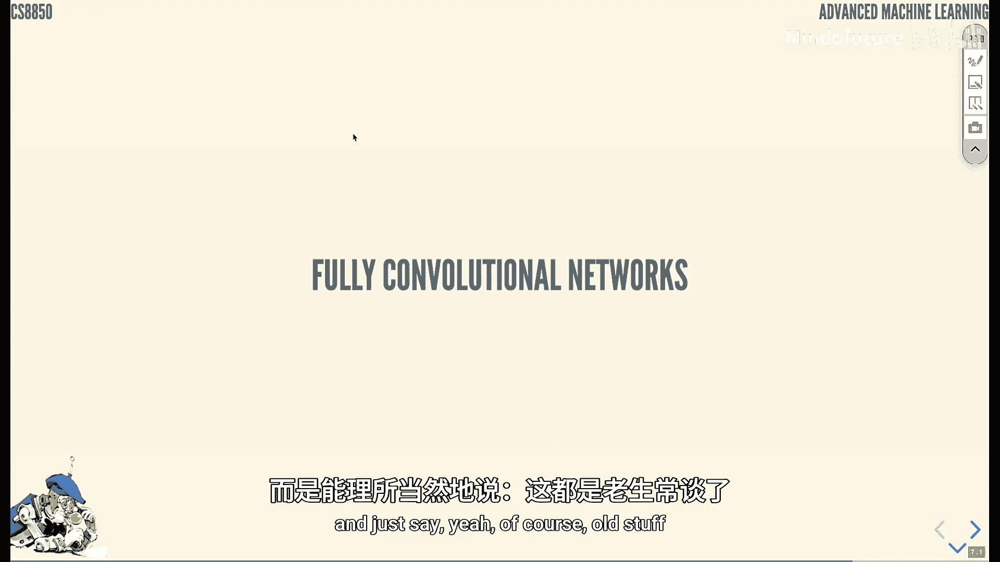
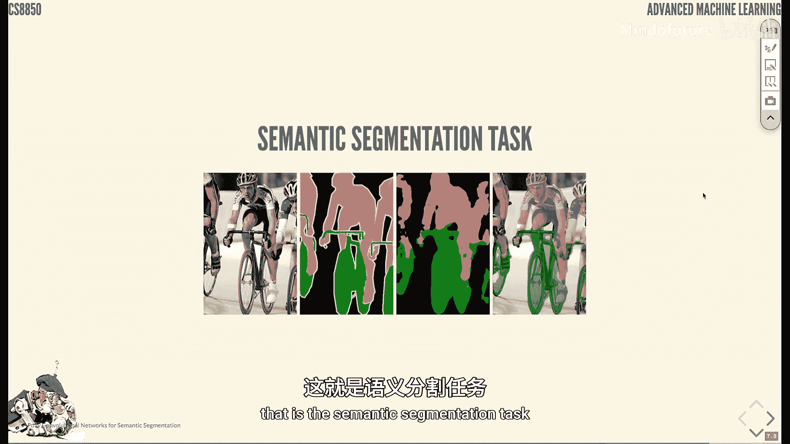
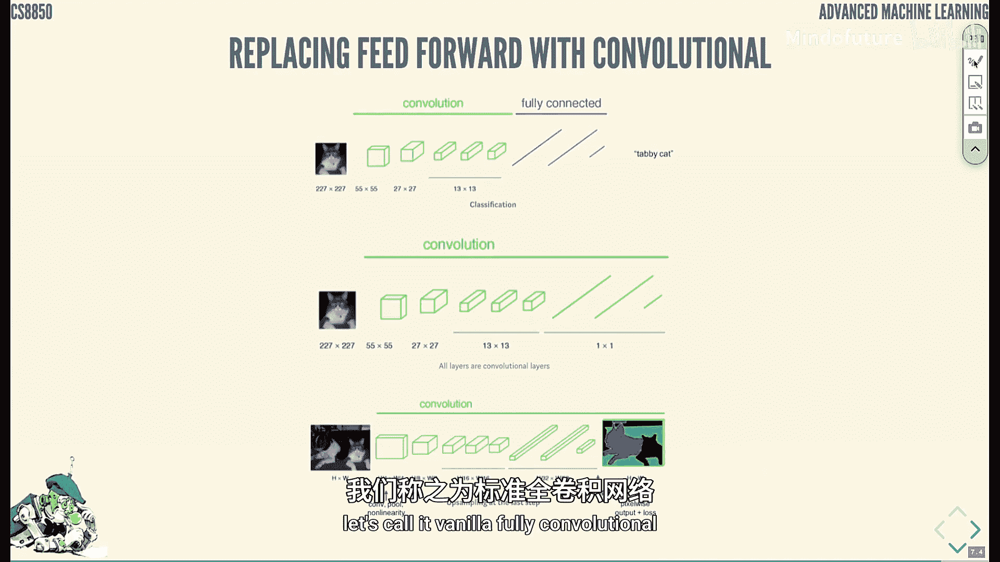
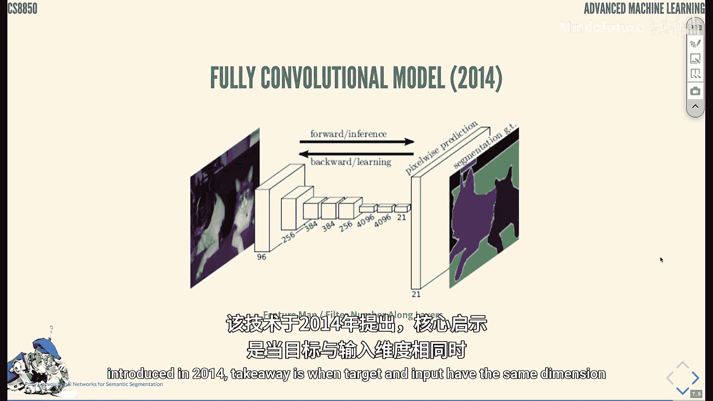
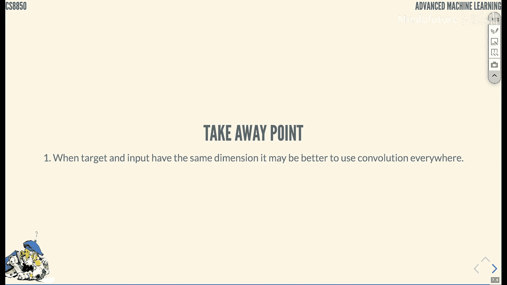

# 高级机器学习主题-CS8850-｜-Advanced-Machine-Learning-p68-P68_CNN-全卷积网络--BV1sapPz4Ewx_p68-

Convolutional networks are a fruitful model。Lots of innovation and lots of successes and as I mentioned before。

 they're very computational intensive， they are intensive。

 but they're efficient because they simultaneously。Can use the parallel pipelines of GPUus。

 So they are。Highly， highly parallelzable。And that's why I can be trained faster。

 Like there are fewer bottlenecks than say in。I a current neural network。

 which we'll talk about later。So fully convolutional neural networks。

 what that is when we have it CNN， isn't it already fully convolutional or。It's。ItsSly evolutionvol。

 or it's。Semiconvolutional what is happening there when you hear that term。

 I by the end of this short discussion， I want you not to be surprised and just say， yeah， of course。

Old stuff。

The task of semantic segmentation。Imagine or observe on the screen。

That you have this task when you have an environment or a video from an environment an image。

 and each pixel of your image has a label。 and when this car drives around。

For each pixel around it at all time， you need to predict well your algorithm your neural network。

 your convol neural network need to predict what object it belongs to， I it a tree， Is it a car。

 I it a road， Is it a person， I it a。ア bike。This task is called semantic segmentmentation task。

In the image I'm showing you here。The part on the left is the ground truth。And crown truth。

Is X and Y together。This is x or theta。Why manually labeled or obtained otherwise？Gives a label。

For each pixel on the X on the image。So we see which pixels belong pixels belong to a bike。

 which pixels belong to border， which pixels belong to a  bicyclist and to the background。

We want automatically， from that image， X。To construct a mask like that。

Or be able to segment live on the image， as you see right here。

That is this semantic segmentation task。

So。Why fully convolutional is needed。Here's our traditional model。We have a few convolution layers。

 maybe with pooling， maybe without that generate channels in the intermediate。Steps， so。Laer 1。

 layer 2。And we generate channels here， the convolutions are actually happening in between。And。

It all culminates with fully connected or so called as you know feed forward neural network that then makes a prediction from K classes。

Can we do the same without fully connected layers？Yes， we can。

Remember one1 convolutions using one convolutions， not 13 by 13， not3 by 3， but one by one。

We can replace all fully connecteded layers。And we need to quickly recap that。

Remember what was happening to in one convolutions。If you have a few layers。Right here。

Then you can apply one convolution that pierces through all the layers。And produces one。

Channel at the next letter。But you don't have to use just。A one neuron， that's a drastic reduction。

 You can use neurons fewer than the layer before。But still multiple one convolution layers。And then。

 gradually。Not in one step， but in a couple of steps。You can create just one layer output。And then。

We use it for prediction。嗯。Clification， each say pixel on this output layer will correspond to the prediction that we want to make。

But for the task of semantic segmentation， what do we do？We need up something。Or up something。

Is the Akin illusion that we spoke about in one of the previous lectures。

So then we started with an image H。Hide by width。 And we ended up with an image， hide by width。Well。

 we went through a number of steps of one convolution and we added up something at the end。

 so we created an image output of the same size， but it's similar to the classification task only now we're classifying one pixel at a time。

An interesting point to note。Is that for each image， if it's H by w， and it's say8 megapixels。

Or whatever the resolution is。We have for 8 megapixels。 We have 8 million labels。 So now instead of。

One D dimensional feature space has an input and only one single label。

 we have many more labels and many more gradient signals at a signal， a single sample。

 single example， so the training can be much more efficient。

 we may not need millions and millions of examples in order to train the network that's a remarkable achievement。

And。This is a fully convolutional network。Let's call it vanillaa fullylic evolutional。

That's how。Full network looks。We have ground through segmentation。

 we produce pixel white prediction back propagated to the input。And perform gradeed， the said。

Introduced in 2014 takeaway。

Is when target and input have the same dimension， it may be better to use convolution。Everywhere。

