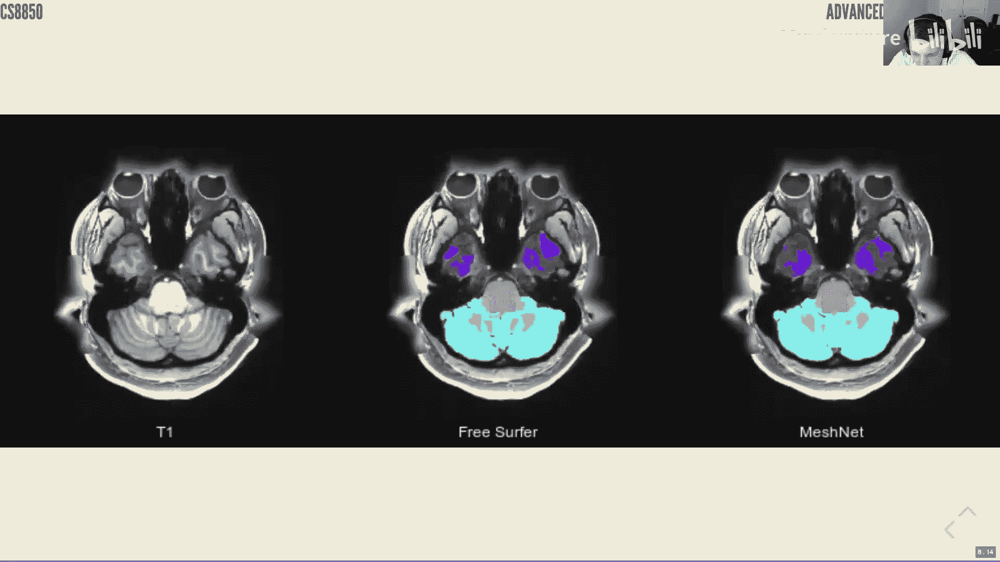

# 高级机器学习主题-CS8850-｜-Advanced-Machine-Learning-p69-P69_CNN-带扭曲的语义分割--BV1sapPz4Ewx_p69-

Okay， it's recording。But it would be easier for me to respond。

 please don't turn your videos at least I can see your faces that you don't understand anything I'm saying or you do understand everything I'm saying。

 let's see so semantic segmentation in my last lecture yesterday while you were asleep and you haven't watched it apparently I was talking about semantic segmentation problem。

And。okay， one of my goals is for you to understand and not be scared when you hear at the interview or in the paper paper terms like fully convolutional neural network right fully convolutional that the first time I heard it I was like what is that the same happened to me by the way with highway networks I saw them I was there when they were presented at the conference and I was like well。

 this is too complicated I just can't see what of these highway and I。get it very simple， the ideas。

 all of the ideas are simple if when you can sort of dig them up。

Let's try that so we've seen all of the components in this diagram。

Before our fully convolutional neural network。And your time travelers。

 you're going backwards in time， you will watch my lecture on fully convolutional neural network the original fully convolutional neural network looks like that。

And I think it was around published around 2014， start with an image。Convolulve。You canvol again。

 down sample， max pullinging or something。Go through another layer。

 a convolution followed by down sampling，micpoing。This one has specific structure。

 it goes through two convolution layers before it does max pullinging but you can just interleave each layer with max pullinging operation and then this will look more conical right it will reduce in dimension with each step that's what's happening here we're reducing dimension sort of creating a bottleneck forcing the network to learn more when distilling that information but then at this last step fully convolutional network applied an upsuppplling operation which I do explain in the building blocks in the first video。

So this up something creates。An output of the same dimension as the input。

 so you have correspondence of your label。For a segmentation sample with your pixel for each pixel。

 there is a segmentation sample。Okay。Quite simple， the only building block was convolution and max pullinging。

 but then upsembling。Three building blocks from the first lecture。Isn't this a typical auto encoder？

No， there is no encoding here， the training is actually supervised， you have a segmentation。嗯。

The out。Exploits the same property about。Any models is creating a bottleneck we want we want to well。

 there is a guy Nata Tishby in Israel who actually has a theory is's called information bottleneck theory。

And sort of a vague statement is that in order to learn anything， you have to do compression。

So you have to represent in lower dimensional space in order to learn only the useful parts of your data space。

O think quarters。If you draw it as this hourglass and this is the representation。

This is notto to encoder we get our final representation somewhere here and then we have sample it。

But auto to encode。Even the name is talking about just specific type of training。

 what to encode is an unsupervised model。Or self supervised rather。

 that's how we decided to call those models because it's trained in a supervised backpro manner。

But the error is reconstruction error you want to reconstruct this the input。

 even though it was passed through a bottleneck through。Lower rank representation。

 so you want to find a low rank representation of the input such that it's informative about recreating that input。

Like our lower rank presentation of our speech is our text。So I mean， at least in this scenario。

 if we use the our input that we are passing to the architecture as our labels。

 like the final needed output， it becomes an auto encoder。

 at least the architecture isnt line with auto encodecoder， that's what I was asking。

It is becoming a model that is trained。In your description， it's a model that is trained to。

Minimize the construction error。So if this is x and this is reconstructed x and you train it to minimize this error。

Let's take L to。Then you're minimizing reconstruction error。

 this is the reconstruction error autota encoder yeah。

 you can call auto encoder it's just a name right， but because it's just a name there is an established way of using that name。

So don't call the fully convolutional neural networks oring code in public， or people will think。

 even though you understand everything， but people think you don't know what the pick。

It's it needs some explanation if you don't care about people's opinion though you can do whatever it's just fine but yes you're like you're absolutely right there is some similarity but similarity is rather here in the reconstruction era if you train it with the reconstruction error in mind。

Good， let's go back to the unit so if you。Look at this encoder。

That telescopes in compresses the image representation， the image representation here。

 it's practically that part of the fully convolutional network of 2013 what the fully convolution and then you get here。

This layer and that layer here are practically the same。Then what they did in 2014。

 they upsled so they convolved with a filter upseling or up convolution is clear right if you have questions ask me now otherwise。

You lost your chance， okay， moving on。What UN people did。Roenberg。

MKai is a good conference for medical imaging。This paper is cited more than 13，000 times now。Yes。

 the network， the model turned out to be so。Powerful。That people in medical field。

 especially are using it everywhere， publishing it all over the place， making a tweak。

Or another tweak and publishing under different name， there are gazillion variants of UN。

Why it's called U because of the shape。It's like a u sign that's it there is no magic there。

 So instead of just as samplingling in one step unit does。嗯。Yeah， let's leave it here unit does。

Step by step up sampling using the same dimensions as it was downs or max pullinging as it was compressing because it's using the same dimension in it now。

 so dimension of the layer 4。2 is the same as the subsampling dimension here in layer 60 and then you can add skip connections。

 you can simply。Like resident did。Watch the skip connection part。

 very important part as well in all of the deep learning not just the convolutional。

 that's my second feature 30 minutes at speed 2。0 is 15 minutes and you're done you're now a professional so don't hesitate。

So but now we added those skip connections and what we're doing with the skip connections that we're saying。

 okay， we're up samplingling this essential representation of the image that was useful in fully connected network。

But we're augmenting the information。So。If we cut this and try to assble even step by step。

 then eventually we're losing the information about fine resolution those skip connections are adding the final resolution information about our image representation input image representation so unit。

Good model， but。As with anything， there is a price。

Let's take a typical unit that this is one very specific we used it for brain imaging problem I will describe in this。

23，000 parameters 23 oh wait000 million 23 million parameters it's the model weighs about just the model not activations and not anything safely parameters to disk it will be about 2。

5 gigabytes so try to share this model with your friend try to share a few models with your friends。

It becomes difficult， very successful model works really well， it's trainable。We didn't like it。

 so let's see。I was thinking let me look at it， I thought I arrangedranged the ask， okay。

 well let me define the problem first。We are working with the brain and also have a segmentation task and we want to segment the three dimensional brain into gray。

 yellow。Yeah yellow is great just do the mapping internal and red is white so we want to do gray and white matter segmentation of the brain and in one task this is task one。

And in another task， we want to segment the brain into functional regions like visual cortex。

 motor cortex， left motor cortex， right motor cortex， there are 105 different functional regions。

This is to Nikhil's question。How do we get people and remember those are 256 cubes。

 how do we get people to sit down and label this for us enough so that we can get usable data so that we can train a model。

Well。Very difficult， we couldn't。So what we did instead。

 we took a normal signal processing approach and that's what people are doing now。

 you just take an existing tool which is not perfect it's not a human but it's an algorithm that takes 10 hours to do all of that labeling and segmentation。

 it's not perfect it makes mistakes I'll show some of them but we use this out with as our teacher。

 so if you can come up with a course Nehiil if you can come up with a course way to label your cats。

By using just objective methods like signal processing edge detection and soble filters and things like that。

That could work potentially。This one is of course much more complicated。

 people have spent years and years a team at Massachusetts General Hospital and developed that tool。

 so it was all right it is quite good people are using it as in this system done。

But we also were not happy with the size of the model， the the 2。

5 gigabytes is very hard for us when we're training when we're building a system that trains the model across institutions。

 so sending a model of 2。5 gigabytes each time we do a parameter update is impossible。

Dialated convolutions were of help。This is the model， all of the layers have exactly the same size。

And all of the filters are also， I'll show a table， they're three by three。Regardless of the layer。

 so you're not adding the parameters， you're seeing more you're dilating with each layer。

 you're dillation coefficient dilating more and more， not just by adding one。

 but next time you add two in between you increase the holes， by the way。

Dild convolution is often called。I think I'm spelling it right， So basically in French。不是啊。嗯。

Something blah， blah， blah， French word， basically they lay convolution with holes。

Just as simple as that and in English we took it back with as Atros just without translation。

 but it's a convolution with holes。Convolution followed by relu batch norm drop out 3D。

 all of the layers are exactly the same imagine this if it was an image a 2D image。

 the model would just look exactly like that all of the layers。

 all of the outputs are the same dimension at least until you come down to the output。

Layer where your labels are。What people usually do instead of having one output layer and label the images one。

 two and three classes。You just have。One binary mask as an output per class。

And then you can soft masks on this dimension。And for each pixel。

 just softms decide which class this particular pixel belongs to。

If you're going to use that in practice。What did we get with that？Yeah。

 all of them are just three by three kernels。And this is 3G， so we're convoing in 3G。

Number of parameters is 7 2，000。600 kilobytes versus2 gigabytes model。

The accuracy and performance is better and it's a faster model it's less weight lightweight there is a huge huge problem though nothing no free lunch remember nothing in the9 is for free。

Because it's a 3D model。A and because。Our dimension never changes。

 we always have the same dimension for each layer。Our activations。

Our channels are always the size of original image， so this model requires more memory in GPU。

 even though the number of parameters are 300 times lower。Because of the activations。

 because of backpro at each step， we compute activation in one layer。

And we need to store it in order to compute back propagation。

 we compute acceleration to the next layer and we need to store it so it's a very it still works faster。

Another trick， practical trick that you probably know， so we have a full brain。

And the full brain doesn't fit in the memory because of that problem we cant can apply unit cannot apply the algorithm on the full brain。

 so what we do we sample subusees randomly。We take。

Center of mass of the brain and align the Gaussian distribution here and sample some subcus according to this Gaussian distribution and train on the subcus on the prediction time we again sample them and do model averaging just by voting majority voting what will this pixel be it's still under one minute。

Origal model， the teacher that we trained it on， and that's how UN model is also trained that's how people do that takes about eight hours for the job and those models take less than a minute for the job to label the whole brain。

 the new brain。Yeah， ground truth。Well ground truth the teacher is not the ground。

 it's not human label， it's the automated label and this is manet predictions generations。

Interesting parts that's back to Uni Hill。Sometimes the model our model that was trained on this。

Teacher is better than the teacher。The teacher makes mistakes。The model was trained on like， look。

 there is this。Structure in the brain， which is called corpus callosum。Preservfer misses it here。

 our model gets it wait a second we just learned from this model， this is out of sample。

 this is testing data。But we learned from this model and we're better than this model。Same here。

 same here， same here were better than the original model。

Sometimes we make mistakes as well like this is part of the skull and our model got them it shouldn get shouldn't have gotten them but this is surprising so you need to know key information or key insight about deep learning models that they are statistical models and when youre training them with incorrect labels and if those incorrect labels are not systematic。

The model learns to average over the non-systematic errors so you can have non-sstematic errors in your training data set it doesn't have to be absolutely perfect as long as you have enough data to overweightigh those non-systematic errors if the errors are systematic the model will learn to predict them if say your teacher your labels are always wrong in one particular place on one particular type of inputs then the model will learn to do that but don't be afraid of noisy labels that's useful insight。

As with anything in deep learning， the same here。Our engineering diagrams if you have one input to your model。

 it's very easy to have three inputs to your model simultaneously multimod learning from different classes of images。

 three classes T1， T1 IR and Flair。we just learn as well as well。

 get better accuracy for free without inventing， think about PCA， how do you do multimodal PCA。

 you have to click your data is differently scaled and has different dimensions you can't do simultaneous PCA of different modlysis。

 speech and say vision view of your lips which move when you speak yet in deep learning models and segmentation models specifically。

 you can just easily combine everything。In engineering。

Another interesting part about superhuman performance。People are faulty， we get tired very quickly。

And in。We're limited in our senses。So a human expert labeled this image。

And our prediction is better than human expert。Why is that well。

 human expert has to look at three three dimensional representations simultaneously and has to look somehow in 3D because if you go slice by slice and you go in this direction。

You may miss that your slices don't match in the other and wide direction。

And that's what the probably the humans done that mistake the slices just did add up they all merge together despite the ground truths was disconnected so that's important part and of course this is just measurements of running time the top signal unit。

Has more parameters， it's computationally more intensive so it takes more time by well this is a number of some volumes for us how many some volumes we take to make a prediction about this single pixel so the point of this presenting you。

The model。That my group developed。And comparing it to existing model is to show you a creative use of two techniques S connections for UniNet were instrumental 13。

000 citations as I mentioned right and for us for Meshnet we didn't use any S connections but we used dilated we didn't find improvements where S connections in our case。

 but we found that dilation was really instrumental is achieving our goals so if you are comfortable with the building blocks that I presented in the previous part you will be able to build your own models and what you see on the videos is just a slice by slice demonstration of the teacher and the result when the model predicts 100 classes of different labeling。

And back to original question， Susanan。If you're looking。I can't pause this unfortunatelyly。

 but if you're looking here in the top of the brain or in the back of the brain。

 the gray matter and white matter and the folds are essentially the same。

How do you know that this is visual cortex and this is frontal lobe cortex without having any additional information so if you have a faintest idea like a very blurred that you are now looking in the front of the brain then the model knows well in the front of the the brain I never see the visual cortex so that hypothesisesis is refuted and the same in the back so it's enough to have a blurry idea of where you are in order to improve your performance greatly and have a few parameters so that's a very good technique okay I think I will stop the recording here if I manage。

