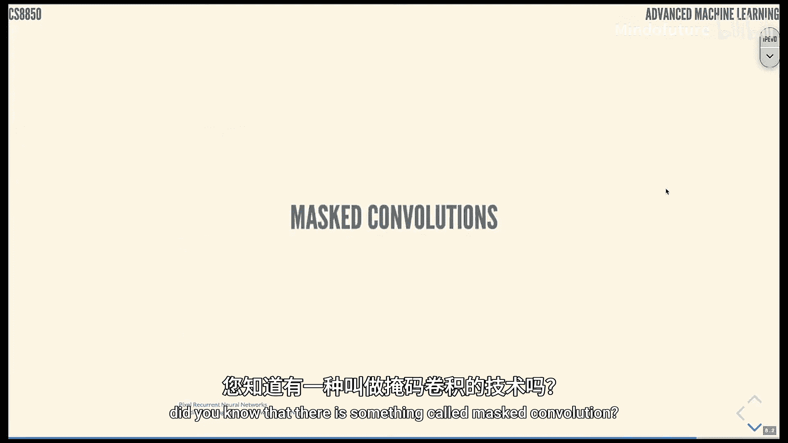
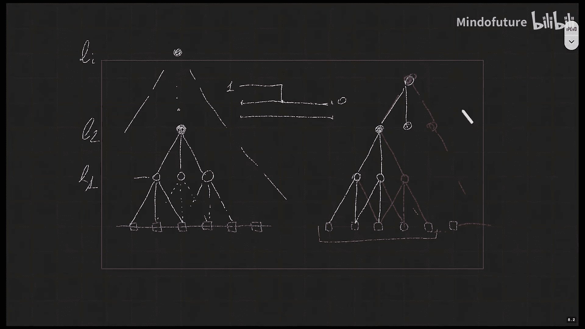
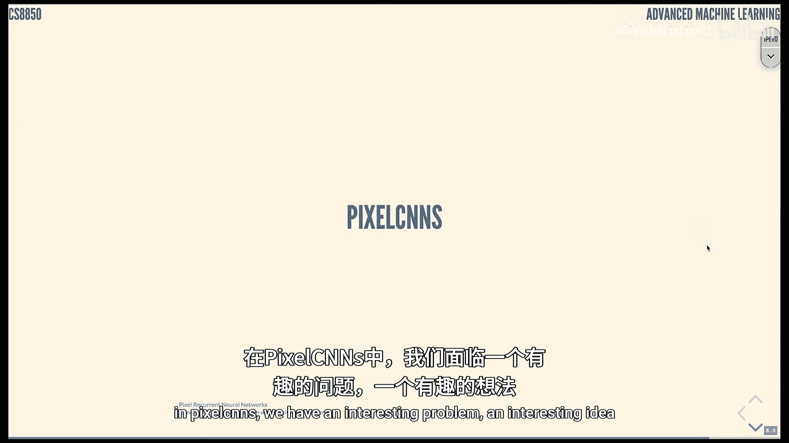
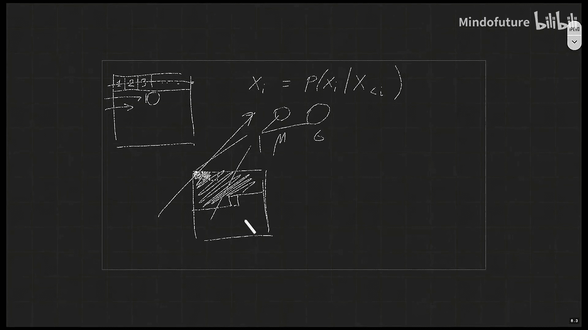
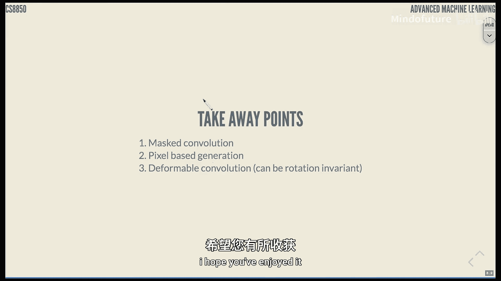

# 高级机器学习主题-CS8850-｜-Advanced-Machine-Learning-p70-P70_CNN-更多奇怪的卷积--BV1sapPz4Ewx_p70-

Our story about convolutional neural network wouldn't been complete without。

The few extra topics that I'm going to。Cover right now。And let's start with one of them。

 Did you know that there is something called。Masks convolution。

So。Mask convolutions work like that， remember？When we looked at one dimensional case。Imagine that。

 well。Yeah。Just a little bit。 imagine we have。Your input。Great you。This is my image。

 But the way it's in。Put that is by pixels。And there are the。Nos。Intersection nodes of this grid。My。

This is one dimensional example。系 am。有人。At this level。Will。See just three pixels。反正。

So this is layer 1。But then the neuron at this level， will layer at layer 2。

We'll see those three pixels， and by proxy。It'll see all five down beneath。

What if we want to mask some pixels out？For example， our Gaul。Is to mask out。In the receptive field。

 below。For this。嗯。Mulan in layer 2 or。For blah， blah， blah。 For that Neon。 and layer I。We want。

To mask out。In a 2 D case， oh， let's just stick to 1 D。So now。

 we just wanted to see half of the input。And not to see the other half。

The way we could do it is take the input， this is our image。And apply a mask。

To the receptive field of the filter。That is for the pixels that we want to pass through。

 that we want。诶 they new人。To see something， we have value of one and for those that we want to eliminate from consideration。

 we have value of 0。Sounds like a good idea， but with it's kind of confusing。And multiple pixels。

 those are the input pixels。We want to mask out。To thirs。Of the of the view。 And let's denote active。

Connection， active weights by white color。And let's， you know。

 byrate those that are not participating。 So we're masking out two third of the field of view for this neuron。

How do we mask two thirds of the field of U for this Nen。Well， we just apply the same mask。

To all the neurons that contribute to the field of view of the top neuron。How does that look visible。

Visible。Invisible， mued out。Well， this whole neuron is masked out。

 so everything it sees doesn't matter。Or because it doesn't contribute to the top near。

But the mask is also applied。Does this near。So。Compare the。

The expected field of view of this neuron and the masked out field of view of the same neuron。

 So as you see by applying mask。Paassesses， not passes。To each neuron in。

Among those that contribute to the neuron in the top layer and form the field of view down to the image by applying the same mask at all levels。

 we achieve the effect that our field of view of the top layer neuron is masked out appropriately。

As we wanted。 And then if we add another neuron right here。

And use the same mask as before we will have achieved exactly the same effect。That this nearance。

Down， down there， where it's supposed to have。Field of U will have two third of the field of U masked out。

 You can imagine that exactly the same process generalizes to two dimensional case okay。

If we have。Fill the view。In two dimensions。And we want。To only see。This part of the image。

Or for the top neuro when the image is。The field of you。Or when the field of view of the top。

 neuron is the whole image the complete image entire image。

And we only want that neuron to see this part and。To have no idea about what's going on here。😔。

We can do the same， we can take this mask and apply it to the weights。

Of two dimensional convolutional。Y人。Why would that be useful， you may ask。Well。

It turns out to be extremely useful in something called P CNNs， in P CNNs。We。Have an interesting。

Problem and interesting idea。

And that is the following， let's take our image。And enumerate all of our pixels。From left to right。

And then， from top to bottom。Great。We go。From here。Then continue here。 then continue here。😔。

And an emorate all of the pixels。 and now the goal is to generate an image pixel by pixel。

Kind of weird idea， right， why would you generate anything pixel by pixel。

 but we will generate it in an autoregressive manner by sampling from a distribution。

So we want to generate pixel I from a probability， conditional probability distribution of pixel I conditioned on all eyes that are。

Listen。This particular eye。Or。All eyes that are listening in this eye， all eyes that went before see。

We the mask。Can be used the maskscuing illusions because we don't want a network to see。

Further where it predicts this pixel， how it is done in pixel C especially in conditioned pixel C And your're practically。

Starting。With one pixel in the image and you're trying to generate the next。

 so you apply this mask to each convolutional filter。When。呃。The top neurons is the whole image。

 but it's emptyty because it's0 and only one pixel contributes。

 The output of pixel net and of convolutional pixel net is a distribution that's also a new concept。

 but I'm not going to go into details， So it has two output positions。 one gives you same mu。

The mean in another gives you the variance that we actually work with scale because the variance could have arbitrary numbers that are hard to handle。

 So when we generate。From this one pixel， we generate。

Mux and Sigma for the next pixel were sampled from this distribution。Fill that pixel。

And go to the next。And repeat the process。 We apply the mask conution with a new mask now when only those two pixels are seen by the network and eventually。

Pixel by pixel， going back and forth。Proppaate forward， make a prediction。 sampleple， fill the value。

 Eventually， we cover the whole image with。诶。

Genenerated image。Well conditioned on。Then， you shall value。When that could be useful。

 I didn't have an example， but didn't have an example figure now。

 but basically you can recover the occluded parts of the image。Was pixelel Santa， but。

The value of pixel syn was in。Sharre surprise that you can generate whole image。

 but pixel at a time and the image that you get is quite meaningful。 That was unexpected。

 But then thinking about it， people from Deep Mind that Google turned to the audio and audioio actually is never thought about it as something。

Genrated or even analyzed sample by sample。Look at this animated example audio is usually at 16 kilohertz that is 16。

000 samples per second or more if we generate the sample by sample。

 why would we do that usually it's generated by concateative or parametric。

Models when you just take phonemes and concatenate them together to create a speech。

 this is by the way interesting when you start generating audio。

 you can generate speech and that was the original motivation for the waveNe which is also a convolutional network of the pixel CNN type。

This is how it works， based。On。The previous input。It convolved。It。In a sliding window manner。

 like a convolution， pixel by pixel or sample by sample in this case， wavenet generates。

An audio waveform。Let's see why or why would that be interesting？

And one of the approaches is parametric。When we parameterizing the waveform and to generate interesting phonemes。

 another one is concate， when we concatenate phonemes together， another one is waveNe。

Which I just introduced。 Let's listen to how they sound。

The Blue Lagoon is a 1980 American romance and adventure film directed by Randaall Kleiser。怎么办？

The Blue Lagoon is a 1980 American romance and adventure film directed by Rndale Kleer。

Those are real phone names stitch together and see what waveNe does。

The Blue Lagooonon is a 1980 American romance and adventure film directed by Raandndaall Kleiser。😊。

That is really good。What about a different phrase， aspects of the sublime in English poetry and painting。

177 to1850。 It is actually not bad。Aspects of the sublime in English， poetry and painting。

 1770 to 1850。aspects of the sublime in English poetry and painting 1770 to 1850。

So what was surprising about wavelength was generation sample by sample。

The network learns to imitate the sounds that I'm making when I'm talking right now。

 like when my lips。嗯。Stick together or you know， when I inhale and part stuff like that， that is not。

Sufficient or not required for。A speech for understanding and all of that is conditioned on actual text that was said interestingly。

 when the network is not conditioned on any meaningful text or not conditional on text at all。

 it still generates。The waveform of the sound。 But here's how it sounds。Addjety Evans。

 though recessses whose law told up the caence to be determined building a could their jiffy river。

It however told her to beard， are they back here what hunt。This is not language。

 this is just gibberish generated by this model Fun right worth listening over and over again so if you thought that's all on no we have more interesting developments that happened in the field fairly recently。

你 number。Convolutions。Shift andvari when you have a property that there is a car somewhere or there is an eye or there is something that just shifts the location。

 you can use convolutional neural networks to find them those parts。

By scanning through the image left， right up and down。

 But if the feature is rotated and if the feature。Is of specific of interesting shape。 For example。

 you're looking for。The one。And you're convolving this with an image where there is a one somewhere。

 but then what if this one is rotated？45 degrees， then there will be always low correlation between this two and this filter。

 which is all the correct， will never find a rotateated one。

So what authors of this paper deformable convolutions suggested that。

Why do we have to stick to the regular grid why don't we run？A parallel network。

Together with the convolutional network that learns deformations or offset for each of the neurons in the receptive field。

 for each of the inputs in the receptive field， so it can learn some chaotic。

And it can learn and at each shift it can guide the network which offsets to add depending on what was regular input to the network。

 this is a regular convolutional network that dictates the deformable convolutional network which offsets to take and once this happened。

 we can model stretches， so。If we learned。To look for an eye in the image。

But there is an eye in the image that is just not the same shape。

 this particular filter in regular convolutional neural network in this kind won't find this eye。

But in the deformable conventionalal neural network。With， we can。

Stretch the filter and still detect it at the right place in time when we are going over that eye。

 this decision maker， very similar to gates by the way， don't you find that funny。

 but we can also learn rotation。If we have an eye here。This control network。Can turn our filters。

 sideways and rotate around the center。This is amazing， right？The results。And amazing， as well。

We see three different neurons trained to recognize something or recognizing something specific。

 I guess this one is recognizing either the scenery or just the sky。

 this one is recognizing red car and this one recognizing the blue car so that's where the control network decided to put all of the samples of the filter。

So take home points is mask convolution， very interesting， very simple。

 and I hope it's a little bit surprising or amusing to you that by masking local field of use。

 we can mask the field of view of a neuron that is somewhere at the end of the deep network that sees the whole image but the mask will be very similar as the local mask。

 then pixel based generation， we can generate signals， sounds and images， pixel by pixel literally。

which is mind blowing when this work first appeared and then deformable convolutions。

 deformable convolutions， they're not even implemented in densorflow yet。

 even though it's not that recent paper， 2017 it was put on an archive。

 but deformable convolutions also going transgress the borders of convolutional neural network because now it's a much more powerful and much more interesting。

 complicated model that can handle。Rotations， scale and even more interesting situation。

 with this part， we conclude our exposition of convolution neural network。 I hope you've enjoyed it。

