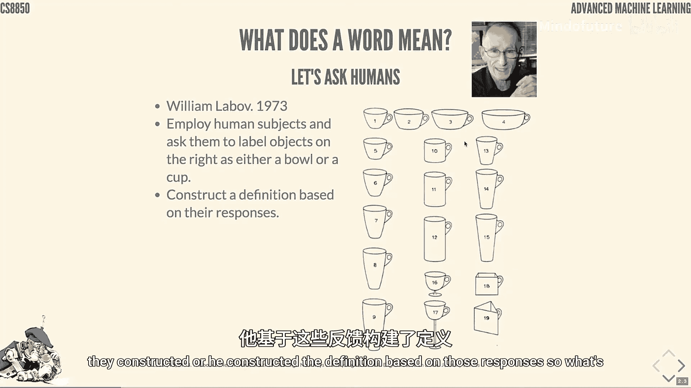
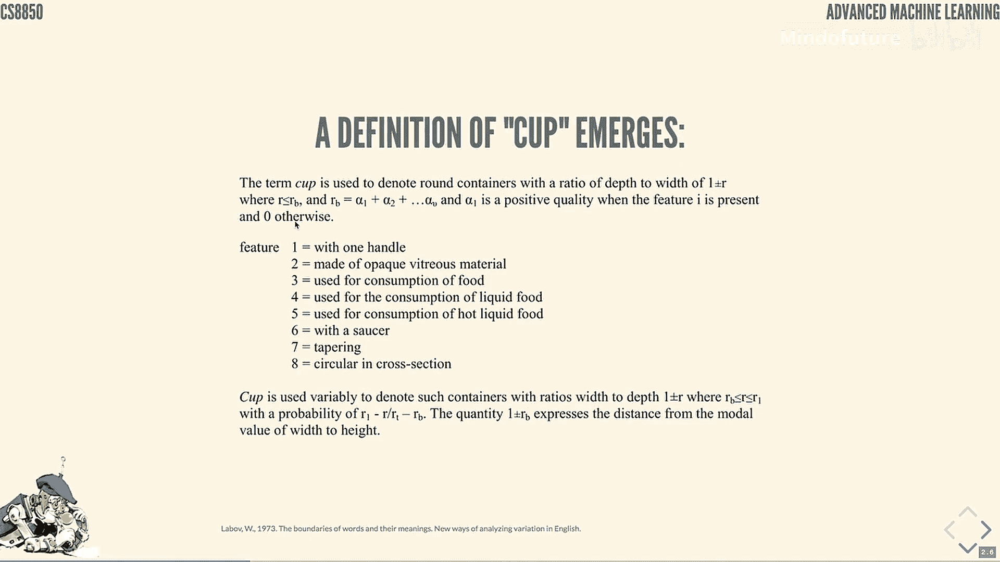
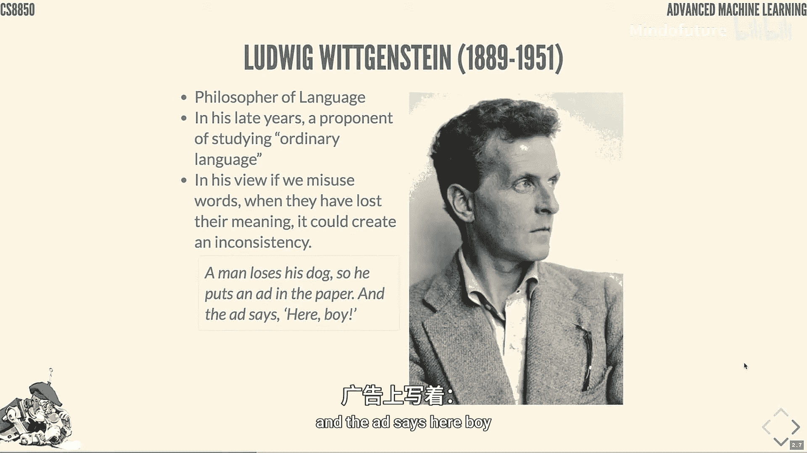
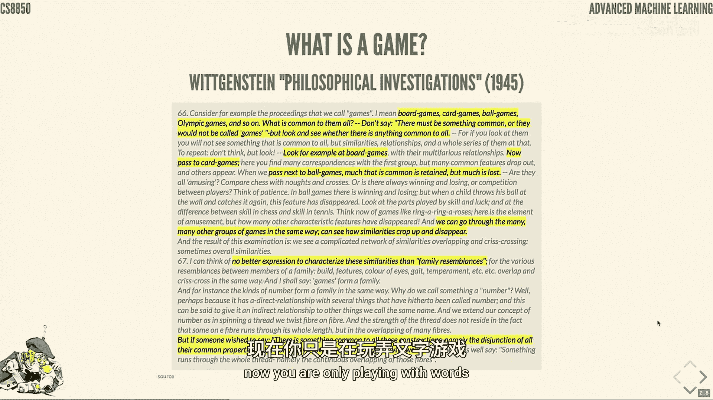
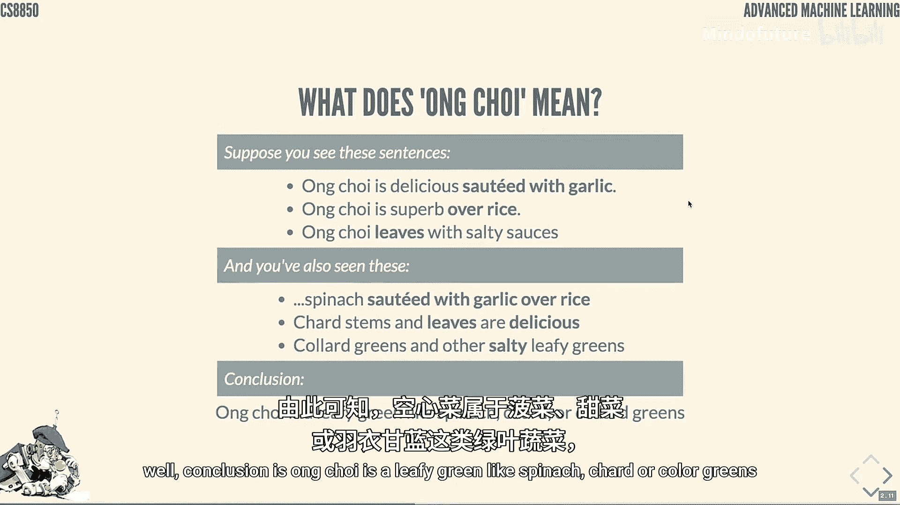
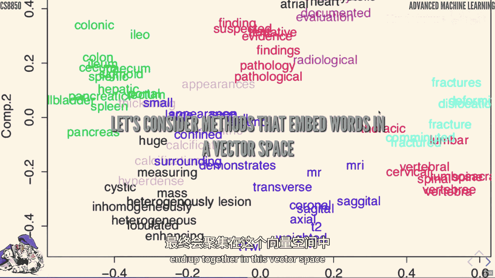

# 高级机器学习主题-CS8850-｜-Advanced-Machine-Learning-p71-P71_词嵌入-介绍--BV1sapPz4Ewx_p71-

This is an introduction section of word embedding lecture from the advancedd N learning course。

 sometimes data is collected from a number of individual sensors。

 putting the sensors together per measurement or sample as at least an array or vector is a natural way to represent the sample。

For example， height， weights， k tone， eye color， hair color。

 and many more maybe measurements about a person。We represent each as a dimension and can walk across the space of all humans represented by those measurements。

traravellling alone each of these dimensions independently from a collection of samples presented as vector we can learn how these dimensions interact for example。

 is there correlation between eye color and the height of people？

We can also apply transformations which eventually may enable us to build predictive models on the human space or we can use existing powerful。

Machine learning models so we can do reverse2 if we have vector data。

 we can assign dimensions to parameters over a cartoon phase and do it in a way that phases are semanically meaningful to us。

Curnal faces。Due to Herman Chernov。Are a way to semantically represent multivariate data。

 Imagine an operator controlling a state of a nuclear reactor， a human operator。

 But instead of observing tens of parameters， she just looks at a cartoon face。

 And if the face grows unhappy， investigates further into what's going on。

Human's process faces in about 100 millisecond。 Wouldn't it be nice to assess the status of a complexx process as fast。

But what if we want to vectorize words by meaning into some form of a semantic space？

So what does a word mean， let's ask humans。William Lab in 1973 constructed this experiment when drawing of different objects which are similar yet sometimes different。

嗯。Were made in order to。Try to assess and distinguish the meaning of words Cup and Paul。

What happened， they employed human subjects and asked them to label objects on their right as either a ball or a cup。

After getting all of the responses。They constructed or he constructed a definition based on those responses。

So what's interesting。As is the question， where does the cup category end and the ball category start？

Absent of everything you can see on the picture here。That it depends on diameter。

The larger the diameter， the more likelihood it's becoming above。 we can。 we're plotting only one。

Pararameter here， but there could be other parameters that we can consider independently or there could be multiple parameters。

At least we can look at three together。So as you see from this picture。

 without any other information without any other context。

Its most of those objects were labeled as a cup， likely to be a cup。But let's add context。

 Lets add a context， whether there is food in it or not。And then suddenly， depending on the context。

 this intersection line shifts dramatically， so boundaries between semantic meaning of the same objects for cups and balls shifted。

 they are context sensitive。So William Loveov started thinking about this and this interesting observation and tried based on that。

 give a definition of what is a cop。So the term cup is used to denote trout containers with a ratio of depth to width of 1 plus minus R where r is less than a record to Rb and R sub B is sum of alpha 1 to alpha V and alpha 1 is a positive quality when the feature I is present and zero otherwise。

 so yeah when it's a positive quality and the features R with1 handle made of opaque virous material used for consumption of food used for consumption of liquid food used for consumption of hot liquid food with a saucer tapering circular in color section。

Cup is usedvariably to denote such containers with ratios width to depth。

 1 plus minus R where r sub B is less than or equal to R。

 which is in turn less than equal to r sub L， with probability of r sub L minus ratio of r to r sub t minus Rb。

The quantity 1 plus minus R sub B expresses the distance from the model value of width to height nice。

 right， cup and ball， what could be simpler and we're just trying to create this technical definitions going deeper and deeper in details now the meaning or at least the feeling for a human of what are we talking about is lost。

 even though we're trying to precisely define what we already know or have an idea of what it is。

So thinking similar thoughts。Ldwig Witgenstein。phhilosopher of language。In his late years。

 a proponent of studying ordinary language。So if in his view。

 if we misuse words when they have lost their meaning， it could create an inconsistency。For example。

 a man loses his dog so he puts in an ad in the paper and the ad says，Here boy。

Witgenstein in his philosophical investigation。嗯。Looked at definition or the meaning of the word game what like let's look at what he writes。

 what is a game？Board games， card games， ball games， Olympicing games and so on。

 What is common to all them。 Don't say there must be something common or they wouldn't be called games。

 But look and see whether there is anything common to all。 Look， for example。

 at board games now pass to card games pass next to ball games。

 which much that is common is retained， but much is lost。We can go through the many。

 many other groups of games in the same way。 can see how similarities crop up and disappear。

 No better expression to characterize the similarities than familiar re sesemblances。

 But if some one wishes to say there is something common to all these constructions。

 namely the disjunction of all their common properties， I should reply。

 Now you are only playing with words。

Well。How about a radically different approach。The meaning of a word is its use in the language。

 Ludwig Witgenstein。So that's what he suggested instead of objectively trying to define。

A word just look how well it's also objective， but it's more observation rather than normative。

 just looks how the word is used and that defines the word meaning。

 not some external normative definition of how it should be observe an interesting phenomena and linguistic。

 most of the dictionaries are normative， like they prescribe the use of the language。

 but there are dictionaries that are more sort of empirical observational。

 they don't prescribe how the words should be used they then just observe how the words are used and report them。

So war， according to this approach， are defined by their environments， by the wars around them。

So Zeelally Harris in 1954 said if A and B have almost identical environments。

 we say that they are synonyms。Here's an example。What does Ungchoi mean？

Suppose you seeize this sentences onchoi is delicious sated with garlic， onchoi is superb over ice。

 onchoi leaves with salty sauces， and then before you've seen this spinach sated with garlic over ice。

Chared sun leaves are delicious， colored greens and other salty leaf greens。Well， conclusion is。

 unngchoi， is a leafy green like spinach chard or collar greens。

Hchoi， water spinach。Our goal in this lecture or my goal in this lecture is to show you。

Various methods of embedding words in vector space， such that。

Words that are similar in their use in the language or meaning， that's how we define it。

 or at least that's how the Wigenstein define it。And up together in this vectorter space。

