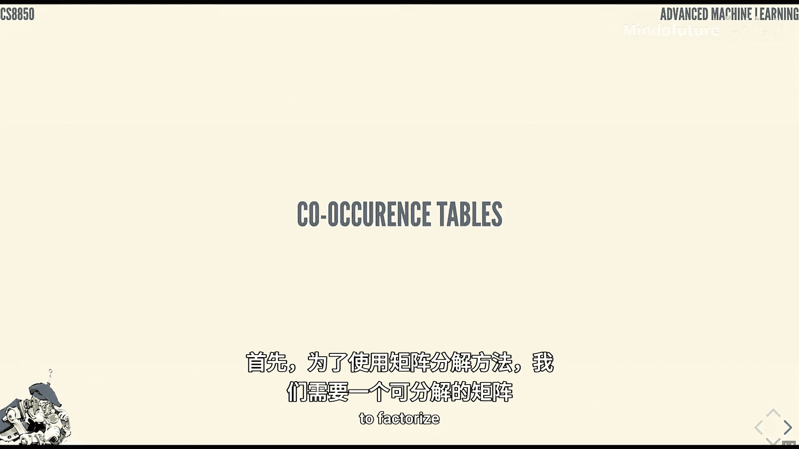
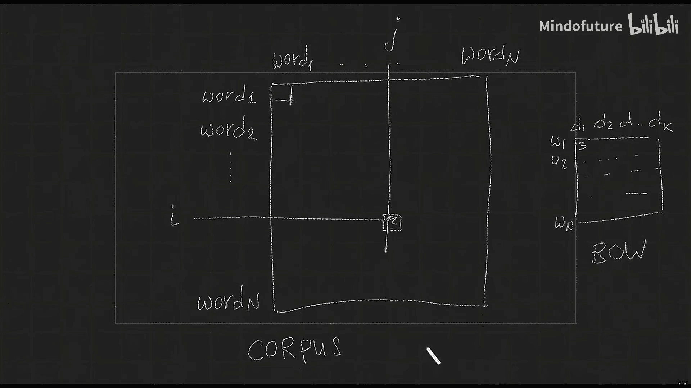
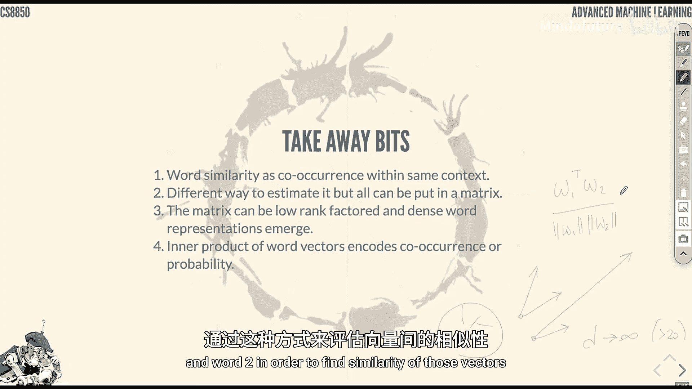

# 高级机器学习主题-CS8850-｜-Advanced-Machine-Learning-p72-P72_词嵌入-语义矩阵--BV1sapPz4Ewx_p72-

Mattrix factorization method for。Dense word vector presentation。Let's look into it a little bit。

So first， in order to use a matrix vectorization method or methods。We need a matrix to factorize。

What would we look at， Let's imagine that。We have a vocabulary。And vocabulary。Goes by。Wd。1 word。这。

And then we get our。Orward and。Of vocabulary size。😔，Andな。哦。In such manner。We construct。Symsymmetric。

Cd one or the two symmetric matrix with all of the words。Voccabulary size。What is written。In those。

Cells of this matrix or a table。So for word I J。We write here the number of times word I and word J occur in the same context。

This is important what context is。If we're doing document analysis。Words inside of documents。

 Then this matrix is notsymmetric， and we can have word 1， War2 through word n， and then document1。

 document 2 document。Does that familiar， does it sound familiar how many documents we have。

 we have key documents here？And okay， how many times does word  one occur in document  one， three。

 how many times does word two occur in document2， and we fill in this matrix with counts of how many times a word occurs in each of the documents。

 that's very similar to what we were doing in a bag of word representation。

 bag of words representation。If you recall。But we can also have word by word matrix and a corpus of text。

And in this corpus。We can decide， we can look at all the strings。And look at all of the context。

 which is nothing but the linear sequence of words。

Of a specific length， we could say even variable length， a context could be a sentence does a word。

I and a word J appear in the same context or how many times word I and word J appear in the same context？

In the same sentence， or sentences could be short could be long。

 let's define a context as a floating window of size w。

 so the context could be w equals 4 or w equals 5 or w equals 6， so look slight a window。

And for each of the words。In the vocabulary。Fill in that matrix with values。Good， right。

 and the values will be just the counts how many times this word and that word I and J occurred together within the same context for all possible contexts。

Nice， but the only problem is thecurs of stop words like articles like and and other words will dominate the table。

 the values will be high because they will co with all of the possible words much more frequently than in other words。

 and the cocur is not semantically meaningful。So one thing to do is to to。嗯。系啊。

AndJust remove the stopboards up front， but。We don't always know which are the words。

 not just the stoveboards， but maybe there are other words just like。

Too frequent in some context if we're looking at corpus of some subfield， scientific subfield。

There could be some terminology that is meaningless， but it's frequently occurring。

In situations like that， you should know by now what to do in this situation。

 We already covered that it's。CFIDF。So fill the table with TF IDF values instead。

 because our TF IDDF value here is。About cocurrence of word I in context J。

 but we can just treat I and J be the word and can normalize the cocurrence relative to the context the same as we've done normalization with ICF relative to the document。

 so this D could be context in which this particular word appears。Or when they share the context。

This is not the only way。Another way that is easier or。not easier。

 but simpler to explain is to use point wise mutual information or PMI。So。게임系。Tries to estimate。

If the words occur， if the word X and y or the words W and C occur or more than if they are independent。

So what you see here is the ratio。This is a binary logithm。 This is their joint occurrence。

 and this is their independent。Occurrence。And we are looking at the ratio of join distribution， and。

Two variables are independent， if theyre。Join distribution can be represented as product of their marginals then the variables are independent that's what we're looking at when this holds this is true the ratio equals1 and the log of this ratio is 0 so pointwise mutual information for word 1 and context1 or word1 and word 2 because word2 now defines our context for War 1 becomes0 so let's see how it works now PMmiI is the ratio as you can see is the ratio of this conditional。

We can just divide through by W and get the conditional and marginal for the context word。In context。

 how do we estimate that， and that's what we learned。In our maximum likelihood estimation classes。

 when we were going through maximum likelihood estimation of coinintosis， if you recall an。

Maxum likelihood estimation for spam detector， filter detector。

It's practically the same probability of context word is count of the context word relative to the number of。

Total words and the corpus。 And then we need to estimate this conditional and this。

The same as before， joined is。Probability of the count of when those pairs appear to the size。

And probability。Of word1 is the number of occurrences of this word normalized by the size。

And then plugging all of that back in into the formula， we get that。

Pointwise mutual information is nothing but the count of when word context word C and our focus word appear together times the size of the corpus。

And then， count of。contexttt word。Just number of times it appears times in the corpus times count of the focus word number of times it appears in the corpus。

 Oh looks good， right。But， wait a second。Okay吗。Pot5 mission information ranges from minus infinity to infinity。

So it is0 when the ratio is  one。But if the ratio is less than1。

 it's negative and it's more than one its positive because it's the log of the ratio but the negative values are problematic things are conquering less than we expect by chance that's what negative value would mean and they are unreliable those negative estimates are unreliable without a enormous cor imagine word 1 and word 2 whose probability each is 10 to the minus 6。

Then。Hard to be sure if probability of the joint probability of those words is significantly different than 10 to the minus 12。

啊。Because that's what we're estimating 10 to the minus6 times 10 to the minus6。

 and then these are tiny numbers and we're getting into the medical problems potentially。And。

Otherwise， it's not clear whether people are good at unrelatedness。

 just understanding whether those two words are unrelated or not is not that it's very hard to reason about so let's try a hack。

 let's just rerase negative PmiI values with zeros and if we do that then we get our definition of positive pointwise mutual information PPMI。

So if your PMmiI is greater than zero， then just use this value or use zero otherwise。

So now you see that frequent words and stuffwards are normalized away in PPMI table。

 so we solve that problem， but we introduced another of course， no free lunch。

 PMI is biased towards infr events。So if we have some words that are very rare。

 they will have very high PMI values and PMI， of course， so the two solution。

 one solution is give rare words slightly higher probabilities。

 just fetch stem or equivalent solution， use add one smoothing。Which has a similar effect。

 Adv smoothing for。Our PMmiI。Or will be。So we have our standard definition， what we'll do。

 we add one here。And had。Size of the corpus here normalizedize by the size of the corpus。Okay。

And let's look at a fun example of how these tables。Could be interesting。嗯。Just by themselves。

 we've constructed a table for all words in the corpus。And。

The value in each table is just a conditional probability。

 say for what's the probability of word solid occurring？Together with the word eyes。

 when look at all of the phrases that contain eyes or all of the context that contain eyes and。

See the chance of occurrence of the word solid and the same forecast。

 water fashion so just about this line， those numbers are kind of small， it's unclear。3 and 2。2。

Are they different or are they compatible， but the fun part happens if we look at the ratio of conditional probability of word K when I is present and conditional probability of word K when steam is present。

 well we have three states of matter， right？Let's forget about plasma for now。 So solid。Liquid。

And gas。So that's what we're considering here， solid state of water and gasous state of water。

 and we want to see if our model knows a little physics。

And look at what happens if we check the ratio。Of。Solid word solid， when it's present。

With eyes like what is what is more likely to eyes to be solid word eyes。

 remember the model't supposedly doesn't know the meaning， but it's surprising what it gets。If。

Wor K is more likely to correspond to the eyes or then the ratio will be higher than one。

 and if it's more likely to correspond to steam， it will be lower than one or just a low ratio。

 and as you see here， the word solid。Is more likely to go with eyes。

 so the eyes must be solid are embedding things quote unquote。Because probability of it being gas。

Or the ratio， it being gas is very low because gas goes more often with steam than with ice。

 although there is dry ice， of course， be careful not to inhale that CO2。And。Interesting。

 we haven't done anything fancy to our table。 We just looked as。

intdent on the neighborhoods on the context few words apart。

 I don't remember how many words were in this context in this particular example from the G paper global vector representations。

But， nevertheless。It's like a table already gets us a matrix。

 it already gets us of a lot of information if we look at the ratios， we see that。

Just work occurrenceencies as Witgenstein predicted。

Can tell us all about physics or rather human use of these words to correspond to their physical meaning of。

States of matter， fun， right？So another case of using the。Another case of using。I wonder。

Another case of using。Yeah another case of using tables like that is leadnt semantic analysis if we construct a matrix word cocurrence matrix。

For documents and words， we can reconstruct the block structure of that matrix and extract topics。

 semantic topics without even encoding the topics， look for example。

This set of documents clearly after rearrangement of the word clear occurrencence or word document clear occurrence matrix in。

Late in semantic analysis， LSA。We see some groups of documents and words emerge and we see that war illegal immigration。

 amnesty aliens represent some kind of group of documents and another group of documents is represented by air pollution。

 power， environmental。And space launch boosters are in another group and so we found latent semantal groups how the documents are grouped together by their meaning。

And that is， we haven't done anything to the matrix yet。Just counted the。

Take occurrences or normalize them with using PPMI or TF IDDF。

What if we look at this matrix of the Kicurnce matrix？In this example。

 M is not equal to n and if m is the number of words and n is the number of documents。

 then it's another symmetric matrix， but we can also say it's an M by m or words by words matrix。

So vocabulary size by vocabulary size matrix， that's fine。 but if our matrix is huge。

If our vocabulary is 10，000 words， it's a 10，000 by 10，000 word matrix。

 is it really informative if every word cocur with every word？ItI contains information that we。嗯。

Can't get rid of。 That is not noise。 So we operate under assumption。

Somewhere from the beginning of our introduction to machine learning first courses， first classes。

 we under assumption that the world has underlying。Spae structure or lower dimensional structure。

 So if we do that， we can represent。 and if we continue that line of third。

 we can represent our award cocurrence。Mattrix， whether。Even though I say occurrence。

 but it could be as L already said TFIDF or PPMI or any other measure of word similarity that you decide to use semantic similarity。

 it is somehow in all of the senses captures context whether they come in the same context。

 but we can if we assume that this matrix has low rank representation， there is。

Hid and lower dimensional。Space where the word semantic leaves。

 then we can construct this matrix or reconstruct it as a product of 2 m by k。And k。But Anne。

And again， M could be equals2 n。Marices， and if we reconstruct， if we do that reconstruction。

Or deconstruction actually factorization。Then notice the following。 We had M words。So Cha word。

Now is represented as a dense factor K of size K。Say just to be。Specific K equals 100。

So we used to have one 100，000 100，000 matrix and we only new occurrence of word I and J。

 but now we have a dense representation of this word because even if this matrix is rather sparse。

 low rank approximation will be dense， necessarily denser because we will chop off the or the higher frequencies that can model the zeros。

And word I and or J are dense， their inner product。

When this vector is multiplied by that vector in the course of this matrix multiplication。

Is that value their co occurrencerence， so we're saying that projection of one vector onto another。

If we decompose this matrix， so those words that occur。More often together。

 more likely to occur together， well have lower angle。Then。Well， there。呃。

That's a bad example that are negatively occurring where。Thank learning those。

Because we are working with PPMI。But if a word never occurs together。Then。

So all of these words in display are orthogonal。呃。Tor。Keyword， their inner product。

Will be close to0 or zero up to noise。As you can see that this matrix vectorization of work occurrenceencies can lead to a vector representation where angle between vectors。

En codes。Semantic similarity， again， but。According to Witgenstein， for Malaysian， semantic。

 the way humans define it， the way humans。Put it in put those words in the same context。

 We can also represent our。嗯。Matrix。Word cocurrence matrix as SVD singular value decomposition。

 singular value deposition， as you see here， you start with regional transform and well。We。

 we decompose the our。Mattrix in SVD into a series of transform one transform is rotation then rescaling and another rotation。

 So V is orthogonal， which is。Yeah， my naming here is slightly off with respect to that picture。

 this is U， this is V transpose。And those are our singular values， then in this case。

 our word vector matrix。Will be。You。That sigma。So skilled， basically skilled version of you。

 this will be our。Wor vector matrix。Each。It will still be dimension M by K。

So for each of the M words， there will be a K dimensional vector representing that word。嗯。

And that's a way to get and this vector will be necessarily dense。

 that's another way of using matrix vectorization to get dense vector representations based on their occurrences and as you note each component in this K vector。

Will be scaled by。嗯。Particular eigenvalue so。Each component will correspond。To certain topic as well。

 but。The point is to note as in my previous example before the relationship of the inner product of those vectors with their similarity。

 the higher， the inner product， the higher is their semantic similarity because the higher is the value。

In。呃。The corresponding cell。Of for the similarity of those two words， I and J on this figure。First。

 first of all。Note that word1。Or to inner a product。Can encode。Semantic similarity。

Or we want to find such representation of W1 and W2 that other inner product encodes semantic similarity cocurrence within the same context that is once we do that。

 then the space where this vector live should。Have some meaning or should have some interesting structure with respect to meaning of those words and people have been doing it for a while。

 although again even SVD4100，000 dimensional matrix。Is very difficult， even though。

Lots of algorithms exist， but they' are still cubic。If you don't use any further approximations。Okay。

 take home points。Were the similarity as co occurrence within same context。

 well we've covered that in the introduction。Different way to estimate it。

 but all can be put in a matrix。So the matrix can be low rank factored and dense word representations emerge as a result of this lower rank factorization。

Inner product of word vectors encodes cocurrence or probability。 That is important。

 And another thing I want to bring up is if we have。If I have word one。Or two。

Lve in some high dimensional space。But， they could be。

You know one vector could be this length another one could be that length when remember from the course of dimensionality lecture just to connect all of the dots when we go to a higher dimensional spaces well not infinity where let's say infinity is more than 20 then all of our vectors they become to be like they happen to be very close to each other and it's very hard to distinguish them so it's a good idea to normalize all of your vectors over equivalently。

Instead of inner product， compute。Cosine between。For1 and vector2 in word 1 and War 2 in order to find similarity of those vectors。

