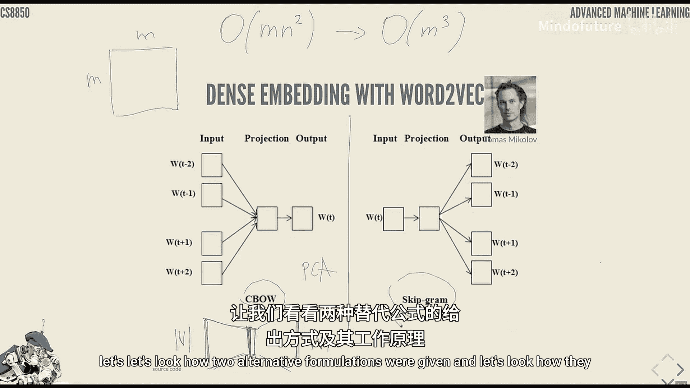
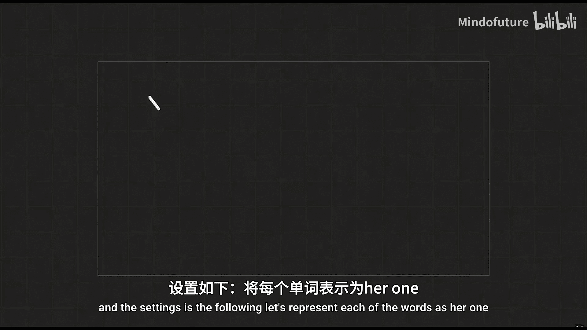
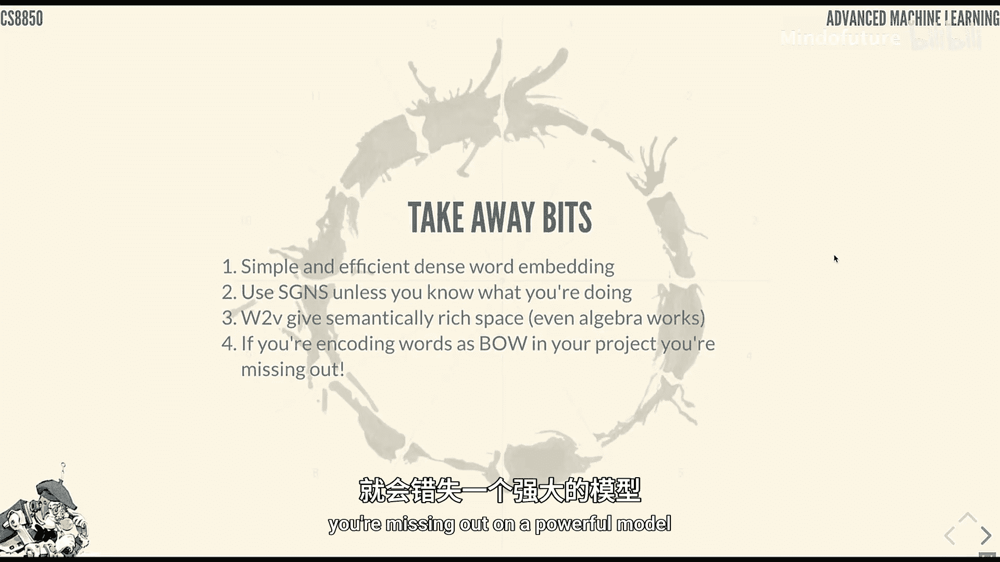

# 高级机器学习主题-CS8850-｜-Advanced-Machine-Learning-p73-P73_词嵌入-word2vec--BV1sapPz4Ewx_p73-

With vectorization of semantic similarity metrics。We saw that。

Tens em beddings could represent useful information precisely by following Ludwig Wittenstein's definition of word meaning。

That is context co occurrencerence of in the same context。And they could be short， and importantly。

 they could be dense because for learning models。And actually for other machine learning models。

 but for deep learning models， more importantly， the input needs to be tense。Matrix App。

 matrix multiplication operations in a neural network。They work better with dense inputs。

So to address that problem。And in general， to try to represent。Awards。In dance。What factorsors。

The following approach has emerged， approached for Tibec。

Approach called World toveg due to Thomasj Mikoov and coauths。And。Of course， we could obtain。

 we could theoretically obtain word vectors by decomposingity word similarity。

Our word context similarity matrix using singular value decomposition。

 but singular value decomposition is。Practically cubic and its complexity。啊。So。

Because our matrix for a non symmetric matrix， right for M by n matrix singular value decomposition when it is truncated。

Is M times n square order of magnitude。AP in the bignotation。 But since M and M are equals。

That is nothing but。M cube。When we use just the words as。contexttt。Okay。

 so what did Tamaian colleagues come up with， Then some Beningu were to read。

 Let's look at the following。Problem that may be familiar to you from or not a problem。

 but a settings that may be familiar to you。From auto encoder， let's。嗯。Represent。Our world。

Inmput word。As a projection。From ten from a sparse space。就诶。

Hide from a hard dimensional sparse space。That is the size of the vocabulary to some。

So a D dimensional space。 and then。As。Projection。Back into。F dimensional space。😔。

Only this is like anotherr。linear auto encodeder as well。 There is there are no no it is here。

 Remember where you've seen linear auto encoder on。All。In this class， yes， in I other representation。

 linear think got the representation of PCA。A youical。Let's。

 let's look how two alternative formulations were given。 And let's look how they work。

 But before I go into this this， let's give some settings。 So， and the settings is the following。

 Let's represent each of the words as。

Her one in cave，1 hot and co it。factoror。So， we have zeros。Almost everywhere。And one。Is at the。

Ordering original， basically， the position of word。I。This will be our input。

 Let's represent all of our。From 0。To the size of the vocabulary， -1 vector。

Let's represent one one hot encoded each word in the dictionary。Oh。That we have the train。So first。

 let's consider the。Continuous。Bag。Of wordss and cutting。So what continuous by awards does。Is simple。

 despite this confusing figure。What it does， it says， okay。We have。Ebedding matrix。W encoder。

And this matrix。Should be of size。Well， let me slightly change my notation。 so it's a little clearer。

Just onenot。So is， it's of size V。八字。Where cardinality of vocabulary of B is the number of words in our vocabulary and D is the dimensionality of our embedding space。

So if we have a word represented as one h and housing。Let's circle it W。hi。Then， we have W E。

Transpose times W I where W I is that one hotd column vector。And then we'll get our em。

Let's call it Phi。失吧。Then， we have another matrix。So remember， in。And最个。So W E。WG。The the D。WT。

Has dimensions。Well， the same， but transposed。子。Bye。你。So， we take。W will you。T transpose。

And we want this result。The B prediction。That reconstructs。A particular word。

So continuous baggo awards。That's the following。Look at this。Product。Look at。Yeah， let's throw。你为。呃。

看能减飞。😔，This is our encoder transpose。Encoder transports is multiplied by a binary binary。Pattrix。

W sub I。What it does it。ches。Picks a binary matrix。Because， well， not only binary。

 it's one hearten coded。It only depicts one column。Oh。The encoder matrix。Transposed。

1 D dimensional column。The rest just don't matter。RightThis doesn't play any at all for this matrix。

And we got an em Beijingdding。Each word。No。That was originally represented as one high encoded und vector。

Now is represented by tense factor。And if we take one word， v sub W sub I。

And we want to generate or predict W sub J。Then。We take。Another matrix。Whathi did we call it this is。

Emazing V。And。We can do V subi transpose W T。😔，A WD。Is。Of course。And the， this is。The matrix。

 this is the vector。 It's now a dense。Matrix。But the result that we want to recreate。

And I'm transposing it。better be binary。When were predicting one word， one hot encoded。

 we only want this number to be one， but notice that。What it means is that we only care。Again。

About one single column in the decoder。This one single column。

At the position of our expected output of the word J。Is what we want to estimate。 So we want W I。

Transpose O V， I transpose times W， J。Or WG。A ja location。Slightly missing up the notation。

 Let's put it like that。😔，So we want this inner our product。To be closer to one。

 while the rest suppressed。What that's when word one word is spread exited from another。

 So what continues by the words does is。Look at all of the context。All of the contexts， say。

We have our text， whereas word1， some preposition， War two， some longer word， some other preposition。

So we scan through our text with a window of。Size， say 5。And we say， okay， this is our context。

Slide this window one words to the right。And you'll get slightly different context， but。

This is our context。If this is our target wordd。This is our target word。And continuous bag of wars。

 seabel。It tells us。Take word 1，2。4 and 5。And simultaneously from these words predict toward the target word 3。

The way it translates to the matrix multiplication model is。We take our input。

Which was previously one hot encode coded for each word。 and just put once。Add those four positions。

That and so on somewhere there。 There's four positions that correspond。

To those four words in the dictionary。Then we'll just multiply W E times this matrix that encodes the。

Context。And as you see equivalently， we just summed summed together。Those arose in W E matrix。

That correspond to embedding of the context words。And from this。

 we want to reconstruct a binary one hot encoded vector with just one element。That is one。So。

This can be decomposed into matrix vector。A multiplication。

And it can be also solved by gradient descent， if we defined。If we can define。嗯。Appropriate loss。

 And in order to define appropriate loss， not just what we're doing here， we have。Categories。

 and we predict only one of them， we want to predict only one of them。

 and the V category is the size of the vocabulary and only one max。

 it should remind you immediately of soft marks。Over soft masks。嗯。Yeah。

 the output of our prediction since we know what word we're expecting as the output。That is words J。

In we compute the value。诶。Yeah， so our output will be our output before softm。 Let's write it here。

IWill be。呃。This is dider。In our presentationation that we just developed in a quarter。😔。

And this is our input word。But。Well， as you figured out。That we don't need。

To multiply input words independently we can use one combined vector， that's how CBO uses it。

Uses the input。And also notice that this product can be。

Can be compute super efficiently because we know where non zero elements are。

 and we only use those columns of。W E transpose that correspond to those non zero elements。

 and we just sum those columns。That's it。 We don't need to go through test which could be 10 to the 7。

Millions of awards， right？But then those are a dense vector times dense matrix where this vector is cheap to compute。

But now it's dense factor times， tense matrix separation， which is not cheap， which is。

Maybeav E times t。Element。Or者 V times the。Complexity， multiplications。 once we've done that。

 we can compute the value of our output。That in the following way。

 this value lets denote why hat are estimate。By using softms will be E。都。Are em。Times。诶。The the。

Column of W G。The codingding matrix。That corresponds to the word J that we want to predict。And。

For soft wax。啊 we。Do。I believe well actually， this is J because this is em bedding。对。She。自。我键 to be。

Precise and not overload an notation。This runs through all of the words。 once we have y。

We can compute our loss。 our loss now。Is。Simply cross entrytropy laws。

And since we're expecting zeros everywhere， but just at this location。That's it。 That's all it is。

 The problems with Cba is that。We need to compute the sum to compute the soft marks over all of the vocabulary。

AndThat's computational indenr。And then when we do back propagation。

 when we compute back propagation， we need another multiplication of the transposed decoder matrix WD。

With the resulting， the output vector that we。Still need to compute， even though。

The loss is just cross centbus。This board is now has a lot of。Color and lot of writing on it， but。

The essence of the model is very simple。Take a binary vector of all of the words that form the context of a target word。

Compute in Beijing。Even though we write it as a matrix multiplication。

 but it's nothing but the sum of the corresponding rows of encoder matrix W E。等。

You have to do then inspectter matrix multiplication with the decoder matrix。Apply softms。

 compute crosscenttropy， and keep optimizing。Looks good and nice， but unfortunately。

It doesn't work that great in practice has something else that I will tell you about in a second。

One more thing about。Continuous bag awards， Cal model。Remember， where started。

With representing our context as binary。呃。1 hot and coated vectors。

But what we wanted here in the em Beijing。To be the sum of the resulting embeddings， right。Is of。

Dimension vocabulary times。 That is R T。Since we want。A sum of the desired beddings here。

 it equivalent of all of our context words。T-2 times。He transfers。Plus。W E transpos at T-1 plus W， E。

Transpose W T plus 1， and plus W。TW。一不。Which is turn is equivalent。W B transse。W T-2。Plus。

T-1 plus W T plus 1 plus W T plus 2。 But each of them is one hot encoded binary vector。

Which means wait the second just take our encoding matrix and multiplied by a single binary vector。

With one the positions corresponding to these words， that is clear， right。Then， we have the order。

And our prediction training。By soft masks。At least。Is clear， I hope， and。Theoretically。Possible。

 right， There is no conceptual difficulties with training a model like that。 But wait。

 the main question that we need to answer is we started with one hot encode as。 we need to produce。

The dictionary。Before we had like， word cat。Cresponds to this vector word dog。

Response to another vector。 And for each of those， we had for each of the words in the vocabulary。

 We had one hot and color vector with dimension。Cardiinity of the vocabulary， Carigity of P。

 After the training， we take our VE。The W E sorry， the encoder matrix。And。They encoder matrix。Is。

T very size D。Where， by the same rule by this one tells us that a corresponding role。

That corresponding position。Is now after training。The dance Beijing of the world cat。

So for each of the words in the vocabulary， we got a tense in Beijing。

 and that's the result of World2V in CBo skip grab， similarly we take after the training。

 we take WE the encoing matrix and use the rows as the encoding。But again。

 when explaining all of that。I did not at all talk about。Computational complexity。Skip gra model。

Let's first talk about skipG。And again。We look at the。Gd one or。Frother。Wt。

It see minus stool or word。T-1， the target word。Orward C plus 1 and word C plus 2。

So well look at the context。And now， instead of。Something that seemed logical， instead of。

Prejecticing our target。From the context， the words。

Let's try to predict the context words from the target。So counterintu。Similarly to before。

We have W target。Represented as one hot， ined word。We multiply this W target。

By our word eming matrix。Or encoder。To get。The。Target the dimensional target emeddding。

So just let a change color for consistency。We have W E。Transpo。他。They are all okay。

 let's not use that。 They're all vectors。What this is， in fact。

 because this is just the binary matrix。What this says is just pick the row of W E that corresponds to the index of the target word。

But then。We take。W。Take quarter。And multiplly by。The embedding。Okay。

And reconstruct what we want to reconstruct。We want to reconstruct。Again， soft marks， but we want。

Probability vector such that。Of the provalences。That corresponds to these four vectors in the context。

 and we choose our parameter to be5。换一个。Which is our context size parameter to be5。And we warned。嗯。

The locations that don't correspond to the words and the concept to be minimum。

 minimal and the ones that correspond。ToTo be closer to one。

 they can't all be simultaneously closer to one because。Softmark verbalizes this。搞第二节。

To sum up to one， but。They can be still maximumimal probability among all other possible options。

And doing stochastic gradientding the sand using。Yeah， using cross entropy as our lowest。

 we can optimize skip Gr model。But。Face computation and backward computation with backpro through this。

Element because of the size of the dictionary。Ithich could be a million。Element or。

Millions of words is problematic。Like， we need to compute。

Order of a million or 10 million operations， depending on the size of your vocabulary。嗯。

Each time we compute the forward pass， that's to compute the softm。

 And each time we backpro through this thats when we compute。嗯。

when we optimize the model with the cross entropys。

 that's kind of sad because it's a nice model and it was found to work better in practice that seabo Sgram。

Well， but lucky for us， Taash and colleagues， they found a way how to。Simplify the computation。

 and optimize。Skipgram model。Dramatically， and。This what they found is called negative sampling。

Which is a simplified version of noise contrastive estimation。

Computational complexity of Scr is unwieldy for large dictionaries， so we use Scr with negative。Sly。

Ass GNS。And skipgram with negative sampling works beautifully。Again。

 what we use is the observation that because our inputs and output matrix are one hot andd or binary。

For C biomod。We observe that in computation of the specific values of interest from the input and in the output。

 we only need corresponding rows and columns of our。Encoder。And the other。Matricsses。So， in order。

To avoid。Normalization of a softm with respect to the whole vector。

Of all of the words and vocabulary。Here's what Tom Mikkoov has suggested and proved that it works quite well。

Let's take。呃。Some context。Like。Tspoon of。Paper cant。Chm A and the sentence continues。

 So our target word now is aprico。And the rest of the words are context。

 So instead of doing CBbo or skipgram。Let's take the same model encoder， decoder。

 the auto encoder linear auto the encoder type。But now， let's。Pick words from the context。Like。

All the bears， Aprico。Tesepoon。A一 pre车子。Jam。Apricott of。Pcut。And， and。Also。

Let's randomly pick words from vocabulary。According to their probilities。

OfThe frequencies in the corpus。That are not in the context of the word aprico。 so it will be。

Apricut。I don't know， pizza。Ymy。Aprico。哦。한。I don't know。Greeze。

And something random that doesn't happen in the context with the word aprico。

And instead of performing all of our predictions， let's formulate。The following for problem。

 let's predict。The probability of the target word。呃。And the context word that is。

 let's predict probability of the target word and the context word。啊。Of appearing together。

And if we can predict this， then we can。Athematicically in this binary classification problem。

Pjectum。The opposite value of。Probbilities of target word and context work not appearing together。So。

 what we can do。How can we start， We can use a proxy。In that product。

We can use embedding of our target word。And。Embazzsing of our context word。

We can use inner product as the proxy of。Probability。

So doesn't that all remind you of logistic regression。

 remember how we went through logistic regression in grade detail。

 how can we turn this product into probability？Well， simply and easily。

 we can use logistic regression now。😔，Ops。We this is embedding of the target。

An embedding of the context word。So this is logistic sigma。 to remember it。

Inner product goes from in minus infinity to infinity。And logistic。Siggno。

Tns anything that goes from minus infinity to infinity to something that goes from0 to 1。

 just like the probability。And by exclusion， we can compute probability of the negative class1 minus the probability of the positive class what。

ANeg sampling does。Now， for this probabilitybils over here。

Negative probability and positive probability。Let's assume our relative to our target。

 the negative context and positive context are independent， so our likelihood。

With respect to the parameters that we're optimizing， that is WE and WD。

Is just the product of the likelihood of individual words。诶。Well， of probabilities here， right？😔。

For the positives and the negatives of target and context。

OrsSo let's keepcr model for what the Vg does。It says let's take the log likelihood。And。

The product will turn into some and willll just separate a log of。APoitive probability。

 given target and context words。Plus， the song of the log。Of negative probability。Going through。Okay。

Negative samples， negative probability。 The condition is there。Trust me。That。

What that will be with the sigmoid function is log of the sigmoid。播放。Context word in a product。

In a product of our target。And the context。Plus。The sum。Not， note what happened here。

 what happens here。When we have one minus。嗯。When we have 1 minus sigmoid。

 we'll get sigmoid into negative。Target transpo context over  one plus 6。冇。E， I mean， exponent。

E to the minus target transpose context。Notow that this is the same as one or want was。

Target transse context。 You can do the algebra， and you'll get this。

 So for the negative samples here。Our log。Will be of sigmoid with negative。He transferpose。

And the corresponding I。Negative word。So now this is our logistic objective function。

 we can optimize it by gradients in descent。Look what is important。 We only at each。

Step of the gradient descent， we only have k plus 1 vector vector multiplications。

There are no million multiplications per each context。

 This is for one target and and one positive word in the context。 We only have K plus1。Time D。

Multipplications because of the complexity of the Spec vector product。

Simultaneously we're only working each it and each gradient update we're only working with one vector with a few sorry with a few importantly。

 vector vector operations。So we selectively update only those products。嗯。That matter。 So before。

 before in the full skipgram model where。Computing soft masks and normalizing everything and in the backward path。

Accounting for that that was much more optimal。In the sense that each iteration was computing the gradient in correct direction。

 but in this case， we are。Encouraging。The product of the target with the context word were to increase while we're suppressing the product of the target with the out of context or negative sample word。

 So if we just try to increase。The word。Product with the corresponding word that is in the context。

 the positive sample。Then we wouldn't be able to control of。 We wouldn't have been controlling。

What happens with other samples， they know that they would arbitrarily increase。

 but that's possible to， but they would increase in a predictable manner by doing this variant of noise contrastive estimation。

We are simultaneously。Trying to maximize inner product between those samples that we want to be close and minimize inner product between those samples that we don't want to be close。

This。ALearning type problem when the learning focuses on pulling similar samples together and thesesimilar samples apart is also called metric learning and the key here is to know that even though we constructed a supervised problem。

Right we have training data， we know that this word should be close to the target word。

 we know that this other word should be far from the target word and we're training it with gradient descent by minimizing the loss here this is actually not a supervised learning problem because we didn't have to label anything。

 we framed the problem as。A problem with label data。

But we did not label or we did't employ any human labelers。or any labelers for that matter。

 we just use the structure of the problem we use the context in the corpus of the words。

 which words come appear together which words words don't appear together this type of learning is an emerging field right now and it's called selfsvised learning field。

Bor to V。Skiip Chme。With negative sampling， very efficient， implemented in multiple places。

 So I can recall of hand at least three。 So one is the original word。To V， you can Google it。

Another one is spay。Backage， very convenient， very simple to use very fast。

 and another one is Gensing package also。Pretty convenient to use。All in Python， of course。

So after we've gotten word vectors。What do you do with them？Well。

 I can do lots of things and all sorts of things。Interestingly。If we look at word vectors。

Say man and woman and subtract one from another。Or simply look at the vectors that connect man and woman。

Uncle and aunt， King and queen， we will find that in word to vector presentations， they are Col here。

Poing in the same direction， we can also do vector algebra。

 we can take word vector for king minus word vector for man plus vector for word vector for woman and we can find the nearest vector in the vocabulary that is near the resulting vector and it will be queen we can do similar vector algebra with word to vector vectors。

 we can take vector for Paris minus vector for France plus vector for Italy in the nearest vector in to where the result of this vector algebra be will be wrong。

Amazing and surprising find。We can also look at like project on some of the vector。

 some of the relationship。Look and again， we see this caity， look king and queen。

 emperor and empress， Duke duchess。Heurl Coness， what is it， nephew， niece， brother， sister。

 uncle aunt， man woman， they all pointing or connecting in the same direction。

 You can also see some degree like slow， slower， slowest。 their location and then short。

 shorter shortest of similar gamma pattern， strong， stronger， strongest than others。

 and this is all just from occurrenceencies， The inside of Ludwig Witgenstein looks like was right。

 There is lots of information， lots of structure in the word context occurrenceencies。

We can study how that， well， language is a living。Animal， it evolves and changes as we change。

 So we can study with war to to。 We can study。Changes of the word meaning excuse me， with the word V。

Because of because the。Language is a living animal， it keeps changing with time。

 we can study the changes in language using word of egg with respect to how the meaning of words was changing from 1900 to the thousandss。

Let's look at this this is based on 30 million books from 1850 to 1990 from Google Book data。

 look how the word gay， for example， changes from 1900 to the 1950s and 1990s in  。

Hundreds gay is surrounded by draft， daft， flnty， tasteful， and then slowly it goes through cheerful。

 sweet pleasant and in 1950s， the meaning was bright， wy。

 what else and then to the 1990s we get into the bisexual usage of the word gay。

 that's quite transition of meaning through just 100 years。

 similar stuff but now caused by different changes in society。

 those are more of a humanitarian type changes， the society gets more humanistic， more tolerant。

And those are more technologically inspired changes in 1850 broadcast was to seed。

 so to spread around， to scatter in the 19s and00s。

 it was to circulate a newspaper and things like that and then closer to the 1990s。

 its radio television broadcast， something that we used to know still。Similar with the word awful。

 as you know， words awful go through reversal of meaning。So majestic， sullen old dread。

 it goes horrible， apparentlying terrible to back to wonderful， weird and awfully。

 that's interesting， simple。Word context occurrence contains。

Such reach information that it's a shame if you're working on your project and not using word vector representation when representing your words。

 you're losing out on a lot of that structure that the model now doesn't have to learn。

 it's pretrained and the model that you're training for sentiment analysis and for other types of predictions from the text。

Can just start jump start or worm start from this rich body of information already embedded into into the word vectors instead of trying to learn the this。

Starting from just merely convenient placement of words in a vector space that the classical bag wordss model gives you。

So take away bits， simple and efficient dense word bedding。

 use skipcrme negative sampling unless you know what you're doing。Wder beg。Give semantically reach。

 give semantically rich space， even algebra works and。

To the point I just made if you' en codinging wordss as bygo awards in your project。

You're missing out on a powerful model。

