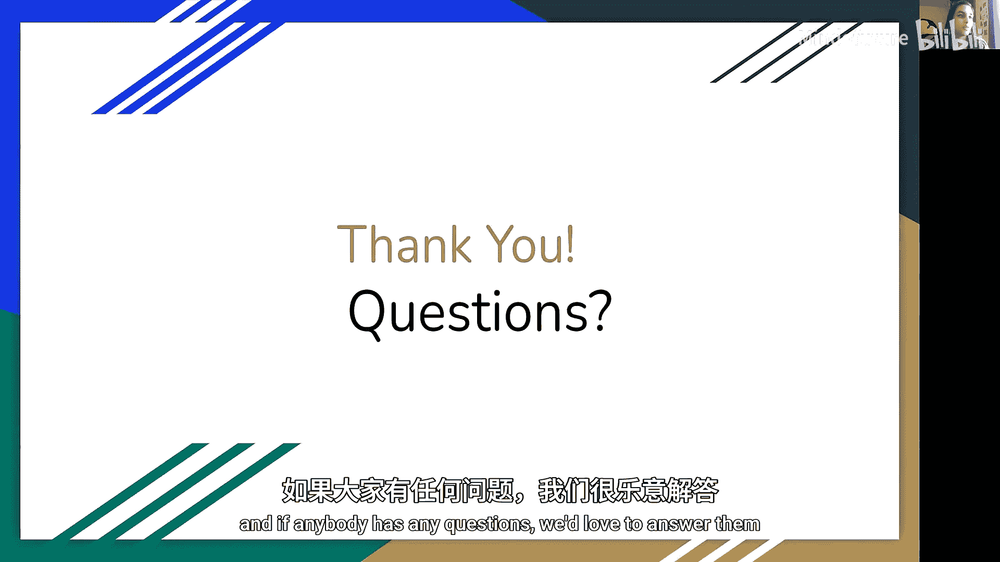

# 高级机器学习主题-CS8850-｜-Advanced-Machine-Learning-p74-P74_2021F_新闻黑手党--BV1sapPz4Ewx_p74-

ok kiss go ahead。

Okay， so our team name is News mafia， and we're doing the Mowali News classification challengeenge。

Soくり Godさ。So for this， we're doing this because there's undersource languages in large texts。

 such for like this language for Chichoa， which is an African language in the South and Southeastern and Eastern countries of Africa and the importance of this is to know the deeper understanding and machine learning algorithms to classify the text apparently。

 appropriately the application of the text classification is so we can categorize them in the proper classifications for the。

Useed。Next slide。All right， so the main steps。For implementing any language model。

 we have to first perform a sequence of operations， the first one is data processing。

 essentially cleaning out the text and making it suitable for the model。

And then we train the model and eventually be evaluated and fine to our model。

So data cleaning and data preprocessing， one of the most important things in any language based model is removing unwanted characters。

 these could be punctuation marks， HTML tags， and all the good stuff which can really affect the QC our model。

Changing everything to either lower or uppercase to maintain consistency。Deleting stop。

 stop wordss are those words such as and or if which are used very frequently and thus don't have a lot of semantic value。

嗯。Breaking attached words like sometimes。The words may be attached。

 it's pretty self explanatory and stemming is essentially removing inflection points and inflection words to maintain consistency in the text and essentially having good words。

So our data consists of 1436 news articles and each article has a label in the training stuff。

And as you can see here in the first one here and in the first one here。

 we don't make it all lowercase， we've removed any punctuation marks。

And that's how we did our pre processing and each news article has about 15 to 16 distinct sentences。

 so in total we had about 16，501 sentences。Along with 20 labels。And once again。

 this is how we did that， we also have a word count for each sentence。

 we found this was our data exploration and preprocess step。

And we also use stratified Kfold cross validation to maintain consistency。

 and we also did encounter class imbalance for our baseline model， we just use stratified Kfold。

 but as we go towards our final model， we probably be looking at different ways to counteract that and work with the class imbalances。

So for our baseline model， we were able to implement some models， we implemented the knife base。

 the support vector machines and the random forest。So we。

We implemented these using the count vector and the TF IDF。

 which is term frequency inverse document frequency， which is a method of converting。

Language into model suitable data。And the best results we have gotten so far were through night base。

 which are about 45%。In the leaderboard for the competition， the highest result so far is about 66%。

 so for a baseline model it's not too far off。Does Ill back to you so for currently we're at a point where we understood and analyzed the initial data we have some of the preprocessing done and we have a working baseline model like we said earlier it's not at the optimal place so we still have to refine it and we are going to experiment more with text processing。

Things like bag of words where to vectors and BRT and we're still looking around and just experimenting and seeing what we could find so at this point we're just kind of playing around with the data and seeing how to make it better we're comparing our results with the accuracy with other metrics so we can just optimize it at the best and we're trying to win the competition。

Let me go to the next slide so the competition itself is a Cindy Africa complicated is hosted by C Africa and which is a African social enterprise and it's made to make the ecosystem of Africa better itself so there's a competition link and the due date is May 9th so it does coincide with the semesters end date so that's why we kind of chose it。

Next slide， please。To help with the project and everything since there are six members and there's a lot of us we do have a Github repo that is up and running we have our initial data sets and everything on there so we'll be using that along with if you go to the next slide you can see that we're using。

Jamboard from Google which is similar to caban to replace it and this is going to allow us to figure out what we need to do what's being processed and completed where we can assign tasks and due dates so everything's set up so we know。

Everything about the project。And if anybody has any questions， we'd love to answer them。

