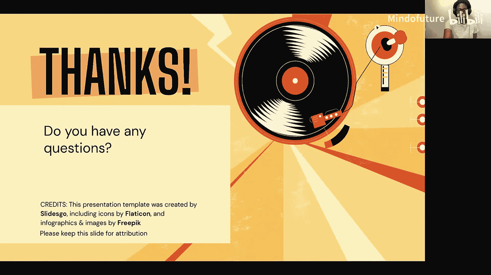

# 高级机器学习主题-CS8850-｜-Advanced-Machine-Learning-p75-P75_2021S_Spotify--BV1sapPz4Ewx_p75-

Sa go。

Okay hi everyone we're going to talk about the Spotify million playlist data challengege my name is Zara I am a getting my master's at GSU in math of a site a concentration in scientific computing。

😊，I am Mujusha I'm doing my PhD PhD in chemistry at GSU I'm also taking up some computer science courses I want to be a data scientist someday so yeah。

😊，right so just to introduce a topic to date over 4 billion playlists have been created and shared by Spotify users and people create playlists for all sorts of reasons so they might create it based on genre or their favorite artist。

 they might also create it based off of the mood so maybe they have a sad playlist for instance。

 or they might have it for a particular purpose so a playlist specifically for working out but the main point is that regardless of the reason every playlist is generally created with some type of intrinsic meaning or purpose for the user themselves so by analyzing the nature of an individual's playlist。

 Spotify is able to suggest other tracks that a listener would enjoy in the context of a given playlist so this can make playlist creation not only easier but it can also help people find more of the music that they love。

So the goal for this challenge is to develop a system for the task of automatic playlist continuation so given a particular set of playlist features so something like artist or the title of your playlist the system should be able to take in all of that information and generate a list of recommended tracks that should be added to that playlist so thereby continuing the playlist so to put it in terms of like a function what would be the input would be the user created playlist and what we are expected to output would be a list of 500 different recommended tracks that could be added to that playlist。

So why this does actually matter so if we think about it the online world is very personalized right so if you wanted to go into Google and you type in perceptron algorithm imagine you get back like pictures of a bunch of fruits right so this seems really silly because our minds are geared with certain expectations so if you type in X Y and Z and any given search engine whether it be Google or whether it be on a store website you're expecting to get personalized and accurate recommendations for any of those products or any information regarding X Y and Z even if you make misspelling errors or any other limited errors on your side you still expect that accuracy so failing to meet these expectations can not only lead to consumer dissatisfaction but it can also mean missed opportunities on introducing consumers to new products that are relevant to them。

So this is more than just a ranking problem for Spotify this can also of course influence other types of media。

 so YouTube Netflix and Hulu all of those different recommending algorithms as well。

 but we can also think of it as in terms of Google searches news article recommendations。

 store product recommendations all of those types of things as well so if we can create an algorithm that can accurately predict user preferences for Spotify of course this can be applied in many other areas which are very important as well。

Okay， let's talk about the data for this challenge so basically this challenge has two types of data first is the training data which is basically Spotify's million playlist dataset the size of this data is around 5。

4 G so as you all know Spotify has like around 4 billion public playlists so this particular data has around 1 million playlists containing 2 billion tracks from around 300000 artists。

😊，So the basic features of this data set is basically the name of the playlist。

The tracks in the playlist， some metadata of these tracks like track ID， etc ce。

 and other meta fields like last edit time， number of playlist edit， etc。

So basically each playlist in itself is a JSON file。😊，We can look at the playlists。

Snapshot yeah so this is just one playlist from the MPD data set so i'll go through this really quick So let's say the name of this playlist is musical and then it has some information regarding how many tracks it has and the number of followers etc so it positions zero of the track list we have。

Artist Deji Hungs song and then we have some information regarding this song and then at different positions we have different songs so basically what we think is the data set is pretty clean and most of the information that is in there is useful for our machine learning algorithm。

😊，The next。Data set that we have is the test data Basically this is the challenge data This data contains around 10000 playlists with either  one2。

5 or 100 seed songs。 There are some playlists which don't have any seed songs at all。

 so let us look at the challenge data set。😊，So if you see this challenge dataset set it has like around 10。

000 playlist I'll try to focus on this particular playlist which is playlist number 9992 so if you see the name of this playlist is body like a backro and this has around 12 tracks but 11 tracks have been withheld by Spotify so what we see right now is just one track which is the track called body like a backro so based on the name of the playlist some of the metadata and based on this particular song we have to suggest around 500 songs for this playlist to continue this playlist。

😊，So we were thinking about some base models that we could use for this challenge。

 This is basically a recommendationbased challenge。

 There are two types of filtering models that generally are used for recommendation based models One of them is the collaborative filtering So what is collaborative filtering let's say Ozaara has a playlist with Michael Jackson and Coleplay in it and Spotify needs to suggest some songs for my playlist and I also have those two songs in my playlist So it's gonna see similarity between the song choices for Ozara and me and then recommend me some songs from her playlist So do you see it's like it mimics user to user recommendation So the machine learning model which generally works for such collaborative filtering models is gay means modeling so we would like to start there and then some other options that we have。

😊，Have is。There is another type of filtering known as content based filtering。

 So let's say I'm listening to sad songs today by let's say Colplay。

 So Spotify sees that I am giving preference to those product features。

 which is like the genre then the artist and based on those genre and artist it's gonna recommend me some other songs。

 So that's basically content based filtering and we can try something like knife based classifier for that。

 but we need to get some more metadata regarding the tracks。 so we are missing metadata like genre。

 which we think is very important for this this kind of classification。😊。

And on that note we can also look at Perceptronn using the inputs as different features of the music such as genre。

 playlist， title artists and so on so forth so as an example suppose we have a playlist with a lot of country music right so then genre is really important to that playlist so we would know that the weights for genre would be high as on contrast let's say that we have a playlist with a lot of different artists like a lot of variability for the artists so we would know that the artists might have a smaller weight in that regard so we would say that genre will be more important to this particular person's playlist so from there we could create a weighted sum and make decisions based off of the different numbers that we get。

So the evaluation metrics for performance we're doing that at both the track level and the artist level so if we let the set G but the set G represents the truth set of tracks and then our represent the tracks that we're going to recommend to the user we can look at our our precision so our precision is going to take the intersection between both the truth set and then our set and then divided by the total amounts of tracks and the truth set so we can kind of think of this as the percentage that we got like correct so ideally of course we want to get this number to be as close to one as possible and we're also going to have the recommended song clicks so recommended song clicks is basically the number of clicks required before a relevant song is encountered so of course ideally we want to keep this number low we don't want them to continue clicking until they finally get to a relevant song。

So what needs to be done from here， we need to go ahead and commit to one of the models that we discussed。

 actually implement and train our model and then test it using the test data set that they provide it to us and analyze its performance using the metrics that we talked about in the previous slide。

😊，So let's talk about where the competition is right now。

 So this is an open ended AI crowd competition。 And I was looking through some of the metrics that other people have achieved。

 So the best I could find is basically our precision of around022 and the number of clicks before a relevant song is encountered is 1。

9， which is around2， which is pretty low already， but yeah， we with our model。

 we aim to we aim to better those numbers。 yeah。😊，All right， thank you everyone， thank you everyone。

😊，She。

