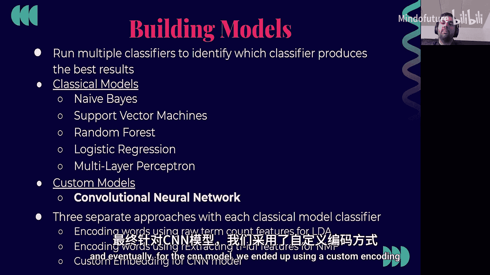
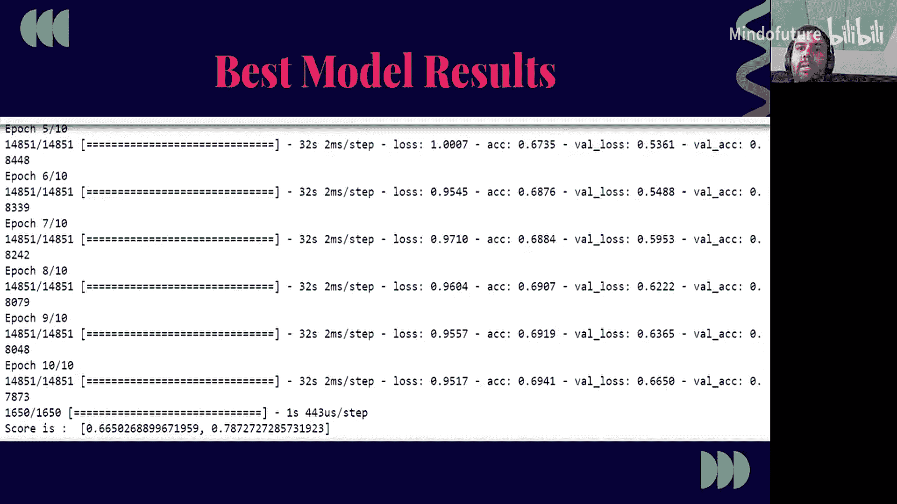

# 高级机器学习主题-CS8850-｜-Advanced-Machine-Learning-p76-P76_新闻黑手党最终项目演示--BV1sapPz4Ewx_p76-

Go ahead， you're on there Okay， everyone， my name is8 gunerson and I'll be presenting on behalf of my group News mafia。

The topic of our project is Malawi New classification。

So this is going to be the outline of our presentation so we're going to start with the introduction and then move on to the presentation。

 which is going to be the data exploration prepro in the models。

Then we're going to go to analysis results， and then the conclusion。So introduction。So as I said。

 our topic is classifying Malawi news。So it's basically a multi label classification of the language Chicha。

 which is a language in the Pantu family it is spoken in。largearge parts of Africa， mainly southern。

 southeastern and eastern Africa， it is the official language of Malaia and Zmbia。

And it's spoken in many different other African languages。Counries。

 so our objective is basically to predict the topic of articles written articles written in Chiwa coming from a Malawi news publication。

So why do we want to？Do this project， what's the motivation？Um， so。

Working with under resource languages such as many languages in Africa。

 there's a lot of problems and challenges creating algorithms for these languages。

So what we ultimately wanted to do was improve techniques for text classification and algorithms for this language Chia。

We were hoping that this would open up new research domains。For this language in market。

 cultural and political studies。So before we started。

 we had to make a few assumptions for this project。

 and these are that all of the text that is included in the articles is written in this language Chi Chiwa。

All of the articles belong to a topic that is listed in our data set there's no other topics that these articles can belong to。

And thirdly， that all of the classes or topics are mutually exclusive。

 so each article cannot belong to two topics at the same time， it has to belong to only one。

Now I'm going to hand it over to Peush。Can you hear me？All right， now we'll go over the presentation。

 data exploration， preprocessing and our models。Next slide。So getting to know our data， as Egel said。

 the data we used was collected by Lavin use publication。

We split the data into training and testing data sets。

 the training data set consists of 41436 news articles。And for each entry we have an article ID。

 we have the text for the article and then we have a corresponding label and for the whole data we have 2p labels or classes ranging from politics。

 witchcrafts， sports， entertainment， etc， and for the whole data we also have551。

137 unique words in the Chiecheva language。And your testing dataset set consists of 621 articles。

 and it's the same as the training， except it doesn't have the class or label column。And yeah。

 we have 20 classes as well。This is a sample of our data set。

 so we have the article ID on the left side and then we have the article and each article contains about 15 to 16 sentences。

So in the preprocessing the objective was to change the form of the text to make it more predictable and easier to analyze。

 we did this by first of all making everything lowercase， erasing punctua， shelflingging the data。

 and also for the labels， we use two different techniques， label encoding and one hot encoding。

Next slide。So building their models， we tried a lot of different models。

 we learned something from the models that didn't work， and eventually we also reached a model。

 which we call the final model。So we tried some classical models such as knife base。

 support vector machines， random forest， logistic regression， and multiier perceptron。

And eventually what we settled on was a custom convolution neural network。

 which had the best results。And also for encoding the text。In the articles， we tried different。

Techniques such as the raw term count features using LDA linear discriminant analysis。

 and we also use TF IDF。And eventually for the CNN model， we ended up using a custom encoding。

Next slide。So here is a quick summary of some of the models we used。

 we will go over in depth on their analysisS and accuracy accuracy in the next few slides。

We have the knife base， the SM， the R For， the logistic regression， and the neural work。

Based on our first analysis， the multi layerair perceptron had the best accuracy of around 58%。

So I tried to hypert the parameters and that'll be the next slide。So using grid search。

 I was able to find the best parameters for this model。

 but then we realized that it did not generalize well。嗯。

We had we also had class imbalance and there really wasn't like we used term count and PFIDF for word encoding。

 but there really wasn't a pre traineded。Like word2 Wi from a lobby or something of the sword we could use。

 so that was one of the problems we ran into and we tried to account that in our CNN。Next slide。

So this is a quick summary of the conution neural network we used。We had a total of 200。

000 traindable parameters， we also used tenfold cross validation and we also used custom word embedding。

Next slide。So I'll go over some of the layers we have， we have an embedding layer， a dropout layer。

A few conilational layers， max pooling， dense layer， dropout activation， and one more dense。

The max pooling and dropout layers also help in regularization and they also help with dealing with orefitting。

Next slide。So using this model， we achieved an accuracy of 78% and we'll talk more about this in the next slides。

Thank you。All right， so let me go over the analysis and the results of our models。see， here we go。

So i'm going to start with the TF IDF approach for the classical classifiers。

 so TF IDF is essentially it evaluates how relevant words are to the whole article and how how。

How much they affect the article in their prediction？So using this approach。

 the average accuracy for extracting the TF ID features for non negative major factorization。

 it was 35。06。Which is not great the best performing TFIDF model was a logistic regression classifier。

 which only predicted 37。4% of the time correctly。So we needed to fund a different classifier。

So for the second approach， we used the LDA linear discriment analysis。

And this is the emotionality reduction technique。😊，So as I said， this reduces the dimensionality。

But it still retains。The the information of the data set so using this approach using the raw term count features for LTA was 49。

5 for all for the average of the five classical models， which is better than the TF IDF。

 which was good。And the best performing LDM model was the MLP。

 the multi layerron multi layer perceptron classifier， which predicted the。Article correctly 58。

6% of the time， which is a lot better than the 37 from the TF IDF。

So this was a summary of these two models， I think this was the。The linear discriminant analysis。

 so as you can see。It's the MLP and the logistic regression are the most accurate ones。

Compared to the knife base SVM and the random forest。

But let's move on to the convolution neural network。So。嗯。

The custom convolutional neural network model that we created produced the best results。

So it was interesting that we decided to use a tenfold cross validation method。And without it。

 the accuracyG was only 20。4% on the test data set， which is way worse than。

Both the TFIDF and also the LDA approaches with the other classifiers。But when we use the arm。

When we used the T cross validation technique， it peaked at 78。2%。On the test data set。

 which is significantly higher than any other classifier that we've built。Which is interesting。

So to conclude this project and presentation。We were able to build and produce a fairly accurate model that predicts the the Che article topic。

So the convolution model produced the best results。Compared to the other class。

Classical models with TF IDF and also the LDA approaches。But was it was interesting this。

Project because。Working with these underred languages。嗯。

It has so many difficulties and problems because you can't use some of the pre processingces techniques that you would usually when you're working with languages such as English or Spanish or whatever。

So you can't use stop worse normalization， limititization and stemming that you would usually use to pre processcess the data with natural language。

 so it is difficult to develop a highly accurate model when you're working with these underred languages。

U。So for the future。We would like to you know develop deeper models that utilize new methods like residual networks there's always you know new new。

New models that we didn't try up maybe and would work well。

Also you developing a model to identify stop wordss in this language would be very helpful just for this this project。

 this problem， because if you can identify as stop wordss， then it's it's a lot easier to。

buuilt a more accurate model， so this is definitely something to do in the future is identify Stockworths not only for to Chi but for other African languages as well。

😊，And then also what we can do is study the performance of this model， the CNN model。

 and also the other models that we produced using new metrics， not just the F1 and the accuracy。

 but using other metrics to identify the best model。So this is our Gitthub history。

 the Canban board and the project， near the report I mean。We were unable to submit。

The result or the model to the competition。As of right now。

 we just have to kind of tweak the code a little bit to be able to do that， but the deadlines not。

Here yes， so hopefully we will。Do that soon。Within the next few days。Thank you everyone。

 for listening from all of our team members。Do you have any questions？Yeah。

 thanks for the presentation， that was actually quicker than anything else in this class。

 but so if you have anything to add。You still have about five minutes， yeah， six minutes。Well。

 in any case， does anyone have questions beside me？

Okay I of course I have some questions so it's interesting like again I haven't some stuff that is unclear like you're saying we removed the punctuation marks and then shuffle the data did you shuffle the words the letters or what do you mean by shuffling the data like you started with lower casing and then like shuffling that's confusing what do you mean by shuffling the data there？

SomebodyExcuse me， Professor may I answer your question。So we shuffled actually the sentences。

So we have 2 sentences for each article and we have one label for each article。

 so we shuffled the all the sentences are labels。So you're predicting which sentences。

 which actually which category belongs to which sentence。Forll each sentence。Okay。

 so but you just mean you mean you randomized your batches or whatever becauses for or randomized your samples right it's only it's only relevant for stochastic learning right or for spliting and things like。

Yeah， so we actually random randomly shows different sentences to train the model。

In our for each patches。Not only relevant to your CNN models right， Yeah exactly exactly。

So 58% accuracy， what does it mean is it like again one versus all average， yeah exactly ones us。

He's long， right？Yeah， yeah。And you didn't look at class specific accuracy in confusion matrix。

 so you don't know if one class dominated everyone。Yeah。

So we are going to actually study the confusion matrix in next step。

Maybe we can put it in the actually submitteded report。Okay， okay， yeah。

 because it is unclear when you what you're optimizing if you don't know if your model is just predicting one class correctly and the rest is incorrectly what is the size of your largest class how many samples are there。

So percentage。Let me ask you about the number。not the exact number。

 but percentage relative to other something。I think it was around 4。

000 samples in the actually the most frequent class。4000 out of。15。So the know they third。Okay。

 so you're getting you're getting 30% accuracy for free or 25， maybe well。

 28 by just predicting this class。YeahOkay， okay。It's kind of it's kind of another good practice right to not like to use bad metric because you can only get as good as your metric is and I spend three lectures on that but okay so accuracy what do you mean tenfold cross validation and no tenfold cross validation okay let's start without tenfold cross validation what do you do to measure accuracy and we it's still the average accuracy or what is it。

So or without cross validation or re cavefold。Which one do you mean let's start without KF so for for without KfoldD we used the whole data set actually we escalated the data set into train and validation set。

And then we train the model using the train train set and we just。

Evaluate our model in each using the validation set。

And this is the without Kfold validation and you done it once。Yeah， exactly。

And you once how did you select like you didn't have any hyperparameters right everything was known we didn't do any hypermeter parametermeter optimization there。

But in the next step， we use Kfold， I mean， ten0fold actually tenfold cross validation and we actually separated the train set。

Into 10 subsections and we have train and validation set in each of those folds。

We trained the model using those training training set in each fold and be evaluated using the validation set in those fold。

And we repeated the procedure for10 time。And you got 10 numbers。Then finally averaged them yeah。Yeah。

 exactly we averaged the all 10 numbers。So you took 10 numbers and when you average them， you get 78。

78， I remember that the number。I remember that the lowest number was around 60 or 62。

And the highest number was around。Let me check it for a minute。Thank you。81 was for one of the folds。

Okay， but the。Your。No cross validation that gives you 20% is also one of the faults right so why do you not get as low results here。

 This is strange something something you're like theres。

A problem somewhere in the day way you're doing it， the way you're interpreting it。

 there shouldn't be a difference。I like that。And there shouldn't be a huge gap between the accuracy of the first difference。

There is no difference in what you're doing， it's the same thing。

But at the point I was thinking about that there may be an issue in shuffling the data because for the classical models。

 we use the shuffle data we in CNN model， I mean using with kfold validation。

 we use the shuffling data， but in。The first model。

 first CNN model we didn't use the shuffling the data。

 so I was thinking that it may be because of actually the preing support the shuffling the data Okay。

 so maybe because we didn't upload the shuffling data。

Sorry what I'm hearing is those results are invalid tenfold cross foundation is the only reasonable numbers。

 but the first one must be invalid， right？Yeah。😊，So okay， one last question。

 this is your final exam team， three minutes left and if you don't answer it。

 there will be consequences。诶。Now you've done the cross validation， you have the model。

 but I'm your customer， ship me the model， which model will you give me。

 you have 10 models that you've trained。Each one on each fold。

 and I want only one because that's what I will install。So the model that general generalizes best。

 which means that I will test the model using the test data because we have another CSV file which is the test data we can why did not you report those numbers we don't care about the other numbers we only care about the test numbers right？

So yeah， what are those numbers？So we didn't report those numbers here because we actually estimated that there are two files。

 a train set and a test set， both of the files are CSV files。

We used the train set because there was more than 16，000 recordscourse there。

 we escalated that file into training set and test set。

 and then we escalated again the into training set and validations。

So we already have training set validation set and test and we reported the test of that structure wait a second。

 so after so many splitting， what is the size like you're getting like smaller and smaller training data。

 right？Yeah， yeah， but actually the differences between the training set。

 I'm in the main training set， this main CSV file。And the test CSV file is around I mean。

 the main training set is around 16，000 records and the main test that is around 2000 record。

So we epid the training set into two portions。Okay。

 it would have been good to have that on the slides because now I'm confused， but well anyways。

Thanks for presentation， you didn't submit to Kago though right？No。

 because we have to report the accuracy on the test CSV file as well。

That doesn't explain why but we can continue next time maybe thanks for the presentation and all the teams done nice work will still have the report due so whatever I was asking if you can answer my questions in your report that'd be nice I will read all of the reports and we'll see the next teams on Thursday。

