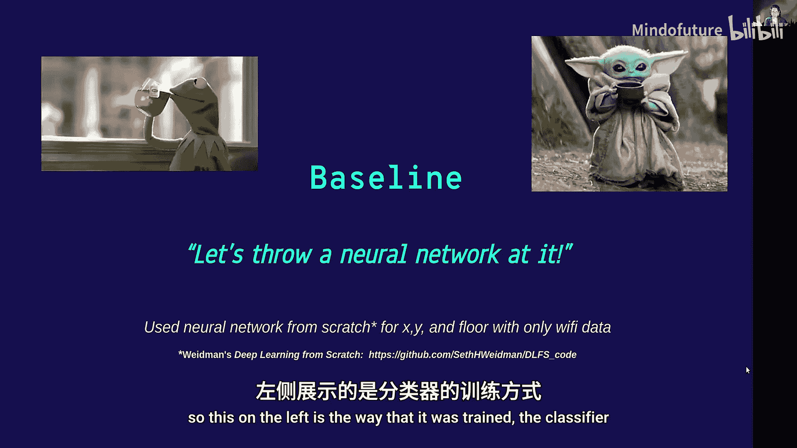
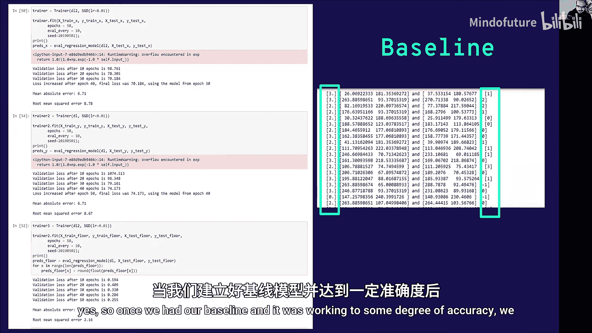
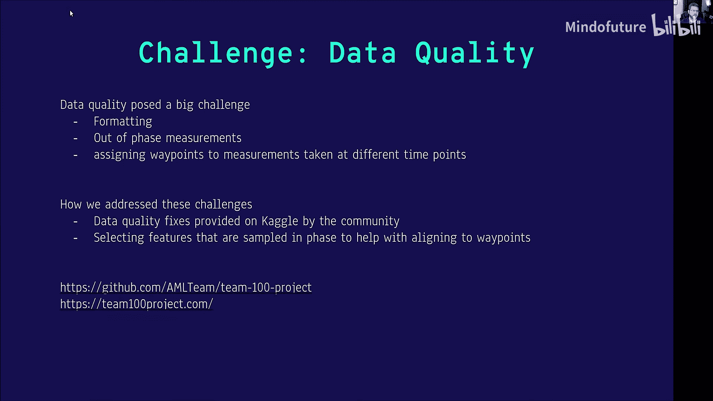
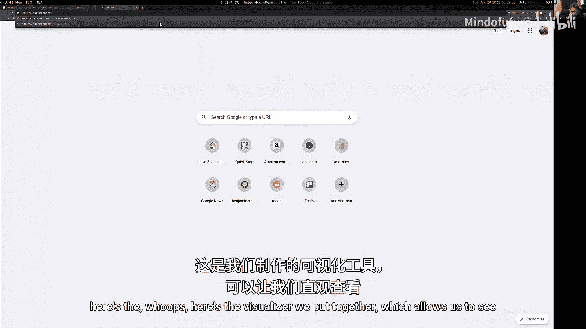
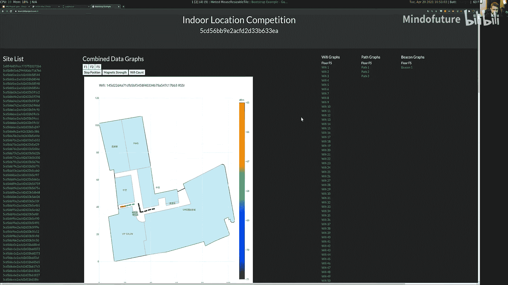
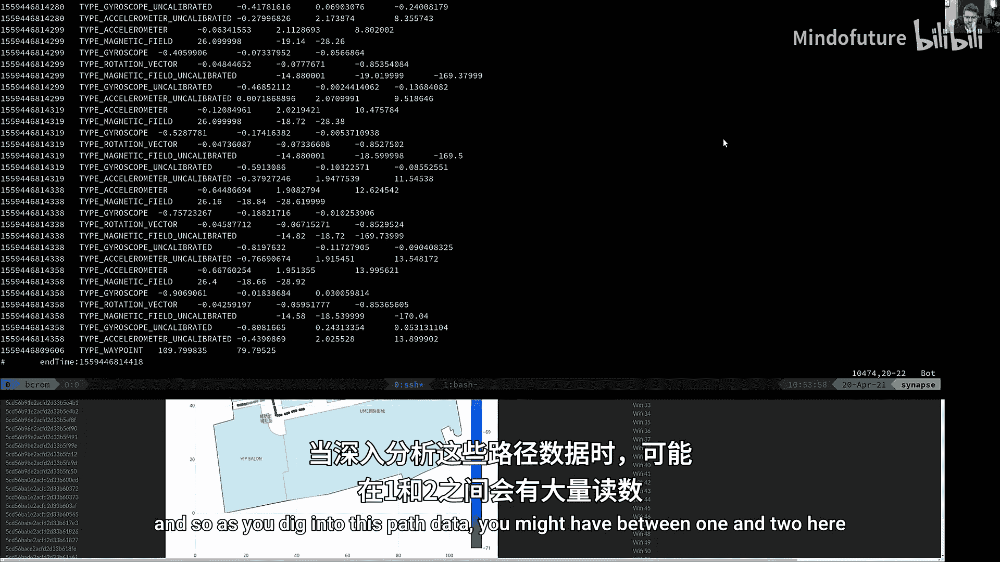
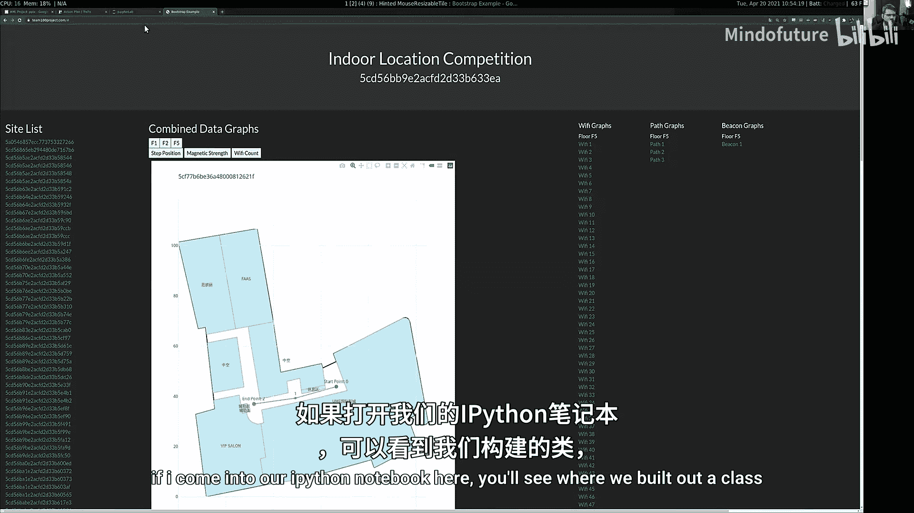
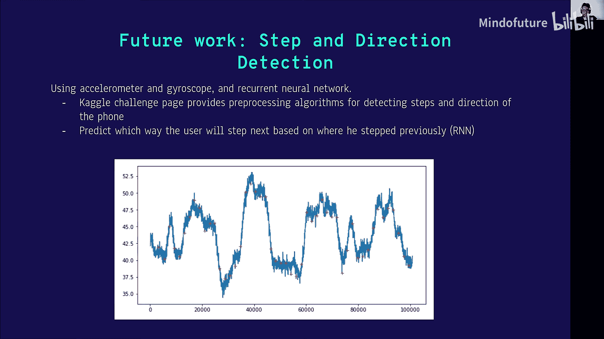

# 高级机器学习主题-CS8850-｜-Advanced-Machine-Learning-p77-P77_Team100的室内定位与导航--BV1sapPz4Ewx_p77-

Ready set go year on error。

Hello everyone， hi we are team Team 100 and I am Sandus and also Benjamin。

 Emma and Danielle and Dansh， this is our team and we will present today award project。

 which is about indoor location and not。Okay。So would you mind clicking more please to all the Quinca thank you Okay so why are we doing this project why it's important and what's the advantage of this project so we want to accurate the indoor positioning we want to improve the response time of emergency services and there is also plenty of advantage like。

For example， if you want to find your store in a mall。

 like if you want to find your brand like Adas or Sephora or any shop you want inside the mall and you cannot find it。

 you can use the into location and then it will show you the path to your shop。

And then also we can use it for other things such as like aid with the tour in museums or travel in the airports。

Next slide， please。Okay so what's the objective of our projects so we want to predict time series of X and Y coordinates and the floor number that trace the pass of the phone through them all so as I said before as they said in the example so for example。

 if you want to find your shop you will find the X and Y coordinate the position exactly of your shop and I would show you the path like a GPS but it's inside。

So we have the ground truth weight points given in the training data and we need to predict the green points。

 which is the path。Next slide， please。So also there is some data collection models so there is some softwares that actually do those things for you so for example AR core so AR core application it's for Android and there is another one also for iPhone it's called AR kit AR kit is you need to pay for it but the AR core for Android it's for free and you can use it also for the same idea there is another application that also similar to the to the idea it's called AR plan 3D and this one this application is also you need to pay for it but。

It will measure it will give you the measurement of the room so both of those application A core and ARP and 3D they collect the data by the real time like real time and when you are in the environment actually so basically you take the picture by or you take the picture of the place or the environment you are in by using your phone camera。

So now I will pass it to Benjamin。Fantastic， so I want to talk a little bit about the data because that turned out to be by far the biggest obstacle of this competition and it was deceptively simple。

 You know this is data collected from or smartphone pretty much with all of the sensors set to record and on its face it's very simple you know we have this large 50 gigabyte trove of you know a couple hundred different locations。

 malls and really it comes down to modeling each individual floor。

 Each floor is its own model and it requires its own or its own you know independent data set and requires its own model。

And we have these， you know features that， you know。

 well not only the test and train data sets as well， but we have these features， which is。

 as I mentioned， every sensor that is on your phone， your gyroscope， rotationation vector。

 magnetic fields， Wifi， Bluetooth， and accelerometers。

And I'll be doing a demo in a little bit to really walk through。

How we preprocess this data and some of the issues that we just really struggled to overcome one of those being that we assumed that all of these that this would either be uniform by position at each position we would have one reading for each one of these sensors and so we would have a nice feature vector or at least that they would be recording at uniform time intervals you know every second we would have one of these data points written and we found neither to be the case that and as I'll dig into in the demo you'll see all of these sensors seem to write data at almost random intervals and they don't ever line up and so getting consistent features and deciding you know how am I either going to partition these values or average them or aggregate the data so that I can get a nice flat feature vector that I can can pipe into my machine learning library it was tremendously challenging not only that we were able to find some data sets that people had already。

Normalized for us， but then the question is how do you submit this to Cale because of course the Cale submission requires that we use the weird irregular timestamp intervals and you know random position points so even if we were able to get good quality uniform data converting it back into a format we could submit to Cale was a real challenge as well so i'll be walking you through some of the code in a little bit that we wrote to try to get around these issues and some of them where we're still looking for better solutions。

Okay， so I'm going to talk a bit about the baseline that we eventually came up with and this is also going to be a section just about all of our models so you can go to the next slide。

So our baseline， I don't know if you remember but we had like a fairly complicated idea and it was going to parse everything into unique squares and then we're going to do linear regression on it well we decided to instead do a very simple baseline and just throw everything into a neural network so we got an X and y in a floor each each one had its own neural network and and then this neural network we used was actually from a book that I had been reading and it was one that was from scratch and so I was able to see all of the steps and like how it all went through there so I just thought that was a really neat thing and we got a pretty good score you can go to the next slide。

So this on the left is the way that it was trained。

 the classifier so the top one is for the X and then the middle one is for the Y and then the bottom one was for the floor。

 we really just threw the wall in there and then for the baseline this is on the right side you can see what it looked like just kind of comparing them you can see with your eyeballs how the floor did not do very well at all so we knew we could definitely improve on that and then the X and Y weren't the worst but as Benjamin Hys kind of mentioned we've had we we struggled on that aspect as well so。

Let me explain on the left side is the ones that we predicted and on the right is the truth。

I didn't explain that yet Okay， next slide and I think it's Dan， yes， yes。

 so once we had our baseline。And it was working to some degree of accuracy。

 we could now create our entire prediction pipeline and show how we could solve this problem。

So。Initially a floor detection or a floor classification algorithm would identify the floor and select the corresponding network for waypoint detection for that floor。

To detect the floor we're using a clustering algorithm and we started off deciding maybe we should try ks and so we did。

And the way pointed detectors that get used for each floor once that's decided are multi layerer perceptrons。

 but importantly。One downside to using just a normal feed forward network is that it does not account for the relationship。

 for the sequential relationship between predictions， because if you imagine that。

Where you are in the mall is kind of a function of where you were in the mall a few seconds ago。

So that type of information。We ignored for so far。So we ran it like this。

 and I'll show you guys what the pipeline， a little more details of how we trained these classifiers and the networks on the next slide。

So。Here's the pre processing we did to the data so for each floor of each building that we're given。

 we selected only the wfi strength and magnetmeter readings。As our features。

The wfi strength features were。Or I should also say that these are these features are sampled in phase。

 which means that every time that we have a wfi reading we also have a magnetometer reading and in fact a magnetometer samples three times as frequently so there were times where we just had a magnetometer reading but no w-fi readings and a little bit about these wfi readings is they're structured as。

There's let's say there's a thousand access points on a floor， wfi access points。

 and then the phone has a single strength to each one of those access points on the floor。

Those are so the columns， the features are the access points and the values are the signal strength to those access points。

So that's the Wifi data So what we did was we dropped the rows。

That only contain magnetometer readings。This is， as I said before。

 the magnetgaometer is sampled three times as fast as the wfi。

So we dropped the rows that were only magnetometer readings， and we filled nano values with zeros。

And these are N values in the signal strength， Wifi signal strength。嗯。

So then after we have done this for each floor， for each building。

We created a unified data set of all the floors in the building and we kept the columns that corresponded to access points which are common to all floors and the idea is if there's some access points on the third floor。

And you're on the first floor， you might have a much lower signal strength than somebody who's on the third floor。

And so that is what we did to the data。Then we trained our floor detector， where for each building。

 we trained a K means clustering floor detector based on the signal strength to common access points across all floors。

And for the waypoint detector， which we trained for each floor of each building。

We train multilayer perceptron regressors。Next slide， please。so。

The training for or the the classification for the floor prediction didn't do super well with K means and what I have in this picture here is。

Basically， the the issue， it's that it was assigning the same floor to many different clusters。

 and I have underlined the。Maximum cluster that was assigned to that floor， like the most。

 but even that doesn't help us distinguish which cluster should belong to which floor。And so it was。

 it was not doing well at all。 It was hard to even judge the accuracy of this because how do we assign like。

Which cluster is flu negative one， for example。Which is the basement。

The point being that the floor prediction was not so good。

 so we needed a better way to do floor prediction， but if you look at the next slide。

which talks about the waypoint prediction， this did much better so with our multilayer perception on regressors the left column shows you the prediction values。

 the middle column shows you the true coordinates and the error is the mean square error。

So you can see。That these predictions are pretty close and with a few exceptions。

 the error is relatively lower and on average we' 9。9 units away from the right prediction。嗯。

So that is actually pretty decent。And this was our。With a multi layerer perception on results。

So but we still need to solve the floor classifier problem and for that I'm going to pass it back to Emma。

Yes， so this section's about solving the floor classifying problem， and it's a very surprising。

Answer， but you can go to the next slide yeah okay so again I just wanted to reiterate about the data the processing that we did for this in particular so we just use the w-fi as if as the feature and so we took out the magnet magnetmeter readings and all of the other things and we just use the w-fi points and then you can see on the right there's a picture of kind of what it looks like for one path and how it sometimes it looks like there's a there's differing wi-fi readings and especially if you look by the word office I can't point to it but there's there's a word office you can see multiple different values there。

But you of course we'll have path for for every single a path for on that floor we'll have a path in multiple circumstances and so there should at some point be a value that that can be used or multiple values and so instead of you can go to the next slide。

And you can is there an animation Okay， so we used K and N model because I was thinking if there's like three values that are similar in an area that would definitely help improve。

Help improve that score so we used a K&N model to predict the floor for each building and then just like what Dan was doing we have a waypoint detection for each floor depending on the model and so you can click through those list right there so I tried the neural network that I mentioned before in the baseline it didn't work very well and then we also did linear regression that actually had a similar output as the one from scratch then we used the one that the MLP regressor again and then let me show you the results and they're a little terrifying but I've had everyone in the group check so this is just one example of the K nearest neighbor on the test data and it was it was perfect in and it was terrifying and it still slightly terrifying that it was perfect in figuring out the floors and then this is again is the waypoint prediction with the MLP regressor that that Dan mentioned before。

And you can go to the next slide when I think。I start talking about challenges spin。Yeah。

You're muted。Benjamin， you're muted。Thank you。 Sorry about that。 Yes。

 and I'll actually jump into some of the processing work we did。

 So data quality continues to be a big challenge， as I mentioned。

 even though we have a model that works being able to submit back to CagL is is a real challenge because we have this pre aggregateated data set and so and again。

 we I think the the moral of this as well is is you really rely on that help from the KagL community because there were a lot of folks who had done a ton of different ideas around how to pre processces this data or how to to solve these issues。

 But if we jump in here， let me actually pull up my。😊。

Here's the whoops。Here's the visualizer we put together。

Which allows us to see and again， part of this is that these are really sparse data sets， you know。

 here are all the paths that were taken on this floor。

 so here are all the measurement positions that we have for this whole floor and we can even break it down into the seven paths and these individual paths are going to be really short you know four or five points some of them are just one or two points and you'll see here if I click through the different floors。

It's not uncommon at all for these to be really sparse data sets and so getting a model from a floor where these are all of the step locations you have access to。

 you you're going， you can look at Wifi as a whole。

 but as Emma mentioned and Daniel mentioned as well。

 we're not actually getting this data what we're seeing is these individual access points we can see you for this person at these close to these points what was the signal strength that they were getting。

😡。

And as we dive deeper into the data， you'll see。This is really。Disorganized， I mean， in fact， let's。

 let's look at some of the training data here。 So you'll see here at the top。We have this waypoint。

And this has its own timestamp and it doesn't share a timestamp with any of the other data and then you'll see here this data just gets written at almost random timestamps as Daniel mentioned the magnetic field readings are going to come in three times as often as your your GP or wi-fi information but there's no guarantee that any two of these data points are going to be collected at the same position and so what you're left with is you have to take this way point here and then this way point here several seconds later and all of that data in between you know that that falls somewhere in the interval between these two points you assume somebody's walking on the straightest point between two lines and so as you dig into this path data you might have between one and two here。

 a whole host of readings and you have to figure out some way to integrate all of those either interpolate those position points which is as we mentioned something we saw a lot of people doing with the accelerometer or some way to integrate that data and it just proved to be a huge challenge。

If I come into our i Python notebook here。

You'll see where we built out a class where we can just build out for any sample file and directory we can can build out a floor。

And then we can see you know here pulled out into pandas we can see here are all the waypoints that we got for this particular data set and the challenge is to figure out。

 okay， if I want to combine this with w-fi， how do I feather that wi-fi data in。

 But then again we hit this other problem of a lot of these aren't going to be quantitative measurements of what was our signal strength。

 it's going to be a qualitative value of here is a wi-fi access point and the quantitative data points。

 So trying to figure out a model that's going to， especially even if we can all get that into a single vector and say for this waypoint I have a fixed time and a fixed set of wifi and a magnet magnetometer data and beacon data。

 it's a real challenge to figure out what kind of models are going to account for these labels and make sure that the correct weights are assigned to the different wifi access points。

So this is something that we still you know， and you can can look through the code if you want。

 but where we' I've spent a lot of time trying to untangle this。

 ultimately the best solution we found was to use preprocessed data sets from CAgL that were provided by the community。

 those allowed us at least get to a point where we could create a baseline。😡。

So you're going on negative time， which is fine we'll discuss after we're done。Yeah， so as Dan said。

 okay， so as Dan， yeah， can you， can everyone hear me。Yeah， yeah。 So as Dan said。

 we are facing with a sequential data problem。 So for our future work。

 we are going to implement the recurrent neural network as a model， so。

As we know that RN performs better than a traditional eem than for a sequential data。

 So for a general neural network in R N， the node chart。

The notes in the different layers of the neural network are compressed to form a single layer for an RnN and。

So the AN works on a principle of saving the output of a particular layer and feeding it back to the input in order to predict the output of the layer。

 so this might solve our sequential data problem and。So there are few。

There are few problems that that we've that we met face with the RN。 So one is the。

Radian decaying problem which can be solved using the LSTM and the other one is the vanishing gradient problem。

 which could be solved using the activation function like RLU Ra network and so using the recurrent or neural network might help us solving the sequential data problem。

So yeah， next slide， please。Yep so for for the next step。

 we are going to use the axelerometer and the grarooscope as our new your features using the recurrent neural network and as you can see in the graph it shows the step detection for every。

TFor every time and the feature of the axialerometer。 So you can see the red red points are the。

Steps step that represents the。Steps the steps of the persons an。So yeah， that's it。Yeah， next slide。

thank you。Any questions？

Okay。Okay。Is the presentation done？Yes it's unclear it was unclear yeah so a nice presentation thank you lots of effort in preprocessing and building the tools so what have you learned about the overall project can you like summarize because it's kind of you ended up abruptly I know you went over time but can you add one not two sentences？

I mean， any of you about I could summarize I would say I mean I think the presentation ended abruptly because that really was what happened to us。

 we really ran into a wall trying to get through this data and you know I think that given more time we definitely have been able to solve some of those issues。

 but you know I curious to hear if the rest of the group agrees with this assessment。

 but I think that really what we ran into was we underestimated the amount of time it would take to process and prune the data we really put a lot of our energy early on into thinking about modeling and and thinking about you know what what the underlying you know physics was here that we we could tackle and really were kind of surprised or more or less blindsided by how hard it was to untangle the data just to generate a feature vector so I think you know certainly what I would learn going into this the next time is to。

Really think hard about how am I going to format the data before you start tackling or before I start tackling you know what the machine learning algorithms are going to be。

Yeah， that's an interesting observation like they say the 80 20 year rule。

 but it feels usually in those projects like 99 versus one it' like they spend a lot of time just preparing your data。

Okay， class， do you have questions to the team？Not anyone well I have just。

Maybe I could just state what we did find is that。With our can nearest neighbor's algorithm。

 we were able to classify the floor。Perfectly and surprising so so it was terrifying when we saw that Yeah it was like oh my gosh what just happened Yeah and then secondly。

 with a multi layer perceptron regressor， we were able to get the coordinates very close to the truth。

With some error so what is your ranking on Kale what is this and that we weren't able to submit to Cale because。

We have to we have to still figure out a way to transform the Caal data into the way that we can use it because we were using。

Data that has been pre processed by the community and the amount of time it takes to。

Wield those same tools to our own uses。It was just it was very high so it's essentially a lossy compression of the data and of course to submit to CagL we have to submit using their original granularity and that that's。

I'm not sure that it's possible to decompress the data set that we're using。

 so I think we would have to be able to replicate whatever techniques were used by the collaborators online to initially compress it。

 and I think that's going to be a significant challenge。

Inesting okay so but then how do it's very hard to judge are you sure you're not leaking information in Can nearest neighbor there that you're using training for testing and things like that or some kind of a form of double dipping when you use the same data for train and for test I don't know I mean I double checked that I was it was not being inputted into the Can nearest neighbor and I send it to everyone and I was like this is this is what I have so I use the SK learn test split so given the floor given a floor then you're running you are running your you're first predicting the floor and then you're running yeah so we have the building and then we predict the floor。

Part of the advantage there I think is that the data is so sparse so you won't have the same points。

 the same position points floor to floor， and so you'll have large gaps in each floor where there's just no data at all。

 and I think the sparseness of the data set helps us get a better prediction there。Okay。

 so can you comment then when。So you've got a Ken neighbor and it's perfect。It's good， okay。

 let's assume that is the fact。When will you not use Can nearest neighbor even when it's perfect in the real life？

Of this application if we needed to give the model to somebody then we wouldn't be able to use K nearest neighbor because it collects all of the values and it's just a huge model So that would be the time。

 But since this is one where we just submit a submission file It didn't matter Also you don't have to give somebody the whole 50 gigabyte model you essentially only have to model the one building which is much smaller So I could see a world in which you know that the building model is only about 10 mebytes and I could see a world in which you could download that to someone's smartphone to model their data it's not the most efficient route。

 but I don't think it would be unacceptable by industry standards。So you still。

 even with lots of people walking around with lots of traces。

 you would still think Kenya's neighbor will be fine。Well。

 the question would be whether or not be we would be continuing to enrich our data set。

 I guess we want to continue to gather data and add it， we would want a different algorithm。Okay。

 and so 9。9 mean squared error， is it 9。9 feet or 9。

59 watt centimeters like I don't know what did your error is measured in？It's measured。

 so every point has some coordinates。And。And then every prediction has some coordinates。

And we just see the distance between the prediction and what the coordinate units were not provided。

 Yeah， the units weren't provided。 They just split it up， split up a floor into， let's say。

300 coordinate，300 by 300 coordinate gridters。 So however they。However。

 they like it's just there's no units for the coordinates they're just。So very hard to judge， okay。

 very very hard to judge is 9。 I mean， it's just a number， I mean 9。9 miles。

 I mean just like so you it's it depends。Okay， well anyways， thank you。

 nice presentation and lots of work。😊，Well I think this one will be rushed I really have to stop at 1130 we can move it to the next meeting and hold it longer or just start right now and go stay on time so news mafia are you on time do you you have time presentation I will stop you in 20 minutes Okay please start sharing。

