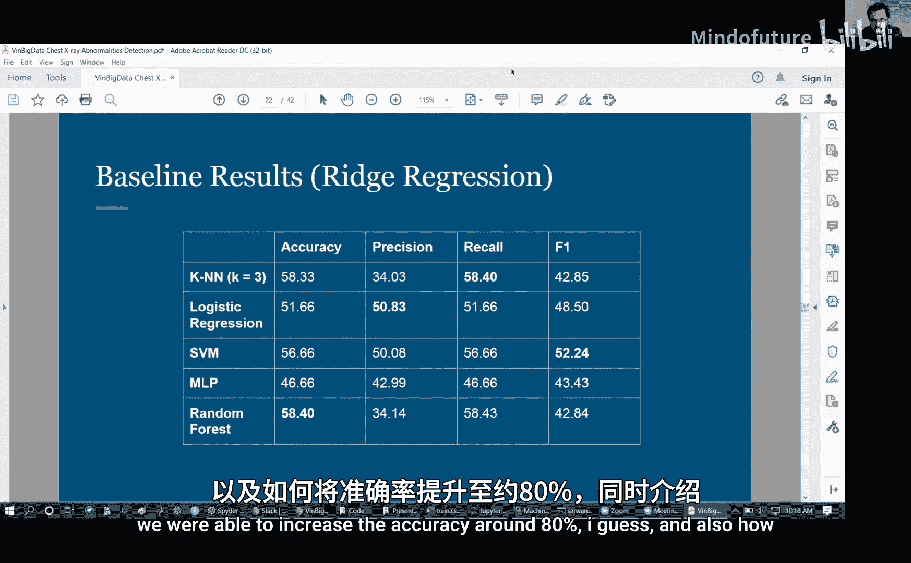
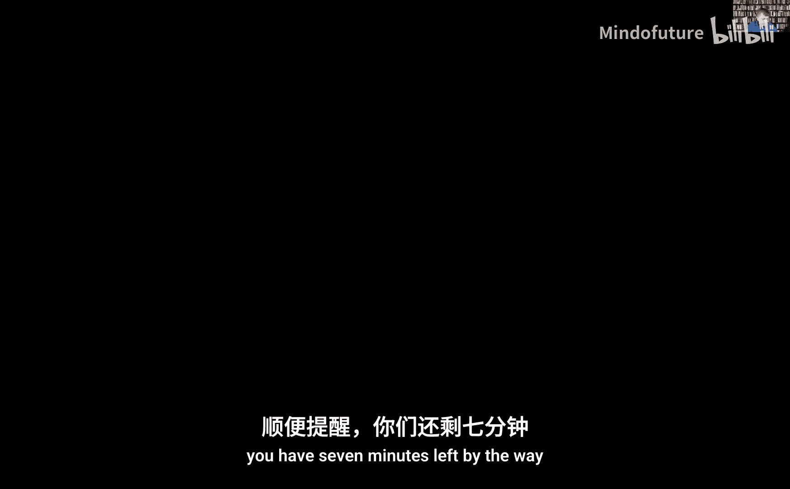
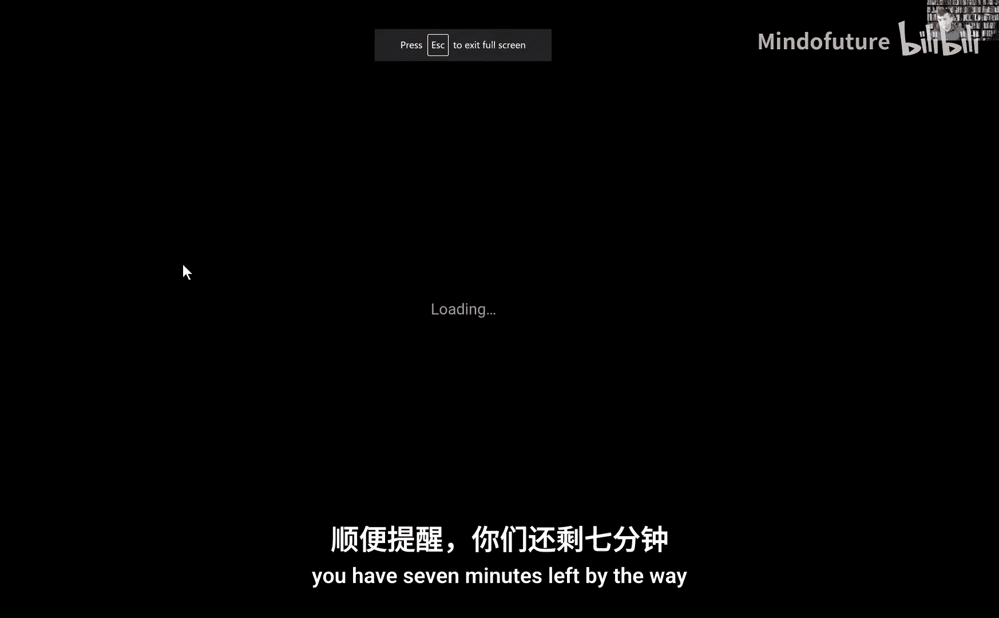
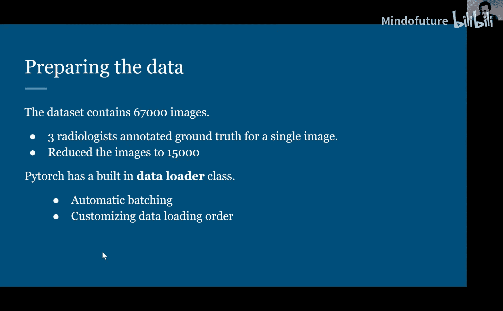
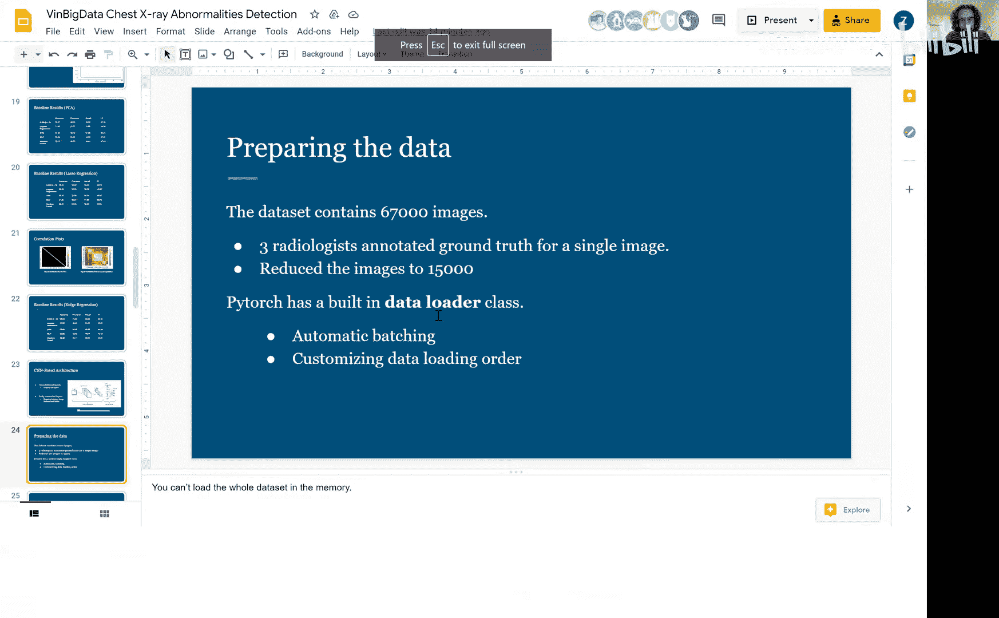
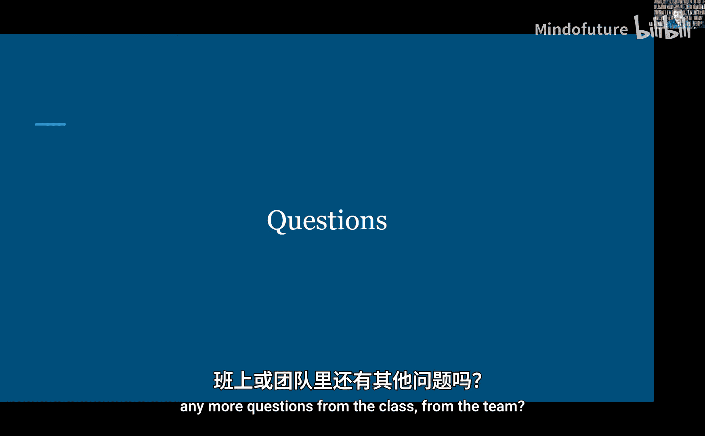

# 高级机器学习主题-CS8850-｜-Advanced-Machine-Learning-p78-P78_BlueScreens的胸部X射线异常检测--BV1sapPz4Ewx_p78-

Okay， you're on there， go ahead and I'm starting my time。Okay， so hello， everybody。 My name is。 S。

 And the topic for our presentation is swing big data， chest X ray abnormality detection。

 My team name is blue screens。😔，Next slide。These are the team members in our group。

 We are like six people。Next slide so this is the outline we are going to follow in our today's presentation。

 We will start by talking about introduction， then the background followed by our proposed system and its experimental results and then of course。

 the future work finally。Talking about the introduction， this project is actually a kgel computation。

Here we are given a set of dataset set which is collected by two hospitals in Vietnam。

 this dataset set consists of chest XRA images and the goal is to find an efficient system which will be able to localize and classify abnormalities in chest XR schemes。

And our submission format was we needed to submit a CSV file with our prediction with our prediction result on the test dataset and the prediction result consists of the following columns we needed to give the image ID then the class IE which is the target class and our bounding box dimensions。

 the deadline for this submission was March 30 it's already over like a month ago。

Coming towards the background， the problem for existing systems is that they're not able to detect the location of their findings。

 which can be misleading when they are doing diagnosis in terms of x ray rays。😔，So。Next slide。

We aim to provide an automatic system based on the deep learning model。

 since we all know that the impact of deep learning is very huge and it's very beneficial。

 so we plan to get an automatic system for classification and localization of abnormalities in our just X ray scans using the deep learning object detection model。

 this can be helpful to provide a second opinion to their radiologist and since they dealing with X scans is already very hard for the experts to。

 so having an automatic system like they can be very helpful in terms of reducing the misdiagnosis。

The data that's already being provided to us by cable。 Here' is an insight to what it looks like。

 We have around like 18000 images of X scans for just they are given to us in Dcom format。

 we have out of the 18000，15000 images are used for training and 3000 you are used for testing and they the training images are already being labeled by a panel of experience radiolog。

 so we don't have to worry about labeling them。This is just a sample image to give you an overview like how our data set looks like。

 you can see from the pictures that it is nothing but an image consisting of just xory。

 and they are already being labeled。 Yeah， in in case if there is an abnormality。

 I don't know if you can see， you can see a box， right， there， there are the labels。

So we aim to predict the target class， talking with the target class。

 we have 15 different values for our target class with their unique identifiers。

 of course starting from 0 to 14， and each of the label of these unique class corresponds to an abnormality in the gist。

 they're named except for the last one which is class 14， if you see it's named no finding。

 which means this class refers to the images in case if there is no abnormality。

Rest of the other classes， yeah， they discuss the abnormalities。

This one is again an overview of a trans it has multiple columns starting from image ID which refers to the ID of any X image then we have a class name class name is the target class name which can have any 15 values as I discussed in my previous slide with their cross bounding IDs and then we do have a idelog Is followed by the bounding box dimensions and the image dimensions if you notice when we have class 14 the dimension for this bounding boxes is nothing and that's expected right because we have class 14 means no finding we don't have anything to do a bounding box off that's why it's expected。

This one is in histogram showing the count of each class， each target class for our dataset。

 highly imbalanced dataset， and the count for class 14 is highest。

 which is again expected because the number of people having no abnormalities will be of course higher than the number of people with the abnormality。

啊ex。Okay， this one no sorry one folks， this histogram is showing the count of classes without class 14。

 which means this is just the distribution of data set on all abnormalities starting from0 to 30。

 and again， it's still very imbalanced class。Distribution。

The rest of the presentation will be followed by everyone。 Thank you。S。

 can you please stop sharing or I can share my screen then？就。Okay， can everyone see a slides here。

Yes， yeah。 okay。 so I will be discussing the baseline model that we are using for。

The classification task so as the sleeve mentioned we are basically delivering the two tasks。

 one is the classification and the other one is the localized abnormality detection so basically that is the object detection problem。

So for the classification task like we ran some of the baseline models and the basic step for all of those baseline model was basically we first rescaleed the image。

 so these 823 by 927 that was the lowest dimension image so。

I scale every image to that so that we have the similar dimensions and then basically flatten the image。

 So these are the。Dimenssion for each vector， when I converted the pixels of each image to a feature vector。

And then we applied dimensionary reduction I will be discussing the different methods for that and then different classification algorithms。

 and then we finally made the performance using different。Performance magic。

For the classification algorithms we use CNNNN， logistic regression， SVM， multi layer perceptron。

 and random forest， and for the train test it just use 70 by 30。

So for dimensionary reduction we use three different techniques， one is a PCA。

The second is the loss regression and third one is the regression。

So I will be explaining these numbers， how how we selected these specific numbers。

 I will be explaining them in the next slides。So just the brief introduction of the regression it basically work by introducing a bias strand and the goal is to increase the bias to improve the variance。

 which is basically the generalizability。So basically。

 the goal is to make the model more generalizable so that we can avoid overfitting。

And it works by changing the slope of the line and it is specifically useful in terms of feature selection。

 basically we will select the features that are like more important and like neglecting or the features that are like useless maybe so it gives the insight on which independent variables are useful。

 so it basically reduce the slope closer to zero。And we can then eliminate those features that are useless for us。

 so the objective is to minimize the sum of square residual plus sum penalty term and penalty is basically an alpha and times the slope of the square of the slope。

So this is just a basic introduction of the rigid regression lasso work lasso regression basically works similar to the ridge the only difference is that as compared to the rigid regression in which we can it can reduce the slope closer to zero so the lasso regression basically can reduce the slope is exactly equals to zero why because in case of lasso regression we have the absolute value for the slope。

Rather than squing the slope。 So this is basically the only difference between the re and the loss of the regression。

for b c n呃。We selected 20 principal components， why we selected 20 you can see the difference in the bag ratio when we try to increase the principal component so there was not much information available if you go greater than 20 so that is how we came up with these 20 principal components here for loss of regression。

After removing the useless variables so we were we selected 1316 features basically out of these many which are which we basically selected after flattening the image for rigid regression we selected around the number is far greater as compared to the lossso why because as I like just explained because in this case the slope is closer to 0 not exactly equal to 0。

 so we only eliminate those features for which we have value exactly equal to zero so that is for rigid regression we have a lot more features to deal with as compared to the lossso regression。

So yeah， these are the three dimensional reduction techniques that we use。And then， I try to。

Apply those classification algorithms to compute the accuracy precision recall and F1。

So you can see that there are not much performance gain here。

Some and no clear winner also in some cases like for accuracy MLLP better as compared to the others or for precision。

 we have SVM performing somewhat better so。We cannot tell exactly which classification algorithm we can exactly use for this purpose。

Similarly case with the lossso regression， there is no clear winner and we don't have much improvement in the accuracy。

 so the maximum we can gain is around 60% less than 60% actually。

So this is basically a correlation plot， I was just curious to see if there is some sort of correlation between the features after we applied the dimension reduction。

 it's no surprising for the PCA because there is no correlation between any of the featureses。

But we can see some pattern for lossso regression when I try to plot the。Correlation。

 the heat map for the correlations。ForFor rigid regulation， I was trying to plot it。

 but because the dimensionity of the matrix was very high。

 So that is what I I haven't shown the correlation plot for rigid regulation here。

 So these are the result for the rigid regulation Again。 we don't have much improvement in terms of。

Accuracy and other performance the year and the maximum we can get is close to less than 60% accuracy。

So now Zd will be explaining how we deal with this problem and how we were able to increase the accuracy around 80%。

 I guess， and also how we deal with the object detection task。

Thank you。You have seven minutes left， by the way。

So you are mutle， I guess。

Whos presenting right now。So Zer is presenting， but he's mute Yeah， okay。

 now I think you can hear me right。

Okay， so。So we are using CN based architecture， we know that basically there are two type of layers in a CN based architecture。

 we have convolutional layers and we extract features using those convolutional layers and then those layers are followed by fully connected layers which are basically kind of the image features to labels right。

So the first step was to preprocess the data right so the data contains 67000 images。

 so in earlier slides we mentioned that there were 15000 images but since three radiologists have annotated ground truth for every single image right so that's why the number increase to 67000 so what we observed here that all the radiologists were most of the time they had consensus on ground truth or they were very close to it right so that's why we just took unique images from their data and now the number was reduced to 15000。

And then we used this built in class to make a data loader right。

 and data loader helps us in batching the data and then of course。

 customizing the data loading order。And then we resized images to 256 by 256 okay and when you resize the images you have to adjust the bounding box coordinates accordingly right so for that what we did is we got to we got scaling for x we got scaling for y by you know dividing predicted the new size of the image divided by the old size of the image so we get two scales and we get those x and y scales to adjust the bounding box coordinates accordingly after resizing the image and then we also applied transformation like we did horizontal flipping and we used random brightness contrast so that the model could not be overfit on the training data and it could generalize well on testing data。

So this is an example like we have done horizontal flipping on the left side and on the right side you see a different contrast level right。

And then training phase comes when you unpack the batch of images。

 you unpack labels and then feed the input to the classification model so so the first thing we tried is we just did classification without using the bonding boxes。

So we used ReNe 18 architecture for that you see here we have a skip skip connections right so skip connections is basically helps to helps in smooth flowing of the gradient right during back propagation so there's a good feature in net 18 and we used this architecture and。

And we run over 20 epoOs and the train accuracy was 0。75% and then test accuracy was 0。77%。

 so I mean we can say that the model was able to generalize well right because it's getting good accuracy on test data。

So this is basically our loss function you can see our model is learning and then there comes a point when this thing becomes flat。

Maybe the model reached its saturation point or something。

And then the object detection task for object detection task we have used faster R CNN。

 it's available on PyOch and we have used a pretrain model that was trained on coco images basically so we have used that model and then we have done stratified five full cross validation so that we could ensure the percentage of sample for each class should be I mean it should be it should remain same。

Across all default forts。And then we have done transformations as well which I explained earlier so faster R scene architecture is basically we have convolutional layers right so we have used here restnet architecture and then we get feature map from these convolutional layers and and and we use those feature maps in region proposal proposal networks so region proposal network basically outputs a set of rectangular object proposals right like you can see on the right side that。

What we do here is we basically slide a window over the feature map right and it spits out anchor boxes so the output for this is basically it outputs a class score for all the classes and then box bonding box coordinates as well。

And the metric we used to evaluate our model was mean average precision because this is most of the times being used to evaluate models that are doing object detection right and the underlying principle in mean average precision is basically IOU and confidence code so intersection over union is basically how overlapping the ground truth box bonding box。

And predict predicted bounding blocks are right so this is kind of my year so so the threshold we used is 0。

5 if they were thresholding above 0。5， then we considered it true positive otherwise they would be false positive。

So this is kind of an experimental result over five fourth right so x here represents fourth and then we have MP so you can see。

Poin。5 and。50% 60， 70， 5060 and something like that， but the average or all the forces was 0。

64% so this is kind of an example so this green bounding box represents ground truth and red represents the predicted value。

And then we have to because it's a KeL competition we had to submit this file right and the format was like this so first column represents image ID and then we have class labels here and then bounding box coordinates four right and then then the conference score for the predicted class。

And we submitted this file on calculator board and we got a score of 0。

21 and this is this submission right we got a 0。21 score for this submission。

So conclusion is I think the classification result was good。

 map score could be improved further and I think maybe biasness in the classes impacted this model and it could not get very good MaPS score I think。

 but the model was not overfitting on training data which was evident from training and testing accuracy。

So future work， maybe we can fine tune hyper parametersmeter further。

 we can explore other object detection models。And like then maybe different activation functions like leakkireo or something that could improve the results。

So this is our Github repository we have to upload the code on the GitHub， it needs some cleaning。

 we will do the cleaning and then we will upload the complete file on GithHub。

And then this is the report in neuroipPS format， we have to finalize it and we will submit it by due date。

And then there so we divided the tasks so we have to clean the code on commit and commit on GitHub and then finalize the report these two tasks are in progress。

And then Kegel Bo， this was our earlier submission right， it was 0。052 and now it's a 0。21 score。嗯。

So these are the links for GitHub and Canden board。There's it from our site。

 if you have any questions， please ask。Yes， thank you， does anyone have a question？Please go ahead。

 ask your questions。那么。Okay， well I do have some questions， so let me just go in chronological order。

Was there any missing data in your data set because like your bounding box Ns。

 not really missing data right they're connected with class 14。

 but was there missing data I don't know， poor quality images or something like that？

So there were some cases when the height and width of bounding boxes were exceeding from height and width of the image right so we kind of preprocessed dead cases right we yeah so sounds good so another question is about your PCA and I'm just as that said I'm just going chronologically the way I observe so PCA seems to fall off and I guess it's in question to serve one fall off very quickly but you still select 20 points instead of like the first three。

哦。Why do you have an IG Y this happening Yeah so till 20 point there was some value after the 20。

 the value was very close to0 you can you are right that from I guess 10 to 20 the value was also small。

 but it had at least some of the value。 So I was just trying to get as much information as I could for the classification angle。

So there's why。So when you're talking about so Tesleline was talking about highly imbalanced data。

 and then through the presentation， all of you are talking about accuracy。

So't do you think it's problematic？To use accuracy for an imbalanced data set。

And I assume this is like average accuracy for all classes and for all 14 classes。

Or what does your accuracy mean？Can you talk about it？Yeah。

 I think we should have used balanced accuracy。 I think there would have been a good metric to use。

Well， but then you have 14 classes， how did you compute F1？What do you use at once for？有力嗯。

Like we want to know specifically， there was just a function and we get。

I mean well function F1 score right it is a precision geometric mean of precision and recall and those are defined for two classes right so are you using some specific quant of F1 or what are you using how do you use two class scores and everything on a 14 class 14 class 15 class there I guess one versus all technique I use and then every job information Oh okay you didn't mention that so you use one versus all and then average by class Yes did you ever look at confusion matrix。

I looked at， but I don't have right now for that years。Also so far your learning curve。

 it looks fine， but why are you showing only the test learning curve， where is your validation curve。

 are you sure you did not overfit？So professors， this is basically validation curve， right。

 because we did not have。Ground truth bounding box coordinates and class level for the test data。

So what we have done is we have done we have used5，4 cross validation and then we we used。

 of course one part to to test that model right so this。This loss is on that training data。

But it's the training loss right so you have three parts training validation and then you test with whatever you left out and your cross validation rate。

Yeah。So did you control for overfeing， okay， let's shorten my question。

Will little to control for our feeding。If you can comment on that， that's fine。

 I mean we don't have time， sorry。Okay， so I don't have any more questions there is you kind of answered with your slides。

That was good any more questions from the class from。

The team， nope。