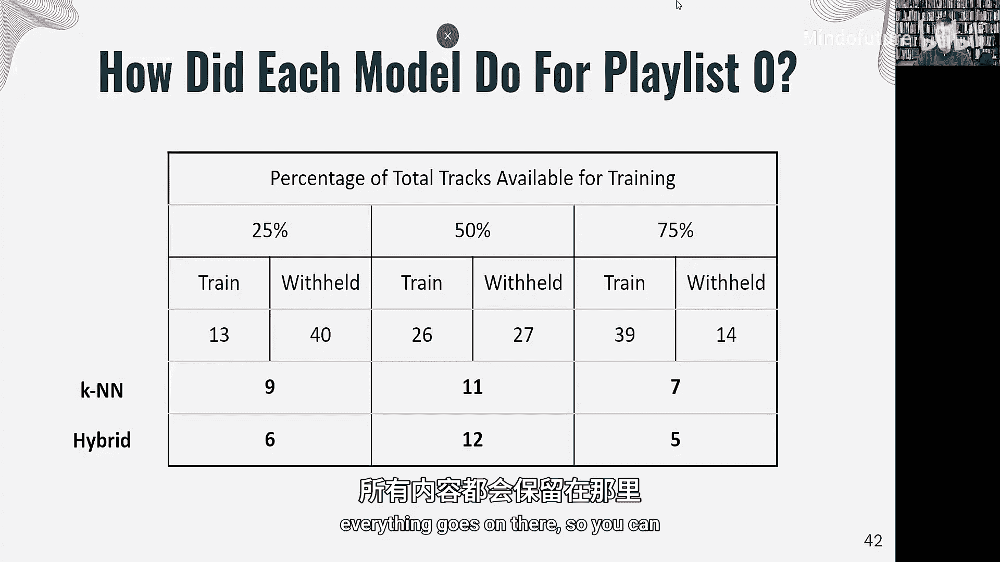

# 高级机器学习主题-CS8850-｜-Advanced-Machine-Learning-p79-P79_Small-but-Deadly的Spotify百万播放列表挑战--BV1sapPz4Ewx_p79-

うり？

Okay， you there。All right， hi everybody， today we're going to talk about the Spotify Mill playlist challenge。

 everyone who contributed to working on this with Manjusha， Carlos and myself andz。ok。嗯。All right。

All right， so before we get into the data set let's just talk about playlists in general so Spotify users love playlists in fact they love it so much that 4 billion playlists。

😊，Okay。so they create playlists for millions of different reasons， maybe genre。

 maybe they want to base it based off of their mood so sadness。

 but regardless of the reason that a playlist is created。

 it's always created with some type of intrinsic meaning or purpose for that particular user。

So Spotify can actually recommend songs to users based on analyzing their playlist and to conduct further research on this they created the million playlist data。

Right so our challenge is to create a recommendation system that recommends 500 new songs to add to each of the million playlists in the million playlist data set。

 and it also must be able to handle cases where the playlists has no tracks so just a title limited tracks and no titles and also incorrect metadata and then an extra challenge that we have is if songs are actually withheld from each of the playlists。

 can we return some of those withheld songs in that list of 500。So put more plainly。

 we have an input of a user created playlist which is going to have playlist metadata， so our titles。

 information about the tracks， and then also the the list of K tracks in the playlist and then our output what we have to give is a list of 500 recommended candidate tracks that are sorted in based on relevance。

So why might this even matter so several of our day-to-day tests are automated by some type of online services so for example at any point you can go and use some search engine to find relevant information about any type of topic given some type of keyword or you can use some type of document service like grammarly and you can in an instant have something check your entire document for things like grammar or spelling so there are a lot of dayto-day tests that we do all the time that are just automated automatically by these services so imagine if none of this was here so for example if you typed in perceptron algorithm into Google and then instead you just get a bunch of pictures of fruits you would be very confused because you have certain expectations to get more information about perceptron instead。

嗯。So that's why this would be important。And all of these different tasks are going to actually be solved by these recommending algorithms。

 so as you can see they do a lot more than just help with musical services an an algorithm that one of us might make for the challenge can be tweaked to complete a completely different task。

😊，And the development of new algorithms altogether collectively can lead to more mundane and tedious tasks being automated and not only being automated。

 but doing so accurately and quickly， adapting to every user。Okay。

 so how does the actual data set look will it contains a million playlists， of course。

 created by Spotify users and a total of two band tracks in total。And there's over 300。

000 artists inside of the entire data set with each of the playlists containing information like the playlist title。

 as well as information about the tracks。And so how is the data set different it's a little bit more challenging so it's going to be 10。

000 playlists with incomplete information， so you might have playlists with just a title only or just a couple of tracks with some of the tracks being withheld。

So in terms of data cleaning， that was necessary for us because the data set was 33 gigabytes and it was split into 1。

033 megabyte JSON files， but most of the data was actually needed for their training and testing of our models。

So we actually ended up creating a method that transformed a JSON playlist file into a CSV file just to make it a little bit easier for us。

 so there's how it looks on the right hand side。And what this would actually contain is not only just basic metadata information。

 but as well as Spotify API metadata information like genre， tempo energy。

 and different things like that。Yeah so this challenge itself is not new it has been there and people keep submitting after they' are done with the recording so Spotify suggests some of the good models they they've already accepted some of them are matrix factorization KNN and neural networks things like word to X so we decided to start with a baseline model like KNN and then go ahead with it。

😊，So we have developed like we started with KNN， we tried word two V， and now we have a hybrid model。

So let's start with word two week。So what to work basically this is a kind of collaborative filtering what I mean by collaborative filtering is let's say I have Michael Jackson and Nirvana on my playlist and Ozaara has Michael Jackson Nirvana and let's say Rolling Stone。

😊，And then based on the similarity our similarity and likings for song Spotify can now go ahead and suggest Rolling Stone because it's not there in my playlist。

 so this doesn't depend on the characteristics of the song as it is like it's not content based it's more like since I like things that Ozara likes。

 it suggests me more songs that Ozara likes。😊，So what we did is we。

Took the playlist and then just got the Is of the tracks in the playlist。 So on the top。

 we see playlist index， and then it has 52 songs。 So basically in song to work， right。

 your sentence is the playlist with the song I is there。 And each I D is a word in the word to work。

😊，So this basically is not my implementation of the visualization。

 but somehow it makes I use somebody else's visualization of a barcode for a vector because。😊。

I don't know it's easier for me to visualize things rather than just see numbers it's just I converted all the songs into 256 vectors。

 so all these are basically gray scaling of 256 numbers。

 but this is not my visualization I have taken it from somewhere。😊。

So how are we actually generating these vectors right So as we discussed in class there are two types of word to V there's skipgramm and there is a continuous bag of words CB so we for our model we use CB and our basic goal for this is just to create vectors for each song so the goal how we create a goal like we don't have labels in this case right so it's uncovised so we create a fake goal so this fake goal is CBB in our case where we we have the context and we are trying to achieve a target and in achieving this target the context are basically the songs above and below the song in in question so in achieving this target we create this matrix to go from the input to the hidden layer and this matrix basically provides us numbers towards our vectors so we have now converted each song into。

😊，で。So we can do maths on them。 This is also， I did it on our model。

 but this visualization is not mine。 So if you see for one song， it's very easy。

 You take Britney spirit two weeks， and it can give you as many。😊，Similar songs。

 and you can see the similarity index。 So what the similarity index is is basically a cosine angle between any two vectors。

 So if they are close enough， the similarity is higher。

 if theyre further then the similarity goes down。 So this can do it for 500， but for visualization。

 I just put in five。😊，Then I've not used K means clustering。

 but just to visualize that after performing the model do I see separate clusters or not。

 I with the vectors to 56 length vectors， I used PCA and TSNE to get them into lower dimensions and then just plotted just to see if it forms some kind of clusters like people having different genres going into one cluster or something like that。

😊，This is just for of visualization。So I ran on some of the playlist I just displayed one of the playlists that I chose I don't quite remember the PID of this one but it has all Martin Garrick's song and I did get similar songs with their similarity index I'm not shown all the 500 songs because of space constraints yeah。

😊，So from this model what we got is let's first talk about the prose right so it's very similar I heard some of the YouTube Spotify people talk and it's very similar to what they follow in giving us recommendations for our songs so it can't be that bad but it's actually only good for playlist that have a lot of songs so let's say I'm a new user for Spotify it cannot suggest me songs because it cannot make vectors out of those songs because of there be no sentences there so the big con of this model is that it cannot。

😊，It cannot deal with playlist without any tracks in them。😊，Okay， hi， I'm Col Swez。

 I'm going to present the approach for K&N， the K nearest neighbors。So K&N， as we know。

 classifies new data points based on similarity measures。

 it calculates a distance between the features。The classification is done by a majority vote to its neighbors。

Okay， so initially， the approach that was taken here was to create an NPRA with only the numeric parameters。

That is associated with each track。For example， energy， tempo。

And assign some weights to these parameters。Okay， we left out Jra， the artist。

 so the performance was not very good， was chill low。

So we understood that we need to add more parameters， so we added a gene。

We translated genre like rock。Pop Western into a numeric parameter。

But in an organized way where the similarity between those genres were grouped together。For example。

 we had Rock， pop。Together in western country， a little farther down on the list。

And when we did that， the performance actually improved。And here is a flow chart， yes。

 it may have been a while since you saw a flowchar， but they still work。To show how we。

What the process consisted of。 So we're starting on the。Top left。Data set。The raw data set。

 we transform that into a data set。With data from Spotify， which is the Spotify API。

And then we got a CSv file from that CSv， we were able to build lists of unique。Track ideas。

And all the met data that comes with that track ID， which are our parameters。

And Pla de Jara associated with that。Now， keep in mind that we need to pull this information from different sources。

 so the track ID， the metadata， the genre。And the general at this point is still a word。So。

From that list of genre of the numeric genre， o， sorry。

We combine these two together to create the matrix。啊。For example， for a thousand playlists。

We get a matrix with 5000。Wrote lines。Or rows and 31 features。So the number of features is variable。

 right depends on how much genre was given to a certain track。So in this case。

 the maximum size of a genre brought the。The columns to be 31。So it's a kind of a sparse matrix。

With zeros on those genremas that are not。There that are up。Absent missing。

So so to run the K&N model， we have this matrix and the target playlist， the red block on the right。

The target playlist being the。A incomplete playlist right where you are going to complete it now。

 so the output from K andN。It's exactly the list of recommended tracks。For that playlist。

So here's an example of what the matrix。That feeds the gay and N looks like。So it's。

Mars dimensional array where each。Element on the array has the features for that particular track。

And。Okay， so this is a very simple plot， but it's good to demonstrate。How what happens when we go？

From 25% of retention。And by retention， I mean 25% of the actual playlist。Has been。Its showing。

 it's showing to the model。The other 75 is hidden， and in they hold out。

So when we so we noticed that the。The hit rate。Goes from 20%。Up to 60%。Okay， as we add more。

Morek tracks。To the to the list that's available to the model。

So when we have 50% of the tracks available， we get a hit。Rate of 40% to 50%。

And youll notice that this gain here。You know， the inclination of this line。Shows that。

The gain is not as much when we go from 50%。To 75%。Of the list being available。

 And that has to do with the。What happens right when you have too many track ideas on the list？

The interaction， the model may get a little。Not precise with the new recommendations。

A little bit of a kind of。Overfitting， so we noticed that there's a decline of performance going。

As we have more lists。But that's consistent with what they notice in previous contests like this。

So for KNN， the pros and cons is a simplicity of the model。It's an advantage。

 it's been used in previous playlist completion competitions。

But it should be coupled with other classification models。To be more efficient。And the cons。

 as we know， is that K&N is not trained。So with the data kept。It keeps the data around。

 so it's a lot of time and space in consuming， especially when you scale。

To the level that we had here。Okay， and I'm going to talk about our hybrid model。

 which is going to combine the use of collaborative filtering and content based filtering。

So that's actually going to handle these two cases a little bit differently。

 the first case that we're going to talk about is the case where the playlist only has a title and that's going to be strictly collaborative filtering。

So step one in this case is you want to go ahead and extract a list of consecutive combinations of the words in the playlist so what I mean by that is it's going to extract so this is an example we have my awesome Minem playlist it's going to extract my awesome M&m and and playlist。

 but it's also going to extract my awesome and then awesome Minem and the Minem playlist like that and so on so forth。

Then from there it's going to take a small sample maybe about like two or five maybe five 10 of user playlists using each of those keywords and it's going to create a numeric measure based on how close each of those songs are in those in that sample for each of the keywords based on genre here and artist so for example here。

When we run that on my awesome Eminem playlist， we see that M&m is a really strong keyword so it's very relevant as well as Iinem playlist and we see that words like my and awesome aren't really that relevant。

😊，And then after that we're just going to go ahead and actually search for user playlists associated with each of those keywords in order of relevance and we're going to go ahead and also save the names that are associated the names of the artist excuse me that are associated with each of these keywords that we can continue our search and over on the right is just an example of what we would get if we tried that v my awesome Eminem playlist。

So for the case where we have both titles and tracks that is when we combine the use of collaborative filtering as well as content filtering so for the first step is the collaborative part。

 this is where we take our list of the names of the artist in the playlist and we go searching for them and extract the tracks from user playlist so what we would end up doing is storing the tracks in a dictionary let's just call it collab tracks and the value is going to be the frequency so how many times those tracks showed up in our search and we do the same with the artist as well we'll call that collab artist。

All right， so this is just an example I use this for playless Ze actually for on the top right you see for Collab artists Chris Brown showed up quite a bit as well as Destinine's challenge at the bottom you can see which coab track showed up most often as well。

All right and then the second step is we are doing the content filtering step and this is when we actually grade each track based on how close it is to the playlist average genre artist year audio feature so things like tempo energy key etc and also how well did it do in coab tracks as well as coab artists so for genre year in artist what is actually going to do is it's going to look at the frequency so how common were certain years artists in genres in the playlist so for example。

 if I have a song that was created in 2000 to 2009 well that's going to do very well because 79% of the songs inside of that playlist was from that year range compared to something that was in 1990 to 1999 that would end up getting a very low grade because that's very uncommon inside of this playlist in terms of the audio features what we would do is we would create an。

Interval around each of the audio features because they're numeric so for example for tempo if we had a median tempo of 142 we could create an interval around it。

 we can make it as large or as small as we want to that's we' tuning comes into play so let's say we made that interval down there 137 to 147 and we just want to see if each of those potential songs that we look through if their tempo is inside of that interval and then in terms of coab artists and clap tracks you just want to see okay how common is each of these songs that we're looking at they' artists and as well as their tracks so if we have a potential song that was created by Chris Brown it's very likely that we would recommend them because Chris Brown is one of the most common artists that we had when we look through the different songs。

So this is just an example of using playlist zero how close we can get in terms of genre and artist specifically。

 so as you can see we get pretty close all of those values are a percentages of what percentage of the playlist is dance pop compared it to the percentage of the 500 recommended songs as dance pop so as you can see we can get pretty close and our goal is to basically have a mirror image of the playlist in terms of things like genre。

 tempo artist and all those other features that we talked about。So that's exactly what the prose is。

 its goal is to mirror the playlist in multiple different ways and the cons would be that the hit rate that Carlos was talking about in terms of if you if you withhold songs from the playlist and your goal is to return songs return those songs in the list of 500 it is very variable for that so it might do extremely well it might not do as well and another con is that it's initially still slow at the beginning。

Okay， I think we have two minutes left here。To illustrate how our models compare， let's look at。

 for example， a playlist with ID zero， which you see on the picture on the right there。

 it has 53 songs。And here is some information about the list so interesting that 27。4%。

Of the playlist is from Jesse McCartney， Chris Brown， Beyonce。Et cetera。

 So let's see what happens when we。Try to complete that list。With 25%。Of retention。Okay。

 it means that we had a holdout of 40 songs。The K&N model was able to predict nine。

And they hybrid zone six。Now with only 27。Withheld。We have 11 and 12。And finally。

 with 14 songs wehel， we have seven and five。So。The only difference。

 the more impact is here on the 25% initial。But we have a very similar behavior of these two models。

Otherwise。So the matrix in this case is called the R precision and its very simple is' just the head rate is the number of correct。

Gas is divided by the number of actual。Treracks on that。Particular playlist。

They also have what's called the recommended song clicks。

 it means how many clicks the user is going to do before they find a song that they really like on that list。

嗯。So we are very pleased to inform that thanks to Ozaara's efforts here in this case， we got。

A submission to the competition。And it wasn't as great as we expected to be， but still it was good。嗯。

I think we ranked。17 out of 30 entries。But this was our initial submission。

 so if we keep if we had more time to try， we would probably go up in the leisure。

But so in conclusion， we have， if you ask us to recommend a model。

 we would recommend in our case here， a combination of either K&N or word to vector。

With the hybrid model to fine tune。The final list。What are some of the challenges we found。

 like most groups， right the size of data set？And was a challenge to get the resources we use CoLab for most part。

But even then at one point， Colllo does， hey you need more RA if you want to continue this。

The data set transformation。Was a challenge was time consuming， right， it was manageable。

 but just time consuming。And what would be done differently？I think we。

With our experience now we can recommend a two stage architecture。

Where we retrieve a small set of tracks on the first stage in the second stage we fine tune using some learning to rank model。

That focus on the order of the playlists。Of the tracks on the playlist。Well。

 with this we conclude our presentation， thank you very much and we' are open for questions。

Yeah thank you guys you're about seven to eight minutes over time yeah that's about half of your presentation so better better planning next time when you give similar talks especially at the conferences and especially with very organized area chairs who will not let that happen but that's fine。

Otherwise， very nice presentation， sorry for this round on air but。嗯。

Please next group try to stay on time that's also kind of the skill of presenting。Otherwise。

 I enjoyed it I learned a lot not sure about the rest of the class do you does anyone want to。

Complain or praise the guys like the team or what do you think anyone and everyone？

Please just speak up。I found it interesting how you created a numerical quantity for the genres where you had numbers that were closer together for similar genres my question is。

If you were to randomly generate an ordering where you just have genres randomly。

Over that number line。Does that change your performance and is there some。

Like have you tried different combinations， yes as a good question。

 yes I did initially I had the alphabetical order of the genre。And and that didn't work very well。

 I didn't notice much difference on the performance as soon as I changed that to group them by similarity。

The performance increased by a big deal。So yes。Would it be like？

Is this is this ordering in a format that could be somehow like published， like maybe you could say。

 like this ordering of genres。These are similars together like could could you somehow share like in the future thisoring Sure yeah I can share that。

 but it was very I would call it a naive approach because what I did was I put like pop rock beetles and then you started to transition。

Each of songs like urbanr and then Western。Or what is the other one？Country music， right。

 and then you have Disney songs and children。So the further away。The topic was。I mean。

 the most different they were farther apart， I can certainly I would need to do more research to be able to publish and say here here's the data that shows this is the best list。

But yeah， I'd be glad to share with you if you want to。I'd be interested， thank you。

Get more questions from from the class don't hesitate or just say hey nice talk or no I will never listen to that again well of course you won't do that but okay anyone。

Because I have some question。And I can't like mostly about presentation， right， well。

 some questions about presentations。It would have been better if you introduced the metric in the beginning。

Because I was already like well what are they doing。

 what are they measuring it's because the main thing is the data and the measurement how yeah exactly that is slide 43 and for those who know how use latex it's just just ignore that but still Mbox on the right would help you like or would help me see that it's just a name not R minus precision。

Just a thing， but yes， this should have been introduced somewhere in the motivation like what well or maybe the data set。

 what you're measuring and things like that。Base performance yes like you talk about baseline but I didn't see the baseline performance in terms of precision it's the same question about Manutsha about your talk your part of the talk where you were talking about baseline but。

Those pictures the T pictures did you generate them or they are also screenshots from online No no they are from but not from the entire data set from like I took one one fifth of the entire data those Ts are generated T and PCA pictures are generated by me so how did you measure baseline performance there so for the other playlist I did perform baseline measurement but this time for the playlist one where we compared。

My program is still running so it should be there in the paper because it's taking a lot of time to run Word to but for my paper I should have for the playlist one the ones with the withhel I did it for the other playlist but I don't have the information Yes for the right up I do need to see performance comparative performance in the same units for all of the models that you tried Yes so for the playlist zero not playlist one we will be having all the three precision model the data。

😊，Okay， thank you。The very beginning about the songng to be， Word tobec。We all know。

 I hope after my last lecture that SiBO wasn't the correct method to use right the authors didn't find its performance and if you use Word tove implementation by I think that Google at the time I don't know much always faster。

Thatscapegram。right。Yes， skip ground with negative sampling that's what worked the best for the language model。

 but I also。Well， there is a recent paper which was not included in my talk。

 but it should be included in the slides that。evaluated CBBAO versus skipcr and actually found a bug in all of the CBO implementations。

 including the original one and once the bug is fixed Spacey has the same bug and everyone has the same bug in the CBBAO implementation。

 but once it's fixed they both work。Comparly like comparatively with each other。

 but what did you use here？hi implementation did you use here I use Jen Sims Vo2 week implementation Yeah they have a bug I but I don't know if they fixed it or not I didn't check last but they they all have a bug so CBba will be weaker much much water I can fix it or do they have to fix it Nick why can't you why aren't you using skip cr？

Because I thought it's as it is the data set is so big。

 it's being a problem so I read somewhere that Cbal is I know C's performance is。😊。

Less compared to skip gra， but I read somewhere that Siba is generally faster compared to skip gra that I decided to go Yeah。

 think about it's called corn K O A N。😊，Continues bug awards Google for that that the paper it's it's fairly recent but it's kind of I was。

You the author's name no， no no that's what they that's what they called that's what they called implementation。

Okay。I I will find yeah corrected CBbel implementation， the first link KOA continues bag of words。

 the first link on D da go I get is the corrected CBbel implementation the paper and I mean， okay。

 anyways， let's move on with the questions。Carlos， you said this phrase that makes me wonder why simplicity of CananN is an advantage。

 what do you mean by that？Well， to be a base model。

We were trying to get some results right away as fast as we could。

 so that's why we decided to go with K&N as the base model。I mean implementation is simple。

 the implementation， yes， the implementation is。Fairly simple。Okay， Azaara。

 do you actually use text when I was listening like so you have the text of the songs like titles and the names of the performance or the bands and stuff。

 right？So in your part， you're actually like Manussha used song tove， not actual text。

 but you are using actual text right in your part of the presentation in your experiment。

It depends on the situation if you're dealing with a situation where the playlist only has a title。

 then then yes it mostly uses the title and you're just basically trying to look at the different combinations it can make。

 but then if you're using if you have a playlist where it has the title but it also has tracks as well then no。

 it's not dealing with the title whatsoever。Oh， but in the tracks you're still using truck names like yes the track names the artist names oh interesting okay。

 so you could also I imagine could you could have used lyrics like the complete set。

Yeah that would actually be an interesting thing to think about that wouldn't be as far as I know based off of the Spotify API which is what we use to extract like things like genre artists and all that stuff they don't have lyrics accessible but in terms of trying to find maybe some songs that have similar types of lyrics and maybe similar types of themes and words that would definitely be an interesting thing to use to recommend songs as well yeah。

Okay， so。Sort of the last comment for your write up and in the vein of show me a picture or it didn't happen for your ranking can you provide a screenshot of your ranking relatively to other in the write up for the competition I guess you mentioned that yeah it's one of the last slides but please in your write up just provide an actual like live footage well that just make a screenshot so I can see other people would you like a link to it。

Maybe yeah maybe we can do both but take a screenshot yeah both take a screenshot I will be reading your PDFf and marking on it with a pencil。

IPa i now not real parents on so for the evaluation bit is it okay if we take one just like Carllos had and we have all the numbers in there for each of the models or do you expect something more。

Evaluation of the models。哦でも哦。like something like this looks or do you expect more？

Like this is the evaluation of the model right Yeah if I can understand this paper this slide then yes。

 but otherwise I don't understand this well give writing but is that information enough like we have taken one playlist and then 25% like 40 with hair 13 to train these are the numbers that we are getting for for model comparison first for showing me that you selected best model what I'd like to see is。

😊，Shared Y axis， which tells me the metric that you're using， say our。

 whatever our precision or our minus precision， whatever you use。On y axis and on X axis。

 I want to see all the models you've tried bar plots。With the cross validated variants， for example。

Maybe I prefer box plots or violin plots， but that's fine yet more ideally I prefer you to sort them by performance so I don't have to scan back and forth so I can see the winner and I can see the loser so。

But it's not for presentation， it's for you， like how else you personally like yourself。

 how do you know which model performs better if you don't have a metric and you're not comparing them。

Something something something like that in the right up would be helpful this table I don't frankly I didn't want to stop you but I don't know what i'm looking at it's just some numbers six nine K and N is nine okay9 and what you have we took one playlist like this particular playlist that all of us used our models on so。

Oh no， you cannot evaluate on your training data。 That will be negative points like100。 No。

 we removed it from the training data。 We didn't train it on that particular playlist。

 we trained it on the rest of the playlist and then because that playlist already has the songs right so we withheld physically we withheld some songs like in this case40 songs were with and trained on 13 songs So the KNN got nine out of the 40 right and then hybrid but6 out of 40 right That's kind of a tiny playlist So you will not see the real performance。

 So like evaluated it on either like something similar to leave one playlist out or something like that we're going way。

 way over time discussion for the presentation So let's let me stop the recording everything goes on there so you can。

