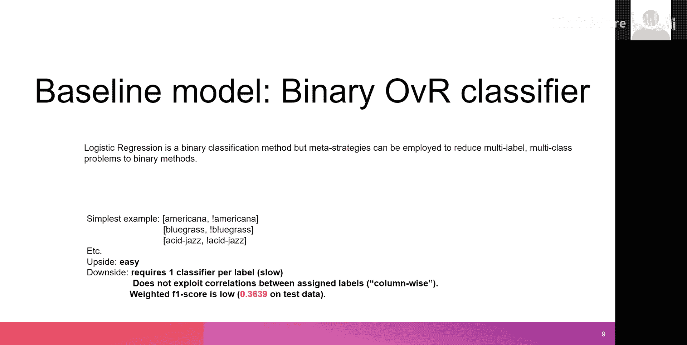
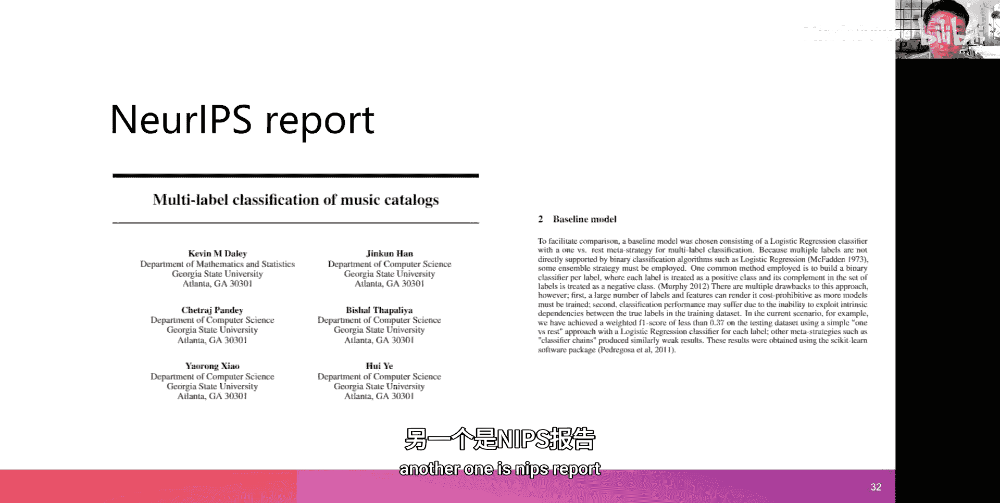
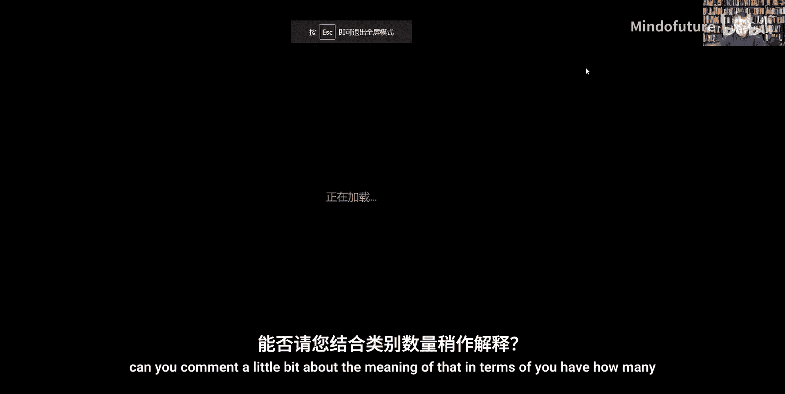
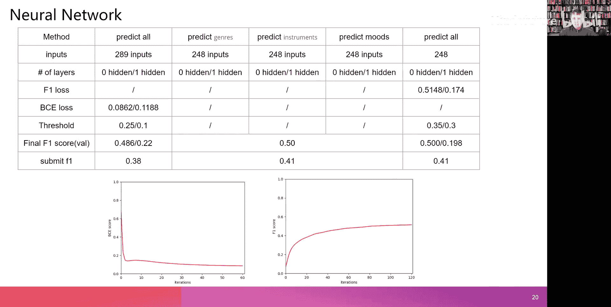

# 高级机器学习主题-CS8850-｜-Advanced-Machine-Learning-p80-P80_AI乐队的音乐目录多标签分类--BV1sapPz4Ewx_p80-

And I'm setting up the timer go。

Al right， so。Next slide， please。Our project was about。Next slide， please。

So our project is regarding a challenge that was issued online to。Categorize。

Production music libraries by label。 So sort of the opposite problem of the previous project where we had。

A bunch of playlists preassembled and we had to assign tags。嗯。啊。Motivation for this is that。

This company or the initial motivation for this is that this company had a neural network that they had run the。

Music through and each track for each track， they generated a one hot encoding vector。

Associated with several different。Categories。Sort of a fuzzy assignment of particular。Labels like。

 you know， genre， mood instruments， things like that。嗯。But so they needed to be able to。

Determine exactly how which labels they wanted to assign in sort of a discrete fashion。

And based on the output of the neural network。And。They they tried just thresholdholding the output of the neural network。

 which is the most naive way of doing it。But they didn't get great results。

They said maybe if you exploit the correlation between the inputs and between the output labels。

You can get better results， so we decided to employ a classifier to do this Excel slide。嗯。

So the object of this challenge is basically defined。A classifier that converts。Numbers。

 the raw sort of probabilities or fuzzy values associated with each tag。

Of their classifier into actual decisions about whether。

They to put each tag and the metric that they wanted us to use was the weighted F1 score。

Of the assignment of each label。嗯。And we want to try。

 and we tried about five to six different models and tuned them heavily and tried to find。

Which ones are best？The data looked like。This that it had about 90 to 100。呃。

Instruments and genres and some other things。Altogether about 250 tags。And almost as many labels。

And the inputs roughly map to the outputs， although there were a few extra inputs。Next slide。So。

The data is actually grouped into classes。So the input data is not just like。

Random features of the network selected features of the input data selected by the network。

That they made。 It was actually each column corresponds to。A tag so， but and the outputs。

Or similarly， we assign multiple outputs to each。Track。

 so it becomes a multi labelbel classification problem， which is。

From a motivational standpoint but also useful in a lot of other。Context， for example， you know。

 image。Classification and segment and detection algorithms。

And various other labeling problems become multi label。Detection problems as soon as you have。

 you know， an audio file with multiple different objects making sound or。Um or anything like that。

 and the accuracy on these problems tends to be a little bit less than binary classification problems。

Next slide。So the structure the exact structure of our data is as a CSV file。

 we didn't need to do really much preprocess we have cap the columns。

As different columns of a CSV file。For each tag and category。The output of the neural network。

For each label。Is given in between 0 and1。嗯。In the actual CSB file。

 so almost no data preprosing was or claiming was actually needed。We just， you know。

 loaded it into nu buy end。啊。Skpped a few rows in one column and compared it with the testing data set。

All right， next slide。So the output variables are similar but they're binary threshold。

And the the interesting thing about the outputs is that the test output was hidden to us， so we。

We had the training output。And then we had to submit a score。呃。Submit our resulting。

Data from the test input to get the tests F1 score from their website and there was a significant discrepancy。

As you'll see later between the and as you can imagine between the even the like leave k out cross validated training。

Score and the actual test score。OfOn the test data， so next slide。

Our data set as far as labels were fairly balanced， we didn't have some。

Label that took up the entire。Space or anything like that。嗯。And of course。

 way the F1 score has a method of。Intrinsic to it of。Handling a little bit of label imbalance so。

Yeah， next slide。So our baseline model that we used very simple was a binary one versus rest classifier。

 We also tried some other models， but this was。The best baseline that we could come up with that was like。

 you know？Of all this simple。Classifiers that we tried。嗯。

And what we did was we took a logistic regression， which is a binary classifier。

And we applied it to each label versus all the other labels as a negative class。

So that's the standard way of doing。One， that's the standard way。

 the most naive way of doing motivation。calledlled one versus rest。

It requires you to create one classifier print label which is slow。

 it doesn't exploit any kind of correlations between the assigned labels。

And the weighted F1 score was for that reason， probably。Quite low。

Compared to what we got later with better models， it was about 0。37。On the actual test data。

So and then next slide and over to Chit Trodge。

Next slide。

Next slide。Okay so the problem was fairly simple as a multilabel classification problem and we we do not have to preprocess our data。

 so for the for trying to as we tried for the more models on our data we took an approach of of converting our multilabel classification problem to a multiclass classification problem which was a very naive approach to do it because after actually after I started training the model then I realized about there could be very large number of combinations of the labels the approach was the approach was like this this was our initial the lefthand side of the table presented here was our the actual。

Actual structure of the data。 and then the model was created model was the data was converted into a multi multiclass problem as finding the unique combination of the labels and when it took a very long time even to train the model because there were there were like998537 unique combination of the label。

 which was a very， very na approach to try， but still we tried it。

 and it took a lot of time and the F1 score we obtained applying this approach was 0。233。

 It was very low than our baseline model and we didn't even submit the model to the。呃Sa。Next slide。

So another approach was to continue the one versus risk approach to try further more models if we could improve the improve our previous baseline model where we used fairly logistic regression and for this in this approach we used the similar binaryly one versus risk classifier where we train the entire data。

 individually for each labels， as you can see in the right hand side of the slide。

And the weighted F1 is square and where we did we did hyperparameter tuning for the we use the classifier ga snipease and logistic rotation together individually and we tuned the parameter and the best result we could get from this was 0。

5 to 8 on the provided test data and when we submitted the model to the site we gave the result of 0。

397 which was a little bit improvement over the logistic rotation classifier that we implemented earlier。

Next slide。And the third approach was used as a remedy over the binary relevance approach where we were treating the problem without considering the correlation among the labels now we decided to use this approach where where different individual classifiers were trained by considering the labels in a chain so you can say in the left hand side the wave for the first classifier trained for the first label we took the data set only and then we train for the label y1 and and the next classifier was trained by considering the label y1 as the feature to predict the Y2 labels so this was used as an approach just just to maintain the quo among the labels as well but sadly we could not improve the result as we got in the binary relevance approach and the F score we obtained。

By training we use the classifier used here are consistent which are logistic regression and goni base again and also we get the best best result by using Goni basease and and the test score test score test f1 score weighted was 0。

358 and when we submitted we get a fairly low score which is 0。3 okay I'm hand over to Vial。O。😊。

So thank you， Charaj。So next slide please okay so after we tried multiple approaches of to classify the multiclass classification problem so we thought that why not look the data in a quite different way right so all of the three approaches did not give us the fairly good results so we just went ahead and looked the problem in a quite different way so we tried columnwise classification so the first approach is we only take the music tags and the cross labels we build a classifier for each of the music tags independent of the other to see how how this。

How good will the score getss so next slide please。Yeah。

 so we tried logistic integration and Gaussian IBs which are both promising of course as we see in the earlier so in the columnwise classification so the first thing we did is we tried logistic integration with regularization as 1。

0 which is of course the default for all the classifiers it becomes like 249 classifiers right so the accuracy was 0。

36tyon score of course and after tuning the hyperparameters we got 0。35 for the Gaussian IBs and 0。

37 for the logistic integration so this was the first approach of columnwise classification and it like kind of give us the few results so next slide please。

Okay， so continuing with the binary relevance approach。

 but instead of not taking all the input features， we only took the one which we're trying to predict which is the HG jazz and the other 41 so we had like 290 features in the training set and 2 49 in the level so they provided us with 41 additional training data。

 so we went ahead and tried those 41 with the corresponding input。

And we build a classifier for each of one， exactly like the binary relevance。

 but we did not took the whole data， but only the layer 41 next slide。Yes。

 and unfortunately the score still decreased like the accuracy was 0134。

 even after we tune all we could get was 0135 at the highest for logistic integration and 01334 de Gasian IBs。

 so we went ahead and we tried neural networks， which PR will continue， thank you。So everyone。

 I'm Yaron and based on the logistic and what we have done。

 we try the neural network and we use the BCE laws and definitely have one score for optimization。

And next slide， please。And we tried cab of experiments since our input data is kind of just some result generated from the neural network of the company and we tried the。

Like use the whole data set whole input features 289 as input and would try if there's zero hidden layers honestly is a logistic regression and indeed it can do a better performance but which with one hidden layers。

It doesn't work。For just for you use the whole data set at the input and from because based on the features we're thinking there are the last 41 columns are some。

K of category is not the exactly the。Tags of the inputs honestly we don't exactly know what they means so I'm thinking of maybe I cut them down and using the 248 as input because output'll put the text we have 248 as a tag and do some prediction of that part。

And then we can hit a better result by using logistic regression 0。

41 with submitted media have one score。And next week。

So we're thinking maybe there are too much input， too much features of the input。

 So we start thinking of maybe just using column wise prediction were thinking using maybe one column as prediction。

 but here is a problem like for the table here is confident is just one type of the data is you can see that the input and output have an overlap result。

 So and the mean and variances of both0 and1 are really similar。

 So for 100000 data is really difficult to to divide them with just one single feature。

 So we think of maybe we can increase the dimensional of the input。 So I still we build very。

 very simple network and increase。They set to the hidden layer with three neurons and do the prediction。

 but and we built 248 neural networks honestly， because parameters are very small so we can train very faster and then hit 0。

44 submission of1 scores。And still based on the overlap problem， and next slide please。

So oh I I forgot mentioned previous for the plot。 there are some overlap。

 if I just use one text because of the overlap problem。

 So this time we think of maybe we we predict text together like we have 94 genres and 112 instrument 46 for the move we just predict that separately。

 but we can think that like moves the music can be happy and confident or something like this。

 so we make them together and do the prediction and then we hit better have one score 0。45 and。

St there are still maybe many other things we can try for the correlation of the text and this the neural network we can do and then we try the random forest。

And next last and， Hu would talk about it。Good morning， everyone。 My name is Huiyan。

I'm going to talk about a large model。 random influence case fire。So what is random forestifier。

 It's ons sampleble model。It consists of a large number decision trees。It's accurate。

 and it's a robust method。It's less likely to be overfitting。

The figure on the right shows how this model works。嗯。So can you hear me。We can hear you yes。ok。ok。

 so。It works in four steps。At first， it select X random samples flow a given data set。

 So as we can see， flow this finger training sample。 one， training sample2 training sample1。

And then it constructs a decision tree for each sample。

 So as we can see decision tree one decision tree to decision to U。

Then each decision tree will produce a result。Finally。

 the model selects the predicting results with the most votes， the majority vote。

So we applied this approach。To the project， then we get the。Initial result point。3，6，3，2。

 So this is the initial result。啊 next slide need。Okay， so。

We tried a lot technique to improve the performance。The output of the classifier is probabilities。어。

对。The range is from 0 to one。 So as we can see the value may be。8。1。9。4。

And we need to transform the probabilities to binary values zero or one。

 Then we can compute the F1 score。So the default threshold is 0。5。even the venue is。

Great and point then。It's one。Otherwise， it's 0。 So this is a simple way。 And the F school。Its03632。

So05 maybe not a。Good choice。 We may have better threshold hold to improve the performance。

so啊 the strategy。To have a good threshold is column wise searchholding。 So we are search。

And switchhold for each label separately。啊，那。Approach is simple。 So we set search hold with step 。1。

This means we may choose the search code flow。0 to one。Then once we get an initial search。

 then we are search the threshold with stepside。01。So we can reduce an error。

We are combined this approach with random from sequenceifier。 then we get the we one score。

 it's 04565。 So as we can see there large improvement compared with the initial result。Next slide。

 please。Okay， another technique to improve the performance is happy Per to only。

Snon has provided a lots of。Hper permit has to to a model。This process is time consuming。

 So we can't to all the parameters。 we are choose。A couple of important parameters bootsstr。

Max steps， max features are and。And we are tune。heavy parameters。 then we get the breast setting。

 What strap is to max steps 50 number of features S Q R T and number of estimates are 300。

Then we apply this model to。Our project then the VT F1 score is 04650。

We can see this also an improvement。あ、レクサイドニーズ。Okay， so someone else will present this part。Hello。

 everyone， I'm。 based on above models。 I will introduce following findings。 First。

 we have three catalogs， instrument and moves。 We found mood has about 54s can break our model accuracy。

 This funding comes from divided neural network。 The mood tags they come froms models。

 is the company of the site。 Sos model isn't so accuracy to the information of mood。

 So mood tag is contains the noise for our models in some extent。

 and the next the next one is we use 10 different model and strategies to analyze the data site。

 We found columnwise or tagwise can improve our accuracy or one score。

 and another one is writing holes is very important for our project。To guide high F1 scope。

The next one finding is that the columnwise thresholds holding hyper parametermeter tuned random forest model workss best。

 we can get M score on Pball is 0。45， which locate at the second projection from this project。

 we can learn how to select model and how to optimize the parameters。

 column wise processing sometimes helps a lot when facing multila classification。

 So in the future project if we facing such this site。

 We can consider how to use columnwise how to use a threshold。

And here is the main contribution of each of us。 We nearly do the same same work and heres some other materials like the cabin board we have over 50 tasks was assigned and everyone has finished their own tasks and Github。

 everyone has hit their branch and upload their model on their branch。

And another one is the challenge board on the challenge data on the public board。

 we can see our best score is the second position and also we have submitted some other models and they also got a good score。

Another one is a NPS report。 We will submit our report later， and another one is a Disc group。

 We have a Disc group。 We have tried over 1000 chats and over five video meetings over 20 model discussions。

 we really share our materials here and noting some important information so。

Here is our， all our actual materials。 Okay， thank you， everyone。 Any questions from the audience。

Yes thank you for the talk very nice and very nice result。

 I will have questions about that second place and what that means。

 but before I start anyone wants to pitch in with some questions with some answers maybe for the team。

John， if you have any anything any comment， go ahead and just。稍门。啱。Sad。

 so much effort and for nothing a group of 26 people。

 no questions besides the person who gets paid for asking questions。Sorry guys， youve worked so hard。

Okay， so my questions then。Like well let's go backwards and time from your presentation。

 let's start with that second place question is it a still active competition or is it like a tutorial competition？

It's too active。Oh okay， so you have when is it when is it over it will update every year and give the result I think it's a June every year。

 but it just started it's a tutorial right it is a tutorial it's not like a competition with the winners and everything。

No winner。 I think。 Yeah， No， no， no money。Yeah yeah yeah so it's a tutorial competition and okay did you use you didn't comment on that but did you use the experience of other people who are working on this problem and like what they' finding and everything find any other method from the from the challenge data。

the this like the team 100 Wifi location discussion。

Because the data set was very difficult you had to collaborate externally so you did not collaborate externally or not。

Didn't like。Yeah， this was the main main demerit of this project because there was no any community we were discussing about this problem anywhere。

 so we were just six people talking about the problem and trying to figure out the solution there。

There were no communities kind of lonely， but yeah。

 yeah made you work together instead of look outside。

Yeah okay okay thanks another question is what does F1 score of 0。

36 mean is it even meaningful I mean it's just even 0。

4046 is very low can you comment a little bit about the meaning of that in terms of。

You have how many classes and one versus all and then you have waiteded yeah so anyone。For me。

 the I once go I just because what we submitted is kind of。The 248 columns of each text CSV file。

And for mine， I use a validation set to calculate the F1 score through the whole data set。

 calculate the true positive to negative and all the four of sync and calculate the F1 score。

but I mean is it good or bad， that's like not just a simple meaning I'm a guy from the street like a 0。

36， what does it mean it's just a number。I mean， if there are， if there were a few number of labels。

 then this would have been very bad， right， But we have like 248 labels where we have to compute the weighted F score。

 So I think I'm not sure， but I think this is。A little bit better。Better better score to obtain。嗯。

Okay， but like sort of the the meaning of that score is。Not clear to me， at least like。

That's why maybe this ranking with the board helps for like I'm not familiar with the problem if you have imbalance data versus when you have balance data that could be good score that could be extremely bad score right for the balance data the score would be like very bad but depends on what the type of imbalance okay well then the question about your tiny neural network model with three neurons which is kind of surprising how you thought about it。

 have you tried support X machine in this case。And。

It think is it will be very time wasting but we didn't try well。

 you could still try linear support vector machine which there are lots of solvers which are like very fast。

Poly our support by clinicians。Because the performance， I mean。

 you're still getting quite good performance。With that tiny neural network。

 but tiny neural network could be。Easily beaten by SM。

 maybe some large networks would be beaten by SM because for the our input data the data they provide for ours honestly we don't exactly know what there means it could be probability or could be anything or maybe nothing we just use them to prediction。

So so find the correlation of the input is also very kind of tough places。

 the competition told us that they would not recommend to use the correlation between the text。

 but seemed that with the correlation， we have better performance。呃。Just some weird part of the。Okay。

 okay， so there was your am I like am I understanding you correctly you mean。

Neural network is justified because it can learn some correlations between the classes between the features yeah because the improvement we can say the improvement by like we using several features or all the features there are some improvement when you can it should be the can be the correlation I think。

W didn't you try didn't you try multiclass logistic regression instead of like you went for binary。

 but we try that use logistic regression to do that multiclass binary， I know you've tried binary。

 but did you try multiclass+ doesn't seem to no， it's just your neural network performance again is telling me that this。

There's other simpler models mean。You can't get any any simpler than your model。

 that's why it's kind of like。Well， interesting， interesting， very simple model。嗯。One hidden layer。

 just three neurons I'm a bit surprised that you went with neural networks at all still even after your response。

 but very nice work， so I liked your presentation somehow you managed well to go way over time but to demonstrate in this presentation that all six of you have done work。

Very good， thank you， anyone else before like any questions？我。

