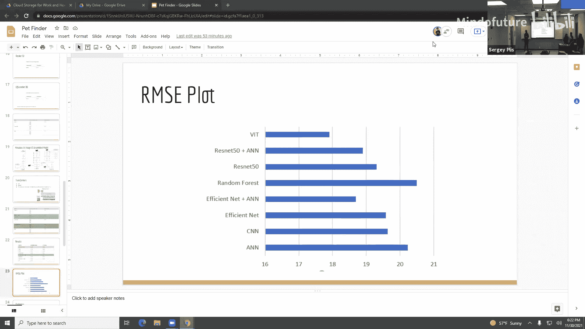

# 高级机器学习主题-CS8850-｜-Advanced-Machine-Learning-p81-P81_0-1勇士最终项目演示_宠物寻找器--BV1sapPz4Ewx_p81-

Yeah。

you already started the recording。Ma as well， just start。All right， good evening everybody。

 we are the zero1 warriors，01 warriors， I'm our mail， that's Krishna Saai and Sriba。

 and today we are going to be talking about our project title Pefinder。没事。Yeah。

All right so right here is a breakdown and outline of what we're going to be indulging today we're going to start with the motivation what we are exactly trying to do what we are going to try to solve After that we are going to explore the different data that was given as well and we are then going to be talking about one of the first processes which。

Protain to data augment and then after that we'll talk about the modeling。

 the different modelss that we applied， we will then discuss about we about the results then we are going to eliminate the challenges that we face and then in the end we are going to have a great conclusion。

So let's start with the motivation so what exactly we are doing and why are we doing it so every year it is estimated that in the United States about over 900000 pets which includes dogs and cats are uuthanized so what happened is that they are found either in homes or shelters and they do not found a。

A foster family， so for due to over population in many instances。

 those shelter owners are compelled to actually go ahead and sacrifice those respects。Petfiner。

mi Re right here is a shelter platform， it's a website platform that allows user to actually go ahead and adopt a pet and that is done through a process whereas someone was's seeking a pet will look at different catalogs and inside the catalogs that person showed with pictures。

 they also have the option to raise the pictures to see how much the micro pictures and provide data saw and saw to the website itself。

知道。Going back， first， so。So now all right so now the question that we're trying to solve here is how do we make the pictures of those different animals more attractive in order to increase the likelihood of those of those of of those animals and includes the the likelihood that animals are going to be adopted by family so pretty easy So now the model that were asked currently there is a basic solution that is provided to the website pet seekers to gauge the attractiveness of the picture so once a picture is uploaded the simple model there is there is going to rate and give a score of attractive。

And the score of attractiveiveness is what we call popularity， not popularity， but humans。

 but popularity we pay AW for pet。Let's go to the next slide what were given to us was two specific batch in one batch we had images these were raw images over 9000 images that were supposed to that were used both for training and testing in addition to the images we also have CFP cells that provided us with metadata。

 the metadata and the ID of the animals in addition to additional characteristics which describe features that we going to be talking about。

Yes， hi， all good evening。 as my friend has already informed you。

 So we were given with two types of data。 One is of metadata and the other is of images。

 So we got 9000 plus images and our metada talks about the various descriptive features of an image So this doesn't contribute directly anything to the output score。

 but still in it is given which represent a unique image and the features of an image。

 So most of the features of pretty self descriptive the subject focus is face near So all this action say that So for example。

 if you take near as a feature So that indicates if your pet is near to the camera or far from the camera and similarly action is performing some action。

 So as it is a pet it obviously would perform some action most of the times either if it is a dog it will play the other actions if it doesn't play any action。

 then we got the value0 similarly。😊，Human so it indicates if there is a human present in the image along with the PE or it easy not present and is the image blurd or something the pop score it varies between a value of1200 where 00 indicates the image is very popular in the sense the PE is very desirable and attractiveing all of our data is pretty much in the binary values so it will be mostly zero or one。

And this is a met datata where we multiple images of pet data。

 so if you see most of them are they like dog images and cat images with few of them having other seconds in them and few of them were having human presences。

 then few of them were having the pets in various angles and all。And as weve already prompt them out。

 so we cannot perform any statistical measures like mean medium max and all the other。

Data all the aspects on metada。 So what we did was we simply ploted a plot。

 and that would be that is our sample distributions。

 If you see most of the pay were having a popularity score in between 20 to 40 with a few values nearly to 93 were having a popularity of hundred out of00。

 So that would be observed in the spike at the end。 Similarlyly。

 each of the we also had the correlation map for that。 So each。

Feature its correspondence to other features was shown over here。

 and if you look at the overall high level overview of the plot。

 you can see that the column popularity， the score。

 it doesn't depend on any of the features So but we still can observe that there are some positive correlations and negative correlations among our features itself。

 for example， if you look at the ice and color， it is negatively correlated and if you look at the best positive correlations。

 we get the human with occroion as well as face and eyes。

 So it indicates that if a face is clearly visible in image。

 then obviously the eyes are also very clearly visible in the image and。😊。

Next talking about preprosing so as we were given perfect data set。

 we did not have any missing values in our data The metadata did not have any missing values。

 it was only binary values at the same time the images were also set of number of images and coming to the outliers same case with the outliers as well we did not have any outliers to handle then the proper preprosing sets that we did do were on the image data where we reize the images and also then performed normalization on that。

And coming to transformations and augments。 So there was a small reup over here。

 So that was we were given with the metada which describes and images。

Features and the popularity scores When we consider it in that case。

 generally whenever we talk about documentation， the most common things that come to our mindsian noise。

 addingian blur and cropping the images etc。 But we could not perform these we cannot perform these on our data the reason is for example if we take the cropping there was a feature in our metadata saying near So if we crop our image。

 then that makes the come near to the camera。 So that's the reason we could not perform that similarly it was already mentioned that the image blurry or not。

 if we perform the blur on that particular image， then thats pop score and the metadata features So they don't correspond well with each other。

 So what we did was when with other transformations the ones which are easy and also which did not impact any relationship between the features and the popularity scores So those transformations would be rotate the image do。

😊，Flips and also control a contrast， brightness and saturation of an images next。

So this is an example of the approved the acceptable transformation that we performed。

 if you take that as an example， so we just flipped it a bit and then rotate it just at a random angle and also we brought it out ahead。

And I guess from this I'll hand it over to Krisma。 Thank you。

 All right now we've seen how metadata is aligned and what kind of data we have。

 So basically we have this popularity score， which is from 1 and00 and it is basically the discrete values。

 So it can be the classification or regression problem， but then in our case。

 we are actually asked to submit an R score as the evaluation methods。

 So this should be a regression case， So we went ahead with performing regressionors on metadata and perform these reors。

 you can see this course of RC between 21 to 20 and even if we do see even if we do even if we apply PC results werent changing and。

Randompoli in was the better one amongst them， very slightly better with 20。4 as the。R tests score。

 but if you can see the model is literally predicting values in first graph the predicted values are about to me so basically our model is putting us view the values about to me so we can't literally trust on our metadata and go further so we have image data as so we have to our models on image data。

So our first model I mean， this was on the meta dataset set we wanted to try a neural net on the metaada set as well。

 which gave us a score of about 20。3 pair which was still better than random forest。

 but not that great。And then we have applied convolution neural network basic model on image data set just to understand how where it stands and we saw that it is mean much more worse so we kind of used different different I mean added layers we did multiple things we did K for and but still we couldn't improve so we kind of decided to go with threetrain models and which has which huge pretrain models that we already have and when you talk about pre models which are applied on images you generally go with pressNe efficient net there is exception and weG16 etc in this particular analysis we have we have opt efficient net and ReNe。

Okay， now we are quite eted with renet as we had it in our lecture。

 so I'm not going to go through it when we've applied the reNe 50 which is 50 50 blocks of。

50 layers basically if we got the testing mcs 90。7 which is very better So we have we have used efficient at these this is this is a kind of grid search method which is done based on okay generally when you're choosing a model you have to choose you can choose it based on the depth of model。

 the width of model or the resolution of model right I mean if you these are the parameters that affect your model generating and if you change one of these parameters。

 itll affect your model So if you kind of have a grid search over these three parameters youll find the best parameters to work with that's what efficient net does and。

And this people。Its。So in this paper you basically find a complexity score when you have different different combinations of GW and R。

 which is depth width and resolution， which is2 to the power of pi or something and this B0 represents the first complexity that is2 to the power of1 we have used e net B0 as3 model and we got the score of about 9。

42 which is not that great when compared with renet but it is in the same peak。

 you can follow that reference link if you want to know more about e net。

So we have performed Kfold I mean Kfold validation on this three techniques and these are the results。

 if you can see ReNe 50 was clearly giving us 19。30 less the received received whatever model。

 so Re 50 is clear we here。Then over here we were literally we didn't see a path to move forward to be ranknk。

 but then we kind of thought of。You know get our hands dirty with enemble models so we started working on enemble models as well so now that you know we had a neural network model which was done on metadata and we had a renet and efficient networks work on images right so we have both of them together to come up with better schools so this is something and this is an ensemble technique that we have used I a friend who continue explaining you the。

So as per gained in the first side we have used artificial neural network。

 so the pipeline for the artificial neural network for the metadata is in Saturday Act we will be giving the metadata scores and we will be performing regularization on it and then possible dense layers we passed into for dense layers。

 five dense layers and then we have predicted the values for。The metadata。

 that's the first pipeline that we've used for AN。 This is a pipeline for the metadata that well be using in example as well。

And then the second pipeline is for the image， image model。 So in the image model。

 what we are doing is we are taking the chain data and as。

S mentioned in the previous slide about the transformations。

 so we will be using all those transformation and really augmenting images as you can see that we just have9 we need more images in order to make sure our data is efficient So we'll be augment images and we'll be sending these augmented images to our model and then we'll be applying global map global map pulling here to it and then we' add dropout and dense data and then predict the values by you're not taking the image So this is our image on pipeline and then coming to assemble model we're going to combine both of these models and concatenate them and then apply a dense here and then predict so before that and just give you a brief of how are we doing this augmentation combining models so we'll be taking the train data and we'll be taking the met data as Se I mentioned previously that you're not going to use。

Any transformation that does not preserve that basically contradicts some pet data。

 So that's how we going。You know augment and duplicate the values the same values that we had for the original image and we apply them to the augmented image as well so and then we disperse that data back to the image models and to the metadata model and then have a concatenated layer where they get pluggged again and then we apply a dense layer。

Then we predict using both metadata and test datata here。So this is how one。Okay， so until now。

 we have gone through all this famous in classification models that we know we know lesson we also some of us also might have known efficient。

 Now what about the transformers， you might have heard about the transferers in NLP national language processinging system。

 but。Isn't that weird are that we are going to use transformers in our image classification well。

In like past nine months。Pasigns， there was a paper that was introduced。

 which is a visual transformer。 So that is going to use a transformer to actually give us this regression。

regressiongress values。So why exactly are we going。

 why exactly did we thought of taking transformers as because it's quite interesting。

 we've going to use national language processing part to actually classify image。

That's really just our experimenting on the visual transformer， we also have a s。

 but we are not using it right now， but well be using it in the future so。

I can briefly explain how exactly is a great architecture。So。

Inspecspective of the image image classification models。

 basically image classification models focuses on the features。

 You can simply say that it focuses mostly on the foreground。Image。A foreground object rather。

Backactground does this article in which this is described actually when you they can on using a CNN or any CNN based architecture and then a transformer if you do due to attention layer attention which a transformer gives the background of the image is being is also being considered in when we use transformer。

 but then in if you use a CNN based model， it is basically on the features of the images that that's what that article means so。

So it's the same so transformer also focuses on the overall environment as side。

 so I'll just briefly explain how exactly our it performs irrespective of the basic image classifications work is going to。

😊，Take。Partts of our image， parts of our image that don't overlap。

They are completely non overlapping patches， and then it will basically make a vector out of those patches。

 and for that vector it will again get。In your I will again vectorize this image and give you the linear vectors for all this after we get the linear projected vectors at a cloud vectors。

 we perform a transformer encoder。 Now what exactly is a transformer encodeder。

 It is a combination of a multi self retention place data So we can apply it a number of times that's up to us。

😊，Based on， you know， optimization， we can apply how many times are going want。

 So what exactly is this multi health health potential So here。

What happens is that you can see that this layer is extra and remaining all are coming from our you know this linear projections。

So this layer is our classification layer。😊，That is a basic classification model which is concatenated with all the linear projections Now in this transformer encode code of。

 what happens is that as Kris mentioned earlier， that we will be calculating the attention here So the cell attention calculates the attention with respect to each of this linear projections and it will perform calculation measure with the classification and then will produce class。

Ca。Basically a class probability and based on that。

 we will actually you know get the values of regression or classification。

And as you can see that we as Ive explained before the assembled models。

 we have performed the combination of resonant 50 and ANN as one assembly model。

 the other assembly model that we had was E plus ANN。😊，And you can see that these are the best。

 so far， the best performed modelss。That we had and a fish rate is one is the best among all of us right now。

And yeah。So these are the results that we have overall these are the assumptions that we have and as you can see as I mentioned earlier。

 this is the bestper one land this is the lowest perform model which is random forest that was our first baseline。

And we actually running up with right now， because we had couple of hours late past days while submitting it to cable。

 So it's still on a run。 We'll let you know once the。Thisis score is updated。

And yeah so this is the RC plot that we have got throughout and through this RC plot we can say that the validation course I plotted it for the validation course so based on this RC plot we can say that the width is performing the best so far compared to every other model and yeah。

ectChallenges adapt to k was really hectic we had very notebookbook errors I don't know if I have to count it might be 5 to 16 I've been travelingubling another in all this time to solve that so it was really hard for us because it was the first time coordinating using Kmen yes。

 we are our busy students so we have asked staff to do so weve used Kma to segment it our work and then you know go on it online and we used to have this cr type of course every week to update。

And then okay， initially we didn't know it might be funny but yeah we used to use neural networks only for classification test I never used personally。

 I never used it for regression so knowing that it is actually performing regression and then the softmax layer test the classification was on really good and it took a long for us to realize how to work with it。

And then。And some memorial architecture， we've no worked with it as a。

So as of now it is just it's on the submer so we don't have the public for for now the best literature that we have with us is efficient net AM and。

知啊。Yes， and finally coming to the additional aspects of our project。

 so as my friend has already mentioned， we initially had trouble but using K burn board has really hit us so this gave us on our degree updates on Vita pending and which is net that is yet to big time。

And we also included the URL for a compound code and coming to the GitthHub so we regularly push our codes into Github so that we can access them later on。

 even though Ca also provides us with that option。And talking about the Ka leader code。

 so we did make medical submissions as of now。 So as we can see our mission RMC was near to 20。

4 so we were initially placed far below in the board but later on as we progress ahead So as of now。

 this was our best submission So we came up to 1454 with 18。

8 as our RC score So mostly once we are done with the datata as well so we can get some confirmation on that was good。

We don't know public school here So we also have looked through the k rankings。

 so most of the top ones the top hundred ones the scored their accuracyacy was near to 17 point chain So over here17。

6 was their score so we can clearly observe that a point1 also changes the position near 200 in the leader goal。

Also I talk about future works， we have few ideas to work on it further The thing is we have seen this K graph mean plot in the first E right if you see the sample distribution is is if you consider it as a classification problem you will see that classes are inbal so that can be one of the issues we can handle this ways on giving sample weights if you know this concept sample weights is nothing but giving priority to the samples whose class is class has less number of row that element So we can actually do sample weights。

 but then we've tried doing that it didn't improve the score per but it is one of the ways to get really authentic。

Authentic model because you are actually given importance to your samplebilistic mission as well that's why we media right So yeah that's one of the things and there is this transformer Sw transformer which has been very good we have been checking for how to go forward with the transformers and we got to know that there are people who use Sw transformer and got good scores。

There are so many people who got good scores but we don't know about it we are still trying to explore it so yeah that's the future work that we can work on and update you once if we can。

Thank you。😊，Msance。唔标位。So no one was listening。 Okay， that's， I will pick on。嗯。Well。

 I have some questions。So。Like in the beginning， you showed some of the methods that。

I don't know you probably took out of the box right in SK learn was among them。

 yeah methods doing that so how did you yeah this table。

So you've used support vector regression and so how did you choose say sparsity parameter for last？

GoodYeah。不。So we directly imported the default lessso implementation and use that in a model。

 we pass the training data and testing data for the score default。

What do you mean by default implementation？So we use checking the。

C is the psy one the linear model So why do you why did you expect that parameters or show you any accuracy actually we followed the same with all of the other server with changing a few parameters but we were having an understanding that the metada was not contributing to the score but still we wanted to check if there is any relationship that we might have So then once we got to understanding that it wasn't contributing anything basically patient data we know that this actually doesn't work because don't have any correlation and all data is in0 and then we justt Why did you then use that data in that multimod model that you callsemble。

Yeah， because we had two different data and we were asked， I mean， in the competition details。

 they totally you can use it if you want to。Can you jump to the table and images that unsemble looks slide。

 please？The arm picture or the result the architecture， yeah yeah the pictures yeah。

 this one so what is what is on the on the figures， what is it displayed it's one， two。

 three more architectures。Yeah， it's one's the one for the ANN。

 that is the one for the metadata architecture and this is a wonderful image and this is the。Okay。

 so when you have been with metadata or the doggy to L2 regularization later。

or to augmentation layer， and then you take the same input and enter it in the last linear layer。Oh。

 this one。And this one and that one and all of them， so you have your input。

As an input to the model and then again， as an input to the last layer this is is which value us the this is very known standard non traditional display。

 So if you look。Called this architecture and arrows is what data flow Yeah yeah so how does the data flow as an input and as into the last layer predict right predict is a linear layer or what is predict is predict part of the model。

No， you is the model， what is predictor linear。This is the whole training model under here and the predict is the one that is using this model So figure is basically wrong it combines yeah should apples and oranges and everything like action predict and model So it's all part of the model I got it I got it yes so it's the figure is just wrong it's correct for you write now so you don't mix the architecture and the process those are different things or at least architecture can be also considered as the click through process the request that's not what you mean Okay。

 another thing。Well， just a comment， when you put a reference to YouTube videos it may be heap。

 but reference is usually good paperss right so if visionionnet this published model and okay I can I can just write down this boy in this street explain to me。

 but I mean it's kind of weird right。And then呢。At some point， maybe next slide。

You say clearly different， yeah in this slide。But they all look too close to me like almost the same why do you know they're different。

 how do you know they're different those are mean values maybe they're randomly different right now。

 but next time you run and they're not different just five times right？

Do you know like what's the variance of that thought versus other result have you considered like are they really different statistically？

Or you unlooked at it， you're just tracking the mean values of the five numbers。ok诶。嗯，你记得得，你记得。

So then you went into so wind， you said it's some kind of a transformer。

That's all we know about it right we are just exploring it we got to know it just a three days back because we were thinking how people are getting 17。

60 so we were kind of seeing what they're doing Okay let's get to it after we figure out what transformer transforms。

😊，So you went like from images， CNN， we've seen CNN in this class。

 and then you jump into transformer， so why it is transformer and so how is it different from the resnet and other models that you've tried？

So， as。Yes。So we see that in most of the CNN models or re or efficient。

 we see that it concentrates more， as Krisrishna said that in one of the articles that we were going through。

 it says that those models mostly concentrated on the features like as in the foreground pages。

As in the object features rather than concentrating on the background whereas it's missing the attention part over there what is attention that's my next question。

So and then the next question is self attention， you can mix them and answer together。

Like what are those things you kind of you said a lot of words there on the slides was transformer。

 but I didn't follow what。Like what is happening， I don't know， maybe。

We haven't covered that in class so I don't know how it works can you explain again so we to the image this part is clear up to the pink bubbles which you called。

Well this gray box is totally great to me I don't see what's happening inside Okay so the transformer encode is basically the combination of multiy head yeah yeah yeah。

 this is just shiverish like I don't know multi a something single head like but what is that？

But can you just explain your own words if you understand or you just took a model and ran it？

I just give you a small description I going， that's what all I'm asking is。😊，Well， here's the board。

 yeah。So basically， we get a linear vector。Here's one。 You can throw it at there。对。啊对感。

What I understood voice from this that that Mon had sent pre part。

 What it will do is now consider this one。 This has some。You know， it just。Is vector。

 that is it is flated， So it is going to take some kind of a Z score。 that's what it mentioned。

Some z score and then it gets the Z score added。ThatSo what what is what so what is that the C code area was like if we have an image and just just for the reference。

 So if we have an image， there's this object this is a basically we say that this is a forground image and this is a background image So we don't know right all we know is the pixel values。

Yeah， but then you run another semantic segmentation mode。 No， So it pixel values right。

 How do you know， which is background foreground， You don't have million years of revolution， right。

 You want to die you have have humans do it。 Okay， that mean， So we don't know。 it just pixel lot。

I don't know。 This is what the the paper that I was reading and I would think okay， sorry。

 I'm being heard on you just yeah。Okay。Oh。Yeah， I just understood that this going to work with this。

 And it's going to take this part in。That's how it's going to plot a C score from it and then it's going to do a dot product of this after getting a dot product we'll be getting us some value matrix and this matrix with respect to all of the metrics that we get like one to three and so on。

When it goes to the dance layer， what do you explain what are you explaining executive transformer attention。

 self attention or you lose means sorry so we start from the image and we do Z score which part which is what is that Z score is a standard deviation right subtract the means divide by the variance or yeah so standard deviation so you do。

I just understand understood like the upper layer in。 Okay， okay， good sorry。

 like that that good now and then。😊，哦。Okay。Cole more questions， just a second。C。

So when you were showing the table， you said the visual transformer is still confusing and then you showed the figure or you're showing the middle column。

Okay， just a comment just a comment for the future， for the write up。

 for the papers that you write in the future for the next plot。

When you show comparison some cloth lower better require better so always better to sort so it's clear who is who and if you're。

Doing cross validation， not just random numbers， then it's always better to put error Mars at least standard error or confidence intervals or something so we know like right now all those may be exactly the same you know as far as I'm concerned we don't know if they're different or not maybe the variance is so large okay。

So anyone else， I remember something or that you want to ask？Yeah。Can you stop the recording then？

It's still trying， but。Yes， it's our there。

Yes。