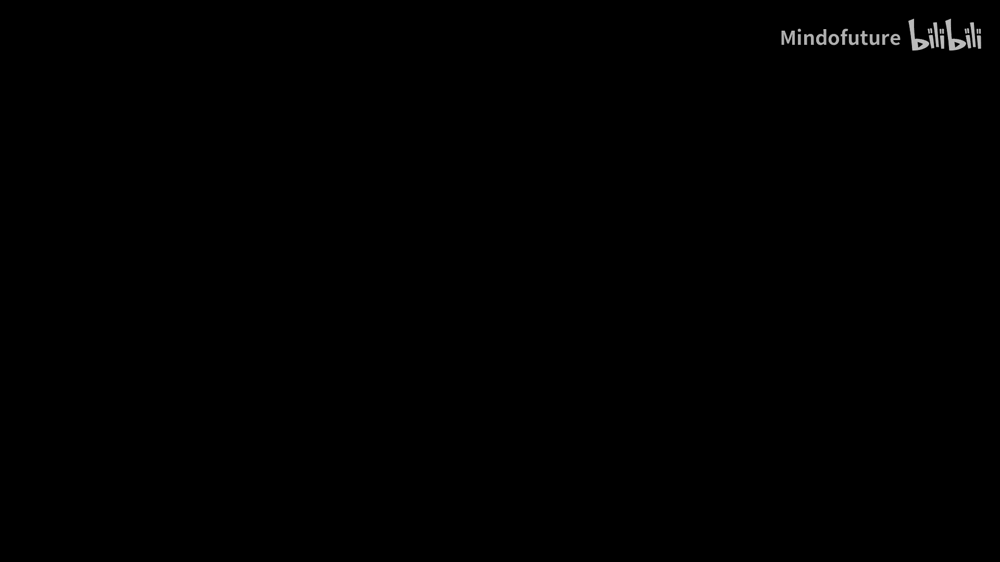
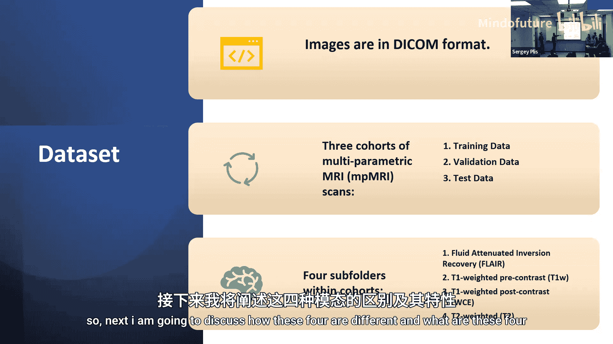
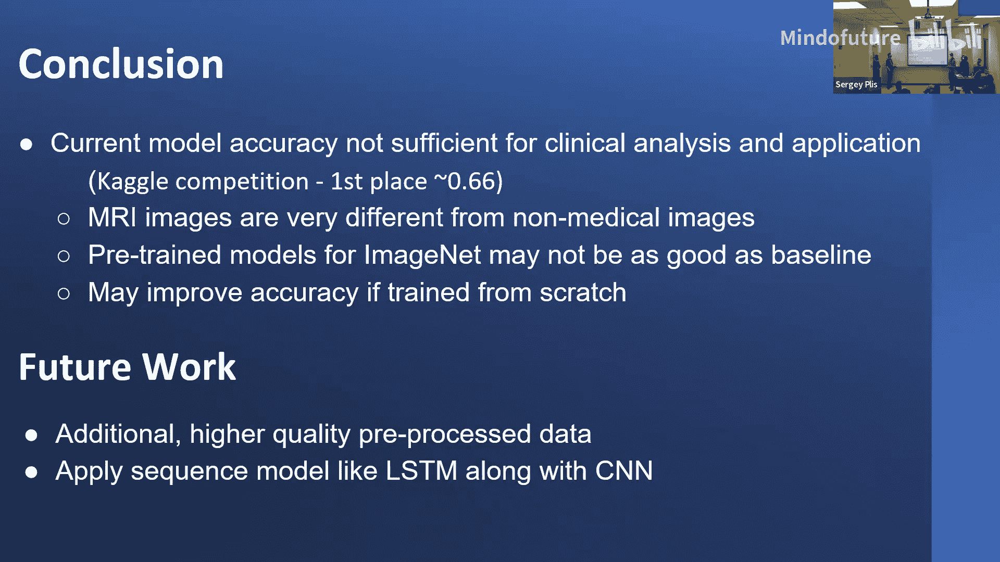
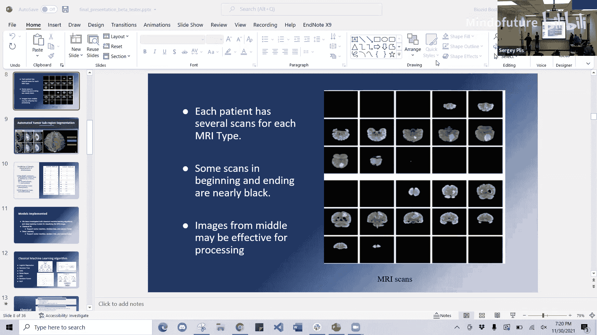

# 高级机器学习主题-CS8850-｜-Advanced-Machine-Learning-p82-P82_Beta-Testers的脑肿瘤分类--BV1sapPz4Ewx_p82-

。Greing everyone and this to present aboutgen classification brain。Before we talk about the process。

 you wanted to give you a little of your aspects that I wanted to。

So as we know brain in the most complex part for human body， it is the initiator of census cultural。

And many things other so sometimes in the brain， there is an uncontrollable thought of cells due to the of mutation which leads to tumor。

And these tumors are management or benign， and they're also capitalized as primary or secondary。

 depending on the oldism。So if it is originating in the brain。

 it is called a primary tro tumor and if it originates from different parts of the body and then spreads to the brain。

 it's called the second。There are more than 1。5 types of brain tumors。

 and we are specifically looking at bioblastoma。So my customer is a very aggressive type of tumor and this is mostly seen an artist。

And it is going of the most common malignin tumors that occurs in reos spike。

The treatment for this varies from surgery radiation， chemotherapy。

 and sometimes the patients have to undergo all the of them。

Moving with a confident that we have a lose in a project that is MGNT promoter metilation。

 so this is a key component that is used in a project， so MMT is basically at the N parent inside。

 it rescues the tumor cells from the agent that is use and chemotherapy。

Which means if our cells are met meta， then the resistance to therapy is higher。

 So just by finding the value of of the NGMP， we'll be able to predict if the patient is going to respond to the treatment or not。

So this critical NTMT value acts as an independent favorable prognostic factor and also a strong predictor for responsiveness to treatment。

So just by identifying this value or finding the value。

 we'll be able to decide the therapy for the patients。

To summarize any patient or any analysis of cancer anymore a patient undergoing surgery。

 it's very painful and then the tissue is extracted and sent for testing and then the characteristics of tumor is identified。

After which the periic diagnosis is decideded， which is very time for find consuming and all this can be avoided just by predicting the value of NDMP by using radio channels。

And coming back to our project， So we have developed the models that is trained inges on MRI scans of patient。

 and this model predicts the value of the FGMT。Using widths。

 the patients are obviously going to get less invasive diagnosis and treatment。Does是 my。发分看这个这。

So next will talk about the dataset。 So the user said we have a retrospectivespec collection of dataset from top vertical institution using a standard inter method but we have used different imaging protocols due to which heterogen I collection So according to the candle。

 we have three types of cohortts as the training variation and access this private which is used to evaluate our model by the candle and binding and variation was provided well So among these three cohortts we had sub of work which is flare t weight the contrast contrast and So next now wem going to discuss of each four are different and what are these four。

。So as you can see over here， almost like a different imaging technique where the time equal sequence5 vector are fluid color and。

 we take an example of even W that is the pre contrast and post contrast。

 the first two images both are almost the same except that if even post contrast。

 we have something called a Y thing， which is because of a presence called gaonium in the MRI scans so B to results is only difference between even W and even ws B to W we can see that the fluid colors are white and bright。

So apart from these s echo time expenses， as I said。

 almost what we we just like this is the difference between these four。

 So next is our data set to given。So for patient ready we were given a sequence of images like does showing the image over there you know which few might at the starting image have blank images that completely back as the sequence and normally in a few we can available to concept images in the middle which are a complete picture of a wing so processing of taking a least images was a bit of anti task for us and using this data said we could perform two types of task letters。

没说。So the first one was automated tumor sub segmentation and the we particular models where the automated model which would identify and add the segmentation part like the financing of the tumor tumor both and the old tumor。

 So this is the first class and the second task which we could do with the data says the as Korea said you was explain about the M。

啊对。It presence can how it can be。 So we will find out the MM promote theres a lot of diagnostic process which is required。

 So according to captain， this is a task， which is。Which willll be doing in this models。

 So next we' explain what our models should we try to fulfill the stuff bio。Hello， everyone。

 I wantna。If we't have all the models that here。Used on the project。 So yes。

 since our project is actually about a higher classification。 mainly we are actually。

Ping whether the MT is present or asset。 So yes since the battery is a viable of yet application problem so that we can actually go for like a whole family of。

嗯，也你先的该。There some of the like the past algorithms。

 like the support de discary and nano course et ce， and the deep learning approach for the later。

it's an interesting slidelate。I're moving with their classical your machine learning algorithms where you choose the most popular。

 which the logistic nutrition， your decision tree， SPBM， N，NN， Gr first。

 and the in the perceptioncepts。So starting with their classical learning the first is the filtering it is the preprocessing。

 third is the damage variation， so the then comes to monitoring and comparison result so starting with I can go to the filter we found that three of the patients that were just。

So。Yeah， we found that the given samples of where。I55。

 but three of the patient samples were not very there are there are some images missing。

 So that's why we removed from the our train。 And after that。

 we got like a 582 images to continue with the preprocessing in the preprossessing Yes， still。

 we first actually get transformed the type images into。A normal or I mean， means a addict and。

We only take the five million slices from each other。哦。I mean， instead of the images。

 for example the flare and of the TW1， TW2。 So the output of the proposal in for the each of the case here like。

你说你。Like we are actually the feature around the 370，000 new features are。Samples。

 so since it is a little like a therapy of your samples your samples list we we。I mean。

 we go for the reduction and that reduction， we use the most popular。他つ。😊。

If you are look see it and we chose of your 1004。I first 100 components from each of the image and then margin from each of the four image types。

 I mean you're taking to 100 from every image。ICon it and yeah it the final feature。

 it as a size of like。Yeah these are like a number of samples and these it's a number of features。

So then we just programme like a normal classical commissionary algorithm。

as I have also mentioned before that we choose the seven of them。

 and then we compare our results using the hourss。yeah those will be I mean there is a will be jetty specator。

 so I am with this， I am finishing my part。有レ题あ。かたに。Right。

 so next we wanted to get a sense of who moved into more advanced models of what a baseline would be so someone where to go and be like。

 hey， I'm going to find a machine learning model and run it。

What would that look like so that we can tell if our later models actually were effective or they weren't better than just going and finding something？

So嗯。行行拜拜。So we chose a convolution note and if you don't know what that means。Let's look on the test。

So some of our factors in making the decision were that when you look at columns evolving images。

 a machine learning。Basically everyone uses a CNNs of some form of affection is pretty common and so we're trying to establish some baseline that makes sense to use that。

Because everyone uses it， they're also very simple to come up。

 there are tons of libraries that have CNs that you can just pull out。

And they just supposed to be fairly simple and not supposed to invest a whole lot of time in them as far as I'm change it。

Now， some of the reasons why pollution lot are that they are fairly good at detect and extracting features。

 and this is pretty important for what we're doing here because we are looking for something that's pretty hard to find。

Relatively small levels of preproness that are apart and they tend to be pretty good results and that's important because the errors we're looking at in our application are either a that we do unnecessary exploratory surgery because we thought there was something there that was actually there。

Which is bad or even worse we don't explore because we think everything that pay。

 and there's actually some sort of cancer forming in our brain， which。Is also kind of bad。

So that was our focus now we can bring。And hopefully you won'll recognize that。

 only steal from the best。So as a review again。嗯。Ploution neural networks are based on the ideas of neural networks。

 so please forget my drawings。And we have these nodes having connected this markerstein。

And our layers， all that fun stuff where the seaport comes in。

Is knowing that our input is going to be an image and so we can take advantage of the properties。

Again，s wonderful which showing you。We had a kernel。

And we are applying it to the image and we are trying to extract information from it so they're going from a larger space to a smaller one。

And as says here create a smaller feature map and we do that several times and that's the basic idea。

 there's some further ways to enhance it so as was noted in class。

There is a disproportionate effect on the final feature map here because we keep sampling it so much。

So we can pad out， we I'm doing here in some imaginary space。a little better distribution there。

We can also。These optimizers and we can use max pooling at the end to for the next。

So hopefully that was a useful review。So our implementation on the baseline。

 just a little bit of data on that， and you can see my wonderful terrible code over here。

I utilize the Harris Library。In Python， and I utilize a 2D kernel。

Something like this because images are 2D and I thought that'd be pretty standard。嗯。Is this note？

Additionally I was like I'm going to go for the simplest one one layer is the simplest to use and that did not give good results。

 it would have made our later models live a lot better。But so bumped it up three layers。3 of these。啊。

I've use the an optimizer。And because my idea was to make sure that this was as close to baseline as possible。

 I did not do much for any hyper peri hyper tuing， which made it a mistake on my part from hearing the other type of patient。

So a little bit of information on that。As a result yeah sorry we so the end result was that it was no better than a coin flip by and large which made sense so our baseline if you just get one off the shelf you could recreate that flaglifting coin sign this one so now that we've got that baseline we can see if our models our work in improvement lines。

Thanks， colleagues。Okay， on。It really okay I guess my view。But has said that。

Whenever we come off to do something using game this is getting background because they show of plastic issues。

Or panel of components on your network。One of theメレジでて。Between the espec visa。

 this is the way importances of combination network as use the special visa if you use the monthly form。

 if you flat in all the numbers， then thespec user will you cannot get any information or special special information so。

As we our class is also image classification so we are also go through the composition network。

 then beside this composition network there some others type of study is also sometimes of。

Convolution of neo type of this deter is maintain its work as a sequence model and enzyme that is but deterator as a sum。

Problem itself that's well known is that it' a sub from radio vanish problem that means if you use the deeper then you you do not find any gradient。

 that means gradient of it will not work if the gradient does not work。

 it doesn't be it means that moral is not before。For this solving this problem。

 this L scheme is one of the。Take this question for more motivation of R and Ever。

 actually L team also support a similar problem。这ですね。

Because his cannot memorize as a very long memory at that time he will forget his first。

 this is one of the things of still so we said that him also suffer similar problem but not before the R。

Other this， there is also very additional。Your network this is being by many of those and in this field we see that there is some visual representation how the network are connected a modelular connected。

行。Actually we choose two models baseline model as a baseline model one is the if that another is rational we just actually using this model because building a module a sketch actually it's not possible for us as a limitation of resource。

Actually， we try our。put in a cable or sometimes our local machine， that's very。

 very addition of edition that means there's a very。It么レ ofレ。Others that maybe theres computer CPU。

 theres limitations。 so we are try to use the baseline architecture using the。

Ways we try to test how this classification works。And efficient inefficient resource and。Now。

 name also indicates that there's more efficient computationally and increase in the figure。

 we see that。An efficient network better in computations， also in。In accuracy for the imagenet。

And actually， division at host is a。main idea is just moral escal if have a baseline moral if you have a baseline moral baseline this is baseline that you can shrink you can scale the way sometimes you can scale the death sometimes you escape the resolution。

 sometimes you can compoundscalating you can do this is the main all of this to sh it。对。

RetNe Renet50 also re is another one popular。You network model because there is some strength of this connection。

 There is steep connection due these features of re。

 renet can be much deeper because if you many architecture theres maybe some very gradient finishing problem。

 but this way we can keep the gradient mass。 So this have the more deeper model we as you know our concept that the deeper the model that this may be mass features or。

不。For course image processing because we do some pre because RI the RI image our usual our TV image that means there has been our pixel。

Pix would take a deliver is not the same as because there's three layer R TVV。

 and theres a much more。Much more resolution but in R image much different and to dig the features from this RM is really different from as usual well as image for the just like as image net data set that's very different for the user we do don see image from thecom we will M image from this we start the image data then we only take the 520 slides from the middle because as R we see that fast and last a few images have no actual test blank that does no information so we does take the 15 minutes  20 image another is as our limitation of computation we did not compare much more 15 image from the middle then it will be bigger size and。

コピーシコピテーション心理。这说是。Then wescale this image to that means we have three image that is 20 and after that we rescale all the picture we20 25 to 55。

And we looked the image in the area and have speak this to create the model training and size for the risk that we as just suggested take the input input。

24 micro24 and in this case we yes the picture is 202，155。

 Another thing is we there is for type of Q image here we try this type of is time to train the model and to object the the performance of the in classification is type and increase try to convert all the four and continue applied SD or sequence model this means type of video classification type to do what actually。

No， anything she said we。Yes， for before applying the efficient net we are based。

 we applied some input work we have defend the input size theres match for our size then this input is at the efficient net after defend output that is on the output01 as value after that we using this output input customer model and we to the fit the model our data and we actually object the loss and or value of the。

你说。嗯唉。That's actually our plan of work and result we did this。Thank you。是。是。是。Co。就佢哋点啊。

Talking about the result portion and like this figure。

 we can see the RC curve as we have used the several classical learning algorithms。

 we get the software vector medicine RC area under the curve at 59%。

And in the right side of the figure shows that the figure shows the bar graph shows the accuracy precision and wrinkle of the different classical missing learning molecule which we have implemented and in this graph。

 it is clearly shown that the support vector missing balance the accuracy precision and the wrinkle。

 so among these we can say that above。And this a software vector machine。

 at least perform better than other classical machine learning algorithmism。

 although it area on the cropism on 59% and accuracy precision and recall around 0。6。

as we have a four scan data types T1W player， DPW and T1WC。

 we also implemented our baseline model on each of these data sets and plot this RRC crop and found that this T2W perform a whale with with AucC of 57%。

So this is a result related to the efficient net where we plot the loss graph between the loss versus the epoch and the AUC versus the epoch in the loss versus the Epo。

 we see that validation loss is more higher than the testing loss and in the AUC versus epoC the validation and the testing they try to overlap and after short that is a 20 epo they all day and try to be a constant。

So this is the this is for the team1 W。previous one was for the F data set and the next one this one is for the G1C where there is a they somewhat somehow loss and the testing and the validation they try to they try to overlap and in the AC versus both the graph somehow tick check where we can see that they do not match with each other。

 and this can be due to the overfiing problem。And this is for the nano prototype that is the T2W where we can where the training loss is more higher than the validation loss and in the AC versus poke。

 we can again find the j chart where there is only a little overlapping detail with the training and the validation data。

So talking about the conclusion as the result or the accuracy is not much that we expect and since our process is based on the medical image analysis analysis we can say that clinical analysis we can our result and we can fully depend on our result result as we have only got the 57 57 person accuracy and it's also that in the capital competition。

 the physician hold they got the 66% accuracy and the shareholder are not happy and disappointed and this can be due to that we have used the  three1 models and this can used more better when we track to train our data from the very or from the spread strategy so for this。

What we can do is that important in the future that we can pre we can use the high quality data for the preprocessing and also we can use it others neural network model and such as an LSTM L with the CM。

So we have also recorded our activities in the hand， and this is the spinr。

And this is the out of repository where we updated out code。This is our neural ideas format。

These are some of our references。你。I plus， do you have any questions？是。

So the highest more you had was。そそす。Yeah the training and validation， if you see that basically yeah。

 if if the training plus and the validation curve overlap， it means it is over。

If it goes on training， then it is basically known for overfiing situation that how can they actually predict get best scores with admission。

there also some诶 I don't know have this actually诶诶。

have my observation is that accuracy is not good also in is not never good in my observation this case also say that there is not a modelism can detect the features of the es and can give a decision is on the current decision get all from the you said you can say that theres the problem of Google fitting problems is okay。

 also there is of them of not。Because my observation is this on this board and we use the actually for most of the layer。

 that means as a base layer for you never re the piece away from the image net。Even for image data。

 but image data image image data said that the image and this image special features。

Are much different from the camera image。 A is very sometimes very close and very few featuress or is much similar as long as though we see in the hybrid spectrum image or multi spectrum image there's bikis or in a small area as well as there is a feature image。

Pip nearly see as I work in the this see is a big given one image。

 but this picture of appears in the big area。 So that means in this image difference from our。

 So so I think that as you use the basically to So in the most of the case we get the target lower accuracy my objective。

Can you go to the model part。Yes。你所你到我。So all of this is being trained on the2 this is actually the3D minutes that will take the 20 slides。

slice and image easy image is2 where we use that con slice that means we must them and you get 3D image Theres a depth is。

所以呃。I mean， it's a very terrible I don't know so the image when you were explaining each and every brain image is like。

And there were like two images where the first one you can actually see the middle of a white spot。

 the second one have lot in having is white spot。I don't know what that you also may be correct because anyoneation some cells may may have any sign of the tumor may not have but all they are saying that the person has the tumor or have the cancer this is one the reason some cells may not have the information if you for this case。

 if you。March many slides together it has a3D model and the network will consider all together。

 that means if there has no any sign of the， this be this is actually the training is the training any there is a if any importance that you be that is the So my main question was when you given that you're using the3 emerging sorry because it keeps coming up I dont understand what do you mean by merg。

 actually not this one I can't what's。It something。And then。

This is the size this is the size we take 20 slide we just this is a that we say you have a Q Q 256 and would you do that。

We useful as a t。I can you use this image use？This will please consider the quantity as a。

So in in 3D image， there's a three center R here is con center。channel。

 we can Which quantity you have 256。2020 what is random20 rather20 leftmost 20 topmost 20。

So I have like， look at me， right， there is this thing。 I can randomly take randomly take 20。

 I can randomly take three types of random take of 20 or like what are you doing the middle which is that this and there is that far the。

Q of the areas subject。 this is a note to both of you。

You are like those people never held screwdriver in their head。

 I never seen the data in both of the talks， just a histogram and here。Some stock images are okay。

 but you're working with the data， Have you ever looked at it， right so。In your case。

 the question is。Is it this probably also from the category of competition right in like yourself have you float you understand but because there's a play so that's a coronal slice right that's that middle this and you took well。

 I mean， be specific geometry sorry this slice means nothing to me right。

It's like there are three directions， X Y Z， or there is a coronal Satal or whatever the the one axle layer。

 so coronal goes like that Saal goes like that Axel goes like that which one you do actually on this especially I have。

So you took it goly randomly without looking at the data。 some random direction。

 some random slide Actually get direction are you taking slices by the because have on it So I know have So basically mean when they scan So the data is provided each structural they provided the segment which which is basically and size varies each of the folders So in each folder。

 they have blank as well as the places where they can find find the in scan So to actually balance the data what have been doing that they have removed。

Those MD plan。Oions that that's what you did， right， So basically， the representation is wrong。

 It is26 by 26。 you have 20 images 20 images we just use 20 images Thats Yeah whenm asking which one。

 which ones out of 256。take in the middle given sequence。

taking each and every image the data take images each folder using size basically0 images each you a there are no images356 and then okay。

 go ahead I have more questions just follow question you have and you said that you areing the middle。

they are giving us the three no no are they only giving the image you have to image youre making it now you have the to image and then you say that you're extracting the or something from the middle。

So take 20 slide 20202D image make very understood you someone set a sentence about extracting something from the middle like what actually middle means they are given that is the list of image take that from the middle's to point you That's where I want to point out if you take a 3D image of that middle thing。

 another 3D image of that melody。 Do you not think that you will be losing the spatial information of that of the brain information。

also that's true。 we are losing to some information because dont image the brain don't know for example17 images and only the beginning and last blank images you select using your only thes true but if you all the you not the know which only the images。

 which brain in that brain image you just the middle you will be the spatial that will be just two。

question you uncover something the Okay you a specific does be in the same place then cannot Let's move on。

 Let'ss we have about three minutes So other types of questions you can discuss on slide or continue the actual details the discussion。

But anyone other types of questions I have mine a little bit just clarification。

 so you took standards talk SVM got 0。6 area end of the card。

And that was your baseline then to improve that you took two models that are too large for you to handle and just applied them blindly to this data right to 20 channels Why did you take models that you can't handle could you continue improving classical model So it looks like this completely failed on resnet def or any it wouldn't wasn't training it gave you just random predictions right。

The very first activity from classical models we found out that。

The classical models can be actually achieved not more than 60% and yeah from the table and other people that were working they were all。

They're going for the CNN so that's why we try to actually I mean we try to actually explore that to get a better result。

 but eventually actually as you can already know or as that that there are like the mistakes that that we I mean。

Yeah give us some mistakes we actually actually failed to reach our。

 I mean it got lower I mean it gone a wrong way， it's supposed to be like more than 60% that was our assumption。

 but their choices we made it was actually giving us like a I mean lesser than a classical one but。

But it should have like I mean if we have like a I mean understand and the at these various images。

 we could have like suppressed the classical models and leach up to 63 or 66。

 that was like the winning team that。 what did the winning and Tim Lu use？They use here the CNN。

They use the mono or something I I't know what the。

We CNN So I have a question about your baseline CNN， what did you apply to？

What was the input to you saying in CNN because it kind of a presentation was mixed with classical machine learning and classical machine learning。

 my understanding is that you performed PCA to first 100 projection into the first 100 components so like I said。

 my idea was just to see what would happen。At a very baseline is some random of idiot trying to find the model。

And so which I had now learned but CAL API gave direct access to images and classifiers and so I quite literally just pulled both of them into the model so what was the input the single question the same 20 channels 256 by 256 image or PCA rejected 100 vectors？

No， it was we of statement and is what the last for the data to we rescaled the pixel size of 0 to 255 and then we rescaled images to22 hold it whichcate ran 20 images or made it as 3 which we took a2 in one。

你一番。Like a middle one in this I mean， okay， like everyone where they got confused like they got that we are adding like extra 2 from other images。

 but here， like for one patient I example by and them。 So for each reason， we have multiple images。

 So we get this whole thing。 So if we split up， we then using from those many questions we we created a3 model and which use for edition here。

 But whereas for。ARenet and the CNNs is just the single image， the complete grain image。

And what is complete brain image， Comp brain image is is one slice。So。This is very confusing。Your。

Story about the data looks like there is a disconnect somewhere。

 the data that you were giving and the data that you worked with they don't there is like a huge gap like if you took the data from somewhere else I'm just explaining why the confusion happening I'm not asking anything。

ButWe don't have time with time。😊，And okay， and another thing。 so I confirmed you took the models。

 I train on images， tried them and you took the largest possible models that you can handle and you didn't have time or whatever you didn't explore where the smaller models that you can handle because 256 by 256。

 I can run it on my laptop even on CPU I can train on our CNN network and it'll take longer than on GPU it's fine。

 I'm just confused by where's the complexity that you're talking about， maybe the data set is large。

 but how you tried randomly picking subject and training on smaller days。

The was like the internet which we tried for one part of forward， that is example play。

 So if you want to say that a layer。 So one epoch to refframe that would took I trying to in a normal computer we tried in right but cattle error that other So those is the size is a big thing because we have。

But there's a lot of ways so I apologize that we're dealing one last question and I guess it's。

 why do you think your CNN performed chance level Why do you think it did not learn anything's it's a learner that can learn any function right Any decisions about there doesn't have to So why do you think it's a chance level we don't think that the CNN word better but we just said we use the baseline models use the width for image No no no。

 this is before image。Before mention， So but why did you use the model that wouldn't work。 Yeah。

 you bias it， You took a model that will not work on purpose because pretrain model on one type of data will not work on the other。

 It's very hard。 You have to be training from scratch。 And yet you did that， I like what was the。

 you try sorry， what was the reason like， oh， let's make it harder or do you understand， right。

 you understand that's coming from you。 Like this wouldn not work。 So I'm just confused。

No criticismsses or anything， just confusion。So okay， anyways， we're out of time。

 can you stop the recording please and sorry for being hard on you。

 but it's very you get some bonus points for eliciting some response from the class。

But interesting basically， you just go yeah on the top there。

。Now， on the button， top。Stop， yes。