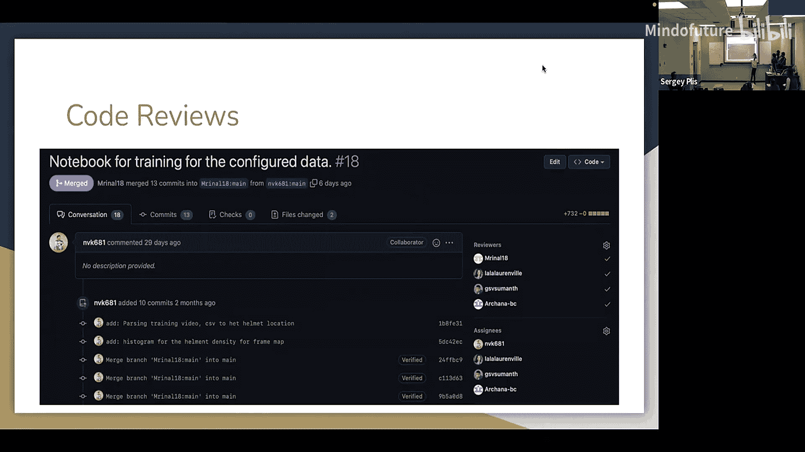
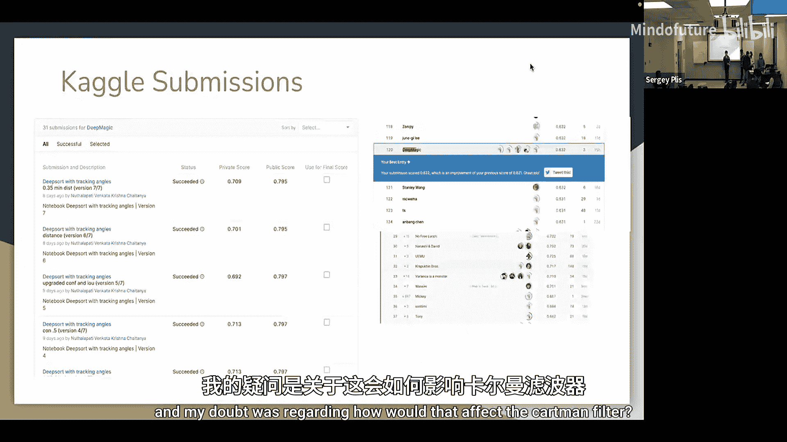

# 高级机器学习主题-CS8850-｜-Advanced-Machine-Learning-p83-P83_Deep-Magic-NFL健康与安全-头盔分配--BV1sapPz4Ewx_p83-

So。

Okay。Hello。It measures the again conversation。And today we're going to be discussing the NFLfl F Coion project that we be worked on。

This a little sign note， this image right here was created by Raigh Minny。

 which you guys should check out so if you just type in any text that'll generate an image from that text so we type in being magic and this image that it created defining。

This going into our concept for presentation。We're going to on the motivation for this project and the data sets to pre processcesed the effects that we did。

 then get into our model and department， then discuss our training and testing and then also what we did for to evaluate and what our results and then we're going to discuss a little bit of violence Human organ against and pollution。

So the NFL sounded back in 1920 and it's working its way up now to be one of the most successful and popular sports leagues in the world and it's like number one America。

So over the years they've been trying to get better and better at making gang Sa because they're just in so many sports related injuries and they're taking information from independent medical researchers from engineering to advancementss just allowing people to analyze their information they actually each fall。

 they release their data from throughout the season so third parties can analyze and see what they can discover that can help it against Sa so with this project they were partnered up with Amazon Web Services AWS and they hope to look tackle competition of engineering。

嗯，是。To automate the client process that they have where their manual leave map each player。

 they allocate the numbers to each player and that map it and that's just a very long two concept。

And if there was an automated way of detecting people。

 then its take more time to answer like more complicated research questions。

About games so if our goal is to make sure that we could correctly assign and decent helmet for players and also accurately identify when they were at encouraged and yeah this is a very great project this I hope with a lot of research and helping game。

This is。嗯。So as I said in our previous presentations， that' just issue our data。

We were provided with MP4 videos， two videos that were time scene and they were。

rainThey corresponded by each single frame last time。

They had one view from the inline zone and went from the sideline zone and it was recorded at 40 frames per second and there were also another additional data that it providers that we have better detection and that data set was full of images that had the label boing boxes for the helmet and that total data set size of 9。

000 almost 10，000 images and so 8，000 training images and almost 2，000 television。等佢诶上家找什么钱。

To discuss the。PD and sorry。 So So to just give you an overview of what model looks like。

 not going too much。 this is what even if they will that they provided with us So they have given us increase。

 So they have map each and everything and expect audit。

 and that's what they've given the we find they've given a place for each and every they have given the location for each and every place along with the direction that theyre moving and and and the rotation our rotation of tracking for tracking。

 theyve also given us the view of this of the end zone and the central that I been showing it you in upcoming size and we have we have total of 53。

3 in the biases and 1。3 in the。Okay。So these are the sideline in the end and and the top view and the side view of the images that we have。

 So as you can see， we can actually see there the top and this is the side view， which we have。

 the So this is actually。Hing model and a model will be evaluated on the 5 unseen case。

 actually the videos that they are having which they don want us to see。

 But a very tricky part of this the testing set that they gave us was a subset of training set that we had。

 So we had to find in such way we will be working on the testing set。

 but we wanted not to be set of the training that we But Ill discussing a about the expatory data analysis which I handled。

 So since in the previous presentation of the previous thing that we had I already explain a lot about areas that we did。

 So I will not be dwelling a lot into that。 but instead we be going for modeling as well as validation and very But the most other information that we look into this was that we we had like 50 games50 games out of which of those 50 games each 50 games had like 60 videos。

And each 60 videos provided into training the test set along with this for each for the total total videos we had like 52000 frame and the biggest helmet size that people found was 5928。

 So when I'm saying 5 928 it's with respect to the image。

 So imagine you' are zooming out and zooming in the camera and whenever youre zooming in the zooming the biggest the biggest area that helmet is covering in that is 5000 something and the smallest area that it's covering is9 and mostly the helmet size are around 150。

Now， there were like few information that we wanted that we previously analyzed was what was the starting point of the game。

 that was a snap。 So when I'm saying snap for those who do not know it's the exact time when the game is starting So before that deal all come into position or something like that。

 but snap is when the game is going to start and so so the video will basically start before that So we wanted to trim the video video till that snap and so that we do not want because we do not want this extra information and it just discarding this information theres the information also like when to place it does now in the previous that we was side zone and the top view on the side view the problem with that is that you could also see players which are outside the outside the field you can see the substitutes the coaches everyone that there and we did not want those information goes there but we can actually find you other data in such a way that we will be discarding those information anyway。

WeSee the upcoming slide are the players， So we only want to consider the 11 players from each team。

 And that's what we are trying to do here。 And each each of those players。

 we want to check that who is providingiding themselves with each other or not the inconsistent player event we are seeing in each each time period is that。

For a particular time， let's say X we are seeing that that player is basically so we have 11 players in in that extreme。

 but in the xus one frame we see that we only have 10 or nine players it means that the camera is not basically they're not focusing on all the players because they only want to focus on those players are actually going to play where the ball is basically So we want to check if those if the information that we are going to gather is going to I mean it doesnt affect the players which we have left out or not。

这是。Now all these information that I explained before that， we have only covered after before。

 but the new thing that we are going to do here is we are going to track each and every player now So the tracking information how is going to happen is we are going to extract the frame from each and every videore using FF energy tool for extracting it because what it doesn it It will load e load it into the memory。

 we can use it。 you can just import it the P image object and it will automatically delete from the desk。

And so this is how the image of one of the frame looks like the second point of this is this will be that it will an but what we did is that we analyticstic each and every player into the X y Z X and y coordinate and you can see here that each and every player from home in the home and visit site theyre all map in the X coordinate and we can see them from talking so that information was actually really important and this kind of we took from the previous competition which was last year and we after doing that we actually come out both of them。

And this is how this is how it goes like， so we are seeing that the external coordinators here。

 but in the sideline in the end zone we are seeing that these kind of tracking these kind of points are also tracking each and every player that actually help us in in tracking each and every player and also labeling these of leavinging these players so that in the upcoming in the upcoming frame we can actually check which original player is actually providing in this is not because beforehand we were not even considering the player information we were just st if those compounding process was providing or not。

 but this will actually help us in the data case。So how we are going to tell this presentation ahead is that well tell you few elements that we did for the model。

 and then we'll combine all of them to show you the pipeline that we showing you to you right here。

 So right now。So for the baseline model， what we did is I mean when you're talking about object detection。

 you you definitely don't want to look twice。 We just have to look once。

 and that's what we consider here。 So we took the U models here and that model is actually very useful and it's very powerful models for for object detection that's been going on since a long time and that's what we consider first because we wanted to detect the object。

 but detection of object is not the only case that we have。

 we have to also track these images and we also need to check if those players are actually because we have because this is a video anchor。

 It's a real detection， not just object detection。So the first thing that you wanted to try is that for the tracking back。

 especially， is that we wanted to。We wanted to like in the previous it。

 we wanted to put each and every points on each on each and every player and we wanted it to go to mean。

 for example， if I'm moving like this， I wanted to track the point that it's on me。

 So imagine so we use this points set registration which uses the caution mixture model unfortunately。

 it did not work for us but it work for a lot of other， but what it does it。

 that as you can see help the red one and the blue one。

 it's basically going to set each and every point or the boxel of of the object and it's going to kind of segmentation and then it's going to put those images those segmented images that we want as the as the object that we want to take it。

 So what we wanted to see is that if the the visitorsor scheme and the home if we could actually。

If we could actually if we could actually point all of these all of these players into one into one box。

 then we able to track each and every player。 But the problem with this is that it could not it could not make the network learn。

 but we could understand now that we need to actually it gave us an idea that we need to try the videos with a rotation of others。

 and this is useful and how it's useful we will discuss it in the next thing。 for now， I give the。

Oh no no sorry not doing。 So okay before we even dwell into the main model。

 So we are using an algorithm for D salt and deep salt is actually a very nice algorithm for tracking each and every frame the object in the frame So what we wanted to see So it uses this Hungarian algorithm to give you just what Hungarian algorithm does it it will let's let's say two frame So it will take the first frame and it will check the second frame it will track the second frame the object in the second frame has well。

 So I won't be going too much deep into how the Hungarian algorithm works。

 but this is how exactly it works。 and along with this Hungarian algorithm So what we try to do with the Hungarian algorithm is that we try to normalize each and every data that we have in the X y coordinate。

 and we try to after normalizing and put in the Hungarian algorithm we can see that the labeling of those players is happening here。

So this green and this blue point， what it， what it tells is this is the this is a predicted。

 This is the actual。This is the actual point of the player in the previous frame and this is the actual point of the player in the next player。

 so this is how we're getting an idea that we can actually try to play a player in each and every frame without even looking at the videos。

说。As I told that we use， we also use detectron2 for a baseline model。

 Deron2 is Facebook A is Py implementation for object detection， but it's like it's like amazing。

 but we couldn't really any。An example of how it works is that it will segment each and every image。

 it will also give you a pointing course prediction。

 and it will also give you a den prediction of that person or any any object。

 And we couldn't do that because there were two problems first it doesn't take the data set in actual format I was given by the cable。

 So we had to convert a data set in a corporate data format Co data set is nothing that format is nothing but converting it into a JSO format。

 That's how you can see。 So this is created by a system So we had to pay the whole data set I was given to us into custom data set。

So that we can use the audit technology， but that took a lot of time for us and as you can see that for each each image we are getting each and each and every information for that whatever was given to us。

But the problem with this was that it took a lot of time and we were able to detect it in the panel for few images。

嗯。As you can see here that each and every helmet is being detected really well。

 but the problem with this this approach was that we couldn understand how we can apply this for video。

 but definitely going forward we definitely try to do it， but going ahead。

 how you're going to find you the model and what is the python of the model。

 I would like to call and explain of other elements。Sure。So。Ca。

 So this is one of the famous tracking filter that was used at even the corner pocket like they detected like where so this。

Camera will what it does is that when the camera fails at an object。

 so when it is moving at a high speed ands encrypt the object in the camera。

 it's some kind of obstruction is being suppose some cloud or something that is upseting the way angle。

So no啊咩。The view so what the camel filter does is that it exactly predicts where the position of truck rocket is going to be So in the same way。

 we have used a camel filter in our model system when a player is getting when a player is moving what happens is。

But。啊。诶你做啊，我。This helmet will get affected by some some board some body of the other player so in frame was you might have seen seen a helmet。

 but in frame to the same way as helmet might be affected by other some other some other like body or something。

I I understand。Our can with the warning girl accurately in Verosio。

What it does is that it the velocityosity of the veracity of the object and the position of the object it also has the average of acceleration acceleration and by these parameters it can estimate like where it is going to be in the next way so even when the object is not visible but we can track that where it is going to be in the next step so。

So here you can see that it's a property density distribution of like where the object is but suppose for a minus1。

 you can see that there is an object that is visible or there。

 but as you can see as forward and but K frame， you can see that we cannot if the object is not visible to us。

 but we then the related state estimate，And we will have a correct measurement like where it should of be from by taking these four values into consideration。

 we will have an optimal state of estimate like where exactly this going to be and then optimally saying like where it it can be so it will be always close to the actual measurement like so that's how we are going to use cabin printer in our model。

So trackinging angle。 So why we are using tracking angle。 So what happens now model this。

 we need to detect the collision of any two helmets。

 So when the two helmets of each pair are coming close to each other their bonding boxes might get the inter。

 So this intersection was considered as a religion before before when the picture before as a。

As a as taken as a question， but as later， we realized that it was not only Europe。

 So we also took the track we looked the a their faith and that they are looking into。

 So if a person is。ai， like I thought if they're looking at each other。

 they will not come on because they see each other。 exactly that's looking at each other。

 that's the case。 but I think they show doesn why that only that information is not。So。In都诶啊 two。啊。

所以这说有的东司。So let's suppose if two players are almost close to each other。

 but they are not I mean from my friends like two players are close to each other by looking at this point。

 but what if the person is here and and here and the camera view is shows the when bond bonding box for this person and bonding box for being and these bonding boxes both can be intercepted So at this position we will consider it as a collision。

 but。And the the real thing is that。啊。So here。And the people are looking at different direction。

 what if they are looking at different directions that he is looking at this direction and he is looking at different direction and and I am looking at this direction and the opposite platform looking at this direction。

 but they are not even looking at the same direction so。In order to have a collision also。

 they need to look at the same direction like these cases would the opposite should be in the same direction this by using this factor。

 we're gonna say like whether the helmets are getting co or not So this can be used by mean this factor percentage percent we are using processingactive in order to know whether whether the mean the are getting co or not。

 So what are the the next step is for the object detection， we are using euro。

 So the states that are involved in euro is that whenever we give you an image， these image is like。

你是咩啊每啲就。So these the number of groupss that are well out the image can be SS。

Or in each in each period， we can we can put like a P number of bonding boxes on the object。

So if there is an object， we can put the main number of bonding boxes and these bonding boxes will have some particular value。

做咩。So if you see here， we have a scope we are concerninging this as an object。

 we are putting a burning mouse object and this body mouse will have it a center So as you see the vector on the right hand side there is a vector to which we are saying the PC as a class the p of being an object present in the image。

And Vs and VY are the center of this point and then there in the image and VW and B V H are the bonding box height and B and C1 and C2 are the class of the object。

So here you can see that the IOU in other words， IOU is like intersection over again。

 So what is this name So let's if you can see here。

 So the actual morning box for this players helmet and the ground it can be the round to but the predicted was like this So this。

Not to know the exact thing where you are going to take the ratio between the actual rounding boxes intersection or。

说。Here you can see that for this image， we have put cash number of grid and we are going to detect like a multiple number ofing bonding boxes over the objects。

 but which bonding boxes are we going to consider。So in order to tackle this stage。

 we are going to use normal max suppress。 So we what it does is it takes a maximum value maximum value of the bonding boxes and it will。

It will give that value to the morning boxes， so here you can see that out of all the morning boxes。

 we are going to get only like a few morning office or the office that have huge number of like very large values management competitors as well。

So the youて。So the every every your model has the three so three。

one of is that Euro backbone the backbone there a feature extraction and the Euro generate the feature of p and and euro head does the generation of prediction of and boxer Gi for tracking for multiple object tracking we are using each and digital condens。

Three algorithms each one is like Canon filter， hungarian algorithm and the CNN。

So the methods that are implemented in our finalal model for object detection。

 we are using neuro and for the name sort we are using the H filter and the a filter and also for the tracking and also we are using tracking or as I said previously the conditions that are set for a collision between the helmets where as long as the intersection between the bonding boxes and also looking at the constant similarity between any two layers。

And the next morning can be accept my agenda。So you saw as like what architecture we were use in the whole pipeline which as you。

 which uses CNN the saw and then you also tracking the animals。

 but sadly we were on we didn't do enough。 So there was definitely a guy who would always come first and we didn't come first that's sad。

 but I just want to explain like how what he did He tell of exactly what read it but but so this is the architecture that he used。

So he took the images， theG images as well as the X coordinate。

 which is marked in the antenna and then he he took all of that we are doing it in just one though。

 but he separated them and he's using the detector as a separate model and he's taking the labeling of that detector of the tracking data as a separate one and the best thing which he did which we didn't even know was after after doing this。

 he started tracking history， the tracking history means that he's using each and every so he's basically stacking each and every frame So let's say I think in his example。

 he gave like10 frames and then he is using those hundred frames to track what the information the collision and then using this checkpoint for checkpoint and then using another hundred frames and then using this checkpoint and then so on and and that actually gave a really good accuracy and one thing which he was using was this Wf like ensomble so。

So I explain you all about non mass suppression wall So you can use so imagine this example just to explain what WBf in very very brief。

 So nonm suppression model it will do is it will take all the frames into in all the bonding box information into consideration but what it is they a bonding box which is which is wrongly labeled that part will also be considered in elements while in WBf。

 that part will not not be considered in fact， WBf will what you to do is it will take all the bonding box information and it will also predict the bonding boxes that should be there if it's misclassified and that's how it can be properly and as you can see it's basically。

N day difference so we didn't do it， but definitely it's a it's a scope of you know learning in the next in the next one。

 what you'll see is that really explain you how we did the training and the testing of a model。

So my girlfriend and media will be taking part with。Hi， everyone so I you be talking about a。

So as you can see the enterprise like， for example， in a video we need to detect people。

 we need to practice and we need to trigger an even whenever pay helmet collect。

 So it is really complicated。 we cannot expect one model to do a building。

 So we made three models to work。 So each model has very very specific task to do and we selected a model that does the task regular So when we can see in this case。

没事。So we always are like people who wants more data。 So we are given same set of data among everyone。

 So we need to allperform others。 So what we need to do is get more data。

 we can't get some data and put in the decision。 So what we have two different kinds of data in videos one side end one is end zone so you can say the question is sideline the second one in end zone So what we trying to do is we took the endz zone image and action by coordinate and even a tracking info So that our models will have more data to learn So by doing it what we are trying to learn from it is we need to find out and player and then we need to see how he is moving in the game through our decision。

 So this will be caution even if filter the action by coordinate and we can say like we could have side also and it it would be even better but we could include it because in sideline most of the camera angle is that there are a lot of outers like people who came to watch the game and。

ho have helmets and standing outside。 So all these random people shoulder。

 So we didn't want them to influence our model。 So we sideline printing。

 So we tried it on sideline end zone and flipped end zone。

 So we had a bit of leverage or other people we tried that and next thing is minimum contents like for example。

 when running the model and output and input the problem was like weers are wearing helmets。

 there are a lot of people outside in many angles which is showing the system off。

 So we wanted to build the demo So we only optimal threshold of 0。

4 we were are getting the best accuracy and we are ignoring any bonding box that has less than contents of 0。

4 with this we made it a bit optimal。So yeah now comes each and every model。

 So our model has euro and leaves shop and tagging an。

 So what Yo does is it's going to take an image。 it's going to detect an bonding box and it's going to give a label for。

 So in the entire tiny process how we give this data to euro to learn we took a video and we took each and every frame from video and we mapped it to the CsV tracking data that was already given to us by the table。

 So we created a bonding box from each and every image the player and label and then we made euro to learn from So once this is done if we take a random video and we take frame and if we give it to euro it use a bonding box and each label So that is how we tri and one model is。

As you listen， we train three models in our table。 So it's obvious that we are going to face a lot of issues based of time complexity and space complexity。

 So the way we went and we didn't pay any money to give us extra parameters。

 we train euro separate notebook completely like we gave all the data we give all warning boxes。

 we in a different notebook and we save its checkpoint。

 and then we imported the same checkpoint in a different notebook and we ran other two models and we ran trying takes a lot of not sending the input and in output。

 So we just save a checkpoint and we use it in a different notebook。

 we done with euro and then we use it in letter points。

 So we deal with high space and time complex using and export is。 So for example。

 that euro is really pretty good。 but it only was on images。 but our entire problem is video。

 So what we do do is once we recognize pattern also we say bond。

And we know what is the feature and made to know how he's going to a video。

 which is like trackingging a player from one frame color。

 So we took the help of a deep salt and how we train a deep salt we took all of things in the video from zero to y and we trained a deep salt based upon it So deep salt takes all the input in the sequence order and then whenever there is an exact film。

 it will be able to understand like okay if this is player where he's going to win the next。

So that it's going to predict。 And these are the are the hypercameter but the leaves which we played around and we played around in a situation way。

 we get a most outcome output， which you can see later on the next thing is angle。

 So now it is the biggest part you know who a pair you know where is going always going and detecting where two pair co is the main part that is where the entire on。

 But the issue is that initially can be a showing we came up with lot of pair。

 So if two warning voice comes close if one covers one if two warning was come close and shrink and so on。

 But most of them are not really practical because that camera changes people changes a lot of shock can happen。

 we can' can see each and of it and the data。 So we when it a better factor approach that is angleng rank。

 So for example， we have a we know where the player is in the exact。

 We know where is in the previous print。We know where he is going to be an next because the CV data is going to build spoon feeders。

 all these data。 So we created like homoography on based upon all these packing value。

 So we know if player and which direction he moving and what is moving So we know if tradition we can do there in what angle daring so we can check if their angle are going to collect if near to create a positive per collision so on。

 so that we can trigger an event， whenever we fund a set of stuff per collision。

when we go to next discussion。 So we it obviously discussion。 So we bring three different models。

 and each model does one。 So like， for example， you only takes care of warning next one is next is。

 So we just give that set of data to model and we let it once each model is doing what is supposed to do then we collaborate all of them into a singleth and we all the data and we got output and we aggregate all the data and then we have our submission Next thing is parameter。

 when we took all these models， we know that the default variables may not best suit for So we on all those values we could around with one variables we trying to do all these possible So our last changing we good。

0。7 monthly and probability is 0。97。 You already see what variables be use and how to impact it。

 actually we will cover it in the next evaluation point。嗯，还有什么。

I you talking about the evaluation of our artist that。

So first thing is we looked at a couple of papers where we could compare on the detector2 as well as the euro and here SSD is a single short detector that is also used used to detect objects itself and then here。

If you consider in this graph here， you see that if the objects are small or medium or large。

For smaller objects appear for all of the models low。

 but faster R problems is better than the other While you can see for the large objects。 Also。

 it is the same case there。 But if you consider the speed。

As a trade between accuracy and if you consider the scheme versus accuracy。

 then you purpose at a faster rate in order to determine the labels or delete the object compared to pass。

 So detect on2 users incorporates pass。And here you can see even the image image processing。

 like when you have the video， you're going to split it into frames， right。

 So the processing of those frames is much faster for you compared to the electron2。

So our problem is to detect the limit collision。 So we wanted to detect it at the earliest rather than compromise on the speed at which it is going to give us the results。

 That is why we went with yellow。嗯。So the feature that used for the evaluation by the candle is for the yellow model is the IO is the intersection over the ur and they are computed weighted accuracy by using the subtle of non and the total where non if is nothing but the zone impact collision like they both the players are about to meet。

 but they haven't actually had any head injury or any injury to the body just that their very close parts。

So there is a non impact collision， and then the impact is the actual impact that has occurred and some injury is determined there。

And also， we have considered that the number of frames should not exceed a number of 22。

 because we have a home carry and home players as well as the visitors，11 players on each side。

 so we don't want to。Have more objects to be detected there。 That is my restricted there and。

When你 go to the we。We know that that training data size， if it is very large the of imagess。

 the will take lot of time to process it。 but then the accuracy that we obtain from D2 is much higher。

Compared to euro， but then euro can process them faster。

 that is why we move forward with Euro and comparing the resource usage like it takes less training time as well as when we tested on those videos it provided us results in a shorter period of time。

So compared to the model compared to model size as well。

Deleron 2 has a bigger implementation logic that we could see。OkayAnd that is and that is what。

And even to proceed with that as well and。U seem to be easy because it is easy to understand as well if you go go to Europe。

 you will be able to understand it。Next's， coming to the matrix evaluation。

We have used the W He library， which is Latin about dates and Mas tool based library and this library is an。

It is used to evaluate the performance of our models， train models。

 whether that's performing good or not， it is easy to represent them here， as you can see in this。

Pture here， we have the training set and the evaluation set。

 and we are going to determine three losses here。 You can see the box source。

 the object loss and is the classification。The box is nothing right。It did。That there is a。The the。

好生啊。不是。So the mouse law is that like the regression loss and when you come to the object loss。

 it is like determining whether the object is actually the one that it has to be or not and if it is not directing that will give us that loss and the classification loss is right。

It has to did that it is helmet only then it has to choose the regular helmet and apply the body boxes。

 otherwise it should not and if it is not a helmet， but still it is applying the body boxer。

 then that will give us the classification loss and same thing has been compoundd on the validation set as we all we had training set of 9000 change records and out of which it also had the testing data as well in it so we segregated there and use the 7000 change for the training and the validation part we the 1900 records。

And when you see there the。What we have。compromise longer。So when you compare the images。

 the resolutions， you see that there will be some helmet that will be clearly visible。

 Some may not be clearly visible。 So on an average， if you can see。

 if you compute the score over the complete parameter on the helmets for completely visible helmet as you can see。

It is having a higher advanced goal there compared to any other ones。

 And if you take it on an average。Around this contrast between 0。22。

6 years like it covers all sort of images of different resolutions that has different helmets that disability factors。

で。が。And decision。And recall call everyone knows about it。

 that the position in any the true positives that it is going to detect。And the the recall is ready。

 but the false nextlace， how much it is going to do it and next。这边讲 you the呃 summary of our。

Model performances， as you can see here for the predicted over the ground truth label。

 this see that it is performing good on clearly visible health size。

Well as you can see across the diagonal values that。It is not performing that great。

 but it is performing。 okay， that is why we have achieved a score of  point7。

 If we had got a scores of a good value on this diagonal act。

 then we could say that it is performing better and maybe we could have achieved above a point8 or so。

Next a。As Angel said， we have use tweak certain to parallel。

 that is a problem of confidence values and I U values and。By just changing these two。

 we could find that we were able to improve our course earlier， it was like。i one six。

And then at a point， as it all like between  point2 to  point。4。

 as showed in the F and graph earlier。This gave us the I。

Dco for our model that we did customized model of your。So as you can see here in the beginning。

 we were at one position and then we had in intermediate submissions and we reached to one immediate position there and later we had the deadline on November 2nd and deadline to submit。

Do the final submissions and we did not perform them。We were on the 19 of 500 over there。

 but then let me change and tweak on those parameters。

And we could see that the maximum that we achieved was 0。713， and that。

73 is equivalent to move the position of between 32 and 33。

 So if we had more time and if we had got this analysis beforehand itself。

 we could have been in the top out of the。s。Cnel set for each of the tasks you're doing。

 so we have a channel for data prepro， model selection， training， testing evaluation the process。

 we all just told some person to be leader。One of those sections so these essentially all these tab are being handled in that chapter to that channel。

 but we all still and put it into each section here。

If you go on and we also met on this board and have our new medal investors so on here this is our GiHub Project Board where we have art to do and the progress done things and check out in the presentation now。

嗯。And this is a picture around GiHub mix and we've been working on this also semester after feel like five that September。

啊嘅 history。And so there were certain comments that only one person had worked on。

 we still wanted all of us to review code we all be in the same page before we push it forward。

 so here's a picture of our full request review and we had a lot of comments that we had meetings that we wanted to mention of change and once it was all we on the same page。

 everyone。然 we多那个。

And we also completed the new APS report for this， so don't know you'll be getting it。Yeah。

So talking about the conclusions。So basically， when you are decidinging on a model， right。

 you may decide any kind of model， but then you need to consider the trade of factors over there。

And decide on based on the problem that you need to solve。You need to choose that model。

 whatever is you think is good or better and。要てります。

W variety of object detection models we will not go over just your or electron。

 you can even go for single short detection， but it is applicable for only like。At a single shot。

 it will detect multiple objects at a time whereas it yellow。

 it will go over everything but at once in for all the infection and while direct to goes over the segmentation and does it。

So there are many more， but we could in this short period of time。

 we just went through those and we could get this analysis and。啊色。

So what we would do differently is we could have worked on detection to more to analyze the actual test case results。

On the videos and we would have vacuumd even the Epos that is the number of times we are going to retrain by adding more training samples。

And then呢。We would have used even the speed and the dash of the motion to and the respective data available for the models so that they can learn better。

诶，再咗啊呢个就。你喺。逼。we almost double over time， but like that's fine if you have any questions Steve the next team。

 please go ahead and ask them the questions。Yeah。So you are actually using of images in training of the data。

 right， So can you give a high level overview of that。

And my doubt was regarding how would the detector carbon filter。

あてかそ it go and make but an。So while we are we are just ready to our model with more data like for example。

 what we are expecting our moral， we just need to know where the player is very。

So that one for example， if you have a camera here and if you record some movement here that is going to move in one way and even if the camera somewhere else hes going to the example in the end zone end zone can yes or no questionss timet my question went twice time not sure。

Yeah， we can shorten the example。 I I we can shorten the example with the same How about it。はい。

the coco format for you or we can just the reason are we using the coco format can if you want you can use the coco format for it's not required because whatever that can mean would you want to it when already have a special case because we had to do itco explicitly on theco So even if you tried to do it in our own given data did not work and a lot of So what you out better to make the custom data rather than just we we just have to convert it into format convert from one to。

Small what you say you're done，'re done if we have time。 sorry， if we have time after the next team。

 then because I have I'm out of。 I don't have any。 So please teams I stop very recording yet， please。

不要来过次对也 thank you for。