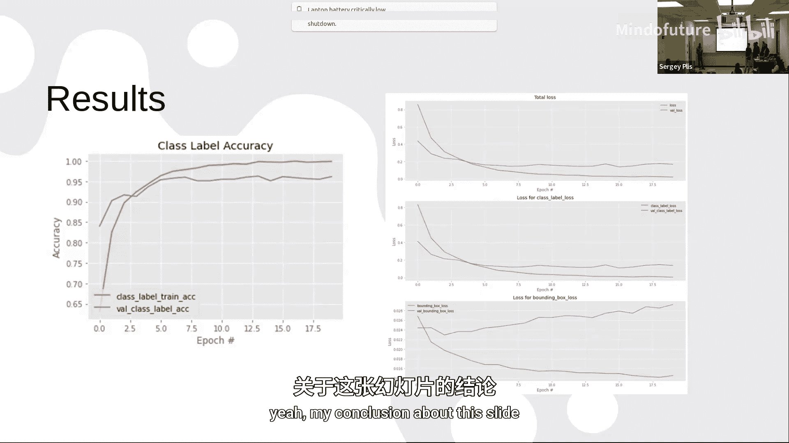

# 高级机器学习主题-CS8850-｜-Advanced-Machine-Learning-p84-P84_Team-Tycoons--BV1sapPz4Ewx_p84-

嗯。Perfect， let's begin。And go for presentation模。是道。是。还行。Ws that couple。可以。那一本。你开。Yeah。Yeah。

 so good evening everyone， we are team tyons and we have worked on the project Mi passion object。

And so I will be just starting off with the motivation behind this project。

 so basically many kinds of pests and diseases in plants in Uganda have led to reduced yield and reduced investment in the overall farming sector。

And Uganan farmers are usually small holders and who own。De less， I mean。

 they come from low income households and they do not have sufficient means to overcome these challenges of pests and diseases in their farms industries that grow in their farms。

 So without the required knowledge about the health of their crops they cannot intervene and avoid these devastating problems and So why should we care about this。

 because overall decrease in the。Redduction throughout other basically the reduced yield and low investment in this sector can lead to some shortage of food。

 and I think it is the responsibility of everyone here to help them out with this Okay， so next。

So the MSML lab at the Macary University has taken the responsibility of addressing this lack of reliable and timely diagnosis of time diagnostic platform for passionable diseases。

 so they are trying to develop a low cost handhel device using lab5。And they have given a。

Uploaded this task on Zindi， it's as an online competition to come up with an Ml model for detecting the health status of the passion truth that they。

So about the data set that we got and what we did to re processces it might individual。

I'm going to introduce the data sets， so for our project， we have the train CSP file。

It has 69 or six rows and six colors， and each language has their unique。一前。啊。一吵队味。

Could have can have more。One more than one object。Which can translate into more than one bonding course and for this project。

 we have three glasses。There are fruit broad spot， fruit healthy and。What is and。

The problem quite the past last week， and it has nine7 rows and one column and we have 2902 holdinging bug from a collection of 3000 images and some images have fallen on hoing back。

And others may have more than one bo parts。For data processing。

 the first step is to removinging the duplicated data and the second step is to。啊有谁呢。

What how are encoding to encode the class from the time string to techniques。And。

Because of the requirement of the。Projects where you need to add。Exax and Web X。

And after those steps， we have。Data like this。We been encode a lot classes into。

It just to print the model， we got the width and height using the width and height index excellent gl and we get what my。

那这の。原が。我这个。From here onwards， we realized that what problem and I wanted to build a deep。

Look into what the actual problem is initially we think like it's a classification problem but it is not I read a lot and I just wanted to share with you guys a little bit and give me a in to deep learning sort of thing like I got a little bit understanding that how what kind of problems we can solve it So the first problem we had is in one image we can have four question groups。

 three1 to4 it can be1，2 three or four question groups。

All of four of them can belong to different classes， either they can be healthy。

 they can be having ground spot or they can have distance。

So it's not there just image classification that you have an image if you have to decide whether it's food or not。

We have to find the objects inside the image， those objects can be variable number of objects in every one image。

So first problem is there are a variable number of objects that can be anything between one to four we have to our model should be able to detect those objects。

 first of all and then do the classification so that was the first challenge with this problem that this is not a very common problem we have to understand to that。

To solve this one， we can use the sliding window that's a very conventional way of doing it we generate the features for their window for different position and this we have a prediction of those windows。

 whether it's object of interest or not。The down image so in conventional method we do the sliding window for these each images and these window size can vary because because of the second problem that we need to address is like each object inside the image can be of a different size so we have to have like different size of windows to run through so therefore a lot of time and it's complex so that was the conventional way of solving it but you going to use the deep learning we will be discussing this in later while we are doing that way。

There are some roles and cons of using thegenal methods and deep learning has changed game on vision problems。

We will discuss it later。So the final problem of right modeling our models not only have to detect the。

 but we have to assign the class we have to do the classification also of each of the object identified during the image period so that was the challenges that extend's insight of a problem or the challenges like what the actual problem is I wanted to give our that you just seem to feel like what we。

有系 said。There are several strategies these are the terms that what I have explained that not only classifying。

 but object detection is one the problem and we call it localization because we have to find the bonding mouse coordinates than the images for each of the object that we are detecting。

 although that object will be fashion through only but it can be of either classes of either size so we have to detect those and get the coordinates also on the input as the output sorry。

So that's call localization， we have to localization。

 let's find the object inside then it is called localization。Next we have to do the MA segmentation。

 we have to find the pixel pixel mask for each of the class that we are doing so we have to print another model to build a mask so that we can do the classification rate reserve first of all for detection。

 then classification I。So our great connection， we have to do the。

We will be doing the object detection to specify a variable number of update on the image。

 and then it can be a variable then and compare it to classification basically itulating the same problem by what we。

There are classical approaches I read a couple of papers I going through by what all have been implemented we have bio drone framework it uses the heart features I didn't go into deep I just read the probes and cons of it that's very complicated it takes longer time histogram of oriented gradient uses the S for classification and it uses again this multi scale sliding window for object detection that's for classification they use that name。

But it's very slow， so not recommended I just read through the paper just wanted to express it。

 we use the reing it's not that what we use， but just wanted to share with you slide。

Then I started write what we can use if it's not the conventional methods that what is the solution。

 so the solution is deep learning。People I means has like free generation of RCNN the first one is the first generation is the typical RCNN which expect possible objects using a region proposal method。

 it proposes that okay what is the region that you are finding and identifying you expect the features from the each reason using the the conRCN when much conventional neural network and then you specify each of its asV。

佢 the problem我诶。Ting was a challenge because the many proposal are expecting features for each of the object within within each image is quite expensive and finally we have to do the classification again with SPM so that's very first generation typical peak learning solution which started changing the word major problem。

After few years faster as theN introduced by researchers。

 they use the selective search to generate the object proposals。

 it's just a different algorithm to create the object proposal。So maybe in the selective search。

 where selective search has its own drop， it is a bottomline for inference if you want to make any inference of detection。

So that's why we have faster R CNNN， but this is the architecture like work。

 but all we do in faster R CNNNN， we do CNNN faster to our CNNN。

 but not only the only thing we don't do is like select such state select such do the region reporter。

じゃごさとです。And objects are the output objects are identified on the basis of objectness score。

 which is like every object identified within an image gets an object score and based on that with decide whether it's a background or it's the region of interest。

你冇ざす。あ。Okay， so basically what we want to do。As progress is or elaborate， we want to from an image。

 we want to be able to detect all all the passion fruits that are in there after detecting all those passion fruits。

 we want to be able to pull and to pull those。Those bonded boxes and we within we then classify so what we do is we take an input image and then we put it into a convolutional network we can use we can use we can use reate 5 we can also use V VGG 16 and then。

So from there we then extract the features and then we get the feature map。 So from the feature map。

 we then go to the RPN which is metric。 So what it does it comes up。

 it comes out with with the founding box and also the object objectness of the object。

 which is not detect not actually detecting the object。Okay， which is。

Not actually detecting the object， but it's showing that is an object within within a bonding box。

 So from those bounding books， you you may have a lot of bonding books。

 So we use region of interest pullinging and then after pulling those for each for each bonding books that we have then we need to pay classification So it is a multi classification and then we from that is we need to adjust if we detect that it a would the partial fruit。

 we need to be able to adjust that bonding box。 So this is what this classification does。

 real just explain whatever a overview like to engage we get feature micro of it and then we have proposal and then we。

A I doing and so far。Cning works and then we run it from the plastic card to leave the plastic。

And we use the morning post， I mean， the faster RNN Google the first morning postor itself to regress and adjust the morning post orance later。

we the letters and the can。Yes。Yes。有。Yeah， so the other model that we tried to explore is VGG16。

 basically it is a conutionional neural network， which was pre trained on imageHnet dataset set。

And based coming to the architecture， the input of the first layer of this con network。

Is an image of 224 by 224 and2 by three because the last layer， as in the fully connected layers。

They need a fixed size of input， so we cannot we have to fix the input of the first layer。

 So moving on， the input to the。Yeah， as I said then to the first layer of that size and then it passes through a series of convol efforts and before it reaches the fully connected layer by using filters it is。

Compressed to a one dimensional array and。Yes so。Basically what happens here is the first layer is learning the edges and the second year is learning more properties like what these edges are corresponding to and then so and so there is a conventional feature map that is created basically the feature map holds information about the picture。

 but it is a smaller dimensions but it has greater depth meaning that it holds information about every single。

Pixel I I say on the image， so this is how the EG 16 basically works and。

What happened and how we trained using this and what the accuracy or the results were will be showed later on？

呃そ。Its。don just something。Yeah， so you on because we use big train like you know6 you know。But like。

 you our coding we had to build like business。 So so we had to like you you know remove this one。

This one， and we have to build like two labels， you know， one for the for the boxes， you know。

 and then one for the， you know label。Okay， so so even though like， you know， we just get the。

We just like there models， you know， but we we had to actually kind of modify it to give us like even the bombing boxes and and you know label know。

 because so this one it's usually like classification so we have to make it know outside。See。Okay。

Now this is with the data this is for the data augmentation like we do the data augmentation when we have a lesser amount of training data so our training data was also less so like in convol networks like if even though if if the image is changed by a small angle then the convol layer network layer won't be able to like recognize it it is not drain properly so for that like we get some data augmentation。

So so the data augmentation this is a technique that we artificially expand our training data so we do some kind of thing like we flip it we originallyly make it like poet it and then we can do something like this so this is all about so for that we use this argumentation this is a library so it's a great library so it's kind of a fast as compared to others。

And there are kind of so many things that we can that we can do with this data augmentation that's in the next slide。

So。This is how we like you know like implemented this in our data sets and then I can tell about everything like that we use in our data。

So it's like this next I just included yeah because we did impact later on and I will just tie all things together right now just putting blocks and piecess and we build the building like like what all we went through and what we got and by we did what all which is giving a brief overview all we did and learn the so like we tried these things like we lifted the hard data horizontally vertical and then we did some kind of we put some kind of brightness into it we made it like we rotate our data set by 90 degrees and some other angles randomly selecting it we took the transpose our images as well then we kind of downscale it。

 decreasing the quality and then upscaling it again we did like random contrast that randomly you know it put the contrast in the images and the random brightness contrast like changes the brightness and the contrast both at the same。

In the input image and then we brought our images as well so this is a data augmentation thing that we tried with our user data and it really you know enters to something this is code。

嗯。Yeah so it's time to tie all the strengths together。

 we started with some patient with very low accuracy as we can see at the bottom we and it terrible mistakes which I will discussed in the last slide of mistakes were causing those but our were baseline model when we thought that started on9 71% accuracy and when we tried multiple things we were so frustrated to do higher accuracy that we thought of trying with G16s after CNN。

So all things were working around that time later we realized that probably faster CNN is giving because that was 71% that day so we picked up that as a waste model that was improved this from faster CNN then we brought VD16 because we made some that we would talk about we tried so hard like on adding layers increasing the epo we ran into so many issues which resources because people were using CPU then I bought a proof subscription which I would recommend definitely for Google Google it's amazing particularly laptop and I ran to program primarily Google was even twice faster than that so it's definitely worth it and was worth it but finally we got after 71% accuracy we did a lot of。

Alummination libraries， we did a couple of image augment initially but it was not working then we did more and finally we reach the accuracy of 18 which is activity% but this was like post competition competition was done it was finished on 22 but unfortunately the competition is on Z which is not very interactive we don't get any updates or any discussions it was not very interactive but ultimately we achieved this post competition we did other techniques also like improvise the score which comes up in the next slide but when you compare it3 you of 25 this negative60 and another 601 so we would have been on 25 position if was under late in9。

Although it's not like a lot of people， it's says 700 people are there and our ranking was like 114 initially it was 14。

 10 monthly0 or something I don't remember black people it was pretty good on leader board if we would have done of。

You can go over ahead， next one。This is all what all I is we acquired6 team should not have given 24%。

 but later we realized why it was given 24% because we were modifying it and while modifying we were producing only the。

诶温温。One warning box per image so we were skipping others and the very first mistake that we read very ashamed to have also。

 but we changed the X environment coordinates so what is X and what is X max and in we just get upload button you have to upload the CSV and they give the score based on that so I really hard about it I discovered it。

 but we corrected it when we learned from the fasterN based on the 71% then with augment and other accuracy parameters that we applied the techniques we got you can go to the next slide。

And 6's almost like really because what we did is1 from data what we did is in the validation result。

We so thought it has since each or two it has9 we。Yeah。

But it was great learning because ultimately got go to faster asking。再来个。

And would think that needed applied ansteroid so so 8%。but you but我。okay so okay doing intersection。

union mean actually glass so one that so。我以来做飞你我 use啊 number max。新そそそそだけどショにの。

And then and then ourll说。So so we get the highest we get the highest of volume actually having our we。

So we haven't validated if it is doing or not， but he did the testing effort ViG net so much and we discovered the images when this is happening a lot of testing effort that and we found this issue and that's how we the an thing so we can it further more and with more data from the data was very less that's why were getting the standard 71% accuracy if we increase the data as we increase more we more because the mask get more training and more rate to get the prediction correctly not only the prediction for the bomb。

就 you think the next one。Our project management， we use the weight as a repository we need use naturally based permit because we were working mostly on Google for that hard。

Make changes in Gs， so we were working in Google Go itself makes a history global history for G is just a repository。

We tried to use trouble to be honest， this is like a college environment it's very hard even in corporates I was in corporate to impose this to like ticket management tools Gra and all it was not working we had two message like on WhatsApp and Co and text we tried T but it didn work at all but still we created the tickets and summary like was going to work on board and we tried to use trouble。

P for pen or what you for making their ideas， we use the blue the over if it helps slide。

Everything work everybody he lose these days in lot else。你 tried some those things。对。嗯。

So theチャ you w talk yes yeah so so so。This is like we just like you know confused so so she like know something like know like the prediction for objects per image but just something like you know the prediction for one object per image so that's why we were like one。

And thenそ but。sixteen just like。SoSo the department access JSUsU has a lot of G。

Like blue cluster has lots of GP。 Why didn't you use that has the GP' about I just started right now。

 I just got。We just have those No no， no there is a whole university cluster that it's called blue there is an Arctic system that has access for everyone yeah lots of resources。

I any idea about that I was wondering。It's like tech。

 do you have to sign up for it or you just go and it's slightly warm when you have access。

I just know that to at there I don't have access So， advanced research computing technology。

 R W GSU that A R。Keep learning challenge give。Yeah， so the biggest challenge for hopefully is like。

When we go back these are the challenges I think the biggest challenges is to understand the challenge understand the problem and that we do really good probably hopefully I mean I tried my best and we discuss it quite often the biggest challenge is to understand the problem correctly and then work on a we have made terrible mistakes or initial run so it was a great learning I think we need to put the core in my past。

Yeah， the biggest challenge is to understand the problem。

 correct because once you start jumping there it don'。So thats yeah。

 a lot of people get through it also， but I don't understand it takes me。

 So I need to know everything from this scratch you。

I not great deal if I put like two slides on deep learning for my part project that I just wanted to show more on this story through my understanding the problem。

😊，Okay， questions， plus， thank you。Okay。No yes they did leave a little bit of time。

 maybe we can roast that first team to it。你睇得看你一故事。I don't have questions。

 I have questions but go ahead。I don't have a question actually。

 So what was the main reason for you to remove or， I mean。

 modify the V here what was the first thought came to your mind。 Why do you need to do it。

Yeah because you know the this boxes so so we have to pay like have to like one layer for boxes because we do like know multi the multi。

 so actually is like in one layer for like in for the the。And then and then we have to like。

 you know like， you know， okay， so oures so we process it between like zero and one know we have yes be like you know between these zeros and one and then for the like say for that and we have to classify the the labels。

the so then like sub max。Yeah， yeah just to just to make it multi。

Aistication my first thought was like it was strain on management images， A when they were different。

 Maybe we need to。This is the reason maybe we need to add more ears do something to make it worse。

 but this this diagram is when So we tried to implement and modify it and then we read it again the problem correctly and then okay now should you guys to we already did it and then we were doing carefully because of our accuracy was like less than not even presentable straight faster CNN So CNN as soon as it give7 even percent as like okay This was we were doing wrong and we system but。

Can you skip a few slide ahead to the slide variation boxes， the warning boxes think。So yeah。

 this one， so there is a answer this one is having five% proof right。

There is one which is not classifieded with the box second I in the maximum。

 So is there you were saying initially like one to four fruits per image。

 I there a chance that it might have multiple more images and that could be a data like test data might that's why we are not and that's why we dropped that could be 17% you the we dropped it because we wanted to take only。

さピ十。That one is better training than this corner This one is not。

 You have like multiple which not those one those one one。This one yeah。

 that is better than this corner bottom corner。 Yeah， I should have that this one。

 I guess probably got it。the master take because of the slave。I this one this one0 think object。

The problem is all tools are just gives let take on from here too much。

 So what was the task basically what was the task given an image What is the task might have one to four or maybe more。

 but we idea that it what is the question what is the task identify boxes to do that Yes and then class it into one of these classes which has like three are truth as or。

我呢边。What was the last oneinessinessiness is disease because the woodiness food can also be just because it was near the skin so its detection was part of the detection and three class plastic case。

The problem was to find the coordinates of the truth the environment and X requirements。

 they take the object and then classified。mention that you did augmentation initially and then you proceeded with augments you told that you generally you first implemented any augment didn't you do the normal augmentation this just an article about that in most of thes have been using this to improve it was really working well that even I can understand because the you take and finally。

でもす。faster makes a must the object。So can you go to the learning for slide or？

I Chris slides where you show up validation。 Yeah， what the next one。Yeah， here。

 so what's on the left？这是那测试因为。But train set in in the wheel of the。And and then for the。

you getting ninety5 why when you submit this thought two。I don't know' why it is not working。

 the reason behind it。 we try to implement V 16 and we try to modify it and modification。

 its working right its working on never training validation and training data。 So this is。

 validation the model this is your first run， right。

 so validation is so you overfe to validation Yes， exactly I don't see that in any of the。Okay， yeah。

 yeah， loss is fine。 you well， the last model of repeated。

 but not to validation validation accuracy is great。 Yes。

 why didn't it work So we have a for the test only you don't have。The coordinates for test data。

 but for validation data we have， we can compare with what's going on。

 Oh so test one is test one comes from oranges， but you train the ba fruit。Why wouldn't， I mean。

 the difference is huge maybe the error is in your submission。

 the model the model looks great wrong Why did you switch to faster CNN when you have a much better model 95。

 Why go with 70 when you have 95 I don'。When you okay okay like like about like25。

 So we have like93 know those are these or images images you know。

 but those images those images bigger like you know one two， three or four you know differents know。

 but you like like to like so should be more that should we should like know the should like you know all those ideas like you each idea can have like different。

这份裤子。I don't know you knowThat's not the question I must。 You should know that。Zindy or in this plot。

You wouldn't train your model to do something that you're not evaluated of， right。

 it's the same time。 Yeah， yes， yes， so I don't get now almostests and reading some because we work %。

We were working on that side and this was a result after the work has been done。

 so we didn't run it on the test data at home。So we dropped the idea of using VGG16 and we just move I understand you saying that this is a better model and why don't you run it from test data and just submit it and you get better accuracy work。

So this is the fresher model。 Yes， this is late。After you fixed that yesterday we wanted to fix the video Okay。

 so this is not a representativeron。 You did not use it。 You're just making a nice slide。Okay。

 okay in other ways， you can say that but it is not like that。

I thought you're showing like historical， like how you trained the model when you were getting this。

 but then this is we just have the score because I can show you those scores like So for VG G when you were training locally was it was like。

😊，We never tested on validation。 Yeah， well， but you can。

 I spent three lectures on model comparison so you can get an idea of how your model performs without asking your either friends at Xindy or Why would you submit anything。

 Think of it as a production hard surgery。 You wouldn't just like， oh， let's try。 Let's just try。

 You wouldn't know already to perform。 So you like this one is telling me。 Okay， but I get it。

 my conclusion about this slide。 this slide is not represented a picture it didn't work。

 It's just like。

Because because the result and we' are hoping that maybe we 16， we can get better results on as data。

中分嘅嘛。I might try to get one9 I every。So we'll run on test later and I see that speaking6。Even by。

You still can submit me。But you will get a ranking right why don't you try it for your report that specific be。

 thatd be nice course Okay we're over time， so I'll send my questions by mail to the first team and we'll see how Thank you can you stop the recording please on this So report is Wednesday right Wednesday was yesterday Yeah okay。

でて。