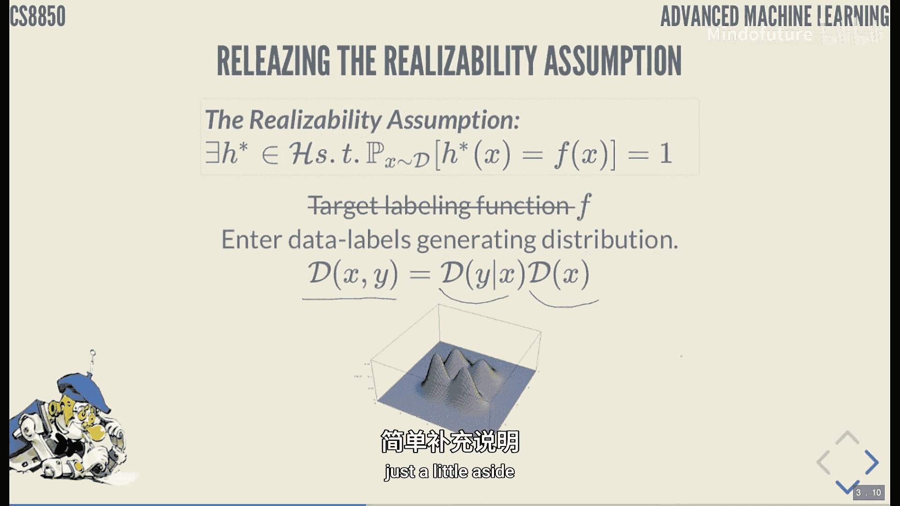
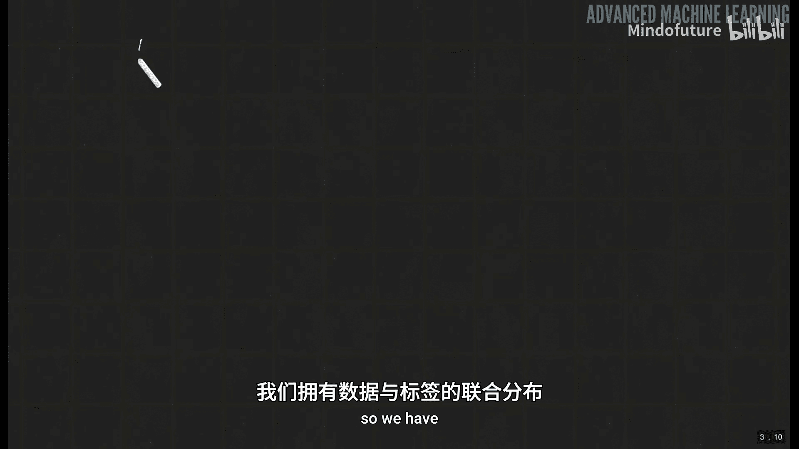
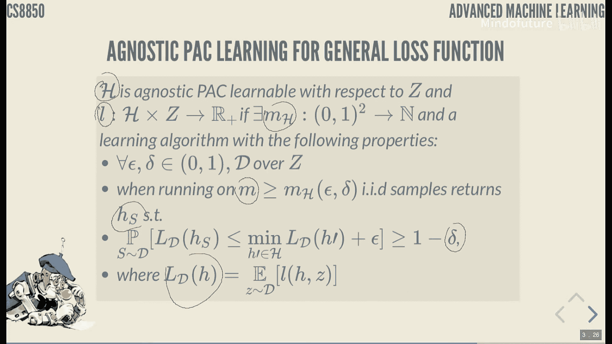

# 高级机器学习主题-CS8850-｜-Advanced-Machine-Learning-p85-P85_不可知PAC学习--BV1sapPz4Ewx_p85-

With each。Small units。Our episode， we're getting closer and closer to the model of learning。

In this module we'll try to define what is learning。Yeah。Okay， I will give you my。Digested。

Definition or digested。嗯。The way。Thanks for learning。Probably approximately correct learning。

So unbounded delta。In the last lecture and in the recap， we defined。呃。

Probability of getting a training set on which。Optimmal hypothesis。Will lead to failure。

In the failure in the。True loss。Right， and that's the bound on the right。

Our deelta is the probability in question because deelta is exactly the probability of getting a bad training sample。

Which is just that， so we have upper bounded delta in our previous lecture。Yes。

 that's it probability of getting a bad sample is less than or equal to the size of the hypothesis set times。

E to the power of our accuracy parameter times。Number of samples。

So let's divide left and right size by delta。And we'll get this。

 that's clear the sign doesn't change。Then， let's apply。

Log to both sides of the inequality and since log is monotonically increasing function。

 the inequality sign doesn't change。So， we end up。With。The right hand side， which is not negative。

 it's greater than or equal to zero。Log of the ratio of our size of hypo is set over delta minus Epsilon M。

Epsilon is our accuracy parameter and M is the sample size。ANumber of samples in the training set。

So from that。We can rearrange， and。Otain this inequality。

 which just says that accuracy parameter epsilon is inversely proportional to the number of samples m。

What do we mean here is。If you fix epsilon。Then。given。The rest， you need more。

 more samples in order to get that epsilon。You need to increase the number of samples。

Another question is。For a fixed Delta and epsilon。Which M should we take。

 How many samples should we take in order to。Achieve。

A given probability of getting a bad training sample。And。And give like super。逃げれない苦し。There's this。

We should take at least。Log of。Then size of our hypothesis set over Delta。Over E。Samples。

 at least that's what this in is。呃。诶 take。At least。This many samples。

And you will guarantee Delta and epsilon and okay。呃。High yeah， higher。

Number of samples will lead to better chances of increasing。One minus Delta。Okay。So from that。

What follows is。Given a finite hypothesis class。A fixed stelda。And the open interval is 0 to one。

So it's between zero and 1， but cannot take either of the values。And non negative or。Sorry， positive。

 epsilon。Im some greater than zero。A number of samples。

More than or equal to the bound that we just established for any labeling function。

And data generating distribution。对。But for that reliability the assumption must hold。

With probability at least one minus delta over IEG samples in a training set of size M for every empirical risk minimization。

 minimizing hypothesis HS。Our true laws。Will be less than or equal to epsilon or success。

 we will be successful。From that。We can define path learnability。AColls。Of hypothesis。

Is pack learnable。If there exists such an M for this class。That belongs to。

Seession name for this class， which at M sub H is a function， it's a mapping。Basically。Look here。

 you will understand this notation better。It's a function that takes。Values on and open。Units。Square。

Let's say this is Har。It's just stay there。So， M takes。Epsilon Dlta， look here。

And it returns a national number。Okay， so H is by learnable if there exists such a function M sub H and a learning algorithm with the following properties。

For all epsilon and Delta。In this unit interval。For， for all。

Data generating distribution and through labeling function。And for all David。

generatingenerating distribution over the domain chi and for all labeling function F that map a sample in the domain chi。

Into either zero or one when reliability assumption holds。When running on M， greater than。

M sub M sub H functions value， IG samples， learning and algorithm returns， a hypothesis S。

Such that probability of。Yeah， probability of success。Remember。

 this is probability of success because our loss is less than epsilon。Is greater than one minus。

So this definition was given by Leslie Vallliant in 1984。And what it defines。

 it defines learnability of a class of hypothesises。And。In our previous lecture， lecture two。

 we established that it should be a finiteite class。So to make it a finite class。

 we have to somehow structure it。And hypothesis hypothesisthesis class could be the class of models。

 for example， linear hyperplanes， polynomial curves， etc in our。Two dimensional example。

 our hypothesis class could be class of rectangles。On a grid to make it finite。Okay。

 back back learnability。Another interesting。So that's how we define back learnability。

But another interesting notion is sample complexity。So。Computer signs。Is all about。

Complexity of algorithms。We have running time complexity， we have space complexity。

And we organize algorithms in different classes of complexity， such as polynomial。

 non deterterministic polynomial， P space， and many others。

 the whole hierarchy of computational complexity classes。

But when we start talking about machine learning。There is another notion of complexity and when we want to talk about learning from examples from data。

We need to define the notion of sample complexity that means。How many samples does one need。

In order to generate the classifier that would perform well on a particular problem。

A particular classifier from a particular class。So sample complexity is a function of Epsilon and delta。

 this is M sub H。And it tells us how many samples are required to guarantee a probably approximately correct solution。

So。In fluffy words， what I just said before this phrase。

 it was about how many samples we need to learn correctly， but what does it mean to learn correctly。

 it's undefined， so to define everything we can just use，Back learning， how many samples do we need？

To get probably approximately correct solution defined through particleability。So， many。

Of those functions。嗯。Satisfy the definition， so to specify just one function， we add a magifier。

 so sample complexity is the minimal integer， sample complexity is the minimal integer that satisfies the requirement of pipe learning with accuracy epsilon。

And confident in stelta。How's that for definition？What would sample complexity be for finite hypothesis classes？

Think about it， let's well think about it before we go to the next slide。

So sample complexity 459 hypothesis classes。Will。As we。

As you recall from one of the previous sites we already established， so once we have this inequality。

And。呃。We have we can establish the following inequality。

 so we bounded the delta and we were able to derive4 m for infinite classes it's not。Finiteness。

 obviously。But another measure determines the ownability。But for finite classes。We can compute。Age。

And our sample complexity。not well。I said it wrong。 It's not that we can compute H。

 but we can compute cardinality of H number of。Possible hypothesis in the class。

 so we need a finite class。And。Basically， by taking the ceiling。Of this ratio。

 we can determine the minimum number of samples。That we need to take。In order that。

Satisfy that our chances of getting a good sample are 1 minus delta。So the more samples。

 the better this。Once you see one minus delta。Well， no。Let's say it recall。Your。

Previous binaryric quiz from lecture to then go through the answers because that's useful。

 so what do we mean by a learner？What what is a learner。

A learner is a process of turning training data as set as into functions or classifiers， simple。

So what is generalization error？Our generalization error is probability of randomly。

Or according to the data distribution， of course， choosing an example x for which。Our hypothesis。

Is not equal to the true labeling， the value that our hypothesis or classifier returns is not equals。

To the value of the true labeling function with it。What is overfieding？

Over we'refitting is when we have excellent performance on the training set and poor performance on the real world。

 or when we minimize perfectly minimize the sample risk。Or empiricaled risk。

We don't perform well on the true loss or true risk。

What is a fundamental question in learning theory？Which hypothesis classes are empirically？

Which hypothesis classes， empirical risk minimizing。Learning will not overfit。Okay， good。

Now we know how to work with finite classes。And we know how to use in bias by limiting。

The number of hypothesistheses in the class， for example。

But binary classification is not the only learning problem that we're in interested in。为你 do。

Do something else or go somehow beyond the。Binary classification into other problems and still have a good sense of sample complexity。

That we need to achieve in order to achieve， given。Accurracy or given。

Probability of not getting failure or of probability of not getting a bad sample。So for example。

 the regressionion。Its one of the problems， right？Be that that we are interested in in。

Machine learning and in natural sciences。And we'll talk about it in a little more detail later。

So to go more general， we need to remove generalizability assumption。So。

Generalizibility assumption tells us。There exists a labeler。Or hypothesis， H star。

 remember that will return。True label。On all of the classes。But。Returning。

A true label in all the classes somehow assumed。No， a true label on all of the samples， I apologize。

That somehow assumes that each of the sample。First of all。Can have a label that is unambiguous。

It's not always possible。But forget about that， imagine that。

A true object in the world can have that label。But the properties or the features that we're measuring。

May not be able to capture that information。May not be enough。For example。

Imagine that we want to train a classifier。That is。Preicting biological sex variable。

From a silhouette。From a shadow of a person。Is that always possible？Well， biological sex variable。

 biological sex can be predicted or can be。Assigned to every person because of their DNA。

If a person has Y chromosome， then。Theyre biological sex。Its my hope。There is also gender。

 but that's too complicated for my example， let's not get there。

So imagine in this situation we can actually have an F function。F supposed to take an X as an name。

 but so like what I'm trying to say is。There is。A way to uniquely and unambiguously assign this variable。

But。We don't have access to all possible features or we don't know which features are relevant to that unique assignment。

 so we are dealing with silhouettes and can you。Predict gender from a sd。Well， we from a s。

 as this picture shows。We can't even predict whether it is a human or an animal or like a live thing at all。

🤢，Like our silhous in this picture， thanks to the artists having created that installation。

They look human。And we can even。Taale the gender looking at silette。

 but what is casting the shadow is just this pile of trash。So。ARe generalizability assumption。

Is tricky。So if we want to release this assumption。Wache is again。Existence of such an H star。

In our hypothesis set。Such that。AProb of。The labels that are function returns being equal to the true labeling function。

Equals to one。So。That we need to get rid of our target labeling function now。

Because we can't assume that one exists。And can label correctly everything。And instead。

 enter data labels generating distribution。So we have a joint distribution of data and labels。

 which is our conditional distribution。That。Given an X has some probability of generating。A why。

And prior on the data。So， now we're in the。In Bayesian world。Sort of， well。

 we're dealing with joint distribution and。He你咁。诶。We're dealing with joint distribution。

Conditional and marginal。 So just a little bit aside note since we haven't。

Spoke with you yet about those issues。 I hope you're familiar with the base theum and with this general conditional and。

Marginal distributions。Just， just a little aside， so。

How do we get there， So we have。

Distribution。对等 label。Which is the joint。 So imagine。嗯，就在买书呢。Right， X and y。 And I will。

Deliberately ignore the fact that our X and Y both。In our example。

 at least y is a binary zero in one， let's just for simplicity。Of exposition， think about。

That continues。So imagine there is a distribution here somewhere in the。え。Yes。

Something for one or another。So and the only thing that we need to know。For the following step。I。

That this distribution integrates to one， right？Over domain that the distribution defined。算。No。

 let's say this is x。And this is why。If we fix a value of x。That means that we're taking a slice。

Of this distribution。 So when we're saying。Let's fix that value of x。Theres something specific。X。好s。

喂。而 getting。The slice of the distribution。Of of why。But in order。To get。This distribution。To correct。

Distribution from functional form。We need to normalize it to sum to one。

To normalize it to sum to one。We need。To take the joint distribution。Integrated over。So， let's take。

T of X and Y。テくズ。all possible values of y。Which we know is just the marginal。And take it。And。好知。Of X。

Let's see。And that will be。等急使用。distinguish。Right。If we do the same。啊，或 the why。Pranitionals。

Then we can easily arrive to the base theem， but we will do that。Later in our course。

What I'm trying to say here is that when really replace the target labeling function F with a conditional probability distribution D。

Davidgene。Then。Okay， just。Trying to start my nose。咁嗯。Slightly different explanationed。

 But then before our loss。A true loss， Tru risk。Was defined。

As probability with respect to the data generates and distribution of our hypothesis。

Not not returning a label that a true labeling function will be return。Well。

 but now how do we deal with that？ Well， let's redefine now。2。Trueos。As probability。

Of the joint now look that was just with respect to the data generating distribution once we had。

A true level function。 Now we get rid of it we know that it's rarely available in the world processes。

 but now R T is the joint distribution of x and Y。So probability with respect to the joint distribution of RH。

Is not being our application or our hypothesis to that x， not being equal equal to 1。Or equivalently。

Is probability。Of。A set。T了。Probability of a set or probability mass of a set of functions， X and Y。

For which our labeling function or hypothesis， doesn't eternal label。

That corresponds to the true label。Of the sample。 So we want to find in our learning。

 in our learning process， we want to find a predictor。Hge that minimizes the true loss。

 the new true loss。And the problem。With this desire is that the learner doesn't know the data generated。

Generating distribution。In the real world， we rarely know the data generating distribution。

So empirical risk remains the same。As we defined before。

 its number of incorrectly classified samples over the total of number of samples in the training set。

And now our goal is to find a hypothesis。That probably approximately minimizes the true loss。

So if we think about it。Well， I you know the answer。

Our answer would be the Bayesian optimal predictor in our Bayesian optimal predictor。

For data generating distribution。Which is joint distribution over our domain。With the。

Cross product set cross product with01， the label set， and the best projector is the following。

Once we get next， if conditional this probability of getting a label 1 is greater than or equal to 12。

 we return one。Otherwise， when it turn zero， I hope you understand that we will go through Bayesian decision theory later and I will try to go into the details。

 but I hope you understand why that is true if not think about it or maybe it read some books and refresh your Bayesian learning theory a Bayesian decision theory。

From the classes that you took previously。But basically， the problem with this。🤢。

Where the base optimal or Bayesian optimal predictor is we don't have a hope to find H， well。

 that's not the problem as an advantage or kind of a property。The Bayesian error is the optimal。

 There is no way that we can find H with better error。At least asytgic。

But our error is defined as the true loss on all of the data， so then the statement is strongly true。

Without assumptions on D， no algorithms or D， data generating distribution。

 no data can be as good as major and optimal。And a lot we don't know D。

 we don't know data generating distribution， so we cannot utilize the Bayesian optimal predictor because we don't know what's the conditional probability of a label given the data。

Instead， what we want to do or what we will do， we will search for predictor with error not much larger than the best possible error。

So our baesian error is the best possible error， so we don't want to be much larger。

 we don't want to find a predictor that deviates from it。Do我。Faabure， air， larger air， too much。

Having that now we can define a diagnostic path learning， a diagnostic。

 probably approximately correct learning。A hypothesis is class H。Is agnostic fact learnable？

If there exists such a。If there is this such a sample complexity function。M some of age。

And the learning algorithm with the following properties。For all Epsilon and theelta。

And join distributions of data and labels。When we run this algorithm on number of samples M。

That is a。Larger than or equal to our sample complexity。嗯。And when we run on MIID samples。

 that algorithms returns I have pohesis。Or a classifier， such that empirical。呃，那。

So I just said the true loss。This is the trueverse iss less than or equal to。The possibly attainable。

Baesian loss plus some eps， so we can only hope to get within the best error。

Achievable by the hypothesis class so this。Would be the best achievable error。

But we can entertain it。 So there will be。Well。No， no， no， so Bayian error is absolutely。

They're absolutely attainable。Good error。E Bayesian air was not defined with respect to our hypothesis class。

So。We don't we're not considering it， we're just saying， okay。

 among all of the hypothesis in our hypothesis class。

We want an error that is less than We want an optimal probability of the。True loss。

Be less than or equal to the minimally attainable error。🤢，Over， all over。

Hypothesis in the hypothesis class。Plus some epsilon and we want that probability to be greater than or equal 1 minus delta。

Okay。That is agnostic park learning。But there are other problems， so with diagnostic pipe learning。

We have。Go rid of one large and strong assumption， a realizability assumption。

That everything can be labeled correctly by。Some unknown to us。T labeling function。

 and we went into the Bayesian world with the distributions that well。

 we still use data distribution。 so why not embrace that fully。

 So we embraced the data distribution fully。helello。And just went into joint data label distribution。

 and now we don't need a notion of true labeling function or agnostic back learnable classes。

But there are other tasks such as multiplus classifications， for example。

 we want to classify documents into different categories。

Or we want to do bring computer interface with EG and to implement mind readers or mind type。Tapers。

 so we can type with just our brain waves。The classic is from which we want to map our brain waves as our x。

You know， we have the whole alphabet plus the numbers to map to not just two classes another multiclass classification is prediction of next word。

So there are lots of real world examples of multiclass classification besides the multiclass classification。

An extension that would we need， there is a totally different problem problem of regression。It is。

Ftting。嗯。Well， I would call it a problem of fitting to the data。

 problem of fitting a function to the data。Usually what we mean by problem of regression。Is。

We want to find functional relationships between our x and y and where our labels say it's not just a binary label。

 but some dependent variable。Or。Aet， so for example， we want to predict age， which is again。

Continuous all the bounded a number， or we want to predict temperature or any other continuous。

Numbers， so basically。嗯。In this task， we want to。Find function。That maps X under Y。

Find the functional dependence。So regression task。嗯。Is an interesting problem。Basically。

 when you measure。Lots of numbers。And。Say you may even have multiple xs， x1， x2。But this y variable。

It is a function of x1 and x2。And maybe we measure this variable with noise。But we need to feed。

A curve。Or in the case of cleaner regression。We need to feed the line。

That has a minimal error and can explain。The underlying process by filtering out noise。

Aggression was。Simultaneously invented by Carfred de Gas and Adnne Marie Lejnder。Or maybe well。

 clearly Alexander published it earlier before Gas。

But there was a dispute who discovered at first because of the problem that Gas was solving of predicting。

🤢，Think that was。葫芦岛。Oh well， but in fact， both of them were studying。Prediction of movement。

 a comets movement by in exact measurements。And gaus and gender， basically what they discovered。

 is not just a general form of regression， but method of least squares of fitting a curve or a line。

In， in any case， an interesting observation so and even from the。From my description。

 you can see that both of them discovered a method of fitting and yet we call it regression。

And the regression is。About something that regresses like what is going on， frankly， I myself。

Confused by the name。Because okay， method least squares are fine， we use it all the time。

 but regression， the term that was coined by Francis Galton in the 19th century to describe a biological phenomenon and the phenomenon was that the height of descendants of tall ancestors tend to regress down toward a normal all。

Also known as regression toward the mean。But somehow， that。呃，name。Got stuck to the method of fitting。

Using list squares。And here's a different example， different examples of fitting different models to the same set of。

Data to the same set of points。 you can use。啊。Like vieer， no slope。

 basically you use the same method， but different models。For example， here。

We're using this squares method to feed a line。对啊。An equation to a line that is。as bias and a slope。

 but here you remove the slope from the function and you still feed the best or get the best possible fit in terms of least squares that was all of this fun examples that。

All of them are showing peaceful expression。thatBut what is that loss least squares loss。

 So the loss for regression is expected。呃。Square difference between a true label。嗯。

And whether function or their hypothesis。A desserts。系。Since。It's very hard to compute the expected。

Square different speakers， remember， rarely we don't know the G。We use mean squared error。

It's is just an average error。Average scored error be our prediction。Our measurement。

That's another loss， regression loss that we can use。So。

Generalized loss function for any hypothesis class age。And demeaning Z。There are generalized loss。

Is a function。From the cross product of our hypothesis set。And our domain Z。

 So for our for prediction tasks， C is nothing but。我哋。

Domain where a joint distribution on our data and labels would be defined。

But we want to be more general， we want to be Z any domain of examples， for example。

 in ansvised learning task。呃。MZ cannot be a product of an instance domain and a label domain， right。

 because we don't have。Labels。So we call such functions。

like the small L loss functions and theyre mapping to no negative numbers， sorry。

 no negative real numbers。So using。The loss function， the generalized loss function， lowercase hell。

 we can redefine the risk function。So our true risk is defined as expectation。

Over the Z's generated by a data distribution。Of whatever the loss function returns and again。

 the loss function。Thanks。I have voice。And a sample from our。

Domain of interest and then empirical risk is just the average loss。

So that's our generalized loss function。We can also define01 loss。

Using this approach generalized the loss function。So， we have。呃。All right， but is。And our pair tu of。

Sample and label。And we define the loss to be zero。

If we correctly or H correctly predicts the label of x or to be one high loss。

 if H incorrectly predicts the label of x。And note for a random variable alpha。呃。Random variable。

I the future is binary。Expected loss will equal to probability of alpha being1。

Because it's just integral over。All of the losses or all of the 0。

1 loss and zeros don't add up only one other。Like that's clear。We can also define the square lowest。

嗯。Which is just the square difference。Between。Whatever our function are hypothesisthe returns and whatever is the true value in the training set。

And that loss is useful for progression problems。So。

Slightly rerising and redefining our agnostic path learning。For general loss function。So。

Class of hypothesis age。Is agnostic back learnable with respect to Z。And。

A generalized loss function L。If there exists a sample complexity function ends up age。

And the learning algorithm is the following properties for all Epsilent Dlta。

And data distributions over Z。When we run the algorithm of M greater than sample complexity。

 greater than recall。Of sample complexity， I samples。And the algorithmator produces a hypothesis。

Such that probability of getting a true loss on this using this hypothesis。Is less than。

The minimum possible loss attainable in this。Hypo is plus plus。Some。Allowable allowable accuracy。

 allowable loss of accuracy parameter are epsilon。And when this probability is greater than one minus thelta。

And like Delta is the probability as before of getting。Unlike each example。

 and representspresent this example that we cannot learn from。And our loss now is defined as a or。2。

Overall， true losses define is expected to loss。Expected， generalized loss。

So that's it for diagnostictic pipe burninging， that's good。

