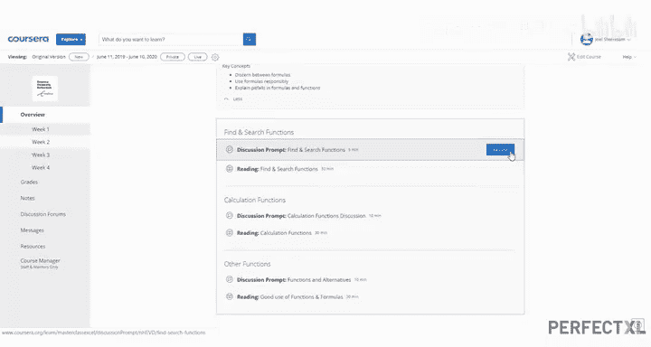
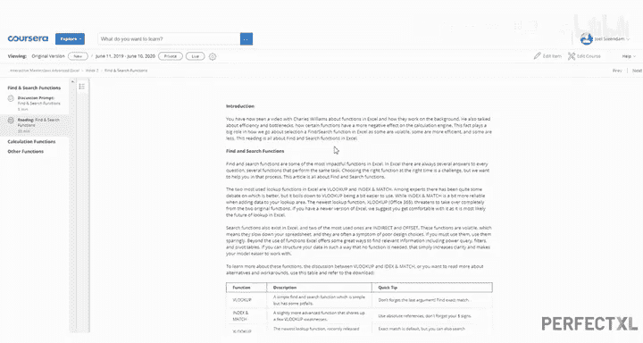
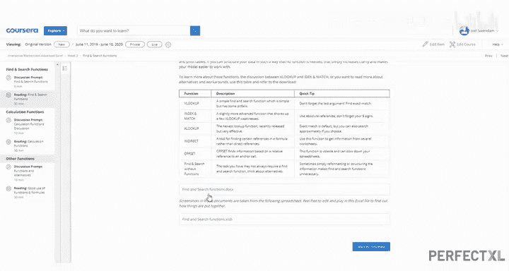
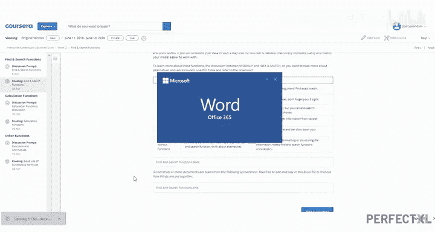

# 鹿特丹伊拉斯姆斯大学《专业人士的 Excel 建模：最佳实践与陷阱｜Excel Modeling for Professionals》中英字幕 - P10：9_知识梳理：函数公式进阶与模型架构设计.zh_en - GPT中英字幕课程资源 - BV1DbeNzqEbf

Hello and welcome back My name is Jan and I want to congratulate you you have now finished your second week in which we talked about functions and formulas。

😊，These are really the live bloodoo and heartbeat of an Excel spreadsheet。

Getting your functions and formulas right is essential to building a good spreadsheet。

 it goes beyond just getting the correct result， but this week has really been about building up formulas which are made to last can be maintained。

😊。

And are easy to understand for other users as well。

I use the filter option quite frequently to quickly observe particular slices of my experimental data。

Formulas are essential to further understand what goes on in the data next week we will be looking at the importance of spreadsheet structure and the flow of information to data to calculations to output。

E VTier talks about how important it is to keep your spreadsheet neat。

How important the correct structuring of a wordbook is and how he practically structures spreadsheets。

Alion Deey， a professor atti Dt， then tells us a bit about the importance of simplicity。

 how we make sure our spreadsheets are easy to understand， maintain， and how we reduce mistakes。

Felina Hemons， a professor at Ly University， then gets practical with us。

How do protection and hidden information impact the quality of our spreadsheet structure？

Understanding the structure of your spreadsheets and figuring out how the data flows through the spreadsheet is incredibly important。

 especially as spreadsheets start to get bigger。Setting up your spreadsheet in logical way is simply essential to producing a model which works well。

Good spreadsheets have good structure， it's just that simple。

Dive into the next week to learn more about this process and I'll see you next week。

