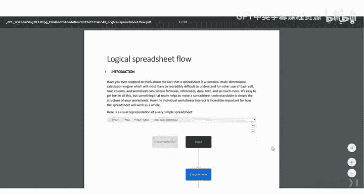

# 鹿特丹伊拉斯姆斯大学《专业人士的 Excel 建模：最佳实践与陷阱｜Excel Modeling for Professionals》中英字幕 - P14：13_阶段总结：架构流程与成果优化策略.zh_en - GPT中英字幕课程资源 - BV1DbeNzqEbf

Hello， you are going into your last week of this course already。This week。

 you'll learn more about spreadsheet structure and logical flow。This is so important to understand。

We challenge you to think about a spreadsheet as if you were an architect。

And I hope this is something you take with you moving forward。 In fact， when I design experiments。

 I try to visualize how the data would be structured in Excel。

 This helps me a great deal in the design stage of my research。😊。

Next week， we will be looking at finalization of a spreadsheet。

 which steps are needed to make sure your spreadsheet becomes a complete model and solution。

 We invite Getsper Kamenzac to talk about the reporting side of a spreadsheet。

 What do you actually present and how do you present when all your data has been calculated。

Lee Am Basig told us about the checking， testing and validating of a model。

 How do we make sure the results we received are actually correct。Finally。

 Chendu encourage us to really think about spreadsheets as if they were pieces of software。

 because in many ways they are。He told us about some of the practical finishing touches we can give our models to really wrap them up nicely。

Chengdu also told us that a spreadsheet development should consist of planning， building。

 and checking。Each phase bearing equal importance。This tip really challenges us to take the checking and finalization process seriously。

Many mistakes have been made in the spreadsheets， and some of these mistakes were catastrophic。

 resulting in millions of euros lost。That's why we encourage you to take Excel seriously。

Don't just build models。Build good models。Good luck this last week of the course。

